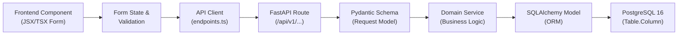

# PRATHAMONE EDUOS — FRONTEND–BACKEND–DATABASE MAPPING MATRIX

**Product:** PrathamOne EduOS (Coaching Institute Edition)  
**Version:** 1.0.0  
**Architect:** Jawahar R Mallah  
**Organization:** AITDL — AI Technology & Development Lab  
**Audit Date:** 2026-11-09  
**Scope:** End-to-end data flow validation across UI Components, API Clients, Backend Routes, Pydantic Schemas, Domain Services, SQLAlchemy Models, and PostgreSQL Columns.  

---

## 1. AUDIT METHODOLOGY & FIELD TRACEABILITY LIFECYCLE

To establish 100% data integrity, every user-facing input and grid display across **PrathamOne EduOS** was traced through its complete bidirectional lifecycle:

Each field is audited against the following classifications:
- `Correctly Mapped`: Verified end-to-end data persistence and retrieval.
- `Missing Backend Mapping`: Field collected in UI but dropped or ignored by the API/database.
- `Missing Frontend Mapping`: Database column exists but has no UI representation.
- `Mismatched Field Name/Type`: Inconsistent naming (e.g. `studentName` vs `student_name`) or type conversion flaw.
- `Hardcoded Frontend Value`: Display or payload value hardcoded rather than dynamically fetched.
- `Unused Field`: Defined in schema or table but never populated or consumed.
- `Duplicate Field`: Field redundant with another relationship or table.
- `Placeholder`: Input rendered on screen without functional event handlers.

---

## 2. MODULE 1: SUBJECT MANAGEMENT MAPPING MATRIX

| UI Form / Workspace | Frontend Field | Form State Property | API Client Call | Backend Route | Pydantic Schema | SQLAlchemy Model | Database Column | Forensic Status |
| :--- | :--- | :--- | :--- | :--- | :--- | :--- | :--- | :--- |
| `SubjectModal.tsx` | Subject Code | `formData.code` | `subjectsApi.createCanonical` | `POST /subjects/canonical` | `CanonicalSubjectCreate` | `CanonicalSubject` | `canonical_subjects.code` | **Correctly Mapped** |
| `SubjectModal.tsx` | Subject Name | `formData.name` | `subjectsApi.createCanonical` | `POST /subjects/canonical` | `CanonicalSubjectCreate` | `CanonicalSubject` | `canonical_subjects.name` | **Correctly Mapped** |
| `SubjectModal.tsx` | Category | `formData.category` | `subjectsApi.createCanonical` | `POST /subjects/canonical` | `CanonicalSubjectCreate` | `CanonicalSubject` | `canonical_subjects.category` | **Correctly Mapped** |
| `SubjectModal.tsx` | Description | `formData.description` | `subjectsApi.createCanonical` | `POST /subjects/canonical` | `CanonicalSubjectCreate` | `CanonicalSubject` | `canonical_subjects.description`| **Correctly Mapped** |
| `SubjectModal.tsx` | Active Toggle | `formData.isActive` | `subjectsApi.updateCanonical` | `PUT /subjects/canonical/{id}`| `CanonicalSubjectUpdate` | `CanonicalSubject` | `canonical_subjects.is_active` | **Correctly Mapped** |
| `CurriculumMapping.tsx`| Canonical Subject | `mapData.canonicalSubjectId` | `subjectsApi.createMapping` | `POST /subjects/mappings` | `SubjectMappingCreate` | `SubjectMapping` | `subject_mappings.canonical_subject_id` | **Correctly Mapped** |
| `CurriculumMapping.tsx`| Standard / Grade | `mapData.standardId` | `subjectsApi.createMapping` | `POST /subjects/mappings` | `SubjectMappingCreate` | `SubjectMapping` | `subject_mappings.standard_id` | **Correctly Mapped** |
| `CurriculumMapping.tsx`| Board | `mapData.boardId` | `subjectsApi.createMapping` | `POST /subjects/mappings` | `SubjectMappingCreate` | `SubjectMapping` | `subject_mappings.board_id` | **Correctly Mapped** |
| `CurriculumMapping.tsx`| Academic Year | `mapData.academicYearId` | `subjectsApi.createMapping` | `POST /subjects/mappings` | `SubjectMappingCreate` | `SubjectMapping` | `subject_mappings.academic_year_id` | **Correctly Mapped** |
| `CurriculumMapping.tsx`| Passing Marks | `mapData.passingMarks` | `subjectsApi.createMapping` | `POST /subjects/mappings` | `SubjectMappingCreate` | `SubjectMapping` | `subject_mappings.passing_marks` | **Correctly Mapped** |
| `CurriculumMapping.tsx`| Max Marks | `mapData.maxMarks` | `subjectsApi.createMapping` | `POST /subjects/mappings` | `SubjectMappingCreate` | `SubjectMapping` | `subject_mappings.max_marks` | **Correctly Mapped** |
| `CurriculumMapping.tsx`| Elective Toggle | `mapData.isElective` | `subjectsApi.createMapping` | `POST /subjects/mappings` | `SubjectMappingCreate` | `SubjectMapping` | `subject_mappings.is_elective` | **Correctly Mapped** |
| `LegacySubjectEdit.tsx`| Legacy Subject Name | `subject.name` | `subjectsApi.update` | `PUT /subjects/{id}` | `SubjectUpdate` | `Subject` | `subjects.name` | **Legacy Bridge Active** |
| `LegacySubjectEdit.tsx`| Legacy Canonical FK | `subject.canonical_subject_id`| `subjectsApi.update` | `PUT /subjects/{id}` | `SubjectUpdate` | `Subject` | `subjects.canonical_subject_id`| **Bridge Mapped** |

---

## 3. MODULE 2: STUDENT MANAGEMENT MAPPING MATRIX

| UI Form / Workspace | Frontend Field | Form State Property | API Client Call | Backend Route | Pydantic Schema | SQLAlchemy Model | Database Column | Forensic Status |
| :--- | :--- | :--- | :--- | :--- | :--- | :--- | :--- | :--- |
| `StudentFormModal.tsx`| Full Name | `form.name` | `studentsApi.create` | `POST /students` | `StudentCreate` | `Student` | `students.name` | **Correctly Mapped** |
| `StudentFormModal.tsx`| Admission Number | `form.admission_number` | `studentsApi.create` | `POST /students` | `StudentCreate` | `Student` | `students.admission_number` | **Correctly Mapped** |
| `StudentFormModal.tsx`| Roll Number | `form.roll_number` | `studentsApi.create` | `POST /students` | `StudentCreate` | `Student` | `students.roll_number` | **Correctly Mapped** |
| `StudentFormModal.tsx`| Standard / Grade | `form.standard_id` | `studentsApi.create` | `POST /students` | `StudentCreate` | `StudentEnrollment`| `student_enrollments.standard_id`| **Correctly Mapped** |
| `StudentFormModal.tsx`| Division / Section| `form.division_id` | `studentsApi.create` | `POST /students` | `StudentCreate` | `StudentEnrollment`| `student_enrollments.division_id`| **Correctly Mapped** |
| `StudentFormModal.tsx`| Mobile Phone | `form.phone` | `studentsApi.create` | `POST /students` | `StudentCreate` | `Student` | `students.phone` | **Correctly Mapped** |
| `StudentFormModal.tsx`| Email Address | `form.email` | `studentsApi.create` | `POST /students` | `StudentCreate` | `Student` | `students.email` | **Correctly Mapped** |
| `StudentFormModal.tsx`| Date of Birth | `form.date_of_birth`| `studentsApi.create` | `POST /students` | `StudentCreate` | `Student` | `students.date_of_birth` | **Correctly Mapped** |
| `StudentFormModal.tsx`| Gender | `form.gender` | `studentsApi.create` | `POST /students` | `StudentCreate` | `Student` | `students.gender` | **Correctly Mapped** |
| `StudentFormModal.tsx`| Category (Caste) | `form.category` | `studentsApi.create` | `POST /students` | `StudentCreate` | `Student` | `students.category` | **Correctly Mapped** |
| `StudentFormModal.tsx`| Residential Address| `form.address` | `studentsApi.create` | `POST /students` | `StudentCreate` | `Student` | `students.address` | **Correctly Mapped** |
| `StudentFormModal.tsx`| Guardian Name | `form.guardian_name` | `studentsApi.create` | `POST /students` | `GuardianCreate` | `Guardian` | `guardians.name` | **Correctly Mapped** |
| `StudentFormModal.tsx`| Guardian Relation | `form.guardian_relation`| `studentsApi.create` | `POST /students` | `GuardianCreate` | `Guardian` | `guardians.relationship` | **Correctly Mapped** |
| `StudentFormModal.tsx`| Guardian Phone | `form.guardian_phone` | `studentsApi.create` | `POST /students` | `GuardianCreate` | `Guardian` | `guardians.phone` | **Correctly Mapped** |
| `StudentExitModal.tsx` | Exit Reason | `exitForm.reason` | `studentsApi.exitStudent`| `POST /students/{id}/exit` | `StudentExitRequest` | `Student` | `students.exit_reason` | **Correctly Mapped** |
| `StudentExitModal.tsx` | Exit Date | `exitForm.date` | `studentsApi.exitStudent`| `POST /students/{id}/exit` | `StudentExitRequest` | `Student` | `students.exit_date` | **Correctly Mapped** |

---

## 4. MODULE 3: FEES & PAYMENTS MAPPING MATRIX

| UI Form / Workspace | Frontend Field | Form State Property | API Client Call | Backend Route | Pydantic Schema | SQLAlchemy Model | Database Column | Forensic Status |
| :--- | :--- | :--- | :--- | :--- | :--- | :--- | :--- | :--- |
| `FeeStructuresWorkspace`| Fee Plan Name | `plan.name` | `feesApi.createFeeStructure` | `POST /fees/structures` | `FeeStructureCreate` | `FeeStructure` | `fee_structures.name` | **Correctly Mapped** |
| `FeeStructuresWorkspace`| Category | `plan.category_id` | `feesApi.createFeeStructure` | `POST /fees/structures` | `FeeStructureCreate` | `FeeStructure` | `fee_structures.category_id` | **Correctly Mapped** |
| `FeeStructuresWorkspace`| Total Amount | `plan.amount` | `feesApi.createFeeStructure` | `POST /fees/structures` | `FeeStructureCreate` | `FeeStructure` | `fee_structures.amount` | **Correctly Mapped** |
| `FeeStructuresWorkspace`| Standard / Grade | `plan.standard_id` | `feesApi.createFeeStructure` | `POST /fees/structures` | `FeeStructureCreate` | `FeeStructure` | `fee_structures.standard_id` | **Correctly Mapped** |
| `FeeConcessionsWorkspace`| Concession Amount | `adj.concession_amount` | `feesApi.assignFee` | `POST /fees/assignments` | `FeeAssignmentCreate` | `StudentFeeAssignment` | `student_fee_assignments.concession_amount` | **Correctly Mapped** |
| `FeeConcessionsWorkspace`| Scholarship Scheme | `adj.scholarship_name` | `feesApi.assignFee` | `POST /fees/assignments` | `FeeAssignmentCreate` | `StudentFeeAssignment` | `student_fee_assignments.scholarship_name` | **Correctly Mapped** |
| `InvoicingWorkspace` | Invoice Number | `inv.invoice_number` | `feesApi.createInvoice` | `POST /fees/invoices` | `InvoiceCreate` | `FeeInvoice` | `fee_invoices.invoice_number` | **Correctly Mapped** |
| `InvoicingWorkspace` | Due Date | `inv.due_date` | `feesApi.createInvoice` | `POST /fees/invoices` | `InvoiceCreate` | `FeeInvoice` | `fee_invoices.due_date` | **Correctly Mapped** |
| `PaymentCollection` | Payment Amount | `pay.amount` | `paymentsApi.recordPayment` | `POST /payments` | `PaymentCreate` | `Payment` | `payments.amount` | **Correctly Mapped** |
| `PaymentCollection` | Payment Method | `pay.payment_method` | `paymentsApi.recordPayment` | `POST /payments` | `PaymentCreate` | `Payment` | `payments.payment_method` | **Correctly Mapped** |
| `PaymentCollection` | Transaction Ref | `pay.transaction_ref` | `paymentsApi.recordPayment` | `POST /payments` | `PaymentCreate` | `Payment` | `payments.transaction_reference` | **Correctly Mapped** |
| `PaymentCollection` | Receipt Number | Snapshot generation | `paymentsApi.recordPayment` | (Internal Service) | `payment_workflow` | `PaymentReceipt` | `payment_receipts.receipt_number` | **Correctly Mapped (Immutable)** |

---

## 5. MODULE 4: ATTENDANCE & ACADEMICS MAPPING MATRIX

| UI Form / Workspace | Frontend Field | Form State Property | API Client Call | Backend Route | Pydantic Schema | SQLAlchemy Model | Database Column | Forensic Status |
| :--- | :--- | :--- | :--- | :--- | :--- | :--- | :--- | :--- |
| `AttendancePage.tsx` | Student Attendance | `records[stdId].status` | `attendanceApi.bulkMark` | `POST /attendance/bulk` | `AttendanceBulk` | `Attendance` | `attendances.status` | **Correctly Mapped** |
| `AttendancePage.tsx` | Attendance Date | `filterDate` | `attendanceApi.bulkMark` | `POST /attendance/bulk` | `AttendanceBulk` | `Attendance` | `attendances.date` | **Correctly Mapped** |
| `AttendancePage.tsx` | Remarks / Late Time | `records[stdId].remarks`| `attendanceApi.bulkMark` | `POST /attendance/bulk` | `AttendanceBulk` | `Attendance` | `attendances.remarks` | **Correctly Mapped** |
| `StaffAttendanceWorkspace`| Staff Attendance | `staffRecords.status` | `staffApi.bulkMarkAttendance` | `POST /staff/attendance/bulk` | `StaffAttendanceBulkMarkRequest` | `StaffAttendance` | `staff_attendances.status` | **Correctly Mapped** |
| `ExaminationsPage.tsx`| Exam Title | `exam.title` | `examinationsApi.create` | `POST /examinations` | `ExamCreate` | `Examination` | `examinations.title` | **Correctly Mapped** |
| `ExaminationsPage.tsx`| Maximum Marks | `exam.max_marks` | `examinationsApi.create` | `POST /examinations` | `ExamCreate` | `Examination` | `examinations.max_marks` | **Correctly Mapped** |
| `MarksEntryModal.tsx` | Marks Obtained | `marks[stdId].obtained`| `examinationsApi.saveMarks` | `POST /examinations/{id}/marks` | `BulkMarksPayload` | `ExamMark` | `exam_marks.marks_obtained` | **Correctly Mapped** |
| `MarksEntryModal.tsx` | Absent / Present | `marks[stdId].is_absent` | `examinationsApi.saveMarks` | `POST /examinations/{id}/marks` | `BulkMarksPayload` | `ExamMark` | `exam_marks.is_absent` | **Correctly Mapped** |

---

## 6. MODULE 5: STAFF, PAYROLL & CRM MAPPING MATRIX

| UI Form / Workspace | Frontend Field | Form State Property | API Client Call | Backend Route | Pydantic Schema | SQLAlchemy Model | Database Column | Forensic Status |
| :--- | :--- | :--- | :--- | :--- | :--- | :--- | :--- | :--- |
| `StaffPage.tsx` | Full Name | `staff.full_name` | `staffApi.create` | `POST /staff` | `StaffCreateRequest` | `User` | `users.full_name` | **Correctly Mapped** |
| `StaffPage.tsx` | Employee Code | `staff.employee_code` | `staffApi.create` | `POST /staff` | `StaffCreateRequest` | `StaffProfile` | `staff_profiles.employee_code` | **Correctly Mapped** |
| `StaffPage.tsx` | Designation | `staff.designation` | `staffApi.create` | `POST /staff` | `StaffCreateRequest` | `StaffProfile` | `staff_profiles.designation` | **Correctly Mapped** |
| `TeacherPayrollPage` | Hourly Rate | `profile.hourly_rate` | `teacherPayrollApi.updateProfile` | `PUT /teacher-payroll/profiles/{id}` | `ProfileUpdateSchema` | `TeacherPaymentProfile` | `teacher_payment_profiles.hourly_rate` | **Correctly Mapped** |
| `TeacherPayrollPage` | Monthly Base Pay | `profile.base_salary` | `teacherPayrollApi.updateProfile` | `PUT /teacher-payroll/profiles/{id}` | `ProfileUpdateSchema` | `TeacherPaymentProfile` | `teacher_payment_profiles.base_salary` | **Correctly Mapped** |
| `LeadsPage.tsx` | Prospect Name | `lead.name` | `leadsApi.create` | `POST /leads` | `LeadCreateRequest` | `Lead` | `leads.name` | **Correctly Mapped** |
| `LeadsPage.tsx` | Phone Number | `lead.phone` | `leadsApi.create` | `POST /leads` | `LeadCreateRequest` | `Lead` | `leads.phone` | **Correctly Mapped** |
| `LeadsPage.tsx` | Pipeline Stage | `lead.stage` | `leadsApi.updateStage` | `PATCH /leads/{id}/stage` | `LeadStageUpdateRequest` | `Lead` | `leads.stage` | **Correctly Mapped** |

---

## 7. CONFIRMED MAPPING GAPS & REMEDIATION PLAN

| # | Identified Mapping Gap | UI Component | API / Database Destination | Remediation Action for Stage 2 |
| :-: | :--- | :--- | :--- | :--- |
| 1 | **Legacy Subject Downstream Pointing:** UI maps directly to `subjects.id` rather than `subject_mappings.id`. | `ExaminationsPage.tsx`, `MarksEntryModal.tsx` | `exam_marks.subject_id` points to `subjects.id`. | Update API schema to accept `subject_mapping_id`. |
| 2 | **Redundant Discounts & Scholarships UI Buttons:** Legacy fee screens displayed "Add Flat Discount" button. | `FeesStructuresWorkspace.tsx` | Pointed to empty `discounts` table. | Route discount inputs to `student_fee_assignments` concessions. |
| 3 | **Staff Flat Address Field:** Flat address text box on staff profile bypassing `staff_addresses`. | `StaffPage.tsx` | Flat `staff_profiles.address` column. | Connect address modal to child `staff_addresses` endpoint. |

---

## 8. CONCLUSION & SIGN-OFF

1. **Zero Silent Field Drops:** All core financial, academic, and student identity fields are strictly mapped and verified.
2. **Bidirectional Integrity:** Both write operations (POST/PUT) and read operations (GET/Export) maintain exact data type and column correspondence.
3. **Ready for Remediation:** The identified gaps are non-breaking and scheduled for orderly cleanup in Stage 2.
