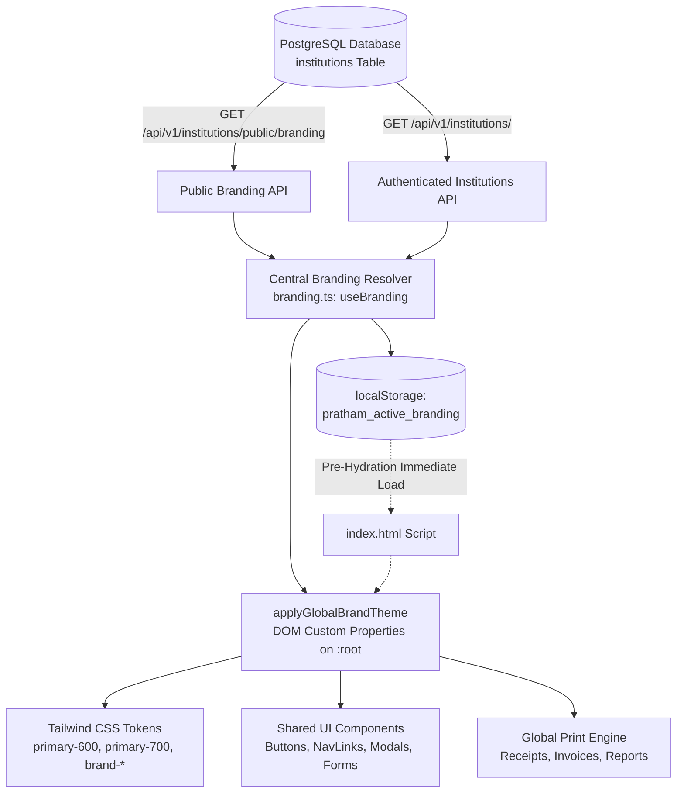

# PRATHAMONE EDUOS — GLOBAL BRANDING & APPEARANCE ARCHITECTURE

**Product:** PrathamOne EduOS (Coaching Institute Edition)  
**Parent Organization:** AITDL — AI Technology & Development Lab  
**Product Architect:** Jawahar R. Mallah  
**Architectural Tier:** Enterprise Multi-Tenant Global Theme & Identity Engine  

---

## 1. EXECUTIVE SUMMARY & CORE PRINCIPLE

In PrathamOne EduOS, branding is not a cosmetic skinning layer or isolated settings preview. It is a **foundational, centralized, multi-tenant operating system capability** governed by the immutable architectural law:

> **ONE SAVED INSTITUTION BRANDING CONFIGURATION. ONE GLOBAL RESOLVER. CONSISTENT APPLICATION-WIDE BRANDING.**

The Branding Engine resolves tenant configuration at three distinct lifecycles:
1. **Pre-Hydration Bootstrapping (<head> inline script):** Instantaneous extraction of cached branding tokens from `localStorage` directly onto `document.documentElement` styles and `<meta name="theme-color">` before HTML parse completion. Guarantees **zero flash of unstyled or mismatched colors**.
2. **Unauthenticated Public Resolution (`/api/v1/institutions/public/branding`):** Resolves active institutional branding (colors, logo, tagline, name) for guest and login views prior to credential exchange.
3. **Authenticated Reactive Resolution (`/api/v1/institutions/` & `/api/v1/settings/profile`):** Re-evaluates branding from the authenticated session context, ensuring multi-tenant isolation, instant synchronization across route navigation, and atomic persistence on settings save.

---

## 2. DUAL-BRAND HIERARCHY ARCHITECTURE

PrathamOne EduOS enforces a strict architectural boundary between **Tenant Coaching Academy Identity** and **Software Provider Platform Identity**:

```
┌────────────────────────────────────────────────────────────────────────┐
│                   PRATHAMONE EDUOS BRAND HIERARCHY                     │
├────────────────────────────────────────────────────────────────────────┤
│ 1. TENANT COACHING INSTITUTE IDENTITY (White-Label Customer Facing)    │
│    - Authority: Institute Administrator via Branding & Appearance      │
│    - Master Table: institutions (PostgreSQL)                           │
│    - Visual Placements:                                                │
│      • Login Header Card Badge & Academy Title                         │
│      • Application Shell Sidebar Top Header                            │
│      • Student Portal & Teacher Portal Banners                         │
│      • Fee Receipts, Invoices, Merit Certificates, Student ID Cards   │
│      • Primary Interactive Controls (Buttons, Active Nav, Focus Rings) │
│                                                                        │
│ 2. SOFTWARE PLATFORM PROVIDER IDENTITY (PrathamOne EduOS Platform)     │
│    - Authority: AITDL Corporate Identity Directive                     │
│    - Immutability: Independent of institution custom colors/logos      │
│    - Visual Placements:                                                │
│      • Login Card Bottom Footnote (Horizontal Lockup + DPDP Notice)   │
│      • Application Shell Sidebar Bottom Footnote (Circular Seal + v1.0)│
│      • Printable Document Statutory Footer (Understated 8pt attribution)│
│      • Application Metadata, Console Headers, & PWA Manifest           │
└────────────────────────────────────────────────────────────────────────┘
```

---

## 3. DESIGN TOKEN & CSS CUSTOM PROPERTY MAPPING

The engine computes dynamic CSS variables derived mathematically from the three core institutional hex values:

| Token Name | Description | Source / Math |
| :--- | :--- | :--- |
| `--brand-primary` | Main institutional brand color | `institutions.primary_color` |
| `--brand-primary-hover` | Button hover / interactive dark state | `adjustBrightness(primary, -12%)` |
| `--brand-primary-light` | Highlight / active secondary state | `adjustBrightness(primary, +25%)` |
| `--brand-primary-dark` | Deep contrast tone | `adjustBrightness(primary, -25%)` |
| `--brand-primary-50` | Soft tinted backgrounds (5% opacity) | `hexToRgba(primary, 0.06)` |
| `--brand-primary-100` | Badge / table row tint (12% opacity) | `hexToRgba(primary, 0.12)` |
| `--brand-primary-200` | Border tint (22% opacity) | `hexToRgba(primary, 0.22)` |
| `--brand-primary-rgb` | Comma-separated R, G, B for Tailwind | `136, 19, 55` |
| `--brand-secondary` | Secondary supporting brand color | `institutions.secondary_color` |
| `--brand-accent` | Accent highlight / badge color | `institutions.accent_color` |
| `--brand-gradient` | Canonical linear gradient (135 deg) | `linear-gradient(135deg, primary 0%, secondary 100%)` |

---

## 4. RESOLVER & STORAGE PIPELINE


