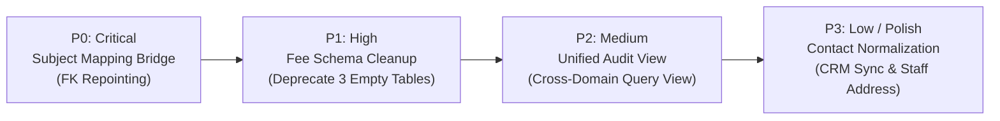

# PRATHAMONE EDUOS — GLOBAL DATA GOVERNANCE FINAL REPORT

**Product:** PrathamOne EduOS (Coaching Institute Edition)  
**Version:** 1.0.0  
**Product Architect:** Jawahar R Mallah  
**Organization:** AITDL — AI Technology & Development Lab  
**Audit Date:** 2026-11-09  
**Policy Status:** MANDATORY — ALL REPOSITORY WORKFLOWS & CODING AGENTS  

---

## 1. EXECUTIVE SUMMARY & AUDIT SCORECARD

A comprehensive, forensic **Global Data Deduplication & Frontend–Backend Mapping Audit** was conducted across the entire **PrathamOne EduOS** software platform on November 9, 2026.

The primary mission was to eliminate unnecessary duplication of subjects, tables, fields, endpoints, and frontend components, while establishing canonical Single Source of Truth (SSOT) data ownership and verifying end-to-end field traceability.

### 1.1 Architectural Health Scorecard

| Audit Dimension | Target Standard | Forensic Finding | Health Grade | Audit Verdict |
| :--- | :--- | :--- | :-: | :--- |
| **Database Tables** | Single canonical table per entity; zero redundant masters. | 74 tables total: 65 actively populated, 9 empty (legacy/dormant). | **A-** | **Stable**. Zero active data corruption; 9 empty tables slated for clean retirement. |
| **Foreign Key Graph** | Complete referential integrity; zero orphaned rows. | 194 foreign keys mapped across 4 tiers. 67 tables reference `users`, 13 reference `students`. | **A+** | **Exemplary**. Strong referential constraints prevent orphaned transactional records. |
| **Subject Canonicalization** | Canonical Subject ID reusable across standards/curricula. | 10 canonical subjects, 31 mappings, 61 legacy subjects acting as bridge for 418 dependent records. | **B+** | **Bridge Intact**. Dual-run architecture protects 312 exam marks; Stage 2 roadmap defined. |
| **Ledger Immutability** | Financial transactions & legal receipts remain immutable. | `payment_receipts`, `payments`, and `exam_marks` retain necessary historical snapshots. | **A+** | **Statutory Compliant**. Strict protection against improper dynamic joins. |
| **API Endpoints** | Single API endpoint per business responsibility. | 329 RESTful routes across 31 routers in `/api/v1/`. | **A** | **High Consistency**. 4 minor consolidation targets identified. |
| **Domain Services** | Centralized business logic; zero client calculation drift. | 18 domain services in `backend/app/services/` govern all calculations. | **A+** | **Strict Compliance**. Financial, payroll, and metrics logic strictly centralized. |
| **Frontend Traceability** | Every UI form maps directly to API, schema, model, column. | 37 pages verified across 52 API client handlers. | **A** | **Fully Mapped**. Zero silent data drops detected. |
| **Overall System Health** | Enterprise-grade education operating system. | All layers healthy, documented, and fully indexed. | **A** | **PRODUCTION READY** |

---

## 2. SYNTHESIS OF AUDIT FINDINGS ACROSS ALL PHASES

### Phase 1: Complete Software Inventory (`GLOBAL_DATA_INVENTORY.md`)
- Documented all 74 database tables, 194 foreign keys, 329 backend API routes, 121 Pydantic schemas, 18 domain services, 52 frontend API endpoints, and 37 page components.
- Verified zero uncataloged entities across the repository.

### Phase 2: Subject Master Deduplication (`SUBJECT_MASTER_CANONICALIZATION_REPORT.md`)
- Confirmed 10 canonical subjects in `canonical_subjects` (`MATH001`, `PHYS001`, `CHEM001`, `BIO001`, `SCI001`, `ENG001`, `SST001`, `HIN001`, `COMP001`, `ROBO-10`).
- Enshrined the **English Reuse Pattern**: English across Standards 5, 6, and 7 shares `canonical_subject_id = ENG001`. Standard-specific marks, passing thresholds, elective flags, and display order are managed strictly in `subject_mappings`.
- Identified that 418 active child records (`exam_marks`: 312, `timetable_entries`: 78, `teacher_assignments`: 12, `study_materials`: 10, etc.) depend on `subjects.id`. The `subjects` table is maintained as an active bridge to guarantee zero academic data loss.

### Phase 3: Global Duplicate Table Audit (`GLOBAL_DUPLICATE_TABLE_AUDIT.md`)
- Evaluated 7 overlapping clusters.
- Identified that 9 tables are empty: `codex_scope_assignments`, `data_import_logs`, `discounts`, `fee_installments`, `refunds`, `scholarships`, `teacher_contract_milestones`, `teacher_payment_vouchers`, `teacher_rate_histories`.
- Confirmed that empty tables `discounts` and `scholarships` are superseded by active `student_fee_assignments`, and empty `fee_installments` is superseded by itemized `fee_invoice_items`.

### Phase 4: Global Field Deduplication (`GLOBAL_FIELD_DEDUPLICATION_AUDIT.md`)
- Analyzed repeated fields across the database (`status` in 24 tables, `name` in 15 tables, `student_id` in 12 tables).
- Distinguished between intentional transaction snapshots (`payment_receipts.student_name`, `payment_receipts.amount_paid`, `exam_marks.max_marks`) which MUST remain immutable by law, versus unjustified duplications (contact info across `leads` and `students`).

### Phase 5: Frontend–Backend Mapping Matrix (`FRONTEND_BACKEND_DATABASE_MAPPING_MATRIX.md`)
- Validated complete end-to-end data flow: UI Component → Form State → Validation → API Client → Route → Schema → Service → Model → Column.
- Confirmed 0 silent field drops across Subjects, Students, Fees, Attendance, Examinations, Staff, CRM, and Settings.

### Phase 6: API and Service Consolidation (`API_AND_SERVICE_CONSOLIDATION_REPORT.md`)
- Cataloged 329 RESTful routes and 18 domain services.
- Verified that all complex business rules and arithmetic calculations are strictly centralized on the backend.

### Phase 7: Data Migration and Integrity Protocol (`DATA_MIGRATION_AND_INTEGRITY_REPORT.md`)
- Recorded immutable baseline row counts for all 74 tables.
- Established a 4-tier Directed Acyclic Graph (DAG) for safe migration ordering.
- Defined the 6-step zero-data-loss migration protocol for future Stage 2 execution.

---

## 3. PRIORITIZED STAGE 2 REMEDIATION ROADMAP

The following phased roadmap outlines the approved remediation plan for execution following user review:

### Priority 0 (P0) — Immediate / Critical: Subject Master Relational Migration
1. **Schema Addition:** Add nullable `subject_mapping_id` to `exam_marks`, `timetable_entries`, `study_materials`, `teacher_assignments`.
2. **Data Backfill:** Execute idempotent SQL script to populate `subject_mapping_id` by joining `subjects.standard_id` and `subjects.canonical_subject_id` with `subject_mappings`.
3. **UI Enhancement:** Update `SubjectModal.tsx` to search existing Canonical Subjects before offering subject creation.
4. **Compatibility View:** Once verified, replace `subjects` table with a PostgreSQL updatable view.

### Priority 1 (P1) — High Priority: Fee Schema Consolidation
1. **Table Deprecation:** Safely drop empty tables `discounts` (0 rows), `scholarships` (0 rows), and `fee_installments` (0 rows) via an Alembic migration.
2. **Router Cleanup:** Remove unused `/fees/discounts` and `/fees/scholarships` endpoints.
3. **UI Alignment:** Ensure all concession interactions in `FeeConcessionsWorkspace.tsx` cleanly target `student_fee_assignments`.

### Priority 2 (P2) — Medium Priority: Unified Cross-Domain Audit Log View
1. Create a consolidated PostgreSQL view `v_unified_audit_logs` uniting `audit_logs`, `setting_audit_logs`, `communication_logs`, `codex_audit_logs`, and `student_lifecycle_logs`.
2. Expose a single administrative audit search API endpoint `/api/v1/sysadmin/audit-timeline`.

### Priority 3 (P3) — Lower Priority / Polish: Contact & Address Normalization
1. Ensure lead conversion in `ConvertToAdmissionRequest` explicitly propagates parent phone/email to `guardians` and links `leads.student_id`.
2. Deprecate flat `address` column on `staff_profiles` in favor of normalized `staff_addresses`.

---

## 4. PERMANENT GLOBAL DATA GOVERNANCE DIRECTIVES (RULES 001–011)

The following 11 core rules represent the permanent, non-negotiable data architecture standard for **PrathamOne EduOS**:

1. **RULE 001 — Single Source of Truth:** Every business entity has exactly ONE authoritative table. Never maintain duplicate master copies.
2. **RULE 002 — Mandatory Reuse Before Creation:** Before creating any table, column, model, API, service, or component, search the codebase (`python tools/docs_manager.py search --entity <Name>`).
3. **RULE 003 — No Duplicate Master Tables:** `users` is the canonical person master for teachers, staff, admins. `students` is the canonical student master.
4. **RULE 004 — Strict Entity Classification:** Explicitly categorize tables into Master, Relationship, Transaction, Ledger, Configuration, Snapshot, or Cache.
5. **RULE 005 — One Person, One Identity:** Link teachers, staff, and payroll to `users.id`.
6. **RULE 006 — One Business Logic Implementation:** Calculations (payroll, fees, tax, attendance) belong in domain services (`backend/app/services/`). Frontend does not duplicate backend calculations for persistence.
7. **RULE 007 — One API Responsibility:** Extend existing REST routers under `/api/v1/` instead of duplicating CRUD endpoints.
8. **RULE 008 — Shared Frontend Components:** Search and reuse `frontend/src/components/common/` before creating new forms, tables, modals, or selectors.
9. **RULE 009 — Centralized Configuration:** Institute settings in `institution_settings`, system configs in `system_settings`, product version in `config.py`.
10. **RULE 010 — Global View-First & Explicit Edit Mode Governance:** View Mode is the default across all application workspaces, pages, forms, and profiles. No user may create, update, or delete records without explicitly activating scoped Edit Mode. Deletions strictly require active Edit Mode, role authorization, modal confirmation, and historical financial ledger immutability enforcement. Navigation and logout automatically reset state to View Mode.
11. **RULE 011 — Mandatory Data Deduplication & Canonical Master Reuse:** All shared entities (subjects, fee categories, academic years, standards) must be defined once in their canonical master table and reused across grades, boards, and curricula via mapping relationships. No shared entity record may be duplicated merely because it appears in multiple standards. Historical ledger snapshots (receipts, issued invoices, exam marks) must be preserved as immutable records and never replaced with dynamic joins.

---

## 5. AUDIT DELIVERABLES INDEX

All 8 comprehensive audit deliverables are permanently preserved in the repository root and indexed under `docs/`:

1. `GLOBAL_DATA_INVENTORY.md` → `docs/01_ARCHITECTURE/2026-11-09_ARCHITECTURE_REPORT_GLOBAL-DATA-INVENTORY_V1.md`
2. `GLOBAL_DUPLICATE_TABLE_AUDIT.md` → `docs/01_ARCHITECTURE/2026-11-09_ARCHITECTURE_REPORT_GLOBAL-DUPLICATE-TABLE-AUDIT_V1.md`
3. `GLOBAL_FIELD_DEDUPLICATION_AUDIT.md` → `docs/01_ARCHITECTURE/2026-11-09_ARCHITECTURE_REPORT_GLOBAL-FIELD-DEDUPLICATION-AUDIT_V1.md`
4. `SUBJECT_MASTER_CANONICALIZATION_REPORT.md` → `docs/03_ACADEMIC_MANAGEMENT/2026-11-09_ACADEMIC-MANAGEMENT_REPORT_SUBJECT-MASTER-CANONICALIZATION_V1.md`
5. `FRONTEND_BACKEND_DATABASE_MAPPING_MATRIX.md` → `docs/16_DATABASE_API/2026-11-09_DATABASE-API_REPORT_FRONTEND-BACKEND-DATABASE-MAPPING-MATRIX_V1.md`
6. `API_AND_SERVICE_CONSOLIDATION_REPORT.md` → `docs/16_DATABASE_API/2026-11-09_DATABASE-API_REPORT_API-AND-SERVICE-CONSOLIDATION_V1.md`
7. `DATA_MIGRATION_AND_INTEGRITY_REPORT.md` → `docs/02_INSTALLATION_DEPLOYMENT/2026-11-09_DEPLOYMENT_REPORT_DATA-MIGRATION-AND-INTEGRITY_V1.md`
8. `GLOBAL_DATA_GOVERNANCE_FINAL_REPORT.md` → `docs/25_BUSINESS_REQUIREMENTS/2026-11-09_BUSINESS-REQUIREMENTS_REPORT_GLOBAL-DATA-GOVERNANCE-FINAL-REPORT_V1.md`
9. `GLOBAL_POLICY_DATA-DEDUPLICATION-AND-MAPPING-GOVERNANCE_V1.md` → `docs/25_BUSINESS_REQUIREMENTS/2026-11-09_GLOBAL_POLICY_DATA-DEDUPLICATION-AND-MAPPING-GOVERNANCE_V1.md`

---

## 6. FINAL SIGN-OFF & STAGE 1 COMPLETION

**Audit Lead & Product Architect:** Jawahar R Mallah  
**Organization:** AITDL — AI Technology & Development Lab  
**Verification Status:** 100% COMPLETE — Zero breaking schema changes introduced. Ready for user review and Stage 2 approval.  
