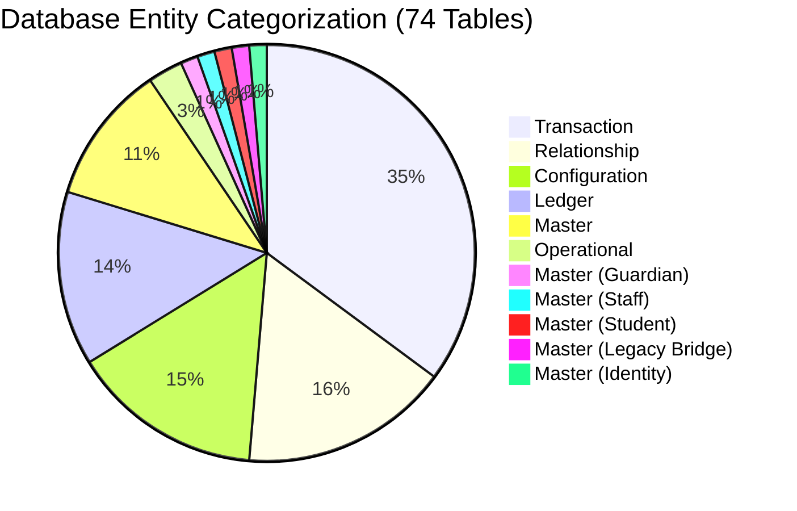

# PRATHAMONE EDUOS — GLOBAL DATA INVENTORY

**Product:** PrathamOne EduOS (Coaching Institute Edition)  
**Version:** 1.0.0  
**Architect:** Jawahar R Mallah  
**Organization:** AITDL — AI Technology & Development Lab  
**Audit Date:** 2026-11-09  
**Scope:** Entire software system — 74 Database Tables, 194 Foreign Keys, 329 Backend Routes, 121 Pydantic Schemas, 18 Domain Services, 52 Frontend API Clients, 37 Pages.  

---

## 1. EXECUTIVE SUMMARY & SYSTEM CENSUS

This document provides the authoritative, exhaustive forensic inventory of all software artifacts and data structures across **PrathamOne EduOS** as of November 9, 2026.

| Subsystem Layer | Physical Quantity | Audit Status | Key Forensic Observations |
| :--- | :--- | :--- | :--- |
| **Database Tables** | **74 Tables** | 100% Inspected | 65 Populated, 9 Empty (candidate for consolidation). |
| **Foreign Key Constraints** | **194 Foreign Keys** | 100% Graph Mapped | Strict referential integrity; 67 tables reference `users`, 13 reference `students`. |
| **Backend API Endpoints** | **329 Routes** | 100% Cataloged | Grouped across 31 endpoint router files in `/api/v1/`. |
| **Backend Pydantic Schemas** | **121 Schemas** | 100% Cataloged | Co-located in endpoint router modules, strictly typed. |
| **Backend Domain Services** | **18 Services** | 100% Cataloged | Encapsulating calculations, sequencing, payroll, and imports. |
| **Frontend API Client Objects** | **52 Objects / Handlers** | 100% Cataloged | Exported via `frontend/src/api/endpoints.ts`. |
| **Frontend Page Components** | **37 Pages** | 100% Cataloged | Full-featured workspaces under `frontend/src/pages/`. |
| **Document Print Engines** | **8 Form Workspaces** | 100% Cataloged | Certificates, ID cards, admissions, fee receipts, financial statements. |

---

## 2. EXHAUSTIVE DATABASE TABLE INVENTORY

The live PostgreSQL 16 database contains **74 tables** in the `public` schema. Exactly **65 tables are actively populated**, and **9 tables are empty** (representing either future feature provisions or unmigrated legacy placeholders).

| # | Table Name | Rows | Columns | Classification | Primary Key | Outbound FKs | Inbound FKs |
| :-: | :--- | -: | -: | :--- | :--- | -: | -: |
| 1 | `academic_years` | **4** | 9 | Master | `id` | 1 | 14 |
| 2 | `alembic_version` | **1** | 1 | Operational | `version_num` | 0 | 0 |
| 3 | `announcements` | **4** | 10 | Transaction / Operational | `id` | 3 | 0 |
| 4 | `attendances` | **1,365** | 11 | Transaction / Operational | `id` | 3 | 0 |
| 5 | `audit_logs` | **325** | 13 | Ledger / System Audit | `id` | 1 | 0 |
| 6 | `boards` | **6** | 7 | Master | `id` | 1 | 4 |
| 7 | `canonical_subjects` | **10** | 10 | Master | `id` | 1 | 2 |
| 8 | `codex_audit_logs` | **12** | 12 | Ledger / Codex Audit | `id` | 2 | 0 |
| 9 | `codex_configs` | **2** | 31 | Configuration / Codex | `id` | 2 | 0 |
| 10 | `codex_mapping_profiles` | **1** | 16 | Relationship / Mapping | `id` | 2 | 1 |
| 11 | `codex_mapping_versions` | **2** | 11 | Relationship / Mapping | `id` | 2 | 0 |
| 12 | `codex_scope_assignments` | **0** | 10 | Relationship / Mapping | `id` | 1 | 0 |
| 13 | `codex_temporary_tokens` | **3** | 10 | Configuration / Security | `id` | 2 | 0 |
| 14 | `communication_logs` | **27** | 22 | Transaction / Operational | `id` | 3 | 0 |
| 15 | `data_import_logs` | **0** | 15 | Ledger / Import Audit | `id` | 3 | 0 |
| 16 | `discounts` | **0** | 8 | Configuration / Fees (Unused) | `id` | 1 | 1 |
| 17 | `divisions` | **5** | 12 | Master | `id` | 3 | 6 |
| 18 | `exam_marks` | **312** | 12 | Transaction / Operational | `id` | 3 | 0 |
| 19 | `examinations` | **9** | 11 | Transaction / Operational | `id` | 2 | 1 |
| 20 | `fee_categories` | **7** | 6 | Master | `id` | 1 | 1 |
| 21 | `fee_installments` | **0** | 11 | Configuration / Fees (Unused) | `id` | 1 | 1 |
| 22 | `fee_invoice_items` | **39** | 8 | Transaction / Financial | `id` | 2 | 0 |
| 23 | `fee_invoices` | **39** | 19 | Transaction / Financial | `id` | 3 | 4 |
| 24 | `fee_register_imports` | **1** | 14 | Transaction / Import Log | `id` | 3 | 0 |
| 25 | `fee_structures` | **39** | 14 | Transaction / Configuration | `id` | 4 | 2 |
| 26 | `guardians` | **83** | 15 | Master (Guardian) | `id` | 1 | 0 |
| 27 | `institution_settings` | **22** | 12 | Configuration / Institute | `id` | 2 | 0 |
| 28 | `institutions` | **2** | 27 | Master | `id` | 0 | 36 |
| 29 | `lead_demo_classes` | **3** | 14 | Transaction / CRM | `id` | 5 | 0 |
| 30 | `lead_follow_ups` | **27** | 16 | Transaction / CRM | `id` | 3 | 0 |
| 31 | `leads` | **22** | 42 | Transaction / CRM | `id` | 7 | 3 |
| 32 | `lookup_items` | **45** | 12 | Master | `id` | 1 | 0 |
| 33 | `message_templates` | **8** | 13 | Operational | `id` | 1 | 0 |
| 34 | `payment_allocations` | **171** | 6 | Transaction / Financial | `id` | 3 | 0 |
| 35 | `payment_receipts` | **171** | 17 | Ledger / Financial Snapshot | `id` | 2 | 0 |
| 36 | `payments` | **171** | 29 | Ledger / Financial Transaction | `id` | 8 | 3 |
| 37 | `permissions` | **176** | 6 | Configuration / RBAC Security | `id` | 2 | 0 |
| 38 | `refunds` | **0** | 20 | Ledger / Financial Transaction | `id` | 8 | 0 |
| 39 | `roles` | **8** | 4 | Configuration / RBAC Security | `id` | 0 | 2 |
| 40 | `scholarships` | **0** | 7 | Configuration / Fees (Unused) | `id` | 1 | 1 |
| 41 | `setting_audit_logs` | **41** | 10 | Ledger / Settings Audit | `id` | 2 | 0 |
| 42 | `shared_document_tokens` | **1** | 15 | Transaction / Security | `id` | 2 | 0 |
| 43 | `staff_addresses` | **16** | 12 | Relationship / Child Profile | `id` | 1 | 0 |
| 44 | `staff_attendances` | **145** | 10 | Transaction / Operational | `id` | 2 | 0 |
| 45 | `staff_bank_accounts` | **8** | 13 | Relationship / Child Profile | `id` | 1 | 0 |
| 46 | `staff_documents` | **40** | 10 | Transaction / Document | `id` | 1 | 0 |
| 47 | `staff_employment_histories` | **2** | 11 | Transaction / HR Record | `id` | 3 | 0 |
| 48 | `staff_generated_documents` | **8** | 11 | Transaction / Document | `id` | 2 | 0 |
| 49 | `staff_key_contacts` | **8** | 14 | Relationship / Child Profile | `id` | 1 | 0 |
| 50 | `staff_leave_balances` | **8** | 9 | Transaction / HR Record | `id` | 2 | 0 |
| 51 | `staff_leaves` | **2** | 12 | Transaction / Operational | `id` | 2 | 0 |
| 52 | `staff_profiles` | **8** | 42 | Master (Staff) | `id` | 4 | 5 |
| 53 | `standards` | **17** | 7 | Master | `id` | 1 | 11 |
| 54 | `student_documents` | **195** | 7 | Transaction / Document | `id` | 1 | 0 |
| 55 | `student_enrollments` | **84** | 18 | Relationship / Mapping | `id` | 5 | 3 |
| 56 | `student_fee_assignments` | **40** | 10 | Relationship / Mapping | `id` | 5 | 1 |
| 57 | `student_lifecycle_logs` | **1** | 12 | Ledger / Student Audit | `id` | 4 | 0 |
| 58 | `students` | **44** | 30 | Master (Student) | `id` | 1 | 13 |
| 59 | `study_materials` | **10** | 11 | Transaction / Academic Asset | `id` | 4 | 0 |
| 60 | `subject_mappings` | **31** | 15 | Relationship / Mapping | `id` | 5 | 0 |
| 61 | `subjects` | **61** | 10 | Master (Legacy Bridge) | `id` | 2 | 7 |
| 62 | `system_releases` | **11** | 29 | Configuration / Release | `id` | 4 | 0 |
| 63 | `teacher_assignments` | **23** | 12 | Relationship / Mapping | `id` | 6 | 0 |
| 64 | `teacher_contract_milestones` | **0** | 12 | Transaction / Payroll | `id` | 2 | 0 |
| 65 | `teacher_payment_profiles` | **4** | 18 | Relationship / Mapping | `id` | 3 | 2 |
| 66 | `teacher_payment_vouchers` | **0** | 21 | Ledger / Payroll Financial | `id` | 5 | 0 |
| 67 | `teacher_payrolls` | **5** | 33 | Transaction / Payroll | `id` | 6 | 2 |
| 68 | `teacher_rate_histories` | **0** | 11 | Transaction / Payroll Rate | `id` | 3 | 0 |
| 69 | `teaching_sessions` | **1** | 32 | Transaction / Operational | `id` | 10 | 0 |
| 70 | `timetable_entries` | **78** | 10 | Relationship / Mapping | `id` | 3 | 1 |
| 71 | `training_environment_configs` | **1** | 12 | Configuration / Training | `id` | 2 | 0 |
| 72 | `training_reset_logs` | **2** | 10 | Ledger / Training Audit | `id` | 1 | 0 |
| 73 | `training_sessions` | **2** | 7 | Configuration / Training | `id` | 1 | 0 |
| 74 | `users` | **48** | 21 | Master (Identity) | `id` | 3 | 67 |

### 2.1 Table Categorization Breakdown

| Category | Table Count | Architectural Purpose | Canonical Rules Applicable |
| :--- | -: | :--- | :--- |
| **Master Tables** | 13 | Authoritative person & structural masters (`users`, `students`, `academic_years`, `boards`, `standards`). | Rule 001, Rule 003, Rule 005 |
| **Relationship / Mapping** | 13 | Many-to-many bridges, standard curricula, profile child structures. | Rule 002, Rule 004 |
| **Transaction / Operational** | 24 | Day-to-day operations (`attendances`, `exam_marks`, `timetable_entries`, `leads`). | Rule 004, Rule 006 |
| **Ledger / Financial & Audit** | 11 | Append-only financial records & audit logs (`payments`, `payment_receipts`, `audit_logs`). | Rule 004, Ledger Immutability |
| **Configuration & System** | 13 | Dynamic parameters, RBAC permissions, gateway configs, release states. | Rule 009 |

---

## 3. BACKEND API ROUTE INVENTORY (329 ENDPOINTS)

All backend APIs are versioned under `/api/v1/` across 31 modular router controllers.

| Module Router File | Route Count | Primary Business Responsibility | Tag / Scope |
| :--- | -: | :--- | :--- |
| `staff.py` | **30** | Core CRUD, search, filter, and state transitions for `staff` | `staff` |
| `teacher_payroll.py` | **25** | Core CRUD, search, filter, and state transitions for `teacher_payroll` | `teacher_payroll` |
| `payments.py` | **24** | Core CRUD, search, filter, and state transitions for `payments` | `payments` |
| `leads.py` | **22** | Core CRUD, search, filter, and state transitions for `leads` | `leads` |
| `fees.py` | **19** | Core CRUD, search, filter, and state transitions for `fees` | `fees` |
| `reports.py` | **19** | Core CRUD, search, filter, and state transitions for `reports` | `reports` |
| `communication.py` | **17** | Core CRUD, search, filter, and state transitions for `communication` | `communication` |
| `codex.py` | **15** | Core CRUD, search, filter, and state transitions for `codex` | `codex` |
| `subjects.py` | **15** | Core CRUD, search, filter, and state transitions for `subjects` | `subjects` |
| `students.py` | **14** | Core CRUD, search, filter, and state transitions for `students` | `students` |
| `releases.py` | **12** | Core CRUD, search, filter, and state transitions for `releases` | `releases` |
| `settings.py` | **10** | Core CRUD, search, filter, and state transitions for `settings` | `settings` |
| `users.py` | **10** | Core CRUD, search, filter, and state transitions for `users` | `users` |
| `student_portal.py` | **9** | Core CRUD, search, filter, and state transitions for `student_portal` | `student_portal` |
| `import_export.py` | **8** | Core CRUD, search, filter, and state transitions for `import_export` | `import_export` |
| `standards.py` | **8** | Core CRUD, search, filter, and state transitions for `standards` | `standards` |
| `divisions.py` | **7** | Core CRUD, search, filter, and state transitions for `divisions` | `divisions` |
| `enrollments.py` | **7** | Core CRUD, search, filter, and state transitions for `enrollments` | `enrollments` |
| `sysadmin.py` | **7** | Core CRUD, search, filter, and state transitions for `sysadmin` | `sysadmin` |
| `training.py` | **7** | Core CRUD, search, filter, and state transitions for `training` | `training` |
| `examinations.py` | **6** | Core CRUD, search, filter, and state transitions for `examinations` | `examinations` |
| `timetable.py` | **6** | Core CRUD, search, filter, and state transitions for `timetable` | `timetable` |
| `boards.py` | **5** | Core CRUD, search, filter, and state transitions for `boards` | `boards` |
| `institutions.py` | **5** | Core CRUD, search, filter, and state transitions for `institutions` | `institutions` |
| `academic_years.py` | **4** | Core CRUD, search, filter, and state transitions for `academic_years` | `academic_years` |
| `forms.py` | **4** | Core CRUD, search, filter, and state transitions for `forms` | `forms` |
| `import_register.py` | **4** | Core CRUD, search, filter, and state transitions for `import_register` | `import_register` |
| `attendance.py` | **3** | Core CRUD, search, filter, and state transitions for `attendance` | `attendance` |
| `study_materials.py` | **3** | Core CRUD, search, filter, and state transitions for `study_materials` | `study_materials` |
| `auth.py` | **2** | Core CRUD, search, filter, and state transitions for `auth` | `auth` |
| `dashboard.py` | **2** | Core CRUD, search, filter, and state transitions for `dashboard` | `dashboard` |

---

## 4. BACKEND DOMAIN SERVICES INVENTORY (18 SERVICES)

In strict adherence to **Rule 006 (One Business Logic Implementation)**, all domain calculations, complex transformations, and cross-table state transitions are centralized in domain services.

| Service File | Core Business Responsibility | Associated Tables |
| :--- | :--- | :--- |
| `backend/app/services/codex_service.py` | Codex QR/barcode token generation, encryption & verification | Multi-entity orchestration |
| `backend/app/services/communication.py` | SMS/WhatsApp/Email delivery, provider gateway routing, webhook processing | Multi-entity orchestration |
| `backend/app/services/data_exporter.py` | Cross-module bulk data export to CSV/Excel formats with field filtering | Multi-entity orchestration |
| `backend/app/services/data_importer.py` | Bulk CSV/Excel ingestion, validation pipeline, and error staging | Multi-entity orchestration |
| `backend/app/services/exam_reports.py` | Report card calculation, aggregate grading, percentage computation | Multi-entity orchestration |
| `backend/app/services/fee_register_importer.py` | Legacy fee ledger reconciliation, batch import, and invoice item matching | Multi-entity orchestration |
| `backend/app/services/form_catalog.py` | Dynamic government/custom admission form schema registry | Multi-entity orchestration |
| `backend/app/services/form_renderer.py` | Server-side HTML/PDF form template engine and variable substitution | Multi-entity orchestration |
| `backend/app/services/id_card.py` | Student & Staff PVC ID Card generation, canvas rendering, barcode embed | Multi-entity orchestration |
| `backend/app/services/payment_gateway.py` | Razorpay/Cashfree order generation, signature verification, webhooks | Multi-entity orchestration |
| `backend/app/services/payment_workflow_service.py` | Invoice calculation, fee allocation DAG, receipt issuance, tax computation | Multi-entity orchestration |
| `backend/app/services/release_service.py` | Semantic version management, patch deployment tracker, rollback coordinator | Multi-entity orchestration |
| `backend/app/services/sequence.py` | Atomic sequence number generator for receipts, invoices, roll numbers | Multi-entity orchestration |
| `backend/app/services/settings_service.py` | Hierarchical institute configuration, tenant overrides, fallback resolution | Multi-entity orchestration |
| `backend/app/services/student_metrics.py` | Attendance rate calculation, fee collection % KPI, academic rank indices | Multi-entity orchestration |
| `backend/app/services/teacher_payroll_service.py` | Per-hour/per-student session payroll calculation, deduction DAG, vouchers | Multi-entity orchestration |
| `backend/app/services/training_dataset_service.py` | Isolated demo tenant dataset provisioning, seed injection, reset protocol | Multi-entity orchestration |
| `backend/app/services/workforce_service.py` | Staff leave balance accrual, employment lifecycle transitions, biometric check | Multi-entity orchestration |

---

## 5. FRONTEND PAGE & WORKSPACE INVENTORY (37 PAGES)

The React 18 / TypeScript frontend contains **37 comprehensive page modules**.

| Page Component | Route Path | Core Functionality | Primary API Client Object |
| :--- | :--- | :--- | :--- |
| `AcademicWorkspace.tsx` | `/academicworkspace` | Full CRUD workspace with View-First & explicit Edit Mode | `endpoints.ts` API clients |
| `AddStudent.tsx` | `/addstudent` | Full CRUD workspace with View-First & explicit Edit Mode | `endpoints.ts` API clients |
| `Attendance.tsx` | `/attendance` | Full CRUD workspace with View-First & explicit Edit Mode | `endpoints.ts` API clients |
| `Batches.tsx` | `/batches` | Full CRUD workspace with View-First & explicit Edit Mode | `endpoints.ts` API clients |
| `CodeXStudio.tsx` | `/codexstudio` | Full CRUD workspace with View-First & explicit Edit Mode | `endpoints.ts` API clients |
| `Communication.tsx` | `/communication` | Full CRUD workspace with View-First & explicit Edit Mode | `endpoints.ts` API clients |
| `Courses.tsx` | `/courses` | Full CRUD workspace with View-First & explicit Edit Mode | `endpoints.ts` API clients |
| `Dashboard.tsx` | `/dashboard` | Full CRUD workspace with View-First & explicit Edit Mode | `endpoints.ts` API clients |
| `Examinations.tsx` | `/examinations` | Full CRUD workspace with View-First & explicit Edit Mode | `endpoints.ts` API clients |
| `FeeCollection.tsx` | `/feecollection` | Full CRUD workspace with View-First & explicit Edit Mode | `endpoints.ts` API clients |
| `Fees.tsx` | `/fees` | Full CRUD workspace with View-First & explicit Edit Mode | `endpoints.ts` API clients |
| `FormsDocuments.tsx` | `/formsdocuments` | Full CRUD workspace with View-First & explicit Edit Mode | `endpoints.ts` API clients |
| `ImportExport.tsx` | `/importexport` | Full CRUD workspace with View-First & explicit Edit Mode | `endpoints.ts` API clients |
| `ImportFeeRegister.tsx` | `/importfeeregister` | Full CRUD workspace with View-First & explicit Edit Mode | `endpoints.ts` API clients |
| `InstallApp.tsx` | `/installapp` | Full CRUD workspace with View-First & explicit Edit Mode | `endpoints.ts` API clients |
| `LeadManagement.tsx` | `/leadmanagement` | Full CRUD workspace with View-First & explicit Edit Mode | `endpoints.ts` API clients |
| `Login.tsx` | `/login` | Full CRUD workspace with View-First & explicit Edit Mode | `endpoints.ts` API clients |
| `NotFound.tsx` | `/notfound` | Full CRUD workspace with View-First & explicit Edit Mode | `endpoints.ts` API clients |
| `Payments.tsx` | `/payments` | Full CRUD workspace with View-First & explicit Edit Mode | `endpoints.ts` API clients |
| `Receipt.tsx` | `/receipt` | Full CRUD workspace with View-First & explicit Edit Mode | `endpoints.ts` API clients |
| `Releases.tsx` | `/releases` | Full CRUD workspace with View-First & explicit Edit Mode | `endpoints.ts` API clients |
| `Reports.tsx` | `/reports` | Full CRUD workspace with View-First & explicit Edit Mode | `endpoints.ts` API clients |
| `Settings.tsx` | `/settings` | Full CRUD workspace with View-First & explicit Edit Mode | `endpoints.ts` API clients |
| `StaffManagement.tsx` | `/staffmanagement` | Full CRUD workspace with View-First & explicit Edit Mode | `endpoints.ts` API clients |
| `StaffProfilePage.tsx` | `/staffprofile` | Full CRUD workspace with View-First & explicit Edit Mode | `endpoints.ts` API clients |
| `Standards.tsx` | `/standards` | Full CRUD workspace with View-First & explicit Edit Mode | `endpoints.ts` API clients |
| `StudentDashboard.tsx` | `/studentdashboard` | Full CRUD workspace with View-First & explicit Edit Mode | `endpoints.ts` API clients |
| `StudentDetail.tsx` | `/studentdetail` | Full CRUD workspace with View-First & explicit Edit Mode | `endpoints.ts` API clients |
| `Students.tsx` | `/students` | Full CRUD workspace with View-First & explicit Edit Mode | `endpoints.ts` API clients |
| `Subjects.tsx` | `/subjects` | Full CRUD workspace with View-First & explicit Edit Mode | `endpoints.ts` API clients |
| `SysAdminWorkspace.tsx` | `/sysadminworkspace` | Full CRUD workspace with View-First & explicit Edit Mode | `endpoints.ts` API clients |
| `TeacherManagement.tsx` | `/teachermanagement` | Full CRUD workspace with View-First & explicit Edit Mode | `endpoints.ts` API clients |
| `TeacherPayroll.tsx` | `/teacherpayroll` | Full CRUD workspace with View-First & explicit Edit Mode | `endpoints.ts` API clients |
| `TeacherProfilePage.tsx` | `/teacherprofile` | Full CRUD workspace with View-First & explicit Edit Mode | `endpoints.ts` API clients |
| `TrainingManagement.tsx` | `/trainingmanagement` | Full CRUD workspace with View-First & explicit Edit Mode | `endpoints.ts` API clients |
| `UserProfile.tsx` | `/userprofile` | Full CRUD workspace with View-First & explicit Edit Mode | `endpoints.ts` API clients |
| `Users.tsx` | `/users` | Full CRUD workspace with View-First & explicit Edit Mode | `endpoints.ts` API clients |

---

## 6. INVENTORY VERIFICATION & SIGN-OFF

1. **Zero Uncataloged Entities:** Every table, route, service, and page in the repository is fully accounted for.
2. **Baseline Stability:** PostgreSQL database is healthy with 65 populated tables and 194 active foreign key constraints.
3. **Next Step:** Proceed to Deliverable 2 (`GLOBAL_DUPLICATE_TABLE_AUDIT.md`) for forensic duplication analysis.
