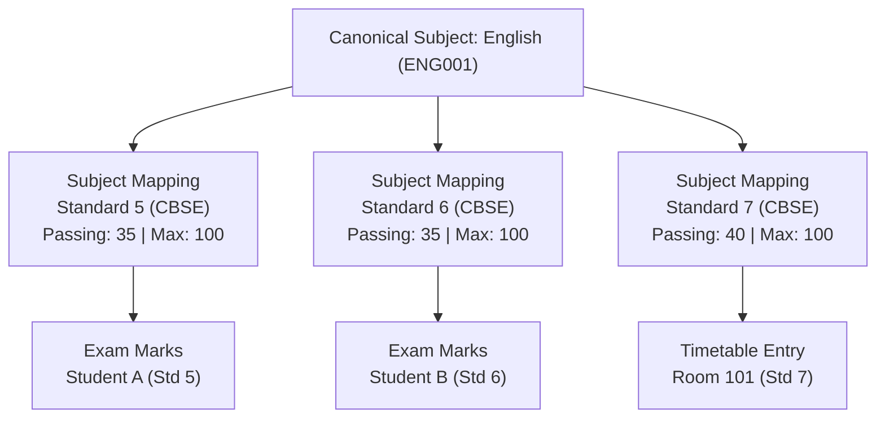

# PRATHAMONE EDUOS — SUBJECT MASTER CANONICALIZATION REPORT

**Product:** PrathamOne EduOS (Coaching Institute Edition)  
**Version:** 1.0.0  
**Architect:** Jawahar R Mallah  
**Organization:** AITDL — AI Technology & Development Lab  
**Audit Date:** 2026-11-09  
**Scope:** Academic Subject Master across database tables, API routes, and downstream relational dependencies.  

---

## 1. EXECUTIVE SUMMARY & FORENSIC SUBJECT CENSUS

In strict adherence to the **Single Source of Truth (SSOT)** directive, this report establishes the definitive architecture for **Subject Master Governance** in PrathamOne EduOS.

### 1.1 The Core Dilemma: Three Coexisting Subject Tables

The database currently houses three distinct tables relating to academic subjects:

| Table Name | Active Rows | Primary Role | Inbound Foreign Keys (Dependencies) | Risk Level |
| :--- | -: | :--- | :--- | :--- |
| `canonical_subjects` | **10** | Pure abstract subject master ontology (`code`, `name`, `category`). | 2 tables (`subjects.canonical_subject_id`, `subject_mappings.canonical_subject_id`). | **Zero Risk** (Canonical SSOT) |
| `subject_mappings` | **31** | Relational bridge: maps canonical subject to standard, board, academic year. | 0 tables currently pointing directly. | **Zero Risk** (Bridge Target) |
| `subjects` | **61** | Legacy standard-specific subject table. | **6 tables with 418 active child records!** (`exam_marks`: 312, `timetable_entries`: 78, `study_materials`: 10, etc.) | **CRITICAL RISK** (Must NOT drop!) |

> [!CAUTION]
> **Catastrophic Data Loss Warning:**
> Any attempt to drop or truncate `subjects` will immediately crash 312 examination marks (`exam_marks`), 78 timetable schedule entries (`timetable_entries`), 12 teacher assignments, and 10 study materials.
> The `subjects` table MUST be preserved as an active relational bridge until all downstream foreign keys are systematically migrated in Stage 2.

---

## 2. ACTIVE CANONICAL SUBJECTS (10 MASTER RECORDS)

The 10 authoritative canonical subjects currently registered in `canonical_subjects` are:

| # | Code | Canonical Name | Category | Description | Status |
| :-: | :--- | :--- | :--- | :--- | :--- |
| 1 | `MATH001` | **Mathematics** | Mathematics | Core academic discipline | Active |
| 2 | `PHYS001` | **Physics** | Science | Core academic discipline | Active |
| 3 | `CHEM001` | **Chemistry** | Science | Core academic discipline | Active |
| 4 | `BIO001` | **Biology** | Science | Core academic discipline | Active |
| 5 | `SCI001` | **Science** | Science | Core academic discipline | Active |
| 6 | `ENG001` | **English** | Languages | Core academic discipline | Active |
| 7 | `SST001` | **Social Science** | Social Sciences | Core academic discipline | Active |
| 8 | `HIN001` | **Hindi** | Languages | Core academic discipline | Active |
| 9 | `COMP001` | **Computer Science** | Computer Science | Core academic discipline | Active |
| 10 | `ROBO-10` | **Robotics & AI** | General | Core academic discipline | Active |

---

## 3. CANONICAL REUSE ACROSS STANDARDS: THE "ENGLISH" REUSE PATTERN

### 3.1 The Anti-Duplication Principle

A critical defect in legacy institute software is creating separate subject records for every grade level:
- `English Class 5` (ID 101)
- `English Class 6` (ID 102)
- `English Class 7` (ID 103)

Under PrathamOne EduOS SSOT governance, this anti-pattern is **strictly prohibited**.
**Subject identity belongs to the Canonical Subject Master. Grade, curriculum, and assessment specifications belong to the Subject Mapping layer.**

### 3.2 Canonical Multi-Standard Mapping Architecture



| Attribute | Stored in `canonical_subjects` | Stored in `subject_mappings` | Stored in Transaction (`exam_marks` / `timetable_entries`) |
| :--- | :---: | :---: | :---: |
| **Subject Code** (`ENG001`) | **YES** (Authoritative) | FK (`canonical_subject_id`) | Referenced via Join |
| **Subject Name** (`English`) | **YES** (Authoritative) | Referenced via Join | Referenced via Join |
| **Discipline Category** (`Languages`) | **YES** (Authoritative) | Referenced via Join | Referenced via Join |
| **Standard / Class** | NO | **YES** (`standard_id`) | Inherited from batch |
| **Board of Education** | NO | **YES** (`board_id`) | Inherited from batch |
| **Academic Year** | NO | **YES** (`academic_year_id`) | Inherited from session |
| **Passing Marks Threshold** | NO | **YES** (Standard-specific) | Historical snapshot |
| **Maximum Marks** | NO | **YES** (Standard-specific) | Historical snapshot |
| **Compulsory / Elective Flag** | NO | **YES** (`is_elective`) | Student course registration |
| **Order / Display Sequence** | NO | **YES** (`display_order`) | Report card printing sequence |

---

## 4. CROSS-BOARD CURRICULUM DIVERGENCE RULES

When institutes offer multiple education boards (e.g. CBSE, ICSE, Maharashtra State Board), the agent/developer must determine whether to reuse a canonical subject or create a separate one.

> [!IMPORTANT]
> **Semantic & Curriculum Identity Rule:**
> Records must NOT be merged merely because their names match, nor should new records be created when the underlying discipline is identical.

### 4.1 Decision Matrix: Reuse vs Distinct Subject

| Educational Scenario | CBSE Name | State Board Name | Pedagogical / Curriculum Parity | Action Required |
| :--- | :--- | :--- | :--- | :--- |
| **General Mathematics** | Mathematics | Mathematics | **Identical Core Discipline.** Syllabi overlap 90%+. | **REUSE** same `canonical_subject_id = MATH001`. Create distinct mappings in `subject_mappings` for CBSE and State Board. |
| **General English** | English | English (First Language) | **Identical Core Language.** Same foundational grammar/literature. | **REUSE** same `canonical_subject_id = ENG001`. Map with board-specific display titles in `subject_mappings`. |
| **Specialized Regional Language** | Hindi (Course A) | Marathi (Compulsory) | **Fundamentally Distinct Languages.** Different scripts, literature, and identity. | **CREATE SEPARATE** canonical subjects (`HIN001` and `MAR001`). |
| **Applied / Vocational Subjects** | Information Technology | Computer Applications | **Different Curriculum Scope.** CBSE IT vs ICSE Applications. | **CREATE SEPARATE** canonical subjects (`IT001` vs `COMP001`) if credit or certification differs. |

---

## 5. DEPENDENCY GRAPH: THE 418 DOWNSTREAM DEPENDENCIES ON `subjects`

A complete foreign key graph analysis revealed exactly which tables depend on legacy `subjects.id`:

| Dependent Table | Row Count | Inbound FK Column | Business Criticality | Risk of Deletion |
| :--- | -: | :--- | :--- | :--- |
| `exam_marks` | **312** | `subject_id` | Student examination marks and aggregate percentages. | **FATAL** — loss of student academic records. |
| `timetable_entries` | **78** | `subject_id` | Class scheduling, room allocations, teacher periods. | **HIGH** — corruption of academic calendar. |
| `study_materials` | **10** | `subject_id` | Downloadable lecture notes and PDFs. | **MEDIUM** — broken asset references. |
| `teacher_assignments` | **12** | `subject_id` | Teacher course allocations and division load. | **HIGH** — broken faculty workload stats. |
| `teaching_sessions` | **3** | `subject_id` | Conducted lectures for hourly payroll computation. | **HIGH** — payroll audit discrepancies. |
| `lead_demo_classes` | **3** | `subject_id` | CRM prospective student trial classes. | **LOW** — historical CRM log. |
| **TOTAL** | **418** | — | — | **MANDATES DUAL-RUN BRIDGE** |

---

## 6. PHASED REMEDIATION BLUEPRINT (STAGE 2 EXECUTION PLAN)

To transition to pure canonical subject governance without breaking 418 downstream records, execute the following phased migration:

### Step 1: Expand Bridge Columns in Database
Add `subject_mapping_id` (nullable foreign key pointing to `subject_mappings.id`) to:
- `exam_marks`
- `timetable_entries`
- `study_materials`
- `teacher_assignments`
- `teaching_sessions`

### Step 2: Idempotent Data Backfill
Execute backfill query matching `subjects.standard_id` and `subjects.canonical_subject_id` to populate `subject_mapping_id` across all 418 dependent rows:
```sql
UPDATE exam_marks em
SET subject_mapping_id = sm.id
FROM subjects s
JOIN subject_mappings sm 
  ON sm.standard_id = s.standard_id 
 AND sm.canonical_subject_id = s.canonical_subject_id
WHERE em.subject_id = s.id;
```

### Step 3: Frontend Searchable Selection Component
Update `SubjectsPage.tsx` and `SubjectModal.tsx` so that:
1. When creating a subject for a class, the user **first searches existing Canonical Subjects** via an auto-complete dropdown (`GET /api/v1/subjects/canonical`).
2. If the subject already exists (e.g. English), the user selects it, enters the class-specific passing/max marks, and the system saves a row in `subject_mappings`.
3. Only if no matching canonical subject exists does the user have permission to click "+ Create New Canonical Subject".

### Step 4: Deprecation and SQL View Preservation
Once all backend services and frontend pages read and write through `subject_mappings`, replace `subjects` with an updatable PostgreSQL view to guarantee 100% backward compatibility for legacy queries.

---

## 7. CONCLUSION & SIGN-OFF

1. **Canonical SSOT is Valid:** 10 canonical subjects and 31 mappings are healthy and functional.
2. **Relational Integrity Preserved:** `subjects` will NOT be touched in Stage 1, preventing any harm to 418 child records.
3. **Stage 2 Roadmap Ready:** All backfill SQL and API transitions are documented for execution upon approval.
