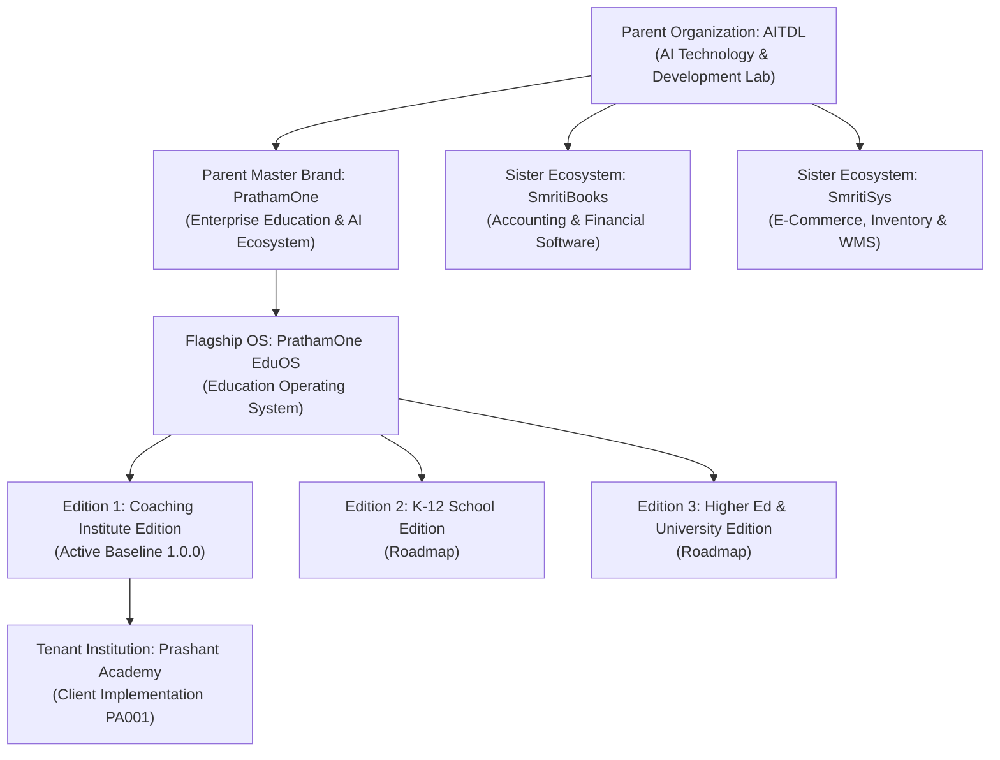

# PrathamOne & PrathamOne EduOS Brand Architecture Specification

**Product Architect:** Jawahar R Mallah  
**Organization:** AITDL — AI Technology & Development Lab  
**Client Organization:** Prashant Academy Coaching Institute  
**Effective Date:** 2026-11-07  
**Governance Level:** Mandatory Global Directive  

---

## 1. Executive Summary

This specification establishes the authoritative, multi-tier brand hierarchy and governance framework across **PrathamOne** and its education technology platform, **PrathamOne EduOS**.

The brand ecosystem is anchored by the master artwork featuring the iconic elephant-formed letter **'P'** emblem, rendered in deep imperial navy (`#1A1A50`) and vibrant energy orange (`#EE8B36`). To avoid organizational and technical dilution, this specification delineates the strict separation between the **Parent Corporate Identity**, the **Product Brand**, and the **Tenant Coaching Institute Identity**.

---

## 2. Multi-Tier Brand Architecture

### Tier 1: Parent Organization — AITDL
- **Full Legal & Corporate Entity:** AI Technology & Development Lab (AITDL).
- **Domain:** [aitdl.com](https://aitdl.com)
- **Role:** Parent incubator, technology provider, AI research laboratory, and legal copyright holder (`Copyright © 2026 AITDL`).
- **Presence:** Displayed in official copyright notices, technical headers, enterprise attribution rows, system diagnostics, and developer governance directives.

### Tier 2: Parent Ecosystem Brand — PrathamOne
- **Full Brand Name:** PrathamOne
- **Domain:** [prathamone.com](https://prathamone.com)
- **Visual Emblem:** Iconic elephant profile integrated with the loop and stem of capital letter **'P'**.
- **Wordmark Typography:** Dual-color typographic lockup — *"pratham"* in deep navy (`#1A1A50`) and *"One"* in vibrant energy orange (`#EE8B36`).
- **Strategic Function:** Master umbrella identity for all education management, coaching institute CRM/ERP, and educational AI software solutions engineered by AITDL.

### Tier 3: Operating System Product Brand — PrathamOne EduOS
- **Full Product Name:** PrathamOne EduOS
- **Baseline Version:** `1.0.0`
- **Edition:** Coaching Institute Edition
- **Visual Signature:** Master PrathamOne lockup with prominent, uppercase block-lettered *"EduOS"* rendered in navy (`#1A1A50`), anchored beneath the primary wordmark.
- **Strategic Function:** The comprehensive, high-security education operating system powering coaching academies, schools, and academic institutions.

### Tier 4: Client & Tenant Institution — Prashant Academy
- **Canonical Identifier:** `Prashant Academy` (Tenant Code `PA001`).
- **Domain:** `prashantacademy.edu.in`
- **Role:** The operating client institution utilizing the software.
- **Tenant Autonomy:** Maintains full autonomy over its institution name, logo, branch locations, fee receipt series, student identity cards, and student portal customization.

---

## 3. Co-Branding & Single Source of Truth (SSOT) Governance

### 3.1 Software Application Workspaces (Console & Portals)
In the software runtime environment (Admin Dashboard, Faculty Workspace, Student Portal, CRM Center):
1. **Primary Product Identity:** `PrathamOne EduOS` is prominently identified in the browser title, system footer, sidebar base, PWA installation manifest, and login interface.
2. **Tenant Customization:** The active tenant institution (`Prashant Academy`) is dynamically surfaced as the primary active academy entity in the navigation header, academy switcher, and administrative cards.

### 3.2 Customer-Facing Output Documents (Receipts, Certificates, Dossiers)
In student-facing and legal financial records:
1. **Tenant Prominence (Primary):** The customer institution (`Prashant Academy`) holds primary prominence. The document header, academy logo, branch address, contact details, affiliation codes, and signature authorization strictly belong to the client institution.
2. **Platform Attribution (Subordinate):** `PrathamOne EduOS` is permanently positioned in the canonical two-row physical bottom footer:
   - **Row 1 (Right):** `Confidential · Document ID: {DOC_ID} · Page {N} of {TOTAL}`
   - **Row 2 (Center):** `Generated by PrathamOne EduOS · © PrathamOne EduOS`
3. **No Header Intrusion:** PrathamOne EduOS branding shall never displace, compete with, or obscure the tenant institution's primary header branding on legal receipts or official report cards.

---

## 4. Brand Evolution & Edition Roadmap

The architecture anticipates multi-edition growth without redesigning core brand assets:
- **PrathamOne EduOS — Coaching Institute Edition:** Tailored for test prep, coaching academies, batch management, lecture payroll, and fast WhatsApp communication.
- **PrathamOne EduOS — K-12 School Edition:** Extends attendance, grading, continuous comprehensive evaluation (CCE), and multi-section timetables.
- **PrathamOne EduOS — College & University Edition:** Extends credit management, semester grading, faculty tenure, and departmental research workflows.

In all future editions, the core PrathamOne elephant mark and EduOS naming convention remain invariant.

