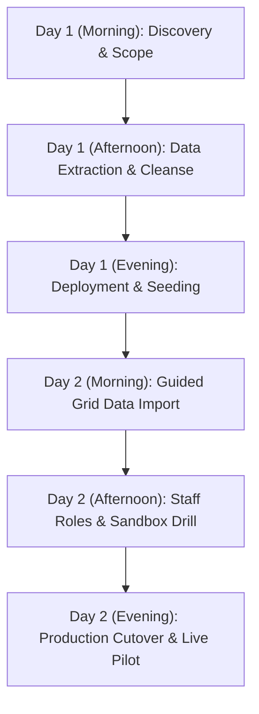

# PRATHAMONE EduOS (Coaching Institute Edition)
## Commercial Go-To-Market (GTM) Playbook & 48-Hour Institute Onboarding Blueprint

**Product Name:** PrathamOne EduOS  
**Edition:** Coaching Institute Edition  
**Baseline Version:** 1.0.0 (Runtime Revision: v1.146.1)  
**Product Architect:** Jawahar R. Mallah  
**Organization:** Smritisys & AITDL Networks  
**Target Market:** Indian Coaching Institutes, Tuition Networks, and Competitive Test Prep Academies  
**Date:** November 20, 2026  

---

## 1. Executive Mission & Strategic Positioning

The purpose of this document is to operationalize the findings of the **Deep Completeness Audit & Indian Market Valuation Report** into an actionable, repeatable commercial rollout framework.

### The Value Proposition
> **"Your Institute Owns Its Data. We Simplify Its Operations."**
> Unlike Classplus and Teachmint, which lock coaching institutes into generic cloud subscriptions, take percentage cuts on course sales, and force parents into yet another mobile app, **PrathamOne EduOS** is an institutional operating system that guarantees:
> 1. **Zero Revenue Leakage:** Banking-grade deterministic fee installments, PDC tracking, and instant WhatsApp receipts.
> 2. **Zero Accidental Overwrites:** Rule 010 View-First protection on every operational desk.
> 3. **Faculty Harmony:** Automated per-hour, per-lecture, and per-student payroll vouchers that end monthly faculty disputes.
> 4. **Classroom Modernization:** Native EduBoard vector whiteboard/greenboard that saves ₹1,00,000+ in proprietary smart-board licenses.
> 5. **Complete Data Sovereignty:** 100% self-hosted on-premise Docker deployment or private cloud, with zero student data poaching by competitors.

---

## 2. Target Segmentation & Regional Strategy (Pan-India)

```
┌────────────────────────────────────────────────────────────────────────────────────────┐
│                      PAN-INDIA COACHING HUBS & TARGET CLUSTERS                         │
├─────────────────────────┬────────────────────────────┬─────────────────────────────────┤
│ Tier / Cluster          │ Major Hub Cities           │ Primary Pain Points & Focus     │
├─────────────────────────┼────────────────────────────┼─────────────────────────────────┤
│ Tier 1: Mega Test Prep  │ Kota, Patna, Hyderabad,    │ Dropper batches, complex fee    │
│ (JEE / NEET / State CET)│ Pune, Sikar, Delhi-NCR     │ concessions, OMR/exam series,   │
│                         │                            │ faculty hourly payout leakage.  │
├─────────────────────────┼────────────────────────────┼─────────────────────────────────┤
│ Tier 2: Regional K-12   │ Nagpur, Nashik, Surat,     │ Multi-installment fee chasing,  │
│ Tuitions & Commerce     │ Indore, Lucknow, Jaipur    │ parent attendance anxiety, PDCs,│
│                         │                            │ manual Excel receipt errors.    │
├─────────────────────────┼────────────────────────────┼─────────────────────────────────┤
│ Tier 3: Foundation &    │ Kolhapur, Aurangabad,      │ Low tech-literacy, high front-  │
│ School-Integrated Prep  │ Belgaum, Varanasi, Gwalior │ desk turnover, need for safe    │
│                         │                            │ View-First protection & training│
└─────────────────────────┴────────────────────────────┴─────────────────────────────────┘
```

---

## 3. Commercial Pricing Architecture & Packaging

```
┌────────────────────────────────────────────────────────────────────────────────────────┐
│                        PRATHAMONE EduOS: COMMERCIAL EDITIONS                           │
├──────────────────────────┬─────────────────────────────┬───────────────────────────────┤
│ Feature Dimension        │ Professional Edition        │ Enterprise & Sovereign Edition│
├──────────────────────────┼─────────────────────────────┼───────────────────────────────┤
│ Ideal Institute Size     │ 100 – 350 Students          │ 350 – 2,500+ Students         │
│ Deployment Topology      │ Managed Dedicated Cloud     │ Private VPS / On-Prem Docker  │
│ Pricing Model            │ ₹36,000 / year (or ₹3.5k/mo)│ ₹72,000 / year (Cloud) or     │
│                          │                             │ ₹1,80,000 One-Time (On-Prem)  │
│ Core Student & Fee Desk  │ Included (Unlimited)        │ Included (Unlimited)          │
│ CRM & Admissions Desk    │ Included (Pipeline & Leads) │ Included (Campaign ROI & Demo)│
│ High-Speed QR Attendance │ Included (Webcam / USB QR)  │ Included (Kiosk mode + RFID)  │
│ WhatsApp Notifications   │ Automated (Bring Your BSP)  │ Multi-Channel Gateway + SMS   │
│ EduBoard Smart Classroom │ Standard 2 Canvas Rooms     │ Unlimited Canvas Rooms + Rec  │
│ Teacher Payroll Engine   │ Basic (Hourly billing)      │ Full (Milestone, Voucher, TDS)│
│ NEET/JEE Exam Engine     │ Standard Test Series        │ Full Negative Marking + Curves│
│ Training Sandbox Tenant  │ Included (`PA001-DEMO`)     │ Included + Custom Clones      │
│ SLA & Technical Support  │ 24-Hour Ticket Response     │ Dedicated Priority Engineer   │
└──────────────────────────┴─────────────────────────────┴───────────────────────────────┘
```

---

## 4. The 48-Hour Rapid Onboarding Blueprint

To achieve high adoption, the transition from paper registers or messy spreadsheets to PrathamOne EduOS must complete in **under 48 hours** with zero loss of historical records.



### Day 1: Deployment & Data Preparation (0 to 24 Hours)
1. **Hour 00–04: Discovery & Parameter Gathering:**
   - Institute legal entity, branch name, logo, academic year (e.g. 2026–2027), active boards (CBSE, State Board, JEE/NEET).
   - Fee structure definitions: standard fees, installment schedules, concession categories.
2. **Hour 04–08: Historical Data Cleansing:**
   - Export student roster from Excel or legacy software into standard CSV format.
   - Run duplicate phone number and student deduplication check.
3. **Hour 08–16: Infrastructure Provisioning:**
   - Deploy PrathamOne EduOS via Docker Compose (`install.ps1` on Windows Server or `install.sh` on Linux).
   - Run initial seed: `python seed.py --bootstrap-only`.
   - Configure institution profile, official branding colors, and logo assets.
4. **Hour 16–24: Automated Healthcheck & Verification:**
   - Validate `/health` endpoint and database schema head `055_device_binding`.

### Day 2: Data Loading, Staff Training & Cutover (24 to 48 Hours)
1. **Hour 24–30: Guided Import via `/import-export`:**
   - Copy-paste student batches directly into the interactive grid.
   - Auto-validate mandatory fields (Student Name, Parent Phone, Standard, Batch).
   - Commit verified student records and auto-generate student IDs.
2. **Hour 30–36: Fee Structure & Ledger Invoicing:**
   - Assign fee packages to batches.
   - Bulk-generate active academic year invoices with installment schedules.
   - Import opening outstanding balances.
3. **Hour 36–42: Role-Based Staff Training in `/training`:**
   - Switch to the isolated `PA001-DEMO` training tenant.
   - Front Desk: Demonstrate walk-in lead capture and 1-click admission conversion.
   - Fee Desk: Demonstrate 3-click fee collection, discount application, and receipt printing.
   - Attendance Operator: Demonstrate QR kiosk barcode scanning (60 scans/min).
   - Teachers: Demonstrate EduBoard whiteboard and timetable schedule check.
4. **Hour 42–48: Live Production Cutover & Go-Live:**
   - Switch active environment to `PRODUCTION`.
   - Issue first live fee receipts and send automated WhatsApp confirmations.
   - Full institute operations transitioned to PrathamOne EduOS.

---

## 5. Objection Handling Guide for Institute Directors

| Common Objection | Director's Concern | Recommended Response & Proof Point |
|:---|:---|:---|
| *"We already use Classplus/Teachmint for our mobile app."* | Fear of disrupting students or losing video courses. | *"PrathamOne EduOS doesn't force you to discard your video apps. It is the core financial and operational brain that manages your cash counter, faculty payroll, and attendance. Plus, our WhatsApp-first approach reaches 100% of parents instantly without app login friction."* |
| *"Our front-desk staff makes mistakes in Excel. Will they break this software?"* | Fear of corrupting financial or student data. | *"PrathamOne EduOS has Rule 010 View-First Governance. Every single screen is locked in read-only mode by default. Junior staff cannot edit or delete any record without activating an authorized, tracked Edit Mode session."* |
| *"Our faculty members argue every month about their teaching hours and payout."* | Wasted management time and faculty attrition. | *"PrathamOne includes a dedicated Teacher Payroll Engine. Faculty sessions are logged daily against the timetable, generating sequential vouchers (`SES-YYYYMM-XXXX`) with automated per-hour or per-lecture calculation. Everything is transparent and exported in 1 click."* |
| *"What if our internet goes down during peak admission hours?"* | Fear of operations halting without connectivity. | *"Because PrathamOne EduOS can run locally via Docker on your local institute network, your fee counter, student search, and attendance kiosk continue operating uninterrupted even if external internet drops."* |
| *"We are worried our competitor coaching institute will steal our student phone list."* | Student poaching and data leakage. | *"In PrathamOne EduOS, your database is 100% self-hosted and encrypted. Student phone numbers and Aadhaar cards are masked in compliance with the DPDP Act 2023. No competitor or cloud third-party has access to your student directory."* |

---

## 6. Commercial Pilot Agreement Framework (Terms Summary)

When onboarding new coaching institutes for initial paid pilots:
- **Pilot Duration:** 30 Days with full Enterprise access.
- **Data Guarantee:** All institute data entered during the pilot remains 100% exportable in Excel/CSV format at any time.
- **Pilot Success Milestones:**
  1. 100% of enrolled students successfully imported with batch allocation.
  2. Zero fee collection discrepancies between daybook and bank deposits.
  3. Daily attendance recorded with automated parent alerts.
  4. Teacher monthly payroll report generated in under 10 minutes.
- **Post-Pilot Conversion:** 100% of the pilot setup fee credited toward the annual license.

---

## 7. Conclusion

By combining **enterprise architectural rigor (Rules 001–011)** with a **practical 48-Hour Onboarding Blueprint**, PrathamOne EduOS is positioned to capture a leadership position in the ₹65,000+ Crore Indian coaching management market.
