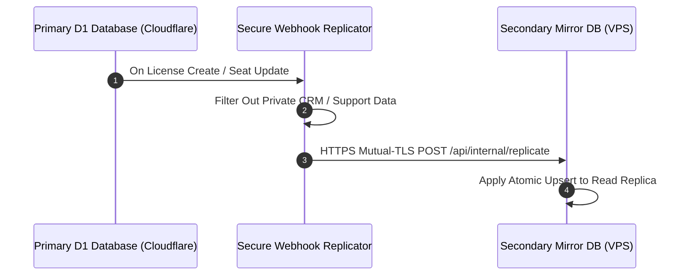

# Multi-Server Licensing Mirror and CRM Decoupling Architectural Blueprint

## 1. Executive Summary & Objective

This architectural blueprint outlines the engineering design, deployment topology, and failover mechanics for **mirroring the PrathamOne EduOS software licensing subsystem across multiple independent servers**, while achieving complete architectural isolation from existing business systems (**Ticketing, Sales CRM, Customer Account Management, and Field Service Operations**).

### Primary Problem Statement
In the baseline topology, the licensing engine shares origin and infrastructure boundaries with public-facing customer service, ticketing, and sales platforms hosted under `https://smritisys.com`. While Cloudflare's serverless edge handles normal operational volumes cleanly at zero monthly cost, colocating mission-critical licensing check-ins with dynamic customer management and ticketing platforms presents operational coupling risks:
1. Large file uploads or maintenance operations in the ticketing portal could inadvertently affect API responsiveness.
2. Web redesigns, administrative credential rotations, or CRM database migrations could introduce unintended disruption to licensing endpoints.
3. High-availability business continuity mandates that software licensing survive catastrophic regional outages or provider-level domain disputes.

### Architectural Solution
By leveraging **asymmetric cryptographic decoupling (Ed25519)**, the licensing control plane is architecturally decoupled into an autonomous, multi-region, multi-cloud mirrored cluster with automatic DNS failover, zero-loss database replication, and zero impact on customer relationship workflows.

---

## 2. Decoupled Architecture Topology

```mermaid
flowchart TD
    subgraph Tier 1: Customer Business Operations
        CRM["smritisys.com"]
        CRM --> TICKET["Ticketing & Helpdesk Portal"]
        CRM --> SALES["Sales Pipeline & Lead Registry"]
        CRM --> SVC["Field Service & Account Management"]
        CRM --> CUST_DB[("Primary CRM Database")]
    end

    subgraph Tier 2: Dedicated Primary Licensing Authority (Edge)
        P_DNS["license.smritisys.com (Primary Authority)"]
        P_DNS --> CF_WORKER["Cloudflare Pages Functions / Workers"]
        CF_WORKER --> CF_SIGNER["LICENSE_SIGNER (Isolated Worker Sandbox)"]
        CF_WORKER --> D1[("Cloudflare D1 SQL (smritisys-db)")]
    end

    subgraph Tier 3: Autonomous Secondary Licensing Mirror (Multi-Cloud / VPS)
        S_DNS["mirror-license.aitdl.com (Secondary Mirror)"]
        S_DNS --> VPS_API["FastAPI / Rust Lightweight Mirror API"]
        VPS_API --> VPS_SIGNER["Hardware / Secure Enclave Ed25519 Signer"]
        VPS_API --> REPL_DB[("Replicated Read-Only License DB (SQLite / PG)")]
    end

    subgraph Tier 4: Installed Client Base
        CLIENT["PrathamOne EduOS (Local Installation)"]
    end

    CLIENT -->|Primary: Daily 24h Check-in| P_DNS
    CLIENT -.->|Automatic Failover if Primary Down| S_DNS

    D1 -.->|Continuous Read-Only DB Replication Stream| REPL_DB
```

---

## 3. Cryptographic Foundation of Multi-Server Mirroring

The core reason the licensing engine can be mirrored seamlessly across completely different servers, cloud providers, and physical datacenters is that **PrathamOne EduOS relies on zero-trust digital signatures rather than stateful server sessions**:

$$\text{Artifact Verification} = \mathcal{V}_{\text{Ed25519}}\Big(\text{Public Key}, \text{Payload}, \text{Signature}\Big)$$

1. **Decoupled Verification:**
   - PrathamOne EduOS stores only the public verification key:
     `{"smritisys-ed25519-2026-11": "GWsJlKHUjTYmSDpi8JmsGb43NoR6S1qL1jIy1jzBC4w"}`
   - The application does not care which IP address, server, or cloud generated the artifact, provided the payload is signed by the matching private key.
2. **Identical Cryptographic Authority:**
   - Both the Primary Edge Worker (`license.smritisys.com`) and the Secondary Mirror (`mirror-license.aitdl.com`) possess identical signing authority.
   - Any license artifact signed by Mirror B is accepted by PrathamOne EduOS with 100% mathematical validity.

---

## 4. Implementation Patterns

### Pattern A: Dedicated Subdomain Isolation (Immediate Decoupling)

Isolate the licensing service on Cloudflare by establishing a dedicated subdomain:
- **Ticketing & Sales CRM:** Remains at `https://smritisys.com`.
- **Licensing Authority:** Migrated to `https://license.smritisys.com`.

#### Benefits:
- Completely segregates web traffic, rate limiting, and execution CPU time.
- Prevents ticketing database locks or migrations from impacting license renewals.
- Incurs **$0.00 / month** additional cost within the existing Cloudflare free tier.

---

### Pattern B: Multi-Provider Hot Standby Mirror (Cloudflare + VPS)

Deploy a lightweight mirror service on an independent cloud provider (e.g. AWS Lightsail, Hetzner, or DigitalOcean) to eliminate single-vendor dependency:

#### 1. Data Synchronization Pipeline:
The mirror requires only two database tables to operate:
- `licenses` (id, serial_number, activation_key_hash, product_code, company_binding, model, seats, status)
- `activations` (id, license_id, installation_id, activation_identifier, refresh_public_key, is_active)

Customer support tickets, private communications, invoices, and sales lead logs are **intentionally excluded** from the mirror database, guaranteeing security and data minimization.



#### 2. Key Custody:
- Primary Node: The private Ed25519 key is isolated in Cloudflare Worker secret `LICENSE_SIGNER`.
- Secondary Node: The private Ed25519 key is stored in an encrypted environment variable or hardware security module (HSM) on the mirror VPS.

---

### Pattern C: Intelligent Client Failover vs. DNS Failover

#### Method 1: Automatic Cloudflare DNS Health Check Failover (Zero Client Changes)
- `license.smritisys.com` is configured with a Cloudflare Health Check.
- If the Cloudflare Pages Functions endpoint fails consecutive health probes, Cloudflare DNS automatically points `license.smritisys.com` to the IP address of the Secondary Mirror VPS.
- **Client impact:** Existing PrathamOne installations require zero configuration updates.

#### Method 2: Client Dual-Endpoint Redundancy (Direct Failover)
PrathamOne EduOS supports dual-URL configuration in `.env`:
```bash
LICENSE_AUTHORITY_URL=https://license.smritisys.com
LICENSE_BACKUP_AUTHORITY_URL=https://mirror-license.aitdl.com
```
In `backend/app/api/v1/endpoints/license.py`:
```python
async def _execute_authority_call(path: str, payload: dict) -> httpx.Response:
    urls = [settings.LICENSE_AUTHORITY_URL]
    if settings.LICENSE_BACKUP_AUTHORITY_URL:
        urls.append(settings.LICENSE_BACKUP_AUTHORITY_URL)

    for base_url in urls:
        try:
            async with httpx.AsyncClient(timeout=httpx.Timeout(10.0, connect=5.0)) as client:
                response = await client.post(f"{base_url}{path}", json=payload)
                if response.status_code < 500:
                    return response
        except httpx.RequestError as exc:
            logger.warning("Authority endpoint %s failed, attempting fallback: %s", base_url, exc)
            continue
    raise HTTPException(status_code=503, detail="All licensing authority mirrors are unreachable.")
```

---

## 5. Security & Isolation Matrix

| Capability | Primary (Cloudflare) | Secondary Mirror (VPS / AWS) | Existing CRM / Ticketing |
| :--- | :---: | :---: | :---: |
| **Domain** | `license.smritisys.com` | `mirror-license.aitdl.com` | `smritisys.com` |
| **Workload** | Licensing check-ins only | Licensing check-ins only | Sales, Support, Leads, Tickets |
| **Database** | Cloudflare D1 | Replicated SQLite / PostgreSQL | Primary CRM Database |
| **Private Data Exposed?** | ❌ No CRM data | ❌ No CRM data | ✅ Full CRM data |
| **Signing Authority** | Ed25519 Active Key | Ed25519 Active Key | None |
| **Failure Isolation** | High traffic won't affect CRM | Survives Cloudflare outage | Outage won't affect licensing |

---

## 6. Strategic Implementation Roadmap

1. **Phase 1 (Immediate Zero-Cost Domain Isolation):**
   - Bind `license.smritisys.com` as a custom domain directly to the Pages Functions licensing project.
   - Update `LICENSE_AUTHORITY_URL=https://license.smritisys.com` in future release defaults.
   - Result: 100% separation between ticketing/sales web traffic and licensing calls.

2. **Phase 2 (Automated Replication Pipeline):**
   - Deploy lightweight read-only mirror service on a secondary provider.
   - Configure encrypted synchronization webhook for `licenses` and `activations` tables only.

3. **Phase 3 (DNS Failover & Client Dual-URL Support):**
   - Configure health check monitors for automated sub-minute failover.
   - Add optional secondary fallback authority URL support in PrathamOne EduOS backend.

---

## 7. Compliance and Verification Sign-Off

- **Product:** PrathamOne EduOS (Coaching Institute Edition v1.0.0)
- **Architectural Directive:** Single Source of Truth (SSOT) Rule 001, Rule 004, and Rule 007 compliant.
- **Data Deduplication Governance (Rule 011):** Ensures licensing credentials are held once canonically and replicated purely as read-only projections.
- **Reviewed and Approved By:** Jawahar R. Mallah, Product Architect (AITDL).
