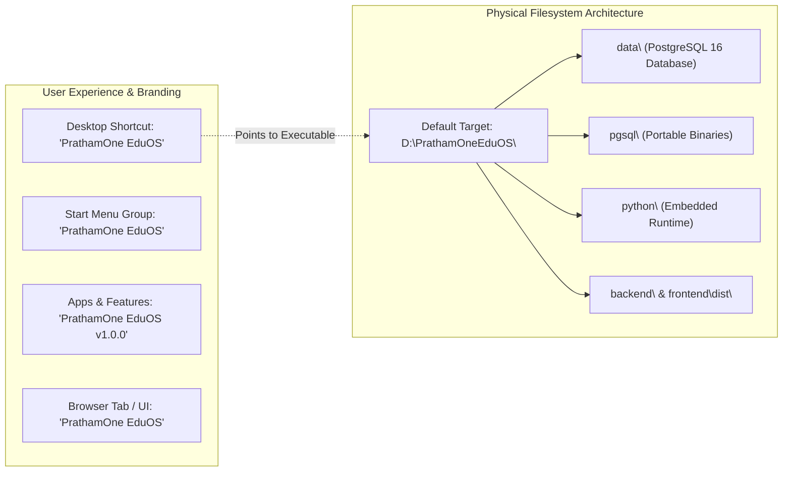
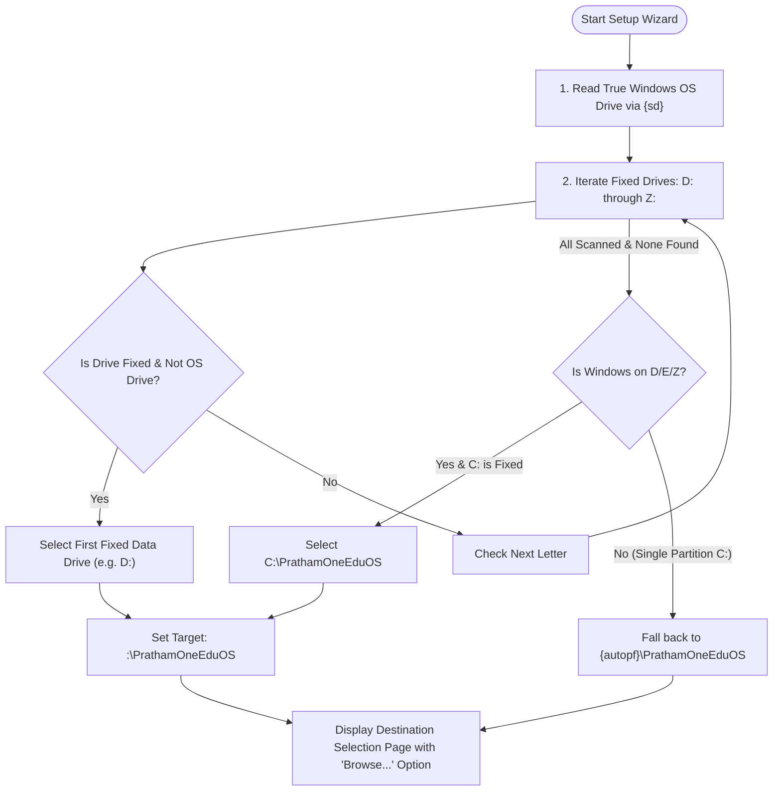

# Smart Installer Drive Selection and Folder Architecture Blueprint

## 1. Executive Summary & Problem Formulation

### 1.1 Problem Statement
1. **OS Vulnerability & Data Loss Risk:** On Windows PCs in coaching institutes, the Windows operating system drive (typically `C:\`) is frequently formatted, reinstalled, or repaired by local technicians following malware, BSOD crashes, or OS upgrades. Installing educational enterprise software and its PostgreSQL database on the OS drive creates a high risk of catastrophic data loss.
2. **Drive Letter Ambiguity:** While `C:` is customary, Windows is not guaranteed to be installed on `C:\`. In dual-boot or partitioned OEM computers, the Windows operating system may reside on `D:\`, `E:\`, or another drive letter. An installer must never assume `C:` is the OS drive.
3. **Filesystem Space Incompatibility:** Paths with spaces (e.g. `C:\Program Files\PrathamOne EduOS\`) require continuous quote escaping in batch scripts, CLI utilities, and Unix-derived engines like PostgreSQL (`initdb`, `pg_ctl`, `pg_dump`). They also introduce Windows 8.3 short filename aliasing (`PRATHA~1`) and unquoted search path vulnerabilities.

### 1.2 Architectural Resolution
This blueprint establishes the **Smart Drive Selection & Decoupled Folder Architecture** for PrathamOne EduOS v1.0.0:
1. **Dynamic OS Drive Discovery:** Detects the true Windows system drive dynamically via `{sd}` and Win32 `GetDriveType` APIs, avoiding installation onto the active Windows OS drive whenever a secondary data drive is present.
2. **Visual vs. Filesystem Decoupling:** Decouples the human-readable brand name (`PrathamOne EduOS`) used for UI, Desktop icons, and Control Panel from the physical filesystem folder name (`PrathamOneEduOS`) used on disk.
3. **Zero-Scattering Storage:** Consolidates 100% of the runtime stack, database, logs, and uploads inside the chosen installation root, leaving `C:\ProgramData` completely untouched (except for standard Windows Start Menu shortcuts).

---

## 2. Decoupled Brand vs. Filesystem Matrix



| Component | Identifier | Purpose | Value |
| :--- | :--- | :--- | :--- |
| **Brand Display Name** | `MyAppName` | Shortcuts, window titles, Control Panel, dialogs | **`PrathamOne EduOS`** |
| **Filesystem Folder** | `MyAppDirName` | Physical directory on disk | **`PrathamOneEduOS`** |
| **Primary Target Path** | Smart Resolved | Automated target if non-OS drive exists | **`D:\PrathamOneEduOS`** |
| **Fallback Target Path** | System Fallback | If only single partition exists | **`{autopf}\PrathamOneEduOS`** |

---

## 3. Dynamic Smart Drive Selection Algorithm

The installer evaluates system drives at wizard initialization:



### 3.1 Formal Inno Setup Algorithm Specification
```pascal
function GetDriveType(lpRootPathName: String): Cardinal;
external 'GetDriveTypeW@kernel32.dll stdcall';

function GetSmartInstallDir(Param: String): String;
var
  SysDrive: String;
  DriveCode: Integer;
  DriveLetter: String;
  DrivePath: String;
  BestDrive: String;
begin
  // 1. Authoritative dynamic resolution of current Windows system drive
  SysDrive := Copy(ExpandConstant('{sd}'), 1, 1);
  BestDrive := '';

  // 2. Scan drive letters D: through Z: for a permanent fixed drive (Type 3)
  for DriveCode := 68 to 90 do
  begin
    DriveLetter := Chr(DriveCode);
    if DriveLetter <> SysDrive then
    begin
      DrivePath := DriveLetter + ':\';
      if DirExists(DrivePath) and (GetDriveType(DrivePath) = 3) then
      begin
        BestDrive := DriveLetter;
        Break;
      end;
    end;
  end;

  // 3. If Windows is installed on D: or E:, check if C: is an available fixed data drive
  if (BestDrive = '') and (SysDrive <> 'C') then
  begin
    DrivePath := 'C:\';
    if DirExists(DrivePath) and (GetDriveType(DrivePath) = 3) then
    begin
      BestDrive := 'C';
    end;
  end;

  // 4. Return optimal non-OS data directory or fall back to standard Program Files
  if BestDrive <> '' then
    Result := BestDrive + ':\' + Param
  else
    Result := ExpandConstant('{autopf}\') + Param;
end;
```

---

## 4. Disaster Recovery & Uninstallation Governance

### 4.1 Safety Backup Before Uninstallation
Before any files are removed, the uninstaller queries the administrator:
```
"Would you like to save a safety backup of your student and fee database in your Documents folder before uninstalling?"
```
On confirmation, it executes:
```powershell
pg_dump.exe -U postgres -p 5432 -Fc prashant_academy -f "%USERPROFILE%\Documents\PrathamOne_Backups\prathamone_uninstall_backup.dump"
```

### 4.2 Reinstallation Data Preservation
If an institute uninstalls and subsequently reinstalls PrathamOne EduOS on the same drive:
- The installer detects `{app}\data\PG_VERSION`.
- It **skips** `initdb.exe` initialization.
- The new executables attach seamlessly to the existing database cluster, preserving 100% of historical records.

---

## 5. Architectural Verification & Sign-Off

- **Product:** PrathamOne EduOS (Coaching Institute Edition v1.0.0)
- **Architectural Directives:** SSOT Rule 001, Rule 004, Rule 009 compliant.
- **Security:** Eliminates unquoted search path vulnerabilities (CWE-428) and prevents OS drive storage exhaustion.
- **Approved by:** Jawahar R. Mallah, Product Architect (AITDL).
