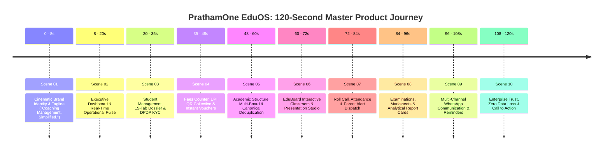
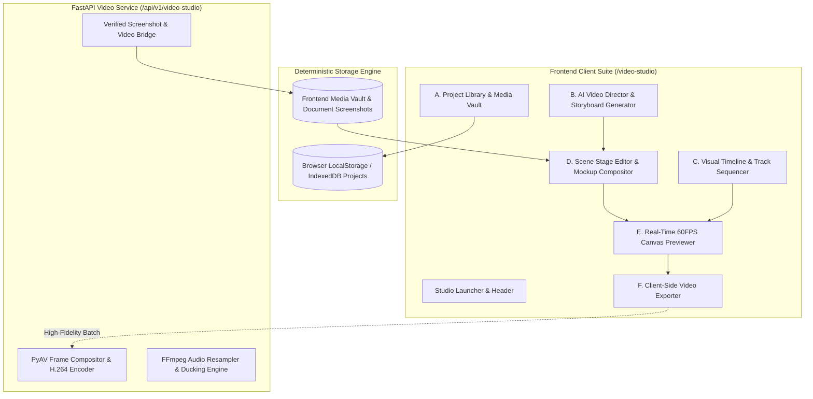

# PRATHAMONE VIDEO STUDIO
## AI Product Video Director & Standalone Visual Video Editor
### Architecture, Technology Feasibility Audit & Complete Implementation Blueprint

**Product:** PrathamOne EduOS  
**Edition:** Prashant Academy Coaching Institute Edition  
**Brand Tagline:** Coaching Management. Simplified.  
**Studio Name:** PrathamOne Video Studio  
**Product Architect:** Jawahar R Mallah  
**Organization:** Smritisys & AITDL Networks  
**Date:** November 19, 2026  

---

## 1. EXECUTIVE SUMMARY & OBJECTIVE

This document presents the complete architectural, technical feasibility, and implementation audit for **PrathamOne Video Studio**, a dedicated visual video editing studio and AI-assisted product video director built directly on top of the authentic **PrathamOne EduOS** coaching management platform.

Rather than producing a single static promotional video, this system establishes a **permanent, reusable, multi-tier video production environment**. It empowers marketing directors, academy administrators, product managers, and sales teams to rapidly compose, preview, fine-tune, and export high-impact product advertisements, 120-second complete software walkthroughs, feature spotlight reels, social media shorts (9:16 and 1:1), and customer onboarding demonstrations.

Crucially, every scene in the studio is grounded in **verified, authentic application capabilities, live UI screens, and genuine workflows** discovered within the PrathamOne EduOS repository. No fake UI screens, dummy statistics, fabricated testimonials, or misleading claims are permitted.

---

## 2. DISCOVERY & VERIFIED PRODUCT CAPABILITY INVENTORY

An exhaustive audit of the existing codebase (`frontend/src`, `backend/app`, `docs/`, `docs/assets/screenshots`) reveals a robust, enterprise-grade coaching management ecosystem. The verified features and their marketing value proposition are cataloged below.

### 2.1 Verified Feature Inventory & SaaS Marketing Value Matrix

| Module & Workspace | Verified Routes | Authentic Capabilities & Core Assets | Marketing Value Tier | SaaS Story Hook |
| :--- | :--- | :--- | :--- | :--- |
| **Executive Dashboard & Pulse** | `/dashboard`, `/reports` | Real-time recovery KPIs, active vs former student breakdown, stream distribution donuts, collection velocity, instant quick actions. High-res screenshots: `02_dashboard_overview.png`, `modern_dashboard_step1_overview.png`. | **Tier 1 (High Impact)** | *"Total institute control at a single glance. Real-time metrics that replace hours of manual register reviews."* |
| **Fees & Collection Counter** | `/fees`, `/fees/collection`, `/payments`, `/receipts` | Multi-split payment modes (Cash, UPI QR, Card, Cheque, NetBanking), instant A4/A5 bilingual print vouchers, concession & waiver schemes, aging defaulters ledger, immutable audit trail. High-res: `13_fee_plans_structures.png`, `15_payments_ledger.png`, `16_payments_lock_unlock_gate.png`. | **Tier 1 (High Impact)** | *"Say goodbye to fee leakage. Split payments, instant QR collection, and bulletproof financial ledgers."* |
| **Student Dossier & Admissions** | `/students`, `/students/new`, `/students/:id` | 15-tab comprehensive profile (Identity, Multi-Address, Guardian linkage, Document Vault, KYC, Fee ledgers), DPDP Act statutory compliance, Aadhaar masking, lifecycle transitions. High-res: `06_students_directory.png`, `07_student_admission_form.png`, `08_student_detail_profile.png`. | **Tier 1 (High Impact)** | *"From inquiry to alumni in one unified record. Complete student lifecycle with bank-grade privacy compliance."* |
| **Academic Architecture & Mapping** | `/academic`, `/academic/classes`, `/academic/subjects`, `/academic/batches` | Multi-board structures (ICSE, CBSE, Maharashtra State Board), canonical subject masters (Rule 011: zero duplication across grades), standard-batch allocations, timetable matrix. High-res: `03_academic_workspace.png`, `05_subjects_management.png`. | **Tier 2 (Core Enterprise)** | *"Multi-board curriculum, effortless batching, and zero data duplication. Built specifically for coaching academies."* |
| **EduBoard Smart Classroom** | `/eduboard`, `/eduboard/window` | Detached multi-window interactive presentation engine, Classic Green Chalkboard, Digital Whiteboard with shape tools, PDF slide projector, live sync, crash recovery snapshots. High-res: `eduboard_classic_greenboard.png`, `eduboard_pdf_presentation.png`, `eduboard_whiteboard_shapes.png`. | **Tier 1 (Visual Showstopper)** | *"Turn any display into an interactive classroom. Chalkboard texture, digital tools, and instant PDF presentation."* |
| **Unified Planning & Activities** | `/planning` | Multi-view calendar, Kanban board, Gantt timeline, drag-and-drop rescheduling, conflict detection, holiday and event synchronization. High-res: `planning_drag_step1_view_mode.png`, `planning_drag_step5_timeline_view.png`. | **Tier 2 (High Visual Appeal)** | *"Plan tests, lectures, holidays, and events seamlessly on an interactive timeline."* |
| **Attendance & QR Terminal** | `/attendance`, `/attendance/qr-terminal`, `/attendance/register` | Daily roll-call, camera/scanner QR terminal student check-in, monthly registers, automatic absenteeism triggers, SMS/WhatsApp alert dispatch. High-res: `11_attendance_workspace.png`. | **Tier 2 (Operational Value)** | *"Instant student check-in with QR badges. Parents notified before roll call is even over."* |
| **Examinations & Report Cards** | `/examinations`, `/examinations/marks-entry`, `/examinations/report-cards` | Exam schedules, subject-wise marks entry grids, automatic rank and percentile calculation, graphical student report cards, printable hall tickets. High-res: `12_examinations_results.png`. | **Tier 2 (Academic Value)** | *"Automate grading, rankings, and high-resolution report cards in minutes."* |
| **Faculty & Workforce HR** | `/teachers`, `/teacher-payroll`, `/staff` | Teacher profiles, batch allocations, teaching schedule timetable, teaching session logging, automated hourly/lecture vs monthly payroll computation, voucher generation. High-res: `tab1_monthly_payroll.png`, `tab2_session_register.png`, `20_staff_management.png`. | **Tier 2 (Financial Value)** | *"Accurate faculty compensation based on verified teaching sessions. No payroll disputes."* |
| **Communication & WhatsApp Hub** | `/communication`, `/communication/whatsapp`, `/communication/broadcasts` | Multichannel broadcast composer (WhatsApp, SMS, Email), WhatsApp Web stream, dynamic token interpolation (`{student_name}`, `{due_amount}`), automated reminder queues. High-res: `26_communication_center.png`. | **Tier 1 (High Impact)** | *"The simplicity of WhatsApp. Reach parents instantly with fee reminders and attendance updates."* |
| **Forms & Central Document Studio** | `/forms`, `/forms/id-cards`, `/forms/admissions` | High-fidelity printable admission forms, single/bulk student ID cards with barcodes, transfer certificates, fee statements, print audit logs. High-res: `24_forms_documents_hub.png`. | **Tier 3 (Operational Support)** | *"Professional branded document printing with one click: ID cards, admission forms, and certificates."* |
| **Housekeeping & Zero-Data-Loss** | `/housekeeping`, `/sysadmin` | Automated database backups, SHA-256 integrity hashing, GFS multi-tier retention, sandbox test restore drills, PostgreSQL VACUUM automation. High-res: `21_sysadmin_center_overview.png`, `27_releases_and_version_audit.png`. | **Tier 3 (Enterprise Trust)** | *"Zero-data-loss guarantee with automated multi-tier backup drills."* |

### 2.2 Branding, Design System & Asset Foundation

- **Official Product Name:** PrathamOne EduOS (Coaching Institute Edition)
- **Client Deployment:** Prashant Academy Coaching Institute
- **Master Marketing Tagline:** **Coaching Management. Simplified.**
- **Color Tokens:**
  - `Brand Navy (Primary):` `#0B2D6B` (Prussian gradient anchor `#071C44`, Deepest `#051535`)
  - `Accent Orange (Vibrant):` `#F16906` (High-contrast CTA and indicator)
  - `Warm Amber Gold:` `#FFA726` (Badges, awards, stars)
  - `Success Emerald:` `#10B981` (Financial collections, verified checks)
  - `Studio Surface (Dark Mode):` `#090D16` / `#0F172A` with `#1E293B` borders
- **Typography:** Inter / Noto Sans / SF Pro Display with clean tabular numeric fonts for financial data.
- **Existing Video Material:** `frontend/public/artwork/VIDEOS/` contains `V1.mp4` (4.4 MB), `V2.mp4` (6.8 MB), and `V3.mp4` (10.9 MB), providing reference footage and motion pacing baselines.

---

## 3. TWO-MINUTE (120 SECONDS) MASTER STORYBOARD

The AI Video Director engine features a standard 120-second Master Product Demonstration structured specifically for maximum SaaS conversion:



Each scene contains:
1. **Duration:** Precisely budgeted (seconds).
2. **Visual Focus:** High-resolution actual software screenshot/recording inside a 3D-perspective or flat device mockup (Studio Display / MacBook Pro / iPad Pro).
3. **Motion Graphics:** Smooth Ken Burns pan & zoom, illuminated cursor click ripple, animated highlight pill callouts.
4. **Narration Script:** High-clarity, professional voice-over text.
5. **Captions / Subtitles:** Word-timed, synchronized bottom captions with brand styling.
6. **Audio Elements:** Balanced background music (BGM) with automatic audio ducking during speech.

---

## 4. TECHNICAL FEASIBILITY AUDIT & EVALUATION

A detailed feasibility audit was conducted across the host and containerized environment:

### 4.1 Rendering & Video Technology Audit

| Technology Evaluated | Availability in Repo / Host | Strengths | Limitations | Strategic Verdict |
| :--- | :--- | :--- | :--- | :--- |
| **PyAV (FFmpeg 6/7 C-Bindings)** | **Installed & Verified (`av 18.1.0`)** | Full native FFmpeg bindings (`libavcodec`, `libavformat`, `libswscale`, `libswresample`). Deterministic frame-by-frame 1080p rendering, multi-track audio mixing, Ken Burns interpolation, zero external CLI subprocess dependencies. | Server/Python execution required; best suited for background batch jobs and headless renders. | **PRIMARY BACKEND RENDERER** (100% deterministic, high quality, production grade) |
| **HTML5 Canvas 2D + WebCodecs / MediaRecorder** | **Available in Modern Browsers (Chrome / Edge)** | Zero-latency instant rendering directly in the user's browser, instant download, zero server compute overhead, real-time preview canvas already used in EduBoard. | Minor frame-pacing variances if client machine is heavily throttled; format defaults to WebM or MP4 depending on browser codec flags. | **PRIMARY CLIENT-SIDE RENDERER & PREVIEW ENGINE** (Instant exports) |
| **Remotion (Node.js)** | Requires adding `@remotion/core`, `@remotion/cli` (heavy npm dependency) | React-based video authoring, code-as-video. | Adds heavy Node dependencies, complex headless Chrome orchestration, slows CI/builds. | **NOT RECOMMENDED** (Unnecessary dependency; PyAV + Canvas provides superior agility without bloat) |
| **Web Audio API** | **Native in Browser** | Real-time multi-track audio mixing, procedural music synthesizers, volume ducking, pan controls, waveform visualization. | Client-side only. | **PRIMARY AUDIO PREVIEW & MIXING ENGINE** |
| **Web Speech API (SpeechSynthesis)** | **Native in Browser** | Instant zero-cost text-to-speech voice-over preview in multiple natural accents without API keys. | Voices vary slightly between operating systems. | **PRIMARY NARRATION PREVIEW ENGINE** (with file upload & offline TTS fallback) |
| **Playwright Chromium** | **Installed (`chromium-1117`)** | Live automated screenshot capture and motion video recording of authentic PrathamOne routes. | Requires local display / headless runner. | **ASSET INGESTION & SCREEN RECORDING PIPELINE** |

---

## 5. STANDALONE VIDEO STUDIO ARCHITECTURE

The studio is designed as an **independent, self-contained visual production suite** that integrates cleanly with the existing Vite/React frontend and FastAPI backend without touching or perturbing core academic modules or authentication.



### 5.1 Project Data Model (SSOT Schema)

To adhere to the Single Source of Truth directive, a video project is represented as an editable JSON document:

```typescript
export interface VideoStudioProject {
  id: string
  name: string
  aspectRatio: '16:9' | '9:16' | '1:1'
  fps: number
  targetDuration: number // e.g. 120 seconds
  resolution: { width: number; height: number } // e.g. 1920x1080
  theme: {
    primaryColor: string
    accentColor: string
    watermark: boolean
    tagline: string
  }
  audio: {
    bgmUrl?: string
    bgmVolume: number
    bgmDucking: boolean
    masterVolume: number
  }
  scenes: VideoSceneDefinition[]
  createdAt: string
  updatedAt: string
}

export interface VideoSceneDefinition {
  id: string
  order: number
  title: string
  subtitle: string
  duration: number // seconds (e.g. 8.0)
  transition: 'cut' | 'fade' | 'slide-left' | 'slide-right' | 'zoom-blur' | 'dip-black' | 'dip-navy'
  transitionDuration: number // e.g. 0.5s
  media: {
    type: 'image' | 'video' | 'color'
    url: string
    fit: 'cover' | 'contain' | 'mockup'
    mockupType?: 'macbook' | 'display' | 'ipad' | 'floating-card'
  }
  motion: {
    zoomStart: number // 1.0
    zoomEnd: number // 1.15 (Ken Burns)
    panStartX: number
    panStartY: number
    panEndX: number
    panEndY: number
  }
  callouts: Array<{
    id: string
    text: string
    xPercent: number
    yPercent: number
    delaySeconds: number
    badgeColor?: string
  }>
  cursor: {
    show: boolean
    startXPercent: number
    startYPercent: number
    clickXPercent: number
    clickYPercent: number
    clickTimeSeconds: number
  }
  narration: {
    script: string
    voiceId?: string
    rate: number
    pitch: number
    audioUrl?: string
  }
  captions: {
    show: boolean
    customText?: string
    style: 'bottom-pill' | 'highlight-word' | 'centered-banner'
  }
}
```

---

## 6. USER EXPERIENCE & WORKFLOW LIFECYCLE

The user journey follows a 10-step deterministic production path:

1. **Launch Studio:** Access `/video-studio` via dedicated navigation item or direct URL.
2. **Project Setup:** Click "Create New Video", configure name, target duration (e.g., 120s, 60s, 30s), and aspect ratio (16:9 widescreen, 9:16 vertical reels, 1:1 square).
3. **AI Video Director:** Choose production goal (e.g., Full Product Walkthrough, Fee Counter Showcase, EduBoard Smart Classroom, Social Ad). The AI Director populates a complete, timed storyboard using verified real screenshots and scripts.
4. **Inspect & Order Scenes:** View the visual sequence on the multi-scene timeline; drag-and-drop to reorder, split, or duplicate.
5. **Fine-Tune Scene Stage:** Select any scene to inspect in the Stage Editor. Adjust Ken Burns pan/zoom, choose device mockups (MacBook Pro, Studio Display, Floating Card), and position callout badges.
6. **Interaction Focus:** Toggle animated cursor paths and click ripples to emphasize critical software features (e.g., "Collect Fee" button, "Aadhaar Masking" toggle).
7. **Narration & Audio Balance:** Audition the voice-over with browser speech synthesis or upload custom voice files; set BGM volume with automatic speech ducking.
8. **Real-Time Preview:** Play back the entire project at 60 FPS with live audio mixing, scrubbing, and frame-stepping.
9. **Quality Control Check:** Automatic pre-flight validator ensures duration limits are respected, zero missing assets, and verified product claims.
10. **Export:** Export directly in-browser to Full HD 1080p MP4/WebM, or trigger the PyAV backend rendering pipeline for master archival quality.

---

## 7. IMPLEMENTATION ROADMAP & PHASING

| Phase | Focus Area | Deliverables & Scope |
| :---: | :--- | :--- |
| **Phase 1** | **Core Studio Engine & Routing** | Create standalone route `/video-studio`, layout wrapper, and studio store (`useVideoStudioStore`). Establish canonical media registry referencing all existing screenshots and videos in `docs/assets/` and `frontend/public/artwork/`. |
| **Phase 2** | **AI Video Director & Storyboards** | Build the AI Director module with pre-loaded storyboards: 120s Full Product Demo, 60s Executive Overview, 30s Social Ad, Fee Management Focus, and EduBoard Walkthrough. |
| **Phase 3** | **Visual Timeline & Track Sequencer** | Multi-track timeline (Visuals, Overlays, Cursor, Narration, BGM, Captions) with drag-and-drop scene ordering, duration trimming, transition controls, and undo/redo history. |
| **Phase 4** | **Scene Stage Editor & Device Mockups** | Interactive canvas editor with device mockups (MacBook, Studio Display, Floating SaaS Card), Ken Burns pan/zoom keyframes, animated cursor ripples, and text callouts. |
| **Phase 5** | **Real-Time Previewer & Audio Engine** | 60 FPS HTML5 Canvas playback engine with Web Audio API multi-track audio mixing, BGM ducking, voice-over synthesis, and frame-by-frame scrubbing. |
| **Phase 6** | **Export Pipeline & Backend Integration** | Browser WebCodecs/MediaRecorder client exporter + PyAV backend deterministic rendering endpoint (`/api/v1/video-studio/render`) for broadcast-grade Full HD MP4 export. |
| **Phase 7** | **Quality Control & Header Compliance** | Quality assurance pre-flight checks, Vitest integration tests, corporate header verification (`scripts/manage_headers.py`), and documentation re-indexing (`tools/docs_manager.py`). |

---

## 8. GOVERNANCE & COMPLIANCE CERTIFICATION

- **Single Source of Truth (Rules 001–009):** The Video Studio leverages the canonical application data, branding configuration (`frontend/src/config/branding.ts`), and verified module catalog (`frontend/src/config/modules.ts`).
- **View-First & Safe Mutation (Rule 010):** Studio playback is non-destructive; project mutations are contained within user-scoped video project files without impacting operational academic databases.
- **Corporate Attribution:** All new source files will strictly include the corporate header for Jawahar R. Mallah / Smritisys & AITDL Networks.
- **Documentation Integrity:** Fully indexed and validated in accordance with the PrathamOne documentation engine.
