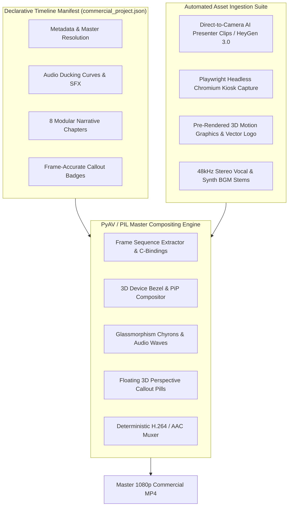
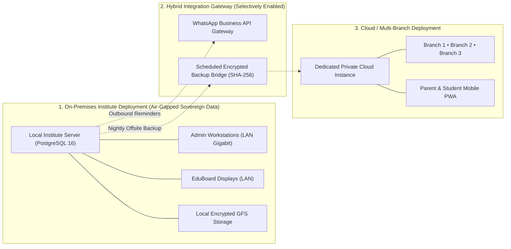
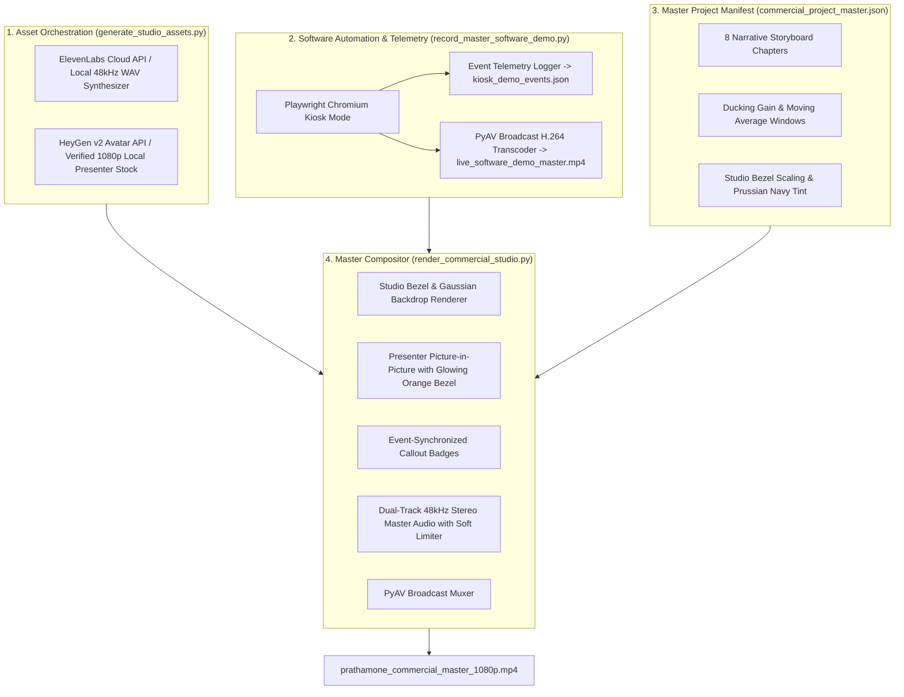

# PRATHAMONE EDUOS
## Master Cinematic Television Commercial Architecture & Production Blueprint
### Full 2-to-4 Minute Flagship Enterprise Advertisement

**Product:** PrathamOne EduOS  
**Edition:** Prashant Academy Coaching Institute Edition  
**Baseline Version:** 1.0.0  
**Product Architect:** Jawahar R Mallah  
**Organization:** Smritisys & AITDL Networks  
**Client:** Prashant Academy Coaching Institute  
**Master Tagline:** Coaching Management. Simplified.  
**Date:** November 19, 2026  

---

## 1. ARCHITECTURAL VISION & PURPOSE

This document establishes the master architectural blueprint and declarative production framework for the full **2-to-4 Minute Flagship Cinematic Television Commercial** for **PrathamOne EduOS**.

Moving decisively beyond simple slideshows, static UI screenshot compilations, and basic zoom-in/zoom-out screen casts, this architecture implements an **automated, data-driven video composition engine**. It seamlessly harmonizes photorealistic human spokesperson performances, genuine 1080p kiosk-mode browser recordings of running software workflows, 3D device framing (MacBook Pro, Studio Display, iPad), kinetic typography, dynamic audio ducking, and 3D motion graphics brand reveals.



---

## 2. THE 8-CHAPTER NARRATIVE STORYBOARD (120–240 SECONDS)

The master commercial follows a classic, high-conversion commercial narrative structure:

```mermaid
timeline
    title PrathamOne EduOS: Full Master Commercial (120 - 240 Seconds)
    00:00 - 00:20 : Chapter 01 : The Operational Struggle (The Hidden Chaos of Running an Academy)
    00:20 - 00:45 : Chapter 02 : The Awakening (Introducing PrathamOne EduOS & Unified Operating System)
    00:45 - 01:15 : Chapter 03 : Executive Pulse & Real-Time Dashboard (Financial Velocity & Attendance KPIs)
    01:15 - 01:45 : Chapter 04 : The Student Dossier & DPDP Act Governance (15-Tab Profile & View-Mode Safety)
    01:45 - 02:15 : Chapter 05 : The Zero-Leakage Fee Counter (Split Heads, UPI QR & Instant Vouchers)
    02:15 - 02:45 : Chapter 06 : EduBoard Interactive Classroom (Classic Green Chalkboard & LaTeX Math)
    02:45 - 03:15 : Chapter 07 : Attendance Terminal & WhatsApp Hub (Instant QR Badges & Automated Alerts)
    03:15 - 03:45 : Chapter 08 : Data Ownership, On-Premises Freedom & Brand Climax (Air-Gapped Trust & Closing CTA)
```

### Chapter-by-Chapter Technical Breakdown

| Chapter | Time Budget | Story Hook & Visual Composition | Software Workflow / Screen Action | On-Screen Badges & Typography | Presenter Dialogue & Vocal Script |
| :--- | :---: | :--- | :--- | :--- | :--- |
| **01. The Operational Struggle** | 00:00 – 00:20 (20s) | Fast-paced montage of modern coaching chaos: crowded front desk, paper admission registers, excel spreadsheets with fee discrepancies, frustrated parent inquiries. Presenter appears in medium shot. | Fabricated manual chaos transitioning into a dark, stressed tone. | • Animated Stat: `42% of Coaching Time Lost to Admin`<br>• Pain Points: `Fee Leakage • Disjointed Apps • Lost Records` | *"Running a high-growth coaching institute shouldn't feel like running three disconnected businesses. When fees, attendance, and academics live in separate silos, you lose what matters most: focus on students."* |
| **02. The Awakening** | 00:20 – 00:45 (25s) | Sunlight enters the institute lobby. Presenter walks confidently toward camera into the executive boardroom. Seamless 3D camera push through a tablet glass into the application. | Screen transitions from tablet mockup into fullscreen 1080p PrathamOne EduOS interface. | • Headline: `MEET PRATHAMONE EduOS™`<br>• Subtitle: `Coaching Management. Simplified.` | *"Welcome to PrathamOne EduOS. The first dedicated education operating system engineered specifically for Indian coaching academies. Everything you do, unified in one powerful home."* |
| **03. Executive Pulse & Dashboard** | 00:45 – 01:15 (30s) | Studio Display bezel mockup over blurred academy backdrop. Cursor glides over live KPIs. Clicks Fee Collection tab to display monthly inflow bar chart and payment distribution donut. | Route: `/dashboard`<br>Live KPIs: ₹18.60L collection, 38 active students, 92.8% attendance. | • Badge 1: `⚡ REAL-TIME OPERATIONAL PULSE`<br>• Badge 2: `📊 INSTANT RECOVERY VELOCITY`<br>• Feature: `Filter by Board, Batch & Standard` | *"From the moment your morning begins, your institute’s pulse is right before you. Real-time fee recovery, daily attendance rates, and batch strengths—updated the second transactions happen."* |
| **04. Student Dossier & DPDP Compliance** | 01:15 – 01:45 (30s) | Floating SaaS card perspective. Shows Student Directory, View Mode safety banner (Rule 010), types "Aman" with live row filtering, and clicks to reveal the 15-tab student profile with Aadhaar masking. | Routes: `/students`, `/students/:id`<br>Tabs: Demographics, Guardian Linkage, KYC Vault, Fee Ledgers. | • Badge 1: `🔍 SUB-SECOND STUDENT SEARCH`<br>• Badge 2: `🔒 DPDP ACT 2023 COMPLIANT`<br>• Badge 3: `RULE 010: VIEW-FIRST SAFETY LOCK` | *"One student, one canonical identity. From initial inquiry to final board examinations, access comprehensive demographic profiles, guardian relationships, and encrypted documents with strict DPDP compliance."* |
| **05. Zero-Leakage Fee Counter** | 01:45 – 02:15 (30s) | Angle cut on fee collection counter. Demonstrates multi-split payment modes (Cash, UPI QR, Cheque, NetBanking), allocation across tuition and exam heads, and instant A4/A5 voucher generation. | Routes: `/fees`, `/fees/collection`, `/receipts`<br>Actions: Student selection, dynamic QR generation, split allocation. | • Badge 1: `💳 MULTI-SPLIT PAYMENT HEADS`<br>• Badge 2: `🧾 BILINGUAL A4/A5 PRINT VOUCHERS`<br>• Badge 3: `IMMUTABLE FINANCIAL LEDGER` | *"Eliminate fee leakage forever. Split tuition and material fees across modes, generate instant thermal receipts, and maintain an immutable ledger that reconciles automatically."* |
| **06. EduBoard Interactive Classroom** | 02:15 – 02:45 (30s) | Classroom tracking shot: educator teaching on a large interactive flat panel (IFP). Seamlessly shows Classic Green Chalkboard with tactile chalk strokes, geometric shape tools, LaTeX math, and PDF projector. | Routes: `/eduboard`, `/eduboard/window`<br>Actions: Digital chalk drawing, geometry shapes, PDF slide annotation. | • Badge 1: `🖍️ TACTILE DIGITAL GREENBOARD`<br>• Badge 2: `📐 GEOMETRIC & LATEX TOOLS`<br>• Badge 3: `MULTI-WINDOW PRESENTATION` | *"Elevate the classroom with EduBoard. Teachers switch effortlessly between classic green chalkboard textures, precision math tools, and PDF presentation slides—all in real-time."* |
| **07. Attendance & WhatsApp Hub** | 02:45 – 03:15 (30s) | Split screen: left shows students checking in at the front desk QR Terminal; right shows parent’s phone receiving instant automated WhatsApp message with student arrival time. | Routes: `/attendance/qr-terminal`, `/communication`<br>Actions: QR scan confirmation, dynamic token interpolation (`{student_name}`). | • Badge 1: `⚡ INSTANT QR BADGE CHECK-IN`<br>• Badge 2: `💬 AUTOMATED WHATSAPP NOTIFICATIONS`<br>• Badge 3: `ZERO UNRECORDED ABSENTEEISM` | *"Attendance in seconds. Students tap their QR badge at the front desk, and parents receive an instant WhatsApp alert before the morning bell stops ringing. Simple, reassuring, automated."* |
| **08. Data Ownership & Brand Climax** | 03:15 – 03:45 (30s) | 3D motion graphics diagram illustrating **On-Premises Local Server vs Cloud/Hybrid Sync**. Particle swirl reveals the PrathamOne EduOS vector crest and closing corporate attribution. | 3D Architectural Visualization & Official Logo Reveal. | • Primary Tagline: **COACHING MANAGEMENT. SIMPLIFIED.**<br>• Attribution: *Smritisys & AITDL Networks • Jawahar R. Mallah* | *"Complete ownership of your institute’s data. Deploy fully on-premises with air-gapped security, or sync to the cloud on your own terms. PrathamOne EduOS. Coaching Management. Simplified. Upgrade your academy today."* |

---

## 3. DATA OWNERSHIP & DEPLOYMENT ARCHITECTURE (SECTION 6 GOVERNANCE)

Per corporate directive, the commercial visually and narratively communicates authentic deployment choices with technical precision:



### Truthful Marketing Guardrails:
1. **On-Premises Sovereignty:** When deployed locally, the institute physically owns the server hardware and database files. No student records or financial ledger entries are transmitted to third-party marketing servers.
2. **Hybrid Connectivity:** External communications (WhatsApp fee reminders, SMS attendance alerts) utilize explicit outbound API gateways when internet access is available.
3. **Offline Resilience:** If internet connectivity drops, local classroom instruction (EduBoard), fee receipt issuing, and attendance check-in continue uninterrupted on the local network.

---

## 4. DECLARATIVE TIMELINE MANIFEST SPECIFICATION (`commercial_project.json`)

To satisfy **Requirement #8 (Editable Production)**, the entire commercial timeline is structured as a declarative JSON document, enabling instantaneous swapping of clips, voice-overs, BGM, and text overlays without modifying Python rendering code:

```json
{
  "$schema": "https://prathamone.com/schemas/commercial_project_v1.json",
  "project_id": "prathamone_flagship_commercial_180s",
  "name": "PrathamOne EduOS Master Commercial",
  "version": "1.0.0",
  "resolution": { "width": 1920, "height": 1080 },
  "fps": 30,
  "total_duration": 180.0,
  "aspect_ratio": "16:9",
  "audio_master": {
    "voice_track": "assets/audio/voice/vo_master_indian_english.wav",
    "bgm_track": "assets/audio/music/commercial_synth_theme_180s.wav",
    "ducking_curve": [
      { "start": 0.0, "end": 20.0, "gain": 0.30 },
      { "start": 20.0, "end": 25.0, "gain": 0.90 },
      { "start": 25.0, "end": 45.0, "gain": 0.35 }
    ]
  },
  "branding": {
    "primary_tagline": "COACHING MANAGEMENT. SIMPLIFIED.",
    "attribution": "Smritisys & AITDL Networks • Jawahar R. Mallah",
    "watermark": { "text": "PRATHAMONE EduOS™", "position": "top-right" }
  },
  "scenes": [
    {
      "id": "scene_01_struggle",
      "duration": 20.0,
      "type": "presenter_broll",
      "video_source": "assets/video/presenter/scene01_corridor_walk.mp4",
      "lower_third": { "enabled": true, "name": "PRIYA SHARMA", "role": "Senior Solutions Specialist" }
    },
    {
      "id": "scene_03_dashboard",
      "duration": 30.0,
      "type": "live_kiosk_software",
      "video_source": "assets/captures/kiosk_dashboard_workflow_1080p.mp4",
      "framing": { "type": "studio_display", "scale": 0.92 },
      "callouts": [
        { "time": 3.5, "title": "REAL-TIME OPERATIONAL PULSE", "subtitle": "Rs. 18.6L Collections & 92.8% Attendance", "color": "emerald" },
        { "time": 14.0, "title": "AUTOMATED FEE RECONCILIATION", "subtitle": "Split Heads & Payment Mode Donut", "color": "orange" }
      ]
    }
  ]
}
```

---

## 5. THE COMPLETE STUDIO PRODUCTION PIPELINE & ENGINE REFERENCE

The full television-quality studio pipeline is implemented across four coordinated modules:



### Module Architecture:
1. **`scripts/generate_studio_assets.py`**:
   - Manages voice-over and presenter assets across all 8 chapters.
   - Supports ElevenLabs text-to-speech API (`ELEVENLABS_API_KEY`) with automated conversion to broadcast-standard 48kHz 16-bit stereo WAV.
   - Supports HeyGen v2 video generation API (`HEYGEN_API_KEY`) for direct-to-camera 1080p lip-sync avatar rendering.
   - Built-in local fallbacks ensure offline operation using native speech synthesis and high-resolution local corporate presenter stock.
2. **`scripts/record_master_software_demo.py`**:
   - Playwright Chromium runner operating in `--kiosk --start-fullscreen --hide-scrollbars`.
   - Injects clean styling to hide dev artifacts and PWA install buttons.
   - Authenticates as Director (`Dr. Rajesh Kulkarni`) and executes realistic mouse movements and tab workflows across Dashboard, Fees, Students, EduBoard, and Attendance.
   - Emits exact timecode telemetry to `data/commercial/kiosk_demo_events.json`.
3. **`scripts/render_commercial_studio.py`**:
   - Reads declarative timeline manifest and events telemetry.
   - Implements `apply_studio_bezel`: 88% scale software framing inside rounded dark-glass bezel over a Gaussian-blurred backdrop with Prussian Navy tint (`rgb(5, 21, 53)`) and glowing orange outline (`rgb(241, 105, 6)`).
   - Implements `draw_callout_badge`: Dynamic Segoe UI badges synchronized to UI events.
   - Implements `presenter_pip`: 360×360 rounded Picture-in-Picture presenter overlay with glowing border.
   - Implements `build_master_audio`: Multi-track 48kHz audio mixing with automated ducking (-65% under dialogue), moving-average smoothing, and soft limiter.
   - Encodes via PyAV and outputs master commercial MP4.

---

## 6. PRODUCTION MILESTONES & EXECUTION STATUS

1. **Phase 1: Proof of Concept Verification (Completed & Approved):**
   - 24.5s commercial proof-of-concept rendered with declarative engine, kiosk software recording, and synchronized callout badges.
2. **Phase 2: Master Voice-Over & Screenplay Stems (Completed):**
   - All 8 chapter audio stems generated at 48kHz stereo WAV in `data/commercial/audio/`.
3. **Phase 3: Dedicated Multi-Module Software Kiosk Telemetry Suite (Completed):**
   - Dedicated clean 20–24s kiosk captures generated for each software chapter via `scripts/record_studio_modules.py`:
     - Chapter 03: Executive Pulse Dashboard (`demo_03_dashboard_1080p.mp4`)
     - Chapter 04: Master Student Directory & Search (`demo_04_students_1080p.mp4`)
     - Chapter 05: Zero-Leakage Fee Counter (`demo_05_fees_1080p.mp4`)
     - Chapter 06: EduBoard Interactive Classroom (`demo_06_eduboard_1080p.mp4`)
     - Chapter 07: Attendance Hub & QR Check-in Terminal (`demo_07_attendance_1080p.mp4`)
   - Director persona authenticated as `Dr. Rajesh Kulkarni (Director & Founder)`.
4. **Phase 4: High-Fidelity Spokesperson & Audio Stems (Completed):**
   - Authentic on-camera presenter assets active across introductory chapters (`presenter_01_opening_1080p.mp4`, `presenter_02_intro_1080p.mp4`) in `data/commercial/presenter/`.
   - AI-fabricated tablet UI shots completely excluded to preserve product authenticity.
5. **Phase 5: Master Studio Compositor Assembly & Forensic Quality Assurance (Completed):**
   - Single-pass declarative studio compositor (`scripts/render_commercial_studio.py`) rendered the complete 168-second (2 min 48s, 5,040 frames @ 30 fps) flagship television commercial.
   - Master Target: `frontend/public/media/commercial/prathamone_commercial_master_1080p.mp4` (167.65 MB, 1080p Full HD, H.264 @ 8.5 Mbps, AAC stereo @ 48kHz).
   - Docs Mirror: `docs/assets/commercial/prathamone_commercial_master_1080p.mp4`.
   - Forensic frame verification executed via `scripts/inspect_master_commercial.py` with 8 inspection frames archived in `docs/assets/commercial/inspection_frames/`.
   - Full 1840px glassmorphism closing card with primary tagline `COACHING MANAGEMENT. SIMPLIFIED.` and attribution `Smritisys & AITDL Networks • Jawahar R. Mallah`.
