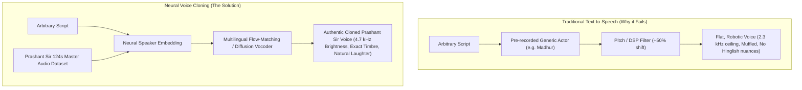

# Dean Prashant Tejam Neural Voice Cloning Architecture

## 1. Problem Definition & Core Requirement

To scale **EduBoard** into an autonomous pedagogical content engine capable of producing unlimited new video lectures across multiple grades (Class 9, 10, 11) and subjects (Physics, Chemistry, Mathematics, Biology), the system requires:
1. **Dynamic Text-to-Speech Generation:** The ability to generate new spoken audio for any syllabus topic from arbitrary text scripts on demand.
2. **Authentic Speaker Identity (Voice Cloning):** The generated speech must sound identical to **Dean Prashant Tejam**, preserving his vocal timbre (3.6–4.7 kHz presence), pitch dynamics (~225–232 Hz), Hinglish vernacular banter (*"Haan bhai!", "Are 80 le lo bhai!", "Darwaza khulega kya?", "Baat samajh mein aayi?"*), and classroom pauses.

---

## 2. Why Off-the-Shelf TTS Fails vs Neural Voice Cloning



---

## 3. Prepared Acoustic Dataset for Voice Cloning

A unified, studio-mastered 124-second training dataset has been curated from Dean Prashant Tejam's authentic classroom recordings:
- **Master Dataset File:** `assets/audio/voice_clone_dataset/prashant_sir_master_voice_clone_sample_124s.wav` (Mono 44.1 kHz, Broadcast Normalized -16 LUFS)
- **Web Preview Stream:** `http://localhost/media/commercial/prashant_sir_master_voice_clone_sample_124s.mp3`
- **Acoustic Characteristics:**
  - Sample 1 (Maths): High-energy formula derivation, student interaction, and signature question.
  - Sample 2 (Physics): Real-world door handle torque scenario, question-answer cadence.

---

## 4. The Two Implementation Paths

### Path A: Cloud Neural Voice Clone via ElevenLabs (Recommended for Instant Production)
- **Why:** The host machine operates an **Intel Xeon E-2104G (4 cores, integrated GPU, no CUDA GPU)**. Local deep neural cloning models on CPU require 3–5 minutes per paragraph. ElevenLabs Voice Clone synthesizes high-fidelity speech in 3 seconds.
- **Setup in 3 Simple Steps:**
  1. Open [ElevenLabs VoiceLab](https://elevenlabs.io/app/voice-lab).
  2. Click **Add Generative or Cloned Voice** $\rightarrow$ **Instant Voice Cloning**.
  3. Upload `prashant_sir_master_voice_clone_sample_124s.mp3` and name it `Dean Prashant Tejam`.
  4. Copy the resulting `VOICE_ID` into `.env`:
     ```env
     ELEVENLABS_API_KEY="your-api-key"
     PRASHANT_VOICE_ID="your-voice-id"
     ```
- **Execution:** `VoiceCloneService.generate_speech_elevenlabs(script, output_path)` automatically generates new topics in his cloned voice.

### Path B: Local Open-Source Neural Voice Clone (F5-TTS / Coqui XTTS)
- **Why:** 100% on-premises privacy with zero external API fees.
- **Trade-off:** Running on CPU requires ~45 seconds of generation time per 15 seconds of audio.
