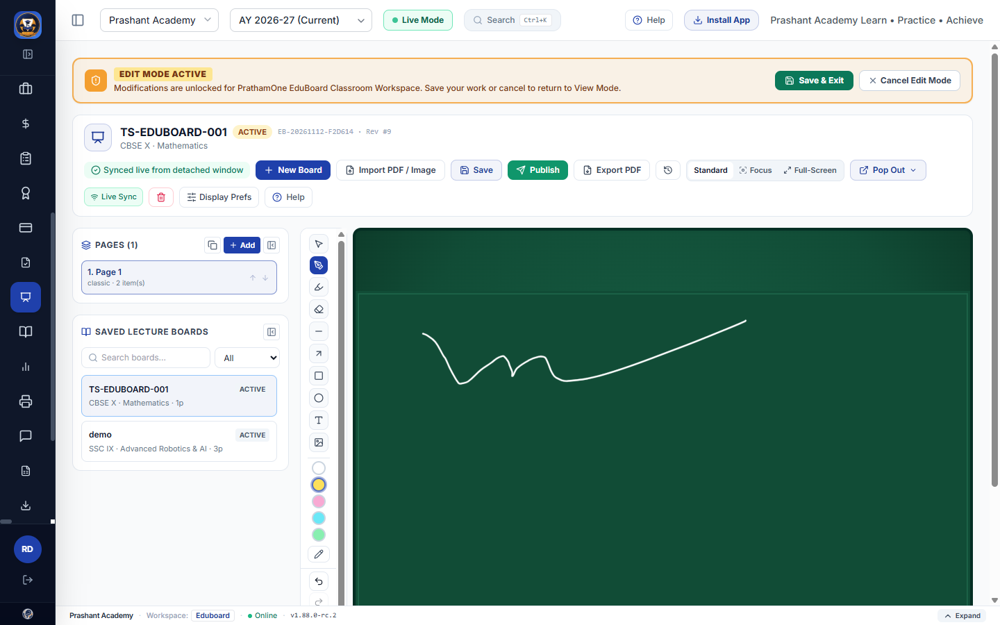
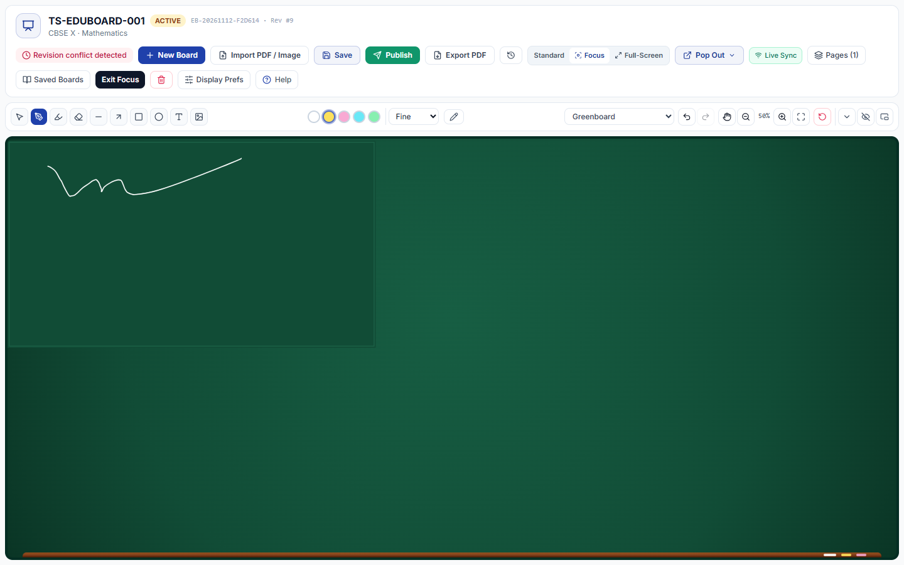

# PrathamOne EduBoard — Display Modes, Greenboard & Toolbar Architecture (`EDUBOARD_DISPLAY_MODES`)

## 1. Three Selectable Workspace Display Modes

Implemented via `frontend/src/store/eduboardDisplayStore.ts`, `frontend/src/components/Layout.tsx`, and `frontend/src/pages/EduBoardWorkspace.tsx`:

| Mode | Application Shell Behaviour | Left Panels (`Pages` & `Saved Lecture Boards`) | Toolbar Default | Exit Controls |
|---|---|---|---|---|
| **Standard Mode** (`standard`) | Preserves full shell (`Sidebar`, top `<header>`, `<TrainingModeBanner />`, `<Footer />`), while allowing sidebar collapse (`Ctrl+B`), optional hiding of header/status bar via Display Prefs. | Independently collapsible side panels (`Collapse Pages Panel` / `Show Pages (N)`, `Collapse Saved Lecture Boards` / `Show Saved Lecture Boards`). | `expanded` (docked top) | N/A |
| **Focus Mode** (`focus`) | Hides `<Sidebar />`, top `<header>`, `<TrainingModeBanner />`, and `<Footer />`; expands EduBoard canvas edge-to-edge cleanly. | Temporary slide-over drawers triggered from workspace header pills (`Pages (N)`, `Saved Boards`). | `compact` automatically (unless `hidden`) | Visible **Exit Focus** button + `Standard` toggle |
| **Immersive Full-Screen** (`fullscreen`) | Triggers native browser `requestFullscreen()` on the workspace root; if browser denies fullscreen, activates a viewport-filling fallback (`fixed inset-0 z-50`). | Temporary slide-over drawers (`Pages (N)`, `Saved Boards`) + canvas page stepper. | Preserves user toolbar state/tool across transition | Visible **Exit Fullscreen** button + `Escape` key handler (`fullscreenchange` synced) |

Tool state (`activeTool`, `activeColor`, `strokeSize`, `isPanMode`) is held inside `useEduBoardDisplayStore` so switching between `Standard`, `Focus`, and `Immersive Full-Screen` preserves active drawing tool and color seamlessly.

---

## 2. Classroom Greenboard, Blackboard & Whiteboard Surfaces

Implemented in `frontend/src/components/eduboard/EduBoardCanvas.tsx`:

- **Selectable Appearances (`EduBoardBackgroundStyle`):**
  - `white`: Whiteboard (Plain)
  - `grid`: Grid Whiteboard
  - `notebook`: Notebook / Ruled Board
  - `greenboard`: Classic Classroom Greenboard (`#114b34 -> #0c3b28` subtle chalk-slate gradient + wooden/brass chalk ledge bar + recessed frame)
  - `blackboard`: Classic Blackboard (`#111827 -> #0a0f18` slate gradient + chalk ledge)
  - `pdf_slide`: Presentation Slide (for imported multi-page PDF decks)
- **Chalk-Style Rendering & Polarity Switching:**
  - Dual-pass chalk stroke synthesis when `tool === 'chalk'` or when drawing with `pen` on `greenboard`/`blackboard`: primary textured chalk stroke with chalk dust aura (`shadowBlur` / grain pass).
  - Readability palette:
    - Dark surfaces (`greenboard`, `blackboard`): **White Chalk (`#ffffff`)**, **Yellow Chalk (`#fde047`)**, **Pink Chalk (`#f9a8d4`)**, **Blue Chalk (`#67e8f9`)**, **Green Chalk (`#86efac`)**.
    - Switching from light surface with dark ink (`#111827`) onto Greenboard/Blackboard automatically promotes the active color to `#ffffff`; switching back to light surfaces switches `#ffffff` back to `#111827`.
- **Navigation, Viewport & Keyboard Shortcuts:**
  - **Tools:** Select (`V`), Pen/Chalk (`P`/`C`), Highlighter (`H`), Eraser (`E`), Line (`L`), Arrow (`A`), Rectangle (`R`), Circle (`O`), Text (`T`), Insert Image, Delete (`Delete`/`Backspace`).
  - **History & Viewport:** Undo (`Ctrl+Z`), Redo (`Ctrl+Y`), Pan (`Space` hold or Hand toggle), Zoom In (`+`), Zoom Out (`-`), Fit-to-Screen (`0`), Page Stepper (`Page X / Y`).

---

## 3. Collapsible, Dockable & Floating Toolbar

Implemented in `frontend/src/components/eduboard/EduBoardToolbar.tsx`:

- **Three States:** `expanded` (labeled controls + thickness presets & slider), `compact` (dense icon strip), and `hidden` (floating `"Show Tools"` pill displaying active color indicator).
- **Five Positions:** `top`, `left` (`68px` vertical dock), `right` (`68px` vertical dock), `bottom`, and `floating` (pointer-draggable panel with `Dock Top` / `Hide` quick controls).

---

## 4. Preference Inheritance Hierarchy (`System -> Institution -> Individual`)

Managed by `EduBoardService` (`backend/app/services/eduboard_service.py`) without duplicating tables:

1. **System Defaults (`SYSTEM_EDUBOARD_DISPLAY_DEFAULTS`):** `standard`, `white`, `expanded`, `top`, `pages_panel_open: true`, `saved_boards_panel_open: true`, `hide_app_header: false`, `hide_status_bar: false`.
2. **Institution Defaults & Policy Locks (`InstitutionSetting(category="eduboard", key="workspace_config")`):** Admins configure institution-wide defaults plus policy toggles:
   - `allow_user_display_overrides` (when `false`, individual teachers cannot override institution layout/appearance preferences — `PUT /api/v1/eduboard/preferences` returns HTTP `403`).
   - `allow_collaborator_mode`
   - `allow_popout_window`
3. **Individual User Preferences (`InstitutionSetting(category="eduboard_user_pref", key=f"eduboard_user_pref:{user.id}")`):** Tenant-isolated per institution. Users can save personal defaults (`PUT /api/v1/eduboard/preferences`) or click **Reset to Institution Default** (`DELETE /api/v1/eduboard/preferences`).

