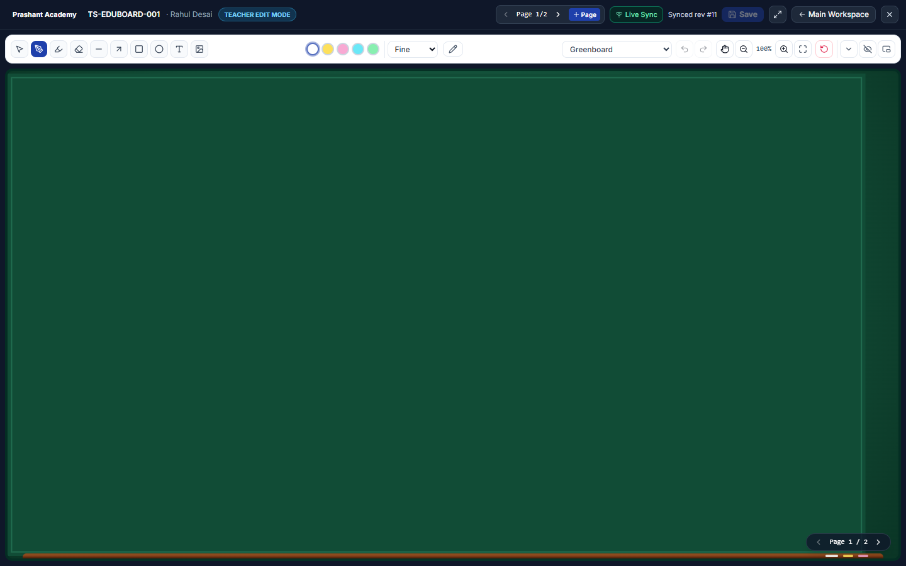

# PrathamOne EduBoard — Detached Pop-Out Window & Real-Time Multi-Tab Sync Report

## 1. Architecture Summary

The Pop-Out Board & Multi-Window Live Sync system allows teachers and authorized presenters to launch a dedicated chromeless classroom board tab (`/eduboard/window?launch=...`) with instant same-origin and server-backed real-time synchronization while strictly enforcing RBAC, tenant isolation, and environment boundaries.

---

## 2. Files Created & Extended

| Layer | File | Purpose |
|---|---|---|
| **Backend Real-Time** | `backend/app/services/eduboard_realtime.py` | Async in-memory `EduBoardRoomManager` isolating rooms by `(institution_id, is_demo, board_id)` with detached window count tracking and presence broadcasts. |
| **Backend Service** | `backend/app/services/eduboard_service.py` | Scoped HMAC/JWT Pop-Out (`eduboard_popout`, 15 min) and WebSocket (`eduboard_ws`, 4 h) token minting/verification, `presentation` read-only enforcement on `sync_board`, and `System -> Institution -> Individual` display preference resolution. |
| **Backend Router** | `backend/app/api/v1/endpoints/eduboard.py` | Added `/preferences` (`GET`/`PUT`/`DELETE`), `/boards/{id}/popout-session`, `/popout/resolve`, `/boards/{id}/ws-ticket`, `@router.websocket("/ws/boards/{id}")`, and live room broadcasts on `sync_board`, `publish_eduboard`, and `restore_revision`. |
| **Proxy / CSP** | `frontend/nginx.conf` | Extended CSP `connect-src` with `ws: wss:` for WebSocket upgrade handshakes through Nginx. |
| **Frontend Sync Hook** | `frontend/src/hooks/useEduBoardSync.ts` | Dual-channel real-time sync (`BroadcastChannel` for instant same-browser updates + authenticated `WebSocket` with heartbeat, throttled patches, and presence tracking). Sends `detached_bye` and closes socket on `beforeunload` / `pagehide`. |
| **Frontend Pop-Out Menu** | `frontend/src/components/eduboard/EduBoardPopoutMenu.tsx` | Launcher dropdown providing scoped permission selector (`Edit` / `Present` / `Collab`), branding toggle, all **6 Pop-Out Actions**, and popup-blocker inline fallback trigger. |
| **Detached Route** | `frontend/src/pages/EduBoardWindowPage.tsx` & `frontend/src/App.tsx` | Chromeless `/eduboard/window` route rendered outside `<Layout />`, resolving scoped launch tokens, supporting Native Fullscreen, page navigation, Teacher Edit autosave (`409` safe), and strict Presentation Read-Only projector view. |

---

## 3. Six Supported Pop-Out Launch Actions

1. **Pop Out Current Board**
2. **Open Greenboard in New Tab** (`surface=greenboard`, `compact_tools=true`)
3. **Open Blackboard in New Tab** (`surface=blackboard`, `compact_tools=true`)
4. **Open Whiteboard in New Tab** (`surface=white`, `compact_tools=true`)
5. **Open Presentation / Projector View** (`launch_mode=presentation`, `hide_toolbar=true`)
6. **Open Detached Teaching Board with Compact Tools** (`compact_tools=true`, `hide_toolbar=false`)

---

## 4. Security, Isolation & Lifecycle Guarantees

- **No Raw Credentials in URLs:** Launch URLs carry only short-lived `eduboard_popout` scoped JWTs (`user_id`, `institution_id`, `is_demo`, `board_id`, `mode`, `ui_config`) bound strictly to the requesting user, institution, and `PRODUCTION`/`TRAINING` environment.
- **Presentation Read-Only Enforcement:** Even if invoked by the board owner, passing a `presentation` pop-out token to `PUT /api/v1/eduboard/boards/{board_id}/sync` returns HTTP `403`, and WebSocket `scene_patch` messages return `READ_ONLY_MODE`.
- **Safe Detached Window Closure:** Closing a detached tab disconnects only its room socket/channel (`detached_bye` + `ws.close(1000)`); the backend teaching session, draft status, and board revisions in PostgreSQL remain untouched.

