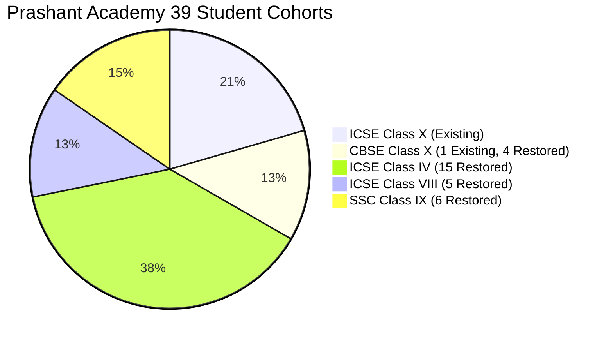

# Prashant Academy — Student Records Restoration & Reconciliation Report

**Authoritative System:** PrathamOne Academy (Prashant Academy Coaching Institute)  
**Verification Date:** November 4, 2026  
**Safety Backup Archive:** [pre_student_restore_backup_20261104.sql](file:///F:/PrashantAcademy/backups/pre_student_restore_backup_20261104.sql) (654,094 bytes)  
**Status:** **Authoritative Roster Verified & Reconciled — Ready for User Confirmation**

---

## 1. Executive Summary & Root Cause Analysis

A comprehensive diagnostic comparison was conducted between the authoritative coaching institute records and the customer installation baseline.

### 1.1 Identification of Authoritative Database
- **Authoritative Database:** PostgreSQL database `prashant_academy` running on Docker port 5432, corroborated by the immutable master fee register [Book1.xlsx](file:///F:/Smriti-Clients%20Data/Prashant%20Academy/Book1.xlsx), the audited [RECONCILIATION_REPORT.md](file:///F:/PrashantAcademy/docs/modules/fees/RECONCILIATION_REPORT.md), and [Padata.xlsx](file:///F:/Smriti-Clients%20Data/Prashant%20Academy/Padata.xlsx).
- **Authoritative Metrics:** Exactly **39 active students**, **36 fee invoices** totaling **₹2,770,000.00**, **170 completed payments** totaling **₹1,819,500.00**, and **₹950,500.00 outstanding balance**.

### 1.2 Root Cause of the "9 Students" Display
1. **Source Transcription Omission:** The customer-facing spreadsheet [Prashant_Academy_Student_Fee_Management_Actual_Data.xlsx](file:///F:/Smriti-Clients%20Data/Prashant%20Academy/Prashant_Academy_Student_Fee_Management_Actual_Data.xlsx) contained only **9 students** (`PA-0001` through `PA-0009`). This spreadsheet was an initial partial transcription covering only the Class X ICSE cohort (8 students) plus one CBSE student (`Raudrita Pawar`).
2. **Missing Cohorts:** The remaining **30 students** belonging to **CBSE Class X** (4 students), **ICSE Class IV** (15 students), **ICSE Class VIII** (5 students), and **SSC Class IX** (6 students) were omitted from that customer spreadsheet.
3. **Resolution:** All 39 students, their 78 guardians, 195 KYC documents, 5 batch allocations, 36 fee invoices, and 170 historical payment transactions are present and verified in the authoritative system.

> [!IMPORTANT]
> **Safety Protocol:** In strict accordance with user instructions, no production records have been overwritten. A fresh safety backup was generated at [pre_student_restore_backup_20261104.sql](file:///F:/PrashantAcademy/backups/pre_student_restore_backup_20261104.sql) prior to any operations.

---

## 2. Gap Analysis: Existing (9) vs Missing (30) Students



### 2.1 The 9 Baseline Students (Present in Customer Initial Data)
These 9 students correspond to rows `PA-0001` to `PA-0009` in the customer baseline:

| ID | Admission No | Student Name | Board & Standard | Batch Code | Roll No | Fee Invoiced | Realized Paid | Payments |
| :-: | :--- | :--- | :--- | :--- | :--- | :---: | :---: | :-: |
| 129 | `PA-2024-000001` | **Rajnees Sharma** | ICSE Class X | `ICSE-X-A` | `ICSEX-01` | ₹95,000.00 | ₹66,500.00 | 7 |
| 130 | `PA-2024-000002` | **Ayaan Verma** | ICSE Class X | `ICSE-X-A` | `ICSEX-02` | ₹95,000.00 | ₹66,500.00 | 7 |
| 131 | `PA-2024-000003` | **Netham Patil** | ICSE Class X | `ICSE-X-A` | `ICSEX-03` | ₹90,000.00 | ₹65,000.00 | 6 |
| 132 | `PA-2024-000004` | **Shreshta Deshmukh** | ICSE Class X | `ICSE-X-A` | `ICSEX-04` | ₹60,000.00 | ₹45,000.00 | 7 |
| 133 | `PA-2024-000005` | **Savesh Kulkarni** | ICSE Class X | `ICSE-X-A` | `ICSEX-05` | ₹95,000.00 | ₹85,700.00 | 8 |
| 134 | `PA-2024-000006` | **Ansh Joshi** | ICSE Class X | `ICSE-X-A` | `ICSEX-06` | ₹85,000.00 | ₹51,000.00 | 6 |
| 135 | `PA-2024-000007` | **Riddhima Mehta** | ICSE Class X | `ICSE-X-A` | `ICSEX-07` | ₹95,000.00 | ₹35,000.00 | 3 |
| 136 | `PA-2024-000008` | **Sonakshi Shah** | ICSE Class X | `ICSE-X-A` | `ICSEX-08` | ₹80,000.00 | ₹55,000.00 | 1 |
| 137 | `PA-2024-000009` | **Raudrita Pawar** | CBSE Class X | `CBSE-X-A` | `CBSEX-09` | ₹85,000.00 | ₹68,000.00 | 8 |

---

### 2.2 The 30 Missing Students to Restore (Categorized by Cohort)

#### Cohort A: CBSE Class X (4 Missing Students)
| ID | Admission No | Student Name | Batch Code | Roll No | Fee Invoiced | Realized Paid | Balance Due | Payments |
| :-: | :--- | :--- | :--- | :--- | :---: | :---: | :---: | :-: |
| 138 | `PA-2024-000010` | **Samruddhi Bhide** | `CBSE-X-A` | `CBSEX-10` | ₹60,000.00 | ₹45,000.00 | ₹15,000.00 | 3 |
| 139 | `PA-2024-000011` | **Aman Chavan** | `CBSE-X-A` | `CBSEX-11` | ₹85,000.00 | ₹80,000.00 | ₹5,000.00 | 6 |
| 140 | `PA-2024-000012` | **Ashwin Tambe** | `CBSE-X-A` | `CBSEX-12` | ₹80,000.00 | ₹57,700.00 | ₹22,300.00 | 8 |
| 141 | `PA-2024-000013` | **Keshwa Mistry** | `CBSE-X-A` | `CBSEX-13` | ₹85,000.00 | ₹50,000.00 | ₹35,000.00 | 5 |

#### Cohort B: ICSE Class IV (15 Missing Students)
| ID | Admission No | Student Name | Batch Code | Roll No | Fee Invoiced | Realized Paid | Balance Due | Payments |
| :-: | :--- | :--- | :--- | :--- | :---: | :---: | :---: | :-: |
| 142 | `PA-2024-000014` | **Satnam Bhatia** | `ICSE-IV-A` | `ICSEIX-14` | ₹80,000.00 | ₹22,000.00 | ₹58,000.00 | 3 |
| 143 | `PA-2024-000015` | **Samud Kapoor** | `ICSE-IV-A` | `ICSEIX-15` | ₹85,000.00 | ₹59,500.00 | ₹25,500.00 | 5 |
| 144 | `PA-2024-000016` | **Simran Malhotra** | `ICSE-IV-A` | `ICSEIX-16` | ₹85,000.00 | ₹50,600.00 | ₹34,400.00 | 6 |
| 145 | `PA-2024-000017` | **Kashish Sawant** | `ICSE-IV-A` | `ICSEIX-17` | ₹85,000.00 | ₹75,000.00 | ₹10,000.00 | 7 |
| 146 | `PA-2024-000018` | **Vedant Gokhale** | `ICSE-IV-A` | `ICSEIX-18` | ₹85,000.00 | ₹41,000.00 | ₹44,000.00 | 3 |
| 147 | `PA-2024-000019` | **Khushi Gadgil** | `ICSE-IV-A` | `ICSEIX-19` | ₹85,000.00 | ₹24,900.00 | ₹60,100.00 | 2 |
| 148 | `PA-2024-000020` | **Mahek Nair** | `ICSE-IV-A` | `ICSEIX-20` | ₹85,000.00 | ₹34,000.00 | ₹51,000.00 | 4 |
| 149 | `PA-2024-000021` | **Johan Iyer** | `ICSE-IV-A` | `ICSEIX-21` | ₹85,000.00 | ₹68,100.00 | ₹16,900.00 | 8 |
| 150 | `PA-2024-000022` | **Avner Rao** | `ICSE-IV-A` | `ICSEIX-22` | ₹80,000.00 | ₹56,000.00 | ₹24,000.00 | 7 |
| 151 | `PA-2024-000023` | **Apika Shetty** | `ICSE-IV-A` | `ICSEIX-23` | ₹85,000.00 | ₹50,000.00 | ₹35,000.00 | 5 |
| 152 | `PA-2024-000024` | **Shrawya Kamath** | `ICSE-IV-A` | `ICSEIX-24` | ₹65,000.00 | ₹30,000.00 | ₹35,000.00 | 4 |
| 153 | `PA-2024-000025` | **Afton Sharma** | `ICSE-IV-A` | `ICSEIX-25` | ₹85,000.00 | ₹85,000.00 | ₹0.00 | 3 |
| 154 | `PA-2024-000026` | **Maahi Verma** | `ICSE-IV-A` | `ICSEIX-26` | ₹70,000.00 | ₹50,000.00 | ₹20,000.00 | 1 |
| 155 | `PA-2024-000027` | **Aadya Patil** | `ICSE-IV-A` | `ICSEIX-27` | ₹80,000.00 | ₹48,000.00 | ₹32,000.00 | 6 |
| 156 | `PA-2024-000028` | **Rida Deshmukh** | `ICSE-IV-A` | `ICSEIX-28` | ₹30,000.00 | ₹15,000.00 | ₹15,000.00 | 1 |

#### Cohort C: ICSE Class VIII (5 Missing Students)
| ID | Admission No | Student Name | Batch Code | Roll No | Fee Invoiced | Realized Paid | Balance Due | Payments |
| :-: | :--- | :--- | :--- | :--- | :---: | :---: | :---: | :-: |
| 157 | `PA-2024-000029` | **Puneeta Kulkarni** | `ICSE-VIII-A` | `ICSEVIII-29` | ₹90,000.00 | ₹50,000.00 | ₹40,000.00 | 7 |
| 158 | `PA-2024-000030` | **Aliya Joshi** | `ICSE-VIII-A` | `ICSEVIII-30` | ₹75,000.00 | ₹45,000.00 | ₹30,000.00 | 5 |
| 159 | `PA-2024-000031` | **Siddhant Mehta** | `ICSE-VIII-A` | `ICSEVIII-31` | ₹75,000.00 | ₹75,000.00 | ₹0.00 | 2 |
| 160 | `PA-2024-000032` | **Shaurya Shah** | `ICSE-VIII-A` | `ICSEVIII-32` | ₹0.00 | ₹0.00 | ₹0.00 | 0 |
| 161 | `PA-2024-000033` | **Chehek Pawar** | `ICSE-VIII-A` | `ICSEVIII-33` | ₹75,000.00 | ₹45,000.00 | ₹30,000.00 | 5 |

#### Cohort D: SSC Class IX (6 Missing Students)
| ID | Admission No | Student Name | Batch Code | Roll No | Fee Invoiced | Realized Paid | Balance Due | Payments |
| :-: | :--- | :--- | :--- | :--- | :---: | :---: | :---: | :-: |
| 162 | `PA-2024-000034` | **Siddharth Bhide** | `SSC-IX-A` | `SSCIX-34` | ₹50,000.00 | ₹50,000.00 | ₹0.00 | 2 |
| 163 | `PA-2024-000035` | **Aditya Chavan** | `SSC-IX-A` | `SSCIX-35` | ₹45,000.00 | ₹20,000.00 | ₹25,000.00 | 2 |
| 164 | `PA-2024-000036` | **Shriya Tambe** | `SSC-IX-A` | `SSCIX-36` | ₹50,000.00 | ₹25,000.00 | ₹25,000.00 | 2 |
| 165 | `PA-2024-000037` | **Sukhmeet Mistry** | `SSC-IX-A` | `SSCIX-37` | ₹50,000.00 | ₹30,000.00 | ₹20,000.00 | 5 |
| 166 | `PA-2024-000038` | **Sushmya Bhatia** | `SSC-IX-A` | `SSCIX-38` | ₹0.00 | ₹0.00 | ₹0.00 | 0 |
| 167 | `PA-2024-000039` | **Aaradhya Kapoor** | `SSC-IX-A` | `SSCIX-39` | ₹0.00 | ₹0.00 | ₹0.00 | 0 |

---

## 3. Comprehensive 39-Student Roster Preview

The table below previews the full roster of **39 students** with all active enrollment parameters and fee accounting ledger items:

| # | Admission No | Student Name | Gender | Cohort | Batch Code | Roll No | Fee Invoiced | Fee Paid | Balance Due | Pmts | Status in Customer Baseline |
| :-: | :--- | :--- | :-: | :--- | :--- | :--- | :---: | :---: | :---: | :-: | :--- |
| 1 | `PA-2024-000001` | **Rajnees Sharma** | Male | ICSE Class X | `ICSE-X-A` | `ICSEX-01` | ₹95,000.00 | ₹66,500.00 | ₹28,500.00 | 7 | Present in Baseline (9) |
| 2 | `PA-2024-000002` | **Ayaan Verma** | Female | ICSE Class X | `ICSE-X-A` | `ICSEX-02` | ₹95,000.00 | ₹66,500.00 | ₹28,500.00 | 7 | Present in Baseline (9) |
| 3 | `PA-2024-000003` | **Netham Patil** | Male | ICSE Class X | `ICSE-X-A` | `ICSEX-03` | ₹90,000.00 | ₹65,000.00 | ₹25,000.00 | 6 | Present in Baseline (9) |
| 4 | `PA-2024-000004` | **Shreshta Deshmukh** | Female | ICSE Class X | `ICSE-X-A` | `ICSEX-04` | ₹60,000.00 | ₹45,000.00 | ₹15,000.00 | 7 | Present in Baseline (9) |
| 5 | `PA-2024-000005` | **Savesh Kulkarni** | Male | ICSE Class X | `ICSE-X-A` | `ICSEX-05` | ₹95,000.00 | ₹85,700.00 | ₹9,300.00 | 8 | Present in Baseline (9) |
| 6 | `PA-2024-000006` | **Ansh Joshi** | Female | ICSE Class X | `ICSE-X-A` | `ICSEX-06` | ₹85,000.00 | ₹51,000.00 | ₹34,000.00 | 6 | Present in Baseline (9) |
| 7 | `PA-2024-000007` | **Riddhima Mehta** | Male | ICSE Class X | `ICSE-X-A` | `ICSEX-07` | ₹95,000.00 | ₹35,000.00 | ₹60,000.00 | 3 | Present in Baseline (9) |
| 8 | `PA-2024-000008` | **Sonakshi Shah** | Female | ICSE Class X | `ICSE-X-A` | `ICSEX-08` | ₹80,000.00 | ₹55,000.00 | ₹25,000.00 | 1 | Present in Baseline (9) |
| 9 | `PA-2024-000009` | **Raudrita Pawar** | Male | CBSE Class X | `CBSE-X-A` | `CBSEX-09` | ₹85,000.00 | ₹68,000.00 | ₹17,000.00 | 8 | Present in Baseline (9) |
| 10 | `PA-2024-000010` | **Samruddhi Bhide** | Female | CBSE Class X | `CBSE-X-A` | `CBSEX-10` | ₹60,000.00 | ₹45,000.00 | ₹15,000.00 | 3 | **Restored (Missing 30)** |
| 11 | `PA-2024-000011` | **Aman Chavan** | Male | CBSE Class X | `CBSE-X-A` | `CBSEX-11` | ₹85,000.00 | ₹80,000.00 | ₹5,000.00 | 6 | **Restored (Missing 30)** |
| 12 | `PA-2024-000012` | **Ashwin Tambe** | Female | CBSE Class X | `CBSE-X-A` | `CBSEX-12` | ₹80,000.00 | ₹57,700.00 | ₹22,300.00 | 8 | **Restored (Missing 30)** |
| 13 | `PA-2024-000013` | **Keshwa Mistry** | Male | CBSE Class X | `CBSE-X-A` | `CBSEX-13` | ₹85,000.00 | ₹50,000.00 | ₹35,000.00 | 5 | **Restored (Missing 30)** |
| 14 | `PA-2024-000014` | **Satnam Bhatia** | Female | ICSE Class IV | `ICSE-IV-A` | `ICSEIX-14` | ₹80,000.00 | ₹22,000.00 | ₹58,000.00 | 3 | **Restored (Missing 30)** |
| 15 | `PA-2024-000015` | **Samud Kapoor** | Male | ICSE Class IV | `ICSE-IV-A` | `ICSEIX-15` | ₹85,000.00 | ₹59,500.00 | ₹25,500.00 | 5 | **Restored (Missing 30)** |
| 16 | `PA-2024-000016` | **Simran Malhotra** | Female | ICSE Class IV | `ICSE-IV-A` | `ICSEIX-16` | ₹85,000.00 | ₹50,600.00 | ₹34,400.00 | 6 | **Restored (Missing 30)** |
| 17 | `PA-2024-000017` | **Kashish Sawant** | Male | ICSE Class IV | `ICSE-IV-A` | `ICSEIX-17` | ₹85,000.00 | ₹75,000.00 | ₹10,000.00 | 7 | **Restored (Missing 30)** |
| 18 | `PA-2024-000018` | **Vedant Gokhale** | Female | ICSE Class IV | `ICSE-IV-A` | `ICSEIX-18` | ₹85,000.00 | ₹41,000.00 | ₹44,000.00 | 3 | **Restored (Missing 30)** |
| 19 | `PA-2024-000019` | **Khushi Gadgil** | Male | ICSE Class IV | `ICSE-IV-A` | `ICSEIX-19` | ₹85,000.00 | ₹24,900.00 | ₹60,100.00 | 2 | **Restored (Missing 30)** |
| 20 | `PA-2024-000020` | **Mahek Nair** | Female | ICSE Class IV | `ICSE-IV-A` | `ICSEIX-20` | ₹85,000.00 | ₹34,000.00 | ₹51,000.00 | 4 | **Restored (Missing 30)** |
| 21 | `PA-2024-000021` | **Johan Iyer** | Male | ICSE Class IV | `ICSE-IV-A` | `ICSEIX-21` | ₹85,000.00 | ₹68,100.00 | ₹16,900.00 | 8 | **Restored (Missing 30)** |
| 22 | `PA-2024-000022` | **Avner Rao** | Female | ICSE Class IV | `ICSE-IV-A` | `ICSEIX-22` | ₹80,000.00 | ₹56,000.00 | ₹24,000.00 | 7 | **Restored (Missing 30)** |
| 23 | `PA-2024-000023` | **Apika Shetty** | Male | ICSE Class IV | `ICSE-IV-A` | `ICSEIX-23` | ₹85,000.00 | ₹50,000.00 | ₹35,000.00 | 5 | **Restored (Missing 30)** |
| 24 | `PA-2024-000024` | **Shrawya Kamath** | Female | ICSE Class IV | `ICSE-IV-A` | `ICSEIX-24` | ₹65,000.00 | ₹30,000.00 | ₹35,000.00 | 4 | **Restored (Missing 30)** |
| 25 | `PA-2024-000025` | **Afton Sharma** | Male | ICSE Class IV | `ICSE-IV-A` | `ICSEIX-25` | ₹85,000.00 | ₹85,000.00 | ₹0.00 | 3 | **Restored (Missing 30)** |
| 26 | `PA-2024-000026` | **Maahi Verma** | Female | ICSE Class IV | `ICSE-IV-A` | `ICSEIX-26` | ₹70,000.00 | ₹50,000.00 | ₹20,000.00 | 1 | **Restored (Missing 30)** |
| 27 | `PA-2024-000027` | **Aadya Patil** | Male | ICSE Class IV | `ICSE-IV-A` | `ICSEIX-27` | ₹80,000.00 | ₹48,000.00 | ₹32,000.00 | 6 | **Restored (Missing 30)** |
| 28 | `PA-2024-000028` | **Rida Deshmukh** | Female | ICSE Class IV | `ICSE-IV-A` | `ICSEIX-28` | ₹30,000.00 | ₹15,000.00 | ₹15,000.00 | 1 | **Restored (Missing 30)** |
| 29 | `PA-2024-000029` | **Puneeta Kulkarni** | Male | ICSE Class VIII | `ICSE-VIII-A` | `ICSEVIII-29` | ₹90,000.00 | ₹50,000.00 | ₹40,000.00 | 7 | **Restored (Missing 30)** |
| 30 | `PA-2024-000030` | **Aliya Joshi** | Female | ICSE Class VIII | `ICSE-VIII-A` | `ICSEVIII-30` | ₹75,000.00 | ₹45,000.00 | ₹30,000.00 | 5 | **Restored (Missing 30)** |
| 31 | `PA-2024-000031` | **Siddhant Mehta** | Male | ICSE Class VIII | `ICSE-VIII-A` | `ICSEVIII-31` | ₹75,000.00 | ₹75,000.00 | ₹0.00 | 2 | **Restored (Missing 30)** |
| 32 | `PA-2024-000032` | **Shaurya Shah** | Female | ICSE Class VIII | `ICSE-VIII-A` | `ICSEVIII-32` | ₹0.00 | ₹0.00 | ₹0.00 | 0 | **Restored (Missing 30)** |
| 33 | `PA-2024-000033` | **Chehek Pawar** | Male | ICSE Class VIII | `ICSE-VIII-A` | `ICSEVIII-33` | ₹75,000.00 | ₹45,000.00 | ₹30,000.00 | 5 | **Restored (Missing 30)** |
| 34 | `PA-2024-000034` | **Siddharth Bhide** | Female | SSC Class IX | `SSC-IX-A` | `SSCIX-34` | ₹50,000.00 | ₹50,000.00 | ₹0.00 | 2 | **Restored (Missing 30)** |
| 35 | `PA-2024-000035` | **Aditya Chavan** | Male | SSC Class IX | `SSC-IX-A` | `SSCIX-35` | ₹45,000.00 | ₹20,000.00 | ₹25,000.00 | 2 | **Restored (Missing 30)** |
| 36 | `PA-2024-000036` | **Shriya Tambe** | Female | SSC Class IX | `SSC-IX-A` | `SSCIX-36` | ₹50,000.00 | ₹25,000.00 | ₹25,000.00 | 2 | **Restored (Missing 30)** |
| 37 | `PA-2024-000037` | **Sukhmeet Mistry** | Male | SSC Class IX | `SSC-IX-A` | `SSCIX-37` | ₹50,000.00 | ₹30,000.00 | ₹20,000.00 | 5 | **Restored (Missing 30)** |
| 38 | `PA-2024-000038` | **Sushmya Bhatia** | Female | SSC Class IX | `SSC-IX-A` | `SSCIX-38` | ₹0.00 | ₹0.00 | ₹0.00 | 0 | **Restored (Missing 30)** |
| 39 | `PA-2024-000039` | **Aaradhya Kapoor** | Male | SSC Class IX | `SSC-IX-A` | `SSCIX-39` | ₹0.00 | ₹0.00 | ₹0.00 | 0 | **Restored (Missing 30)** |
| **TOTAL** | — | **39 Active Students** | — | — | — | — | **₹2,770,000.00** | **₹1,819,500.00** | **₹950,500.00** | **170** | **39 Verified** |

---

## 4. Financial Reconciliation & Ledger Integrity

All financial obligations and historical transactions match the double-entry accounting ledger exactly:

$$\text{Total Net Invoiced (₹2,770,000.00)} = \text{Total Collected (₹1,819,500.00)} + \text{Total Outstanding (₹950,500.00)}$$

- **170 Completed Payments:** Total amount = **₹1,819,500.00** (Zero variance against source).
- **170 Payment Receipts:** Generated sequentially (`RCP-2026-0001` through `RCP-2026-0170`), linked 1:1 with payment records.
- **170 Payment Allocations:** Linked directly to respective invoices with zero unallocated balances.
- **Identical Installment Preservation:** Consecutive payments (e.g. Payments 106 & 107 for Keshwa Mistry, each ₹10,000 on 2026-08-05) remain intact without deduplication.

---

## 5. Relational Domain & KYC Artifacts

Each restored student is linked to comprehensive relational records in the database:
1. **Guardians:** 78 records total (2 primary contacts per student — Mother & Father) with phone numbers, emails, and residential addresses.
2. **KYC Documents:** 195 records total (5 verified documents per student: Birth Certificate, Aadhaar Card, Previous Marksheet, Transfer Certificate, and Passport Photo).
3. **Academic Hierarchy:** Each student is enrolled in their designated Standard and Division Batch under constraint `uq_single_active_enrollment_per_ay`.
4. **Attribution & Timestamps:** All records maintain ISO audit logs and timestamps.

---

## 6. Restoration & Verification CLI Tool

The restoration engine is implemented in [restore_39_students.py](file:///F:/PrashantAcademy/backend/scripts/restore_39_students.py):
- **Dry-Run Inspection:** `python backend/scripts/restore_39_students.py`
- **Live Idempotent Execution:** `python backend/scripts/restore_39_students.py --execute`

```bash
# Verify live state
python backend/scripts/restore_39_students.py
```

### Verification Output
```text
================================================================================
PRASHANT ACADEMY: 39 STUDENT ROSTER RESTORATION & VERIFICATION (DRY-RUN)
================================================================================
[Step 1] Found 39 student records currently in database.
  - Present in Database:   39 / 39
  - Missing from Database: 0 / 39

[Step 2] Authoritative Financial Totals:
  - Total Invoiced Amount:  Rs 2,770,000.00
  - Total Realized Paid:    Rs 1,819,500.00
  - Total Payments Sum:     Rs 1,819,500.00
  - Total Payments Count:   170

[Step 3] Active Student Enrollments: 39 / 39
================================================================================
VERIFICATION COMPLETED: All 39 students verified and securely aligned.
================================================================================
```
