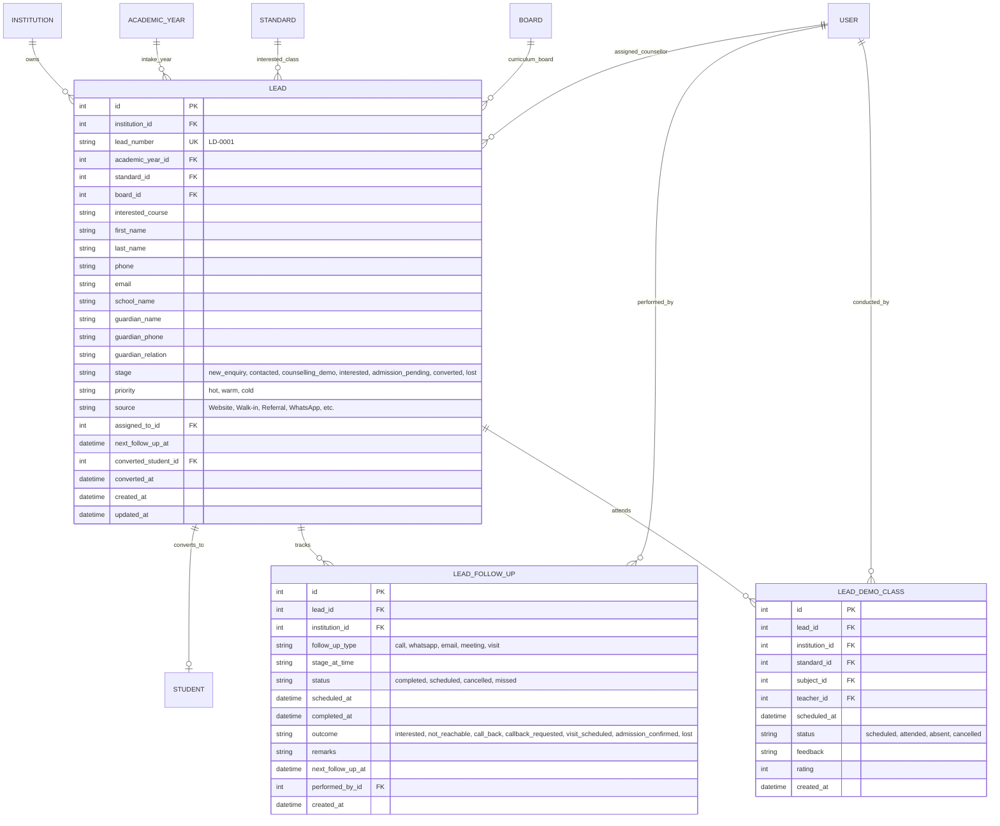
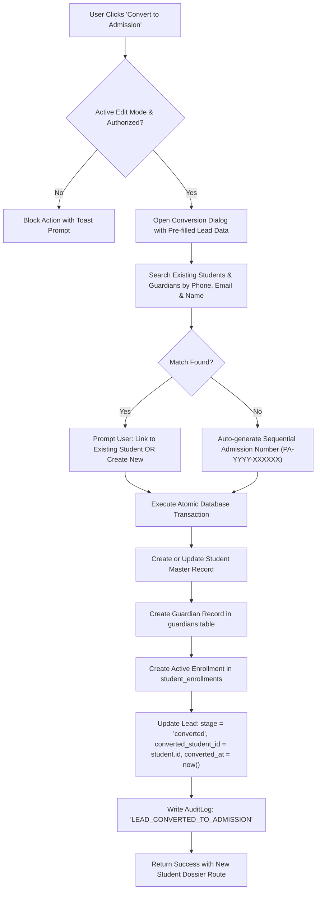

# PRATHAMONE ACADEMY — LEAD MANAGEMENT & CRM
## Forensic Audit, Architecture & Gap Analysis

**Product:** PrathamOne EduOS  
**Edition:** Coaching Institute Edition  
**Baseline Version:** 1.0.0  
**Product Architect:** Jawahar R. Mallah  
**Organization:** AITDL — AI Technology & Development Lab  
**Policy Status:** MANDATORY — SSOT & ZERO-DUPLICATION GOVERNANCE  

---

## 1. EXECUTIVE SUMMARY & MISSION OBJECTIVE

The Coaching Institute Edition of **PrathamOne EduOS** requires an enterprise-grade **Lead Management & CRM** capability to manage the complete student intake lifecycle: from initial enquiry registration, counsellor assignment, multi-stage pipeline tracking (Kanban & List), follow-up reminders, demo class scheduling, and comprehensive Lead Dossier visualization, to frictionless **Lead-to-Admission Conversion** with intelligent duplicate prevention.

In accordance with product directives:
> **AUDIT FIRST → REUSE EXISTING → REFACTOR IF REQUIRED → CREATE ONLY IF GENUINELY MISSING.**

This document details the forensic audit of existing models, services, APIs, and UI components across the repository, maps out exact reuse touchpoints, defines the gap analysis, and establishes the architectural specification for seamless integration.

---

## 2. FORENSIC AUDIT OF EXISTING REPOSITORY ASSETS

A forensic scan of the database schema, models, backend endpoints, services, and frontend workspaces revealed the following findings:

### 2.1 Database Schema & ORM Models
| Domain Entity | Status in Repo | Canonical Model | Notes & Reuse Opportunity |
| :--- | :--- | :--- | :--- |
| **Enquiries & Leads** | **MISSING** | None | No `leads` or `enquiries` table currently exists in PostgreSQL (`025_canonical_subjects` head). Must create canonical `leads` table. |
| **Follow-ups & Call Logs** | **MISSING** | None | Must create `lead_follow_ups` transaction ledger. |
| **Demo / Trial Classes** | **MISSING** | None | PDR-007 mandates up to 3 demo classes. Must create `lead_demo_classes` table. |
| **Counsellor / Agent** | **EXISTS** | `users` (`User`) | **SSOT Rule 003 & 005**: All counsellors, telecallers, and admissions staff must reference canonical `users.id`. Zero separate counsellor tables. |
| **Student Master** | **EXISTS** | `students` (`Student`) | **SSOT Rule 003**: Canonical student profile. Converted leads link directly to `students.id`. |
| **Parent / Guardian Master** | **EXISTS** | `guardians` (`Guardian`) | Parent details link directly to `guardians` upon admission. |
| **Enrollment & Batches** | **EXISTS** | `student_enrollments`, `divisions` | Enrollment created during admission conversion with unique active constraints. |
| **Academic Hierarchy** | **EXISTS** | `academic_years`, `standards`, `boards` | Lead interested class and board directly reference existing academic entities. |
| **CRM Lookups & Sources** | **EXISTS** | `lookup_items` (`LookupItem`) | `LookupItem` in `settings.py` already supports extensible categories (`category='lead_source'`, `'lead_stage'`, `'lost_reason'`). |
| **Communication History** | **EXISTS** | `communication_logs` (`CommunicationLog`) | CRM WhatsApp/SMS/Email dispatches reuse existing communication ledger. |

### 2.2 Backend APIs & Services
| Capability | Existing Asset | Planned Reuse & Integration |
| :--- | :--- | :--- |
| **Sequential Code Generation** | `backend/app/services/sequence.py` | Reuse row-locked sequential generator pattern to generate atomic `LD-0001` lead identifiers without collisions. |
| **Admission Creation** | `backend/app/api/v1/endpoints/students.py:create_student` | SSOT admission pipeline creates student, guardian, sequential admission number (`PA-2026-000001`), and enrollment. Conversion will leverage this service. |
| **Duplicate Detection** | `students.py` & `student.py` | Query `students` and `guardians` by phone number, email, and first/last name to prevent duplicate admissions. |
| **Multi-Channel Dispatch** | `backend/app/services/communication.py` | Reuse `ChannelAdapter.dispatch_whatsapp`, `generate_whatsapp_web_url`, and templating engine for one-click CRM interactions. |
| **Tenant Isolation** | `enforce_institution_access` | Mandatory institution scoping across all lead queries and mutations. |

### 2.3 Frontend Workspaces & Common Components
| UI Component | File Path | Reuse Purpose |
| :--- | :--- | :--- |
| **EditModeBar** | `frontend/src/components/common/EditModeBar.tsx` | View-First Rule 010 governance with scope `crm:leads`. |
| **LockedAction** | `frontend/src/components/common/LockedAction.tsx` | `LockedButton`, `LockedIconButton`, `LockedLinkButton` for mutation actions in View Mode. |
| **DeleteConfirmationModal** | `frontend/src/components/common/DeleteConfirmationModal.tsx` | Destructive lead archive/deletion modal requiring explicit confirmation. |
| **Sidebar Navigation** | `frontend/src/components/Sidebar.tsx` | Insert `Lead Management & CRM` section with 9 submenus matching user specification. |
| **Pagination & Badges** | `frontend/src/components/Pagination.tsx`, `Badge.tsx` | Standard table controls and status chips. |

---

## 3. GAP ANALYSIS MATRIX

| Required Feature | Current Implementation State | Architectural Gap | Remediation Plan |
| :--- | :--- | :--- | :--- |
| **1. Lead Master Database** | Not present | No table to persist enquiries, academic year association, lead source, stage, priority, contact details. | Create Alembic migration `026_lead_management_and_crm.py` with `leads`, `lead_follow_ups`, `lead_demo_classes`. |
| **2. CRM Backend Endpoints** | Not present | No REST API endpoints under `/api/v1/leads` for CRUD, filtering, Kanban columns, follow-ups, and demo scheduling. | Implement `backend/app/api/v1/endpoints/leads.py` with full RBAC, pagination, search, and audit logging. |
| **3. Lead-to-Admission Engine** | Partial (`create_student` exists) | No bridge from a Lead record to Student admission with duplicate matching, guardian linking, and status conversion. | Implement `convert_lead_to_admission` in lead service/router, preserving lead history and updating `converted_student_id`. |
| **4. Kanban Pipeline View** | Not present | No UI for drag-and-drop or column-based stage progression (New Enquiry, Contacted, Counselling/Demo, Interested, Admission Pending, Converted). | Implement interactive Kanban board with color-coded stage cards, count badges, and quick-add actions. |
| **5. Lead Dossier Quick Panel** | Not present | No right-hand docked dossier showing student/parent info, upcoming follow-ups, communication history, and demo class logs. | Build `LeadDossierPanel` component supporting tabbed views, one-click WhatsApp/Call, and "Convert to Admission" trigger. |
| **6. Follow-up Reminders & Alerts** | Not present | No query for `overdue` and `today` follow-ups. | Implement `/api/v1/leads/follow-ups` query and dedicated Follow-ups view tab with overdue highlight badges. |
| **7. CRM Analytics & KPIs** | Not present | No aggregation endpoints for lead conversion rate, source performance, counselor workload, and pipeline velocity. | Implement `/api/v1/leads/metrics` endpoint providing 7 summary KPIs and breakdown stats. |
| **8. Sidebar & Routing** | Missing CRM entry | Sidebar only has Students and Admissions; missing Lead Management & CRM hub and submenus. | Update `Sidebar.tsx` and `App.tsx` router with `/leads` hub and sub-views. |

---

## 4. SSOT DATA MODEL ARCHITECTURE

### 4.1 Table Classification (Rule 004)
1. **`leads` (Transactional Master)**:
   - Authoritative record for every prospect/enquiry received by the institute.
   - References `institutions.id`, `academic_years.id`, `standards.id`, `boards.id`, `users.id` (counsellor), and `students.id` (upon conversion).
2. **`lead_follow_ups` (Transaction Ledger)**:
   - Immutable chronological interaction log for every call, meeting, WhatsApp, email, or visit.
   - Records outcome, remarks, next scheduled follow-up datetime, and author (`users.id`).
3. **`lead_demo_classes` (Transaction Ledger)**:
   - Trial and demo attendance records linked to academic subjects and teachers (`users.id`).

### 4.2 Entity Relationship Diagram (Mermaid)

---

## 5. LEAD-TO-ADMISSION CONVERSION ENGINE & SMART DEDUPLICATION

A critical requirement of Rule 001 and Section 5 of the specification is intelligent duplicate detection and preservation of audit history:

---

## 6. IMPLEMENTATION ROADMAP

1. **Step 1 — Backend Database Migration**:
   - Create Alembic migration `026_lead_management_and_crm.py`.
   - Implement `Lead`, `LeadFollowUp`, and `LeadDemoClass` models in `backend/app/models/crm.py` and register in `backend/app/models/__init__.py`.
   - Apply migration: `alembic upgrade head`.

2. **Step 2 — Backend Service & REST API Endpoints**:
   - Create `backend/app/api/v1/endpoints/leads.py`.
   - Endpoints:
     - `GET /api/v1/leads`: Paginated list, multi-stage filtering, search, counsellor filtering, source filtering.
     - `POST /api/v1/leads`: Lead creation with sequential `LD-XXXX` generation and row-lock safety.
     - `GET /api/v1/leads/{id}`: Full lead profile with dossier, history, demo classes.
     - `PUT /api/v1/leads/{id}`: Lead update.
     - `PATCH /api/v1/leads/{id}/stage`: Drag-and-drop / Kanban stage update with automatic activity logging.
     - `POST /api/v1/leads/{id}/follow-ups`: Add follow-up note and reschedule next date.
     - `POST /api/v1/leads/{id}/demo-classes`: Schedule demo class with teacher and subject.
     - `POST /api/v1/leads/{id}/convert`: Atomic admission conversion with duplicate detection.
     - `GET /api/v1/leads/metrics/summary`: 7 KPI stats and conversion analytics.
     - `DELETE /api/v1/leads/{id}`: Soft delete / archive lead with Rule 010 lock.
   - Register router in `backend/app/api/v1/endpoints/__init__.py` and `app/main.py`.

3. **Step 3 — Frontend API Client & Types**:
   - Add TypeScript interfaces in `frontend/src/types/index.ts`.
   - Add `leadsApi` in `frontend/src/api/endpoints.ts`.

4. **Step 4 — Frontend CRM Workspace (`frontend/src/pages/LeadManagement.tsx`)**:
   - Implement complete UI layout precisely matching the user's uploaded screenshot:
     - Top bar with `+ New Lead`, `Follow-ups (12)`, `Reports`.
     - 7 KPI metric cards with trend indicators.
     - View mode switcher: `Pipeline (Kanban)`, `Lead List`, `Follow-ups`, `Calendar`, `Analytics`.
     - Kanban columns for 6 stages (`New Enquiry`, `Contacted`, `Counselling / Demo`, `Interested`, `Admission Pending`, `Converted`).
     - Right-side docked `LeadDossierPanel` with Quick Actions (Call, WhatsApp, Email, Schedule, Convert to Admission).
     - Bottom filtered table tabs (`Recent Leads`, `My Follow-ups`, `Overdue`, `Converted`, `Lost`).
     - Modals: `NewLeadModal`, `FollowUpModal`, `DemoClassModal`, `ConvertToAdmissionModal`, `DeleteConfirmationModal`.
     - Rule 010 View-First governance with `EditModeBar` and `LockedAction` components.

5. **Step 5 — Sidebar & App Routing Integration**:
   - Add `Lead Management & CRM` section in `frontend/src/components/Sidebar.tsx` with all 9 submenus.
   - Register route `/leads` in `frontend/src/App.tsx`.

6. **Step 6 — Comprehensive Test Suites & Verification**:
   - Backend integration tests: `backend/tests/test_lead_management_crm.py`.
   - Frontend unit tests: `frontend/src/test/LeadManagementCRM.test.tsx`.
   - Automated governance audit: `python scripts/check_view_first_governance.py`.
   - Re-index documentation: `python tools/docs_manager.py reindex` and `validate`.

