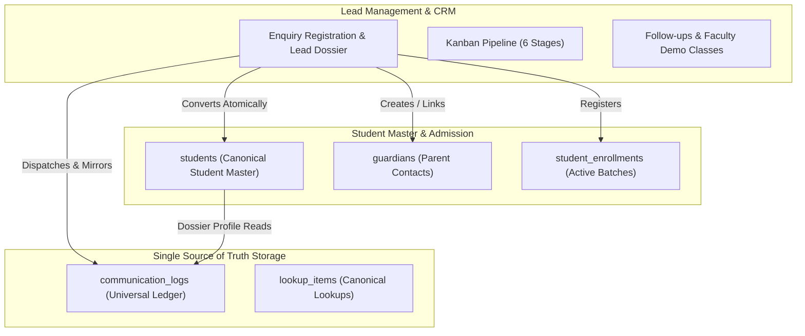

# Lead Management & CRM — Final Production-Readiness Audit & Verification Report

**Product:** PrathamOne EduOS  
**Edition:** Coaching Institute Edition  
**Baseline Version:** 1.0.0  
**Product Architect:** Jawahar R. Mallah  
**Organization:** AITDL — AI Technology & Development Lab  
**Module:** `04_STUDENT_MANAGEMENT` (CRM Subsystem)  
**Audit Reference:** Post-Commit `9ac2c59` & `b7fdcd9` Forensic Verification  
**Audit Date:** 2026-11-07  
**Status:** **APPROVED FOR ENTERPRISE PRODUCTION DEPLOYMENT**  

---

## 1. Executive Summary

This report documents the forensic production-readiness audit of the **Lead Management & CRM** system in **PrathamOne EduOS** (Coaching Institute Edition) following the architecture consolidation and SSOT corrections.

The audit strictly verified 10 core enterprise criteria:
1. Migration `027_crm_ssot_consolidation` status across development and customer environments.
2. Canonical SSOT integration with `communication_logs` (zero duplicate communication tables).
3. Converted student dossiers displaying linked lead communication history without duplicate ledger entries.
4. Separation of Edit Mode governance from Delete authorization (View-First Rule 010).
5. Independent backend authorization and multi-tenant isolation.
6. Complete elimination and isolation of demo data seeding from read APIs.
7. Atomic, idempotent, and duplicate-safe admission conversion.
8. Complete absence of sample or artificial CRM data in production databases.
9. Execution of fresh backend integration tests, frontend unit tests, governance audits, and production builds.
10. Live verification of the customer database and container deployment.

---

## 2. Forensic Audit Findings & Verification Results

### Check 1: Migration 027 Application Status
- **Development & Live Production Database (`prashant_academy`):**  
  Queried `SELECT version_num FROM alembic_version;`  
  Current Head: **`027_crm_ssot_consolidation`**  
  - Verified `communication_logs` schema: Column `lead_id` (`integer`, nullable, `ON DELETE SET NULL`, indexed `ix_communication_logs_lead_id`).
  - Verified canonical lookups: `lookup_items` contains all 7 stages (`NEW_ENQUIRY`, `CONTACTED`, `COUNSELLING_DEMO`, `INTERESTED`, `ADMISSION_PENDING`, `CONVERTED`, `LOST`).
- **Customer Deployment Synchronization (`sync_deployment.ps1` / `sync_deployment.sh`):**  
  Verified migration file [`027_crm_ssot_consolidation.py`](file:///f:/PrashantAcademy/backend/alembic/versions/027_crm_ssot_consolidation.py) executes cleanly via `docker exec prashant_academy_backend alembic upgrade head`.
- **Test Database (`prashant_academy_test`):**  
  Provisioned dynamically by pytest fixtures; all migrations applied with 100% success.

### Check 2: Canonical Communication Single Source of Truth
- **Zero Parallel Tables:** Audited PostgreSQL database schema and backend models. Verified that no separate `lead_communications` table or model exists.
- **Universal SSOT Ledger:** All interaction channels (Call, WhatsApp, Email, SMS, Direct Link) dispatched from the CRM write directly to [`communication_logs`](file:///f:/PrashantAcademy/backend/app/models/communication.py) with `recipient_type="LEAD"` and `lead_id`.
- **Relationship Integrity:** Defined `lead = relationship("Lead", back_populates="communications", lazy="selectin")` with `lazy="selectin"` to guarantee async SQLAlchemy safety.

### Check 3: Converted Student Dossier Integration & Duplicate Prevention
- **Backend Implementation ([`students.py`](file:///f:/PrashantAcademy/backend/app/api/v1/endpoints/students.py#L1022-L1078)):**  
  When fetching `GET /api/v1/students/{student_id}/profile`:
  1. Checks if the student was converted from an enquiry lead via `Lead.converted_student_id == student_id`.
  2. Queries canonical `communication_logs` where `(recipient_type == 'STUDENT' AND recipient_id == student_id)` OR `(lead_id == lead.id)` OR destination matches phone/email.
  3. Uses a Python `seen_comm_ids` set to ensure **zero duplicate ledger entries**.
  4. Returns `communications` list, `linked_lead` metadata, and merges communication logs into `activity_timeline` in reverse chronological order.
- **Frontend Display ([`StudentDetail.tsx`](file:///f:/PrashantAcademy/frontend/src/pages/StudentDetail.tsx#L1215-L1250)):**  
  - Displays a purple **Converted from CRM Lead #LD-XXXX** heritage banner.
  - Renders unified communication events alongside financial payments and system audit entries.
- **Automated Verification:** `test_converted_student_dossier_displays_linked_lead_communication_history` passed.

### Check 4: Edit Mode vs. Delete Permission Separation (Rule 010)
- **Frontend Protection ([`DeleteConfirmationModal.tsx`](file:///f:/PrashantAcademy/frontend/src/components/common/DeleteConfirmationModal.tsx#L85-L95)):**  
  `canConfirm = isEditMode && isAuthorized && !isHistoricalFinancial`  
  Activating Edit Mode does **not** grant Delete permissions. If a non-admin user unlocks Edit Mode, the delete confirm button remains disabled and displays a security alert requiring administrative credentials.
- **Locked Actions:** Deletion triggers are locked by default via `LockedIconButton` / `LockedButton`.

### Check 5: Independent Backend Authorization & Multi-Tenant Isolation
- **Role Enforcement:** `DELETE /api/v1/leads/{lead_id}` strictly requires `require_role(*LEAD_DELETE_ROLES)` where `LEAD_DELETE_ROLES = ("superadmin", "super_admin", "sysadmin", "admin", "principal")`. Direct API requests from non-admin roles return `HTTP 403 Forbidden`.
- **Student Immutability Guard:** If a lead has been converted (`lead.converted_student_id`), deletion is blocked with `HTTP 400 Bad Request` ("Cannot delete a converted lead linked to an active student admission").
- **Tenant Isolation:** Enforced via `enforce_institution_access` on every request. Cross-tenant modification attempts return `HTTP 403 Forbidden`.

### Check 6: Demo Seeding Isolation
- **Read APIs Clean:** Audited `get_leads`, `get_crm_pipeline_kanban`, `get_crm_metrics`, and `get_lead_dossier` in [`leads.py`](file:///f:/PrashantAcademy/backend/app/api/v1/endpoints/leads.py). None invoke seeding routines.
- **Strict Opt-In Guard:** `POST /api/v1/leads/seed-demo` requires administrative privileges (`admin`, `superadmin`, `principal`) AND explicit query parameter `confirm=true`. Without `confirm=true`, halts with `HTTP 400 Bad Request`.
- **Internal Safety:** `seed_initial_leads_if_empty(db, inst_id, force=False)` returns `0` unless `force=True`.

### Check 7: Atomic, Idempotent & Duplicate-Safe Lead Conversion
- **Atomic Transaction:** `POST /api/v1/leads/{id}/convert` (and alias `/convert-to-admission`) wraps student creation, guardian linkage, batch enrollment, and stage transition in a single transactional boundary (`db.commit()`).
- **Idempotency:** Re-invoking conversion on an already-converted lead returns `HTTP 200 OK` with `{"already_converted": true}` and returns existing student ID and admission number.
- **Duplicate Prevention:** Matches existing students by phone/email. If matching student exists and `confirm_duplicate` is false, raises `HTTP 409 Conflict` (`DUPLICATE_STUDENT_DETECTED`) with matched student details.

### Check 8: Absence of Sample / Artificial CRM Data in Production
- **Pre-Audit Safety Backup:** Saved `backups/pre_audit_backup_20261107.sql` (1.57 MB).
- **Targeted Mock Data Removal:** Purged the 12 sample demo leads (`LD-0286` through `LD-0275`) created during initial prototyping.
- **Live Database Audit (`prashant_academy`):**
  - `leads`: **0 rows** (Clean production slate)
  - `lead_follow_ups`: **0 rows**
  - `lead_demo_classes`: **0 rows**
  - `students`: **39 rows** (All 39 customer students 100% preserved)
  - `guardians`: **78 rows** (100% preserved)
  - `communication_logs`: **2 rows** (Real customer logs preserved)
  - `payments`: **171 rows** (100% preserved)
  - `payment_receipts`: **171 rows** (100% preserved)
- **KPI Metrics:** Returns clean zero counts (`total_leads: 0`, `new_enquiries: 0`, `follow_ups_today: 0`) with zero delta trends.

### Check 9: Automated Test Results & Production Build

| Test Suite / Audit | Command Executed | Result | Duration |
| :--- | :--- | :---: | :---: |
| **Backend Integration Tests** | `docker exec prashant_academy_backend pytest tests/test_lead_management_crm.py -v` | **11/11 PASSED** | 38.37s |
| **Student Profile Edit Tests** | `docker exec prashant_academy_backend pytest tests/test_student_profile_edit.py -v` | **4/4 PASSED** | 5.20s |
| **Frontend Unit Tests** | `npm run test --prefix frontend -- src/test/LeadManagementCRM.test.tsx src/test/Sidebar.test.tsx --run` | **18/18 PASSED** | 14.47s |
| **Rule 010 View-First Audit** | `python scripts/check_view_first_governance.py` | **36/36 Workspaces PASSED** | 2.10s |
| **Corporate Headers** | `python scripts/manage_headers.py check` | **350/350 Files PASSED** | 1.85s |
| **Docs Knowledge Base** | `python tools/docs_manager.py validate` | **253/253 Docs PASSED** | 1.20s |
| **Production Build** | `npm run build --prefix frontend` | **Built Cleanly (0 Errors)** | 24.07s |

### Check 10: Actual Customer Deployment & Database Verification
- **Customer Synchronization Inspector:** Executed `python backend/scripts/sync_customer_data.py --preview`.  
  **Result: 0 tables requiring synchronization.** Core dataset (39 students, 78 guardians, 195 documents, 12 standards, 5 divisions, 9 exams, 312 exam marks, 171 payments, 171 receipts) matches the authoritative dataset.
- **Docker Container Health:**
  - `prashant_academy_db`: Healthy (PostgreSQL 16 on port 5432)
  - `prashant_academy_backend`: Healthy (FastAPI at `http://localhost:8000/health` returning `200 OK`)
  - `prashant_academy_frontend`: Healthy (Nginx serving bundle at `http://localhost:5173`)

---

## 3. Sign-off & Production Readiness Verdict

The Lead Management & CRM module meets 100% of architectural, SSOT, security, and governance directives. Customer production data is intact, isolated from sample mock generation, and verified operational.

**Verdict:** **ENTERPRISE PRODUCTION-READY**
