# PRATHAMONE EDUOS — STUDENT STATUS & FINANCIAL CLASSIFICATION SPECIFICATION

**Product:** PrathamOne EduOS  
**Edition:** Coaching Institute Edition  
**Baseline Version:** 1.0.0  
**Architect:** Jawahar R Mallah  
**Organization:** AITDL — AI Technology & Development Lab  
**Policy Status:** MANDATORY ARCHITECTURAL SPECIFICATION  

---

## 1. PURPOSE & ARCHITECTURAL PRINCIPLES

This specification defines the canonical classification of student states across PrathamOne EduOS and establishes their exact financial, reporting, and ledger implications.

### Non-Negotiable Principle: Person Identity vs Academic Enrollment
1. **Person Identity (`students`)**: Captures the person's lifelong identity within the educational institution (`id`, `admission_number`, `is_active`, `exit_date`, `exit_reason`).
2. **Academic Enrollment (`student_enrollments`)**: Captures the temporal, standard, and batch-scoped academic relationship (`academic_year_id`, `standard_id`, `division_id`, `status`).
3. **Financial Contracts (`fee_invoices`)**: Fee obligations attach to the student identity (`student_id`) and the contractual academic year (`academic_year_id`). They do not dissolve upon enrollment state changes.

---

## 2. SIX CANONICAL STUDENT CLASSIFICATIONS

The system enforces six mutually exclusive, unambiguously defined student classifications:

```mermaid
stateDiagram-v2
    [*] --> Active: Admission Enrolled
    Active --> Transferred: Batch / Division Reallocation
    Transferred --> Active: Regular Class Attendance
    Active --> TemporarilyInactive: Long Medical / Travel Leave
    TemporarilyInactive --> Active: Reactivated
    Active --> DiscontinuedFormer: Student Withdrawal / Dropout
    Active --> AdmissionCancelled: Rescinded Prior to Session Start
    DiscontinuedFormer --> Archived: Data Retention Policy Reached
    AdmissionCancelled --> Archived: Post Clearance
```

### Classification A: Active Student
- **Definition:** A student currently enrolled, attending classes, and engaged in active academic coursework.
- **Database Signature:**
  - `students.is_active = TRUE`
  - Current `student_enrollments.status = 'active'`
  - `students.exit_date IS NULL`
- **Financial Treatment:**
  - Standard periodic billing and installment schedules active.
  - Receivables are classified under `active_students_outstanding`.
  - Eligible for regular collection notifications, batch attendance, exam admit cards, and LMS access.

### Classification B: Temporarily Inactive / On Hold
- **Definition:** An enrolled student temporarily not attending classes due to medical reasons, sanctioned family leave, or administrative suspension, but NOT formally discontinued.
- **Database Signature:**
  - `students.is_active = FALSE`
  - `students.exit_date IS NULL` and `students.exit_reason IS NULL`
  - `student_enrollments.status IN ('on_hold', 'suspended')`
- **Financial Treatment:**
  - Outstanding balances remain active and classified under `inactive_students_outstanding`.
  - Billing is paused or continued per institute leave policy.
  - Receivables are recoverable; reactivation restores active status without invoice recreation.

### Classification C: Transferred Student (Internal)
- **Definition:** A student reallocated from one batch, division, or standard to another within the institute during an active academic year.
- **Database Signature:**
  - `students.is_active = TRUE`
  - Prior `student_enrollments.status = 'transferred'` with `exit_date` and `exit_reason = 'Internal Transfer'`.
  - New `student_enrollments.status = 'active'` pointing to the new standard/division.
- **Financial Treatment:**
  - Invoices are linked to `student_id` and `academic_year_id`; all payments, receipts, and outstanding obligations travel with the student seamlessly.
  - Fee structure delta (if moving between standards with differential tuition) is handled via `POST /api/v1/fees/students/{id}/adjustment` creating an audited differential invoice or concession credit.
  - Zero loss of payment history or receipt references.

### Classification D: Discontinued / Former Student
- **Definition:** A student who has formally withdrawn, dropped out, graduated, or relocated away from the institution.
- **Database Signature:**
  - `students.is_active = FALSE`
  - `students.exit_date IS NOT NULL`
  - `students.exit_reason IS NOT NULL`
  - `student_enrollments.status IN ('withdrawn', 'graduated', 'discontinued')`
- **Financial Treatment:**
  - **CRITICAL:** Outstanding fee balances DO NOT DISAPPEAR.
  - Unpaid balances are classified under `former_students_outstanding`.
  - Included in `total_recoverable_outstanding` until formally cleared, waived by board authorization, or written off.
  - Surface automatically in the **Former Students Recovery Register** (`GET /api/v1/fees/former-students-recovery`).
  - School Leaving Certificate (LC) / Transfer Certificate (TC) generation requires institutional financial clearance.

### Classification E: Admission Cancelled
- **Definition:** An applicant whose admission was formally rescinded or cancelled before completing the course cycle.
- **Database Signature:**
  - `students.is_active = FALSE`
  - `students.exit_reason = 'Admission Cancelled'`
  - `student_enrollments.status = 'cancelled'`
- **Financial Treatment:**
  - Governed by formal cancellation rules:
    $$\text{Net Settlement} = \text{Fees Paid} - \text{Non-refundable Admission Processing Fee} - \text{Classes Attended Charge}$$
  - If net amount is positive: refund payable is disbursed via `execute_refund_disbursement()`, decrementing `paid_amount` and restoring invoice status.
  - If net amount is negative: remaining uncollected fee liability remains in `former_students_outstanding`.

### Classification F: Archived Record
- **Definition:** An administrative storage state for historical records older than statutory retention thresholds.
- **Database Signature:**
  - `students.data_environment = 'ARCHIVE'` or administrative archive flag.
- **Financial Treatment:**
  - Archive state is strictly a data management flag. It is NOT proof of debt settlement.
  - Financial balances remain frozen in audit registers and ledger tables.

---

## 3. STATE TRANSITION & RECONCILIATION MATRIX

| From Status | To Status | Trigger API | Financial Balance Impact | Audit Log Action |
| :--- | :--- | :--- | :--- | :--- |
| **Active** | **Transferred** | `POST /students/{id}/batch-transfer` | 0% change. Invoices travel intact. | `batch_transfer` |
| **Active** | **Discontinued / Former** | `POST /students/{id}/exit` | Outstanding balance retained 100%. Moves from Active to Former reporting bucket. | `student_exit` |
| **Former** | **Active** | `POST /students/{id}/reactivate` | Outstanding balance retained 100%. Moves from Former to Active reporting bucket. | `student_reactivate` |
| **Active / Former** | **Debt Settled** | `POST /payments/` | Outstanding balance reduced by paid amount. Receipts issued sequentially. | `payment_collected` |
| **Active / Former** | **Debt Waived** | `POST /fees/students/{id}/adjustment` | Concession applied. Outstanding reduced. Never marked recoverable. | `STUDENT_FEE_ADJUSTMENT` |
| **Former** | **Written-Off** | Admin Debt Resolution | `FeeInvoice.status` set to `'written_off'`. Removed from recoverable pool; recorded in bad-debt ledger. | `DEBT_WRITE_OFF` |

---

## 4. CONCLUSION

By clearly establishing these 6 canonical student states and separating academic status from financial liabilities, PrathamOne EduOS guarantees that receivables are never dropped, forgotten, or artificially inflated across student lifecycle events.
