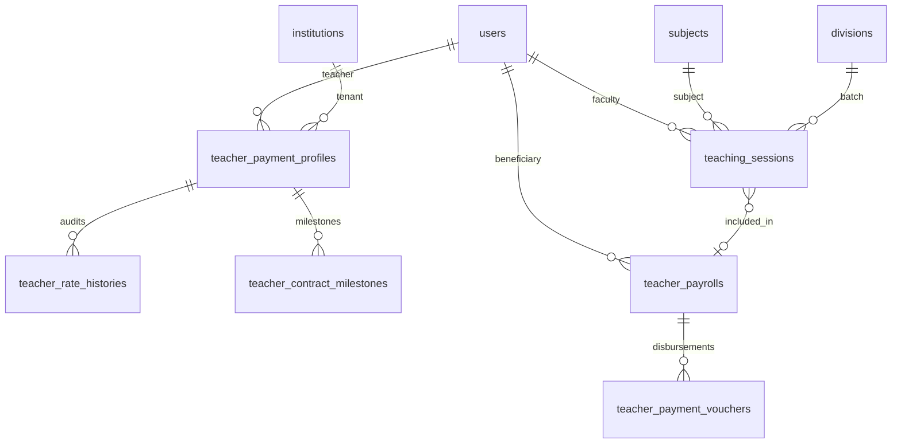
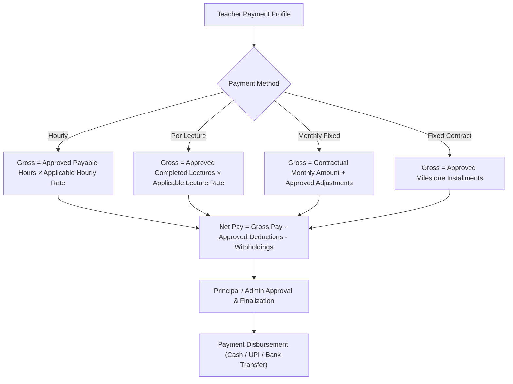

# Implementation Plan — Teacher Payroll & Payment Management
**Product:** PrathamOne EduOS  
**Edition:** Coaching Institute Edition  
**Module:** Teacher Payroll & Payment Management  
**Product Architect:** Jawahar R Mallah  
**Organization:** AITDL — AI Technology & Development Lab  
**Specification Baseline:** Version 1.0 (November 2026)

---

## 1. Executive Summary & Audit of Existing Systems

Following a rigorous audit of the current **PrathamOne EduOS** enterprise codebase, the Teacher Payroll & Payment Management module will seamlessly integrate with existing entities without duplicating records or disrupting running operations.

### 1.1 Existing Architecture Reused

| Existing Module / Entity | Table in DB | Reuse in Teacher Payroll |
|---|---|---|
| **User & RBAC Accounts** | `users`, `roles`, `permissions` | Every faculty member is an active user with `role = 'teacher'`. User IDs link to all payment profiles, session registers, and vouchers. Permissions extend centrally via RBAC. |
| **Staff Profile** | `staff_profiles` | Houses employment details (`employee_id`, `department`, `qualification`, `joining_date`, `basic_salary`, `pan_number`, `bank_account_number`, `bank_ifsc`, `bank_name`). |
| **Academic Divisions & Batches** | `divisions` | Represents coaching institute batches and sections. Teaching sessions directly link to `division_id`. |
| **Curriculum Subjects** | `subjects` | Subjects taught by faculty members. Teaching sessions and payment rates link to `subject_id`. |
| **Teacher Academic Assignments** | `teacher_assignments` | Pre-existing mapping of teacher to standard, division, subject, and weekly workload hours. |
| **Timetable Scheduling** | `timetable_entries` | Weekly scheduled slots per division, subject, teacher, start/end times, and room numbers. Session register pre-populates and reconciles against this. |
| **Tenant & Year Context** | `institutions`, `academic_years` | Enforces multi-tenant data isolation and session budgeting. |
| **Audit Logs** | `audit_logs` | Immutable logging for rate changes, session approvals, payroll finalization, and disbursements. |
| **Sequential Generator** | `sequence.py` | Provides collision-free row-locked identifiers for payment vouchers (`TPV-YYYY-NNNN`) and payroll statements (`PRL-YYYY-MM-NNNN`). |

---

## 2. Core Entities & Database Schema

To support the four payment models (Hourly, Per-Lecture, Monthly Fixed, Fixed Contract) while maintaining immutable financial ledgers, the following relational schema will be added via Alembic migration `020_teacher_payroll_and_sessions.py`:

### 2.1 Table Specifications

1. **`teacher_payment_profiles`**:
   - `id`: Integer Primary Key
   - `institution_id`: FK `institutions.id` (Tenant isolation)
   - `teacher_user_id`: FK `users.id` (Indexed, unique per active contract)
   - `payment_method`: String(30) (`'hourly'`, `'per_lecture'`, `'monthly_fixed'`, `'fixed_contract'`, `'mixed'`)
   - `hourly_rate`: Numeric(10, 2) default 0.00
   - `per_lecture_rate`: Numeric(10, 2) default 0.00
   - `monthly_fixed_amount`: Numeric(10, 2) default 0.00
   - `contract_total_amount`: Numeric(10, 2) default 0.00
   - `currency`: String(10) default `'INR'`
   - `effective_from`: Date default Current Date
   - `effective_until`: Date nullable
   - `payment_frequency`: String(30) default `'monthly'`
   - `payment_terms`: String(255) nullable
   - `is_active`: Boolean default True
   - `notes`: Text nullable
   - `created_by_id`: FK `users.id`
   - `created_at`, `updated_at`: DateTime with timezone

2. **`teacher_rate_histories`**:
   - Maintains immutable audit trail of every contract/rate revision.
   - `id`: Integer Primary Key
   - `payment_profile_id`: FK `teacher_payment_profiles.id`
   - `teacher_user_id`: FK `users.id`
   - `old_payment_method`: String(30)
   - `new_payment_method`: String(30)
   - `old_rate`: Numeric(10, 2)
   - `new_rate`: Numeric(10, 2)
   - `effective_from`: Date
   - `reason`: Text
   - `changed_by_id`: FK `users.id`
   - `changed_at`: DateTime with timezone

3. **`teacher_contract_milestones`**:
   - Defined deliverables for fixed course / subject contracts.
   - `id`: Integer Primary Key
   - `payment_profile_id`: FK `teacher_payment_profiles.id`
   - `milestone_name`: String(150) (e.g. "Term 1 Syllabus Completion")
   - `milestone_order`: Integer default 1
   - `amount`: Numeric(10, 2)
   - `percentage`: Float default 0.0
   - `due_date`: Date nullable
   - `achieved_date`: Date nullable
   - `status`: String(30) default `'pending'` (`'pending'`, `'achieved'`, `'approved'`, `'paid'`)
   - `approved_by_id`: FK `users.id` nullable
   - `notes`: Text nullable

4. **`teaching_sessions` (Teaching Session Register)**:
   - Connects live academic activity with financial calculation.
   - `id`: Integer Primary Key
   - `session_code`: String(50) Unique (e.g. `SES-202611-0001`)
   - `institution_id`: FK `institutions.id`
   - `academic_year_id`: FK `academic_years.id`
   - `teacher_user_id`: FK `users.id` (Indexed)
   - `substitute_teacher_id`: FK `users.id` nullable
   - `subject_id`: FK `subjects.id`
   - `division_id`: FK `divisions.id` (Batch)
   - `timetable_entry_id`: FK `timetable_entries.id` nullable
   - `session_date`: Date (Indexed)
   - `scheduled_start_time`: String(15)
   - `scheduled_end_time`: String(15)
   - `actual_start_time`: String(15) nullable
   - `actual_end_time`: String(15) nullable
   - `break_duration_minutes`: Integer default 0
   - `calculated_duration_hours`: Float default 1.0
   - `payment_method`: String(30)
   - `applicable_rate`: Numeric(10, 2)
   - `calculated_amount`: Numeric(10, 2)
   - `session_status`: String(30) default `'completed'` (`'scheduled'`, `'completed'`, `'cancelled'`, `'rescheduled'`, `'absent'`, `'substitute_assigned'`)
   - `approval_status`: String(30) default `'submitted'` (`'draft'`, `'submitted'`, `'approved'`, `'rejected'`)
   - `approved_by_id`: FK `users.id` nullable
   - `approved_at`: DateTime nullable
   - `rejection_reason`: Text nullable
   - `topic_taught`: String(255) nullable
   - `students_present_count`: Integer nullable
   - `is_payable`: Boolean default True
   - `payroll_id`: FK `teacher_payrolls.id` nullable (Locks session once payroll is processed)
   - `remarks`: Text nullable
   - `created_by_id`: FK `users.id`
   - `created_at`, `updated_at`: DateTime

5. **`teacher_payrolls` (Monthly Payroll Statement)**:
   - Generated period statement per teacher.
   - `id`: Integer Primary Key
   - `payroll_number`: String(50) Unique (e.g. `PRL-2026-11-0001`)
   - `institution_id`: FK `institutions.id`
   - `academic_year_id`: FK `academic_years.id`
   - `teacher_user_id`: FK `users.id` (Indexed)
   - `month`: Integer (1-12)
   - `year`: Integer (e.g. 2026)
   - `start_date`: Date
   - `end_date`: Date
   - `payment_method`: String(30)
   - `total_teaching_hours`: Float default 0.0
   - `total_completed_lectures`: Integer default 0
   - `base_earnings`: Numeric(12, 2) default 0.00
   - `approved_incentives`: Numeric(12, 2) default 0.00
   - `approved_additional_earnings`: Numeric(12, 2) default 0.00
   - `contractual_adjustments`: Numeric(12, 2) default 0.00
   - `gross_pay`: Numeric(12, 2) default 0.00
   - `total_deductions`: Numeric(12, 2) default 0.00
   - `withholdings`: Numeric(12, 2) default 0.00
   - `net_payable`: Numeric(12, 2) default 0.00
   - `paid_amount`: Numeric(12, 2) default 0.00
   - `pending_amount`: Numeric(12, 2) default 0.00
   - `calculation_breakdown_json`: Text nullable (Stores complete itemized audit snapshot)
   - `status`: String(30) default `'calculated'` (`'calculated'`, `'submitted'`, `'approved'`, `'finalized'`, `'partially_paid'`, `'paid'`, `'adjusted'`)
   - `calculated_by_id`: FK `users.id`
   - `approved_by_id`: FK `users.id` nullable
   - `finalized_by_id`: FK `users.id` nullable
   - `calculated_at`, `approved_at`, `finalized_at`: DateTime nullable
   - `notes`: Text nullable

6. **`teacher_payment_vouchers` (Disbursement & Accounting Integration)**:
   - Integrates with coaching institute expense records.
   - `id`: Integer Primary Key
   - `voucher_number`: String(50) Unique (e.g. `TPV-2026-0001`)
   - `institution_id`: FK `institutions.id`
   - `payroll_id`: FK `teacher_payrolls.id`
   - `teacher_user_id`: FK `users.id`
   - `amount_paid`: Numeric(12, 2)
   - `payment_date`: Date
   - `payment_method`: String(30) (`'cash'`, `'upi'`, `'bank_transfer'`, `'cheque'`, `'other'`)
   - `transaction_reference`: String(100) nullable
   - `bank_name`: String(100) nullable
   - `cheque_number`: String(50) nullable
   - `cheque_date`: Date nullable
   - `debit_account`: String(100) default `'Teacher Remuneration & Faculty Expense'`
   - `credit_account`: String(100) default `'Operating Bank Account'`
   - `recorded_by_id`: FK `users.id`
   - `status`: String(30) default `'posted'` (`'posted'`, `'cleared'`, `'reversed'`)
   - `reversal_reason`: Text nullable
   - `receipt_statement_data`: Text nullable
   - `notes`: Text nullable
   - `created_at`: DateTime

---

## 3. Four Payment Methods & Calculation Engine

1. **Hourly Engine**:
   - Queries `teaching_sessions` where `session_status = 'completed'`, `approval_status = 'approved'`, `is_payable = True`, and `session_date` is in billing period.
   - Hours calculated as: `(actual_end_time - actual_start_time) - break_duration`.
   - Rate locked at session completion from historical contract profile active on that date.
2. **Per-Lecture Engine**:
   - Counts distinct approved completed sessions.
   - Multiplied by lecture rate active on session date.
3. **Monthly Fixed Engine**:
   - Baseline monthly fixed salary with pro-rata adjustments for unapproved absences.
4. **Fixed Contract Engine**:
   - Releases payments according to approved `teacher_contract_milestones`.
5. **Anti-Double-Counting Guard**:
   - Once a session enters a generated payroll, its `payroll_id` is set to that payroll. A session with an assigned `payroll_id` can never be selected for another payroll period.

---

## 4. Workflows & Separation of Duties

### 4.1 Role Permissions Matrix

| Capability / Action | Sysadmin | Superadmin / Admin | Principal | Accountant | Academic Coord | Teacher |
|---|:---:|:---:|:---:|:---:|:---:|:---:|
| Configure Teacher Payment Profile | ✅ | ✅ | ✅ | ❌ | ❌ | ❌ |
| Log / Register Teaching Sessions | ✅ | ✅ | ✅ | ❌ | ✅ | ✅ (Own Only) |
| Approve / Reject Teaching Sessions | ✅ | ✅ | ✅ | ❌ | ✅ | ❌ (Forbidden) |
| Calculate Monthly Payroll | ✅ | ✅ | ✅ | ✅ | ❌ | ❌ |
| Approve Monthly Payroll | ✅ | ✅ | ✅ | ❌ | ❌ | ❌ |
| Finalize & Lock Monthly Payroll | ✅ | ✅ | ✅ | ❌ | ❌ | ❌ |
| Record Payment / Issue Voucher | ✅ | ✅ | ❌ | ✅ | ❌ | ❌ |
| View Own Payment Statements | ✅ | ✅ | ✅ | ✅ | ✅ | ✅ (Own Only) |
| View Financial Reports & Costs | ✅ | ✅ | ✅ | ✅ | ❌ | ❌ |

---

## 5. UI Architecture & Navigation

The module will be accessible through two intuitive, seamless entry points:
1. **Dedicated Workspace:** `/teacher-payroll` (with direct link in sidebar under Staff / Finance).
2. **Integrated Tab:** in `StaffManagement.tsx` (`Payroll` tab).

### Five Master Workspaces / Tabs:

1. **Monthly Payroll Workspace:**
   - Period selectors (Month, Year, Academic Year, Branch).
   - Real-time KPI StatCards: Total Faculty, Approved Teaching Hours, Payable Lectures, Gross Payable, Deductions, Net Payable, Paid Amount, Outstanding Balance.
   - Filterable DataGrid: Faculty Name, Payment Mode, Approved Workload, Effective Rate, Gross, Deductions, Net, Paid, Pending, Status Badge.
   - One-Click Actions: **Calculate Payroll**, **View Breakdown**, **Submit for Approval**, **Approve**, **Finalize & Lock**, **Record Payment**, **Print Statement**, **Export Excel**.

2. **Teaching Session Register:**
   - Daily & monthly calendar/list views.
   - Quick Session Entry modal with batch, subject, date, start/end time, substitute teacher option.
   - Batch Actions: **Bulk Approve Selected**, **Reject with Reason**, **Assign Substitute**.
   - Direct status indicators: Scheduled, Completed, Substitute, Cancelled.

3. **Teacher Payment Profiles & Rates:**
   - Faculty contract management.
   - Rate cards with hourly, lecture, monthly, and milestone contract tabs.
   - Historical rate revision viewer with effective date tracking.

4. **Payment Vouchers & Ledger:**
   - Voucher Register (`TPV-YYYY-NNNN`).
   - Partial payment recording with live balance check preventing overpayment.
   - Official Printable Payment Voucher / Receipt with PrathamOne EduOS branding.

5. **Reports & Cost Analytics:**
   - All 10 mandated reports with real-time filtering, Excel export, and print preview.

---

## 6. Implementation Milestones & Dependencies

- **Dependency 1:** Alembic migration `020_teacher_payroll_and_sessions.py` creating the 6 relational tables.
- **Dependency 2:** Backend models in `backend/app/models/teacher_payroll.py`.
- **Dependency 3:** Calculation engine & service layer in `backend/app/services/teacher_payroll_service.py`.
- **Dependency 4:** FastAPI router in `backend/app/api/v1/endpoints/teacher_payroll.py`.
- **Dependency 5:** Frontend API client and React workspace in `frontend/src/pages/TeacherPayroll.tsx` and integration with `StaffManagement.tsx`.
- **Dependency 6:** Automated test coverage (`test_teacher_payroll.py` and `TeacherPayroll.test.tsx`).
