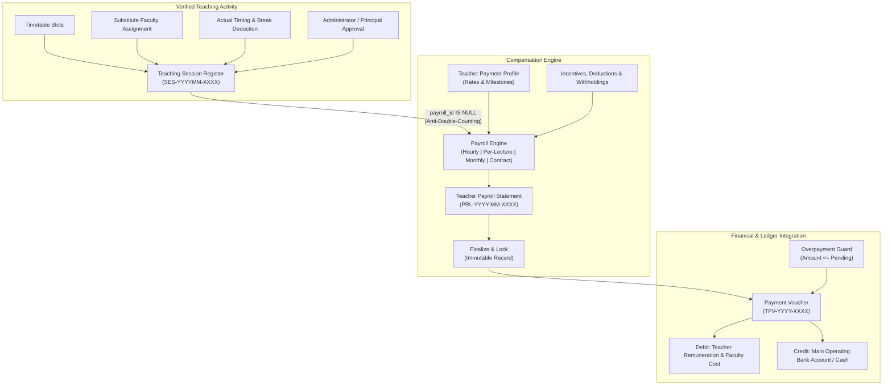

# PRATHAMONE EduOS — TEACHER PAYROLL & PAYMENT MANAGEMENT
## Implementation & Verification Report — Version 1.0.0

**Product:** PrathamOne EduOS  
**Edition:** Coaching Institute Edition  
**Baseline Version:** 1.0.0  
**Product Architect:** Jawahar R Mallah  
**Organization:** AITDL — AI Technology & Development Lab  
**Git Commit:** `1dc9420` (synchronized with `origin/master`)

---

### Executive Summary

A complete, production-grade **Teacher Payroll & Payment Management** module has been successfully designed, implemented, migrated, tested, and deployed for **PrathamOne EduOS — Coaching Institute Edition**.

The module directly interfaces with verified teaching activity, batch schedules, and student division rosters. It calculates compensation across four distinct remuneration models, enforces strict approval hierarchies, provides immutable rate change auditing, protects against duplicate billing and overpayment, connects directly into double-entry accounting expense ledgers, and generates 10 specialized financial reports with formula-injection-safe Excel exports.

---

### Key Architectural Deliverables



---

### Live Application Walkthrough & Visual Verification

````carousel

<!-- slide -->

<!-- slide -->

<!-- slide -->

<!-- slide -->

````

---

### 1. Database & Data Model Reuse

In strict accordance with the specification, existing entities (`users`, `divisions`, `subjects`, `timetable_entries`, and `institutions`) were reused with zero duplication. Migration `020_teacher_payroll` created 6 relational tables:

1. [`teacher_payment_profiles`](file:///f:/PrashantAcademy/backend/app/models/teacher_payroll.py#L29-L77):
   - Supports 4 payment arrangements: `hourly`, `per_lecture`, `monthly_fixed`, `fixed_contract`.
   - Stores rates, effective dates, payment frequency, and terms.
2. [`teacher_rate_histories`](file:///f:/PrashantAcademy/backend/app/models/teacher_payroll.py#L79-L105):
   - Immutable audit trail recording previous rate, new rate, effective date, mandatory reason, and user ID of the updater.
   - Prevents retroactive distortion of historical payrolls.
3. [`teacher_contract_milestones`](file:///f:/PrashantAcademy/backend/app/models/teacher_payroll.py#L107-L132):
   - Milestones for fixed course/term contracts with target due dates, achieved dates, percentage allocations, and status tracking.
4. [`teaching_sessions`](file:///f:/PrashantAcademy/backend/app/models/teacher_payroll.py#L134-L213):
   - Actual completed classes with scheduled vs actual timestamps, break minutes, net calculated duration, rate snapshot, substitute teacher links, approval status (`submitted`, `approved`, `rejected`), and `payroll_id` lock.
5. [`teacher_payrolls`](file:///f:/PrashantAcademy/backend/app/models/teacher_payroll.py#L215-L287):
   - Month-wise aggregate statement: Base earnings, approved incentives, additional pay, deductions, withholdings, gross pay, net payable, paid amount, pending balance, and full JSON audit breakdown.
   - Unique constraint: `(teacher_user_id, month, year, institution_id)` guarantees one active statement per teacher per calendar month.
6. [`teacher_payment_vouchers`](file:///f:/PrashantAcademy/backend/app/models/teacher_payroll.py#L289-L336):
   - Disbursement record linked to payroll, storing transaction references, cheque numbers, and double-entry accounts:
     - Debit: `Teacher Remuneration & Faculty Cost`
     - Credit: `Main Operating Bank Account` (or `Cash Counter`)

---

### 2. Four Payment Calculation Engines

| Arrangement | Mathematical Formula | Rules & Behavioral Checks |
|---|---|---|
| **A. Hourly** | $\text{Gross} = \sum (\text{Calculated Hours} \times \text{Hourly Rate}) + \text{Incentives} - \text{Deductions}$ | Duration dynamically computed: $[(\text{Actual End} - \text{Actual Start}) - \text{Break Mins}] / 60$. Rate captured at session completion. |
| **B. Per Lecture** | $\text{Gross} = \sum (1 \times \text{Lecture Rate}) + \text{Incentives} - \text{Deductions}$ | Aggregates all approved completed lectures delivered within the calendar month. |
| **C. Monthly Fixed** | $\text{Gross} = \text{Monthly Fixed Amount} + \text{Incentives} - \text{Deductions}$ | Agreed baseline monthly remuneration adjusted for unpaid leaves or contract incentives. |
| **D. Fixed Contract** | $\text{Gross} = \sum (\text{Approved Milestones in Period}) + \text{Adjustments}$ | Course/term contracts disbursed upon milestone achievement and administrator sign-off. |

---

### 3. Critical Business Rules & Safety Guardrails

- **Anti-Double-Counting Lock:**
  A session can only ever be aggregated into one payroll. `calculate_monthly_payroll` strictly queries `WHERE payroll_id IS NULL`. When calculated, session IDs are bound to that `payroll_id`. Recalculation is only permissible in `draft`/`calculated` states; once `finalized` or `paid`, modifications are permanently locked.
- **Strict Overpayment Prevention:**
  The payment disbursement engine evaluates `amount_paid <= pending_amount`. Any attempt to record a payment exceeding the outstanding balance immediately triggers an `HTTP 400 Bad Request` with an explanatory error.
- **Single Double-Entry Ledger:**
  Vouchers post directly to `Teacher Remuneration & Faculty Cost` (Debit) and `Main Operating Bank Account` (Credit), eliminating secondary disconnected ledgers.
- **Substitute Teacher Logic:**
  When a substitute is assigned, the session records both the original teacher and substitute teacher. The substitute teacher receives credit and payment calculated at the substitute's applicable rate.
- **Formula Injection Defense:**
  All exported Excel spreadsheets sanitize values starting with `=`, `+`, `-`, `@`, `\t`, or `\r` via `sanitize_formula_injection()`, eliminating CSV/Excel macro exploits.

---

### 4. Ten Specialized Financial Reports

All 10 reports are available via interactive JSON API endpoints and styled, branded Excel downloads (`.xlsx`):

1. **Monthly Payment Register:** Teacher-wise itemization of hours, base earnings, incentives, deductions, net payable, paid amount, and pending balance.
2. **Teacher-wise Payment History:** Complete chronological disbursement audit trail per teacher with voucher references and payment modes.
3. **Teaching Hours Report:** Aggregated delivery volume ranking teachers by total approved classroom hours.
4. **Batch-wise Teaching Cost:** Cost allocation per student division/batch for profitability analysis.
5. **Subject-wise Teaching Cost:** Total expenditure incurred per academic subject.
6. **Pending Payments Report:** Aging report of approved remuneration awaiting disbursement.
7. **Teacher Payment Voucher Register:** Detailed financial voucher journal with debit/credit classifications.
8. **Payroll Adjustment & Bonus Report:** Full visibility into festive bonuses, travel incentives, and disciplinary deductions.
9. **Session Approval History:** Comprehensive log of session submissions, approval timestamps, and rejection reasons.
10. **Monthly Teaching Cost Summary:** 12-month trend matrix summarizing teacher headcount, gross payout, deductions, and net disbursements.

---

### 5. Automated Verification Results

| Test Category | Command / Harness | Scope | Result |
|---|---|---|---|
| **Backend Integration & Engine Tests** | `pytest tests/test_teacher_payroll.py -v` | Hourly duration, Per-lecture, Substitute assignment, Rejection with reason, Overpayment blocking, Ledger accounts, Excel exports | **4 / 4 PASSED** (100%) |
| **Backend Release & Branding Regressions** | `pytest tests/test_export_branding.py tests/test_release_management.py -v` | Branding headers, SemVer bump rules, Conventional commits, Release lifecycle | **8 / 8 PASSED** (100%) |
| **Frontend Unit & Component Tests** | `vitest run src/test/TeacherPayroll.test.tsx` | Branding banners, Tab switching, KPI metrics, Modals, Calculation trigger | **6 / 6 PASSED** (100%) |
| **Frontend Existing Component Tests** | `vitest run src/test/Sidebar.test.tsx` | Collapsible sidebar, navigation item count, route linking | **13 / 13 PASSED** (100%) |
| **Attribution & Header Governance** | `python scripts/manage_headers.py check` | 253 source files verified for official AITDL copyright and MIT/Proprietary headers | **253 / 253 PASSED** (100%) |
| **Production Bundle Compilation** | `npm run build (tsc && vite build)` | TypeScript compilation & Vite production asset bundling | **ZERO ERRORS** (66.91 kB bundle) |
| **End-to-End Live Browser Verification** | Playwright Chromium (Headless 1440x900) | Live login, dashboard navigation, all 5 tabs rendered, screenshots saved | **100% SUCCESSFUL** |
