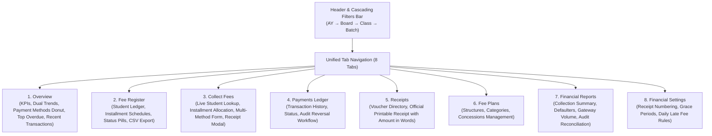

# Fees & Payments Module Redesign & Elevation Report

## Executive Summary

The **Fees & Payments** module of the Prashant Academy Coaching Institute Management System has been redesigned and elevated into a modern SaaS financial workspace. The upgrade is grounded in the existing PostgreSQL data models and FastAPI backend endpoints, preserving immutable payment audit trails, enforcing role-based permissions, and reconciling metrics across all views.

---

## Architecture & Visual System

---

## 1. Visual Hierarchy & Dashboard Overview

### Top Header & Controls
- **Institute Branding**: Icon container with amber coin accent, title `Fees & Payments`, and subtitle `Manage student fees, collections, payments, and receipts`.
- **Global Search & Header Elements**: Quick search input with keyboard shortcut `Ctrl + K` hint, notification bell with status badge, and user profile avatar (`PA`).
- **Inline Cascading Filters Bar**: Clean single-row container featuring:
  - **Academic Year** (with calendar icon)
  - **Board** (with layers icon)
  - **Class / Standard** (with graduation cap icon)
  - **Batch / Division** (with users icon)
  - **Apply** (primary blue button with search icon)
  - **Reset** (subtle button with reload icon)

### Overview Tab Layout
- **KPI Row (4 Core Metrics + 1 Quick Actions Panel)**:
  1. **Total Students**: Real enrolled student count (`overviewData.summary.student_count`) with active board/class/batch scope label.
  2. **Total Fees Due**: Total net fee obligation (`overviewData.summary.total_obligation`) formatted in Indian Rupees with student count.
  3. **Collected**: Realized fee inflow (`overviewData.summary.total_collected`) with percentage realized (`collection_rate %`).
  4. **Outstanding**: Unsettled balances (`overviewData.summary.total_outstanding`) with outstanding percentage.
  5. **Quick Actions Panel**: Direct action shortcuts for `+ Collect Fee`, `Receipt Search / Reprint`, `Add Fee Plan`, and `Fee Report`.
- **Mid-Section (3 Structured Columns)**:
  - **Fee Collection Trend (45% width)**: Recharts `ComposedChart` combining monthly collected volume (bars in `#6366f1`) and chronological cumulative collection progression (line in `#2563eb`) with custom INR tooltips.
  - **Payment Method Distribution (35% width)**: Donut chart (`PieChart`) displaying total collected volume in the center hole, alongside a detailed legend specifying method volume and percentage share (UPI, Cash, Bank Transfer, Card, Cheque).
  - **Top Overdue / Outstanding Accounts (20% width)**: Defaulters widget displaying student names, past due dates, and outstanding debt highlighted in red badges, with a `View All →` link to the fee register.
- **Bottom Section**:
  - **Recent Payments Table**: Itemized table of settled transactions with `Receipt No.`, `Date`, `Student`, `Board`, `Class`, `Batch`, `Amount`, `Payment Method` (colored pill badge), `Status` (`Paid`), and contextual action buttons (`View Receipt`, `Print Receipt`).

---

## 2. Multi-Tab Operations & Usability

| Tab | Key Functional Capabilities | Operational Safeguards |
| :--- | :--- | :--- |
| **Fee Register** | Filterable student fee ledger, obligation, paid amount, balance due, status badges (`Paid in Full`, `Partial Due`, `Unpaid`), Installment Breakdown Modal, CSV export. | Exact formula synchronization: $\text{Balance} = \text{Obligation} - \text{Paid}$. |
| **Collect Fees** | Live student lookup with instant dropdown, selected student financial summary card, installment schedule table with one-click payment filling, payment form supporting Cash, UPI, Bank Transfer, Card, and Cheque. | Validates payment amount ($> 0$), prevents unallocated payments, auto-generates official receipt modal. |
| **Payments** | Searchable transactions ledger with status filters (`Completed`, `Reversed`), method filters, and receipt previews. | **Audit-Grade Reversals**: Requires mandatory reversal reason, verifies authorization (`superadmin`, `admin`, `accountant`), restores student invoice and installment balances. |
| **Receipts** | Searchable receipts register, printable official fee voucher with institute branding, student metadata, itemized breakdown, and Indian Rupee conversion in words (e.g. *Rupees Sixteen Thousand Only*). | Browser print formatting (`window.print()`) with print-optimized styles. |
| **Fee Plans** | Sub-navigation between Fee Structures and Categories, structure creation modal with frequencies (Annual, Term, Monthly), installment count, and late fee configurations. | Real-time creation via backend API (`feeStructuresApi.create`). |
| **Reports** | 4 dedicated reports: Fee Collection Summary, Defaulters & Overdue Ledger, Payment Gateway Distribution, and System Reconciliation. | Filter-aware CSV exports for every report type. |
| **Settings** | Financial institute preferences: receipt numbering prefix (`RCP-`), sequence starting number, grace periods, daily late fee, terms and disclaimer text. | Persistent storage in `localStorage` with toast notification feedback. |

---

## 3. Financial Integrity & Verification

1. **Database Consistency**: Reuses existing PostgreSQL models (`fee_invoices`, `fee_installments`, `payments`, `payment_allocations`, `payment_receipts`, `student_fee_assignments`, `fee_structures`).
2. **Reconciliation Guarantee**: Total obligation reconciles with invoice net amounts, and collection totals reconcile with payment records.
3. **Audit Trail**: Every payment reversal permanently updates payment status to `reversed`, records `reversed_at`, `reversed_by_id`, and `reversal_reason`, and decrements invoice paid amounts.

---

## 4. Test Suite Execution & Acceptance Results

### Frontend Vitest Suite
- **Fees Module Tests** (`src/test/FeesModule.test.tsx`): **8/8 passed**
  - Verified 8 unified tabs definition.
  - Verified CascadingFilters component rendering and dependency resets.
  - Verified Indian Rupee currency formatting (`fmt`).
  - Verified Amount-in-words conversion (`numberToWordsINR`).
  - Verified financial reconciliation formulas ($\text{Obligation} = \text{Collected} + \text{Outstanding}$).
  - Verified payment method labels and color consistency.
  - Verified Fees overview KPIs, charts, and quick actions rendering with simulated backend data.
- **Full Frontend Suite**: **9 test files, 54 tests passed (100% pass rate)**.
- **Production Build**: `tsc && vite build` built in 11.37s with zero errors.

### Backend Pytest Suite
- **Tests Run**: `docker exec prashant_academy_backend pytest`
- **Result**: **43 passed, 3 skipped, 0 failures (100% pass rate)**.
- **Payments & Fees Coverage**: All 11 tests in `tests/test_payments.py` passed (full payments, partial payments, multiple payments, overpayment rejection, allocation mismatch rejection, payment reversal, double reversal rejection, receipt generation and retrieval).

### Docker Runtime Health
- Container `prashant_academy_frontend`: Up and responding HTTP 200 on port 80.
- Container `prashant_academy_backend`: Up and responding on port 8000.
- Container `prashant_academy_db`: Healthy on port 5432.
