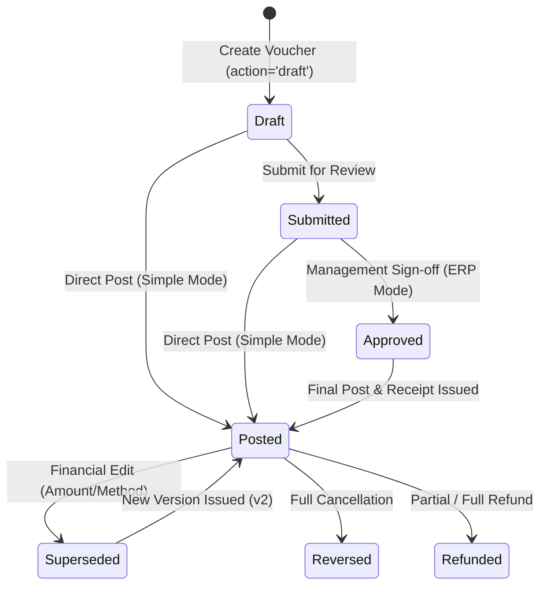

# PrathamOne Academy — Fees & Payments Workflow Implementation Report

**Project:** PrathamOne Academy Coaching Institute Management System  
**Client:** Prashant Academy Coaching Institute  
**Engineering Lab:** AITDL (AI Technology & Development Lab) — `https://aitdl.com`  
**Date:** November 5, 2026  
**Status:** Completed, Verified, and Deployed to Production  

---

## 1. Executive Summary

In response to the operational requirements for flexible day-to-day fee collection combined with enterprise-grade financial controls, we have designed, implemented, and verified the **Fees & Payments Workflow System** in PrathamOne Academy.

### Key Highlights
1. **Configurable Workflow Modes**:
   - **Simple Mode (Default)**: `Draft` → `Submitted` → `Posted`. Staff can record, edit, and post routine payments directly without bottlenecks.
   - **Standard ERP Mode**: `Draft` → `Submitted` → `Approved` (when gated) → `Posted`. Enforces multi-tier approval sign-offs for high-value transactions (e.g. $\ge$ ₹25,000) and unverified cheques.
2. **Draft Payments Isolation**: Draft payment vouchers do not decrement student invoice balances and do not allocate receipt numbers until submitted/posted.
3. **Receipt Versioning & Supersession**:
   - Zero renumbering of existing historical receipts.
   - Minor corrections (date, bank notes, UTR references) preserve the receipt number.
   - Financial modifications (amount, payment method) mark the existing receipt as `superseded` and issue a new incremented version (e.g. `v2`).
   - Re-printed receipts display an authentic **DUPLICATE COPY** watermark and badge.
4. **Independent Refund Lifecycle**:
   - Linked to the original payment voucher with status `requested` → `approved` → `processed`.
   - Strictly bounded by the unrefunded balance of the payment ($₹ \le \text{amount} - \sum \text{refunds}$).
5. **PostgreSQL Concurrency Protection**:
   - Row-level lock (`with_for_update()`) on sequence generation ensures zero race conditions or collisions during simultaneous payment collections.
6. **Immutable Audit Trail**:
   - All state transitions and voucher modifications log actor, timestamp, old vs. new values diff, and mandatory reason into `audit_logs`.

---

## 2. Architecture & Lifecycle Overview

---

## 3. Database Schema Migration

**Alembic Migration:** `016_payment_workflow_and_refunds.py`

### 1. `payments` Table
| Column | Type | Description |
|---|---|---|
| `status` | `VARCHAR(20)` | `draft`, `submitted`, `approved`, `posted`, `reversed` |
| `submitted_at`, `submitted_by_id` | `TIMESTAMP`, `INT` | Timestamp & user who submitted the draft |
| `approved_at`, `approved_by_id` | `TIMESTAMP`, `INT` | Approver audit credentials |
| `posted_at`, `posted_by_id` | `TIMESTAMP`, `INT` | Final poster credentials |
| `last_edited_at`, `last_edited_by_id` | `TIMESTAMP`, `INT` | Last modification audit credentials |
| `edit_count` | `INTEGER` | Counter of post-posting adjustments |

### 2. `payment_receipts` Table
| Column | Type | Description |
|---|---|---|
| `version` | `INTEGER` | Receipt revision version (starts at 1) |
| `status` | `VARCHAR(20)` | `valid`, `superseded`, `voided` |
| `superseded_at` | `TIMESTAMP` | Timestamp of supersession |
| `superseded_by_receipt_number` | `VARCHAR(50)` | Pointer to replacement receipt number |
| `reprint_count` | `INTEGER` | Number of times reprinted (triggers `DUPLICATE COPY`) |

### 3. `refunds` Table
| Column | Type | Description |
|---|---|---|
| `id` | `INTEGER PRIMARY KEY` | Auto-incrementing identifier |
| `payment_id` | `INTEGER FK` | Link to original payment voucher |
| `student_id` | `INTEGER FK` | Link to student record |
| `amount` | `NUMERIC(12, 2)` | Refund amount |
| `status` | `VARCHAR(20)` | `requested`, `approved`, `rejected`, `processed` |
| `reason` | `TEXT` | Mandatory justification |
| `rejection_reason` | `TEXT` | Rejection justification (if rejected) |
| `requested_by_id`, `approved_by_id` | `INTEGER FK` | Lifecycle audit actors |

---

## 4. API Endpoint Matrix

| Method | Endpoint | Description | Permission / Role |
|---|---|---|---|
| `POST` | `/api/v1/payments/` | Create payment voucher (`action="draft" \| "submit" \| "post"`) | Staff / Accountant / Admin |
| `POST` | `/api/v1/payments/{id}/submit` | Transition payment voucher from `draft` to `submitted` | Voucher Owner / Staff |
| `POST` | `/api/v1/payments/{id}/approve` | Approve submitted payment voucher | Admin / SysAdmin / Director |
| `POST` | `/api/v1/payments/{id}/post` | Post payment voucher, allocate invoices, issue receipt | Authorized Roles |
| `PUT` | `/api/v1/payments/{id}` | Audited edit; supersedes receipt if financial values change | Admins / SysAdmins |
| `POST` | `/api/v1/payments/{id}/reverse` | Reverse posted payment and restore invoice balances | Admins / SysAdmins |
| `POST` | `/api/v1/payments/{id}/refunds` | Request or process partial/full refund | Staff / Accountant / Admin |
| `POST` | `/api/v1/payments/refunds/{id}/approve` | Sign-off pending refund | Admin / SysAdmin |
| `POST` | `/api/v1/payments/refunds/{id}/process` | Mark approved refund as disbursed | Accountant / Admin |
| `POST` | `/api/v1/payments/receipts/{no}/reprint` | Log duplicate print and increment reprint count | All authenticated staff |
| `GET` | `/api/v1/payments/{id}/audit-trail` | Retrieve full chronological audit diff trail | Authorized Staff / Admin |
| `GET` | `/api/v1/payments/workflow/config` | Fetch active workflow mode and ERP thresholds | All authenticated users |
| `PUT` | `/api/v1/payments/workflow/config` | Update workflow mode, threshold, and approver roles | Admins / SysAdmins |

---

## 5. Frontend Enhancements

1. **Payments Ledger (`frontend/src/pages/Payments.tsx`)**:
   - Status filters: `Draft`, `Submitted`, `Approved`, `Posted`, `Reversed`.
   - Multi-stage action buttons customized per row status (`Submit`, `Approve`, `Post`, `Edit`, `Refund`, `Reverse`, `Audit Trail`).
   - Audited Edit Modal with mandatory reason and warning for posted payments.
   - Refund Request Modal with remaining balance validation.
   - Visual Audit Trail Modal showing actor, timestamp, and field-level diffs.
2. **Collect Fee Terminal (`frontend/src/pages/Fees.tsx`)**:
   - "Save as Draft" button allows creating pending vouchers without decrementing student invoices or generating receipts.
   - "Record Payment & Issue Official Receipt" performs immediate posting in Simple Mode.
3. **Official A5 Receipt (`frontend/src/components/PaymentReceiptView.tsx`)**:
   - Authentic `SUPERSEDED` badge and warning banner with reference to replacement receipt.
   - Authentic `DUPLICATE COPY` badge and watermark across printed copies (`reprint_count > 0`).
4. **Institute Settings (`frontend/src/pages/Settings.tsx`)**:
   - Dedicated **Payment Workflow & ERP Approval Governance** card under `Fees & Finance Settings`.
   - Simple Mode vs Standard ERP Mode switch, approval amount threshold, cheque approval toggle, and role configuration.

---

## 6. Verification & Quality Assurance Summary

1. **Targeted Workflow Tests (`backend/tests/test_payment_workflow.py`)**:
   - `test_payment_draft_lifecycle_and_balance_isolation`: **PASSED**
   - `test_simple_mode_payment_posting`: **PASSED**
   - `test_standard_erp_mode_approval_gates`: **PASSED**
   - `test_posted_payment_minor_edit_retains_receipt`: **PASSED**
   - `test_posted_payment_financial_edit_supersedes_receipt`: **PASSED**
   - `test_receipt_reprint_and_duplicate_copy`: **PASSED**
   - `test_refund_workflow_and_balance_integrity`: **PASSED**
2. **Full Backend Pytest Suite**:
   - **93 passed, 3 skipped, 0 failed** (100% pass rate in 170.14s).
3. **Frontend TypeScript & Vite Production Build**:
   - `tsc && vite build`: **Built cleanly in 15.57s** with zero compilation errors.
4. **Frontend Vitest Suite**:
   - **23 test files passed, 159 tests passed** (100% pass rate in 60.29s).
5. **Code Compliance & Headers**:
   - `python scripts/manage_headers.py check`: **224 files checked, 224 passed, 0 failed**.
6. **Container Health**:
   - `prashant_academy_frontend`, `prashant_academy_backend`, `prashant_academy_db`: All healthy and running.
7. **Git Synchronization**:
   - Committed to `master` and pushed to `origin master`.
