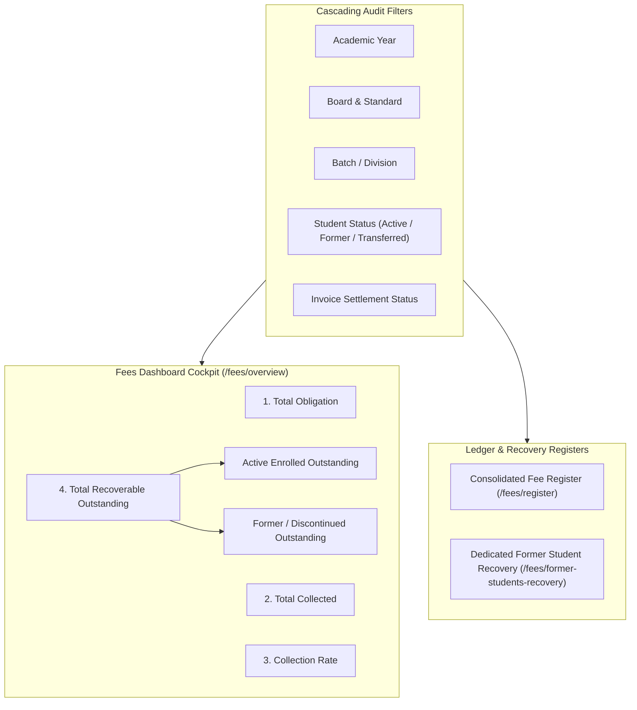

# PRATHAMONE EDUOS — FEES DASHBOARD & STUDENT RECEIVABLES REPORTING ARCHITECTURE

**Product:** PrathamOne EduOS  
**Edition:** Coaching Institute Edition  
**Baseline Version:** 1.0.0  
**Architect:** Jawahar R Mallah  
**Organization:** AITDL — AI Technology & Development Lab  
**Policy Status:** APPROVED ARCHITECTURAL SPECIFICATION  

---

## 1. USER INTERFACE & REPORTING ARCHITECTURE

The PrathamOne EduOS Fees workspace (`frontend/src/pages/Fees.tsx`) provides an integrated, audit-grade financial cockpit. With the implementation of the Student Receivables Governance directives, administrators, principals, and accountants have real-time visibility into active collections and former-student debt recovery.



---

## 2. DASHBOARD KPI METRICS SPECIFICATION

The primary financial overview cards (`/fees/overview`) report 7 distinct, reconciling metrics:

| Metric Card | Definition & Source | Visual Styling | Reconciliation Relationship |
| :--- | :--- | :--- | :--- |
| **Total Obligation** | Gross contractual billing net of initial discounts and concessions across non-cancelled invoices. | Slate icon, bold slate font | Base denominator for collection rate. |
| **Total Collected** | Cumulative realized cash, UPI, bank transfer, and cheque receipts deposited. | Emerald icon, emerald bold font | $\text{Collected} = \text{Obligation} - \text{Total Outstanding}$. |
| **Collection Rate** | Percentage of billing realized: $(\text{Collected} / \text{Obligation}) \times 100$. | Blue progress indicator | Standard institutional liquidity metric. |
| **Total Recoverable Outstanding** | Total unsettled debt actively recoverable by the institute. | Orange alert icon, prominent orange text | **Must equal** $\text{Active} + \text{Former} + \text{Inactive}$. |
| **Active Students Outstanding** | Unsettled debt owed by students currently enrolled and attending. | Sub-badge inside recoverable card | Immediate collection target for regular installment cycles. |
| **Former Students Outstanding** | Unsettled debt owed by students who have left, withdrawn, or graduated. | Amber sub-badge inside recoverable card | Recovery target for legal/administrative follow-up and TC clearance. |
| **Overdue Outstanding** | Outstanding balance on invoices where `due_date < current_date`. | Defaulters workspace card | Identifies critical debt at risk of default. |

---

## 3. CONSOLIDATED FEE REGISTER & FILTER SPECIFICATION

The Fee Register (`/fees/register`) provides row-by-row student ledger entries with the following features:

### Cascading Filters:
1. **Academic Year Filter:** Scopes records to the selected academic year.
2. **Board, Standard, Batch Filter:** Hierarchical academic classification.
3. **Invoice Status Filter:** `All Invoices`, `Paid in Full`, `Partial Due`, `Unpaid / Overdue`.
4. **Student Status Filter:**
   - `All Students`: Returns both active and departed students.
   - `Active Enrolled`: Restricts results to currently active students (`students.is_active = True`).
   - `Former / Discontinued`: Restricts results to former students (`students.is_active = False`).
   - `Transferred`: Restricts results to students with transferred enrollment history.
   - `Inactive / On Hold`: Restricts results to students temporarily suspended/paused.
5. **Universal Search:** Instant search by student name, admission number (`PA-2024-XXXXXX`), or invoice number.

### Row Badges & Former Student Visual Flagging:
- Students with `is_former: true` display an amber badge: `Former Student`.
- Departure date and exit reasons are printed alongside contact numbers:
  `+91-9820014411 • Exited: 2026-11-05 (Discontinued)`.
- Prevents staff from mistaking departed debtors for active students during billing rounds.

---

## 4. DEDICATED FORMER STUDENT RECOVERY WORKSPACE

To address debts that persist after student departures, a dedicated recovery endpoint and register are provided:

**API Route:** `GET /api/v1/fees/former-students-recovery`  
**Query Parameters:** `academic_year_id`, `board_id`, `standard_id`, `min_outstanding`, `search`  

### Payload Structure:
```json
{
  "debtors_count": 1,
  "total_recoverable_outstanding": 58000.0,
  "records": [
    {
      "student_id": 142,
      "admission_number": "PA-2024-000014",
      "student_name": "Satnam Bhatia",
      "phone": "+91-9820014414",
      "email": "satnam.bhatia@example.com",
      "exit_date": "2026-11-05",
      "exit_reason": "Discontinued",
      "exit_notes": "Discontinued per administrative notification",
      "days_since_exit": 4,
      "board_name": "General",
      "standard_name": "General",
      "batch_name": "Unassigned",
      "academic_year_name": "2024-25",
      "invoice_id": 24,
      "invoice_number": "INV-2026-0142",
      "total_obligation": 80000.0,
      "paid_amount": 22000.0,
      "outstanding_amount": 58000.0,
      "status": "partial",
      "due_date": "2024-09-30",
      "last_payment_date": "2026-11-04"
    }
  ]
}
```

---

## 5. CSV & EXCEL EXPORT INTEGRATION

Both the Fee Register and the Former Student Recovery Register integrate with `ExcelReportGrid` (`frontend/src/components/common/ExcelReportGrid.tsx`):
- Exports student status, exit date, and debt balance columns.
- Preserves audit traceability for institutional auditors and tax authorities.
- Fully compatible with CodeX privacy masking when active.
