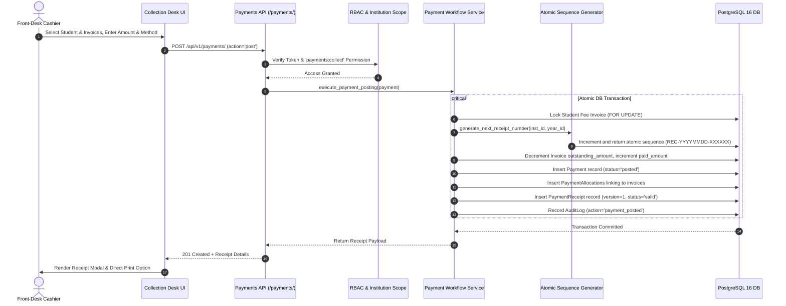
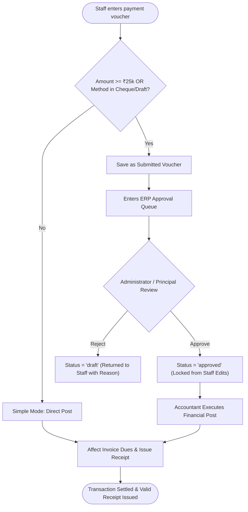
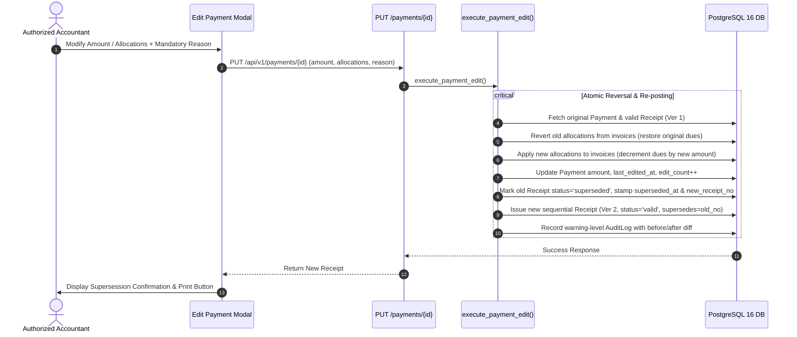
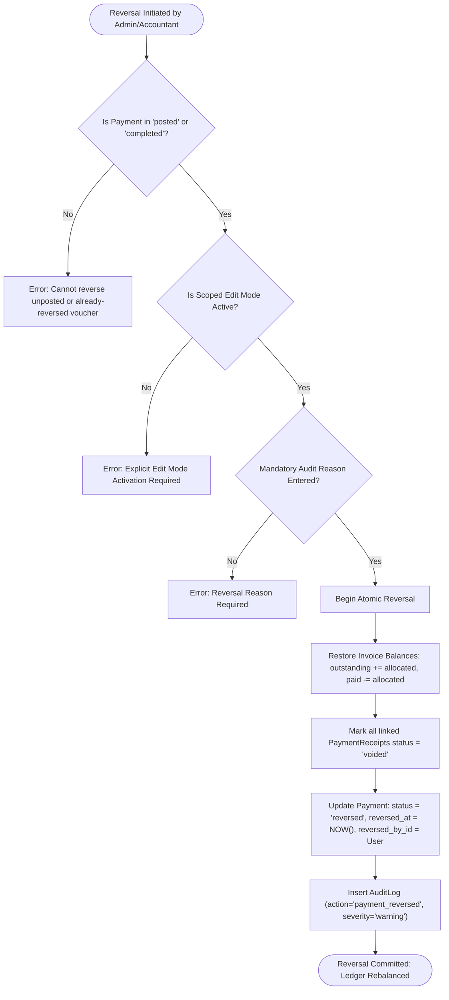
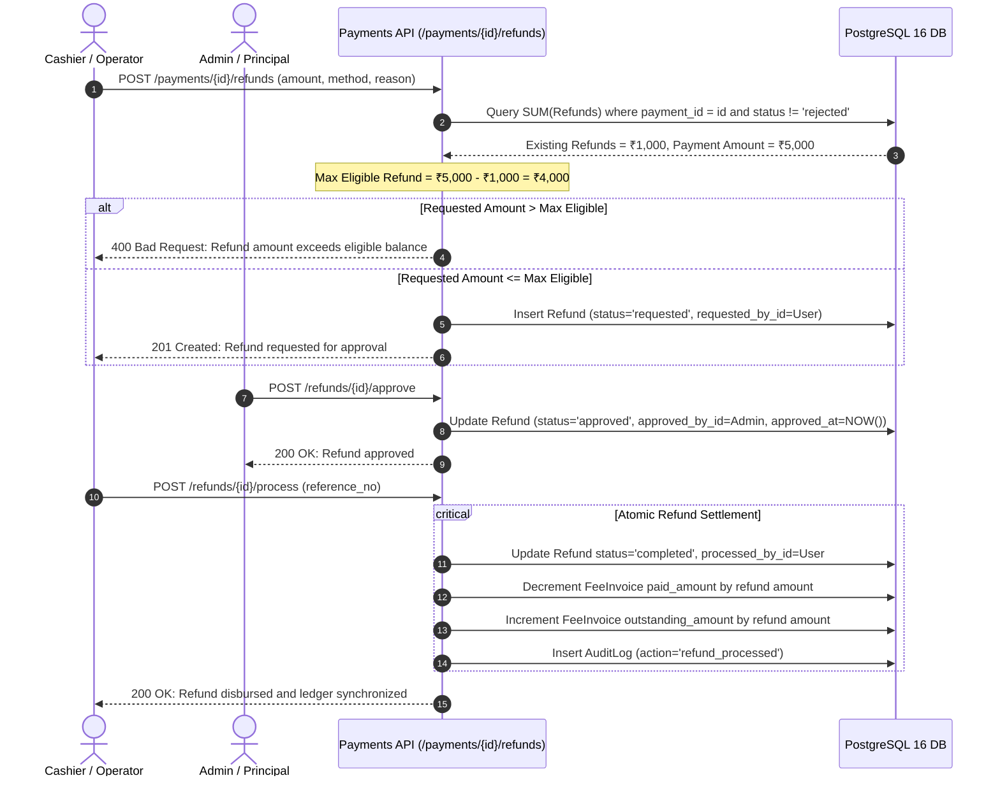
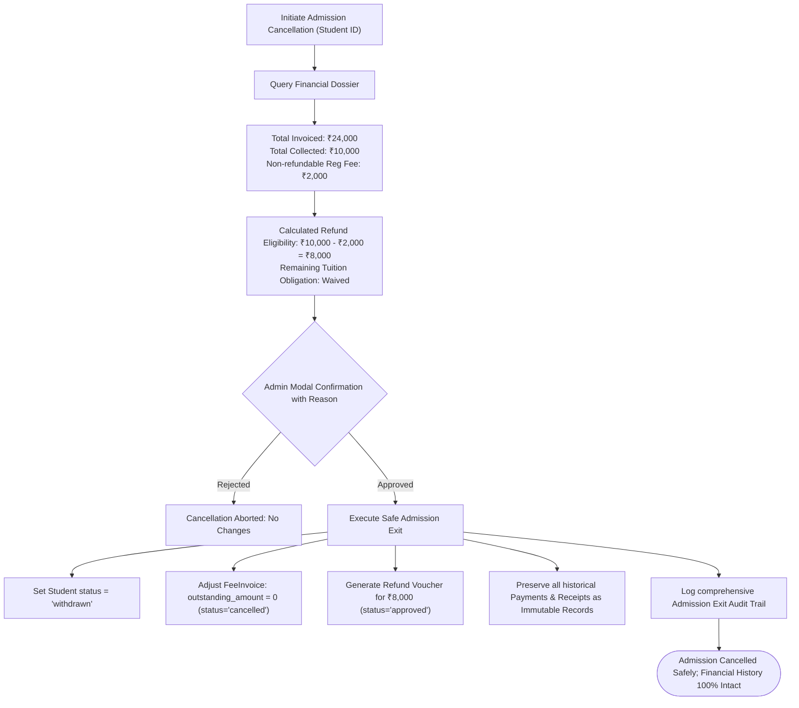

# Financial Transaction Flow Diagrams
## Visual Architectural Specifications for Payment, Reversal, Refund, and Cancellation Pipelines

**Product:** PrathamOne EduOS  
**Edition:** Coaching Institute Edition  
**Baseline Version:** 1.0.0  
**Product Architect:** Jawahar R Mallah  
**Organization:** AITDL — AI Technology & Development Lab  
**Specification Standard:** GitHub Flavored Markdown & Mermaid Visualizations  

---

## 1. FLOW 1: STANDARD PAYMENT COLLECTION & SEQUENTIAL RECEIPT ISSUANCE

This sequence depicts the counter payment workflow (Simple Mode) where funds are received by the cashier, sequentially numbered receipts are issued, and invoice balances are atomically decremented.

---

## 2. FLOW 2: ERP TWO-PERSON APPROVAL WORKFLOW (HIGH VALUE / CHEQUE)

For transactions exceeding the institution threshold (default ₹25,000) or high-risk instruments (`cheque`, `demand_draft`, `bank_transfer`), standard ERP segregation of duties is strictly enforced.

---

## 3. FLOW 3: POSTED PAYMENT CORRECTION & RECEIPT SUPERSESSION

When a posted payment requires financial adjustment (e.g., corrected from ₹5,000 to ₹4,000), the historical receipt is preserved with status `superseded` and version $N+1$ is generated.

---

## 4. FLOW 4: PAYMENT REVERSAL & COUNTER-TRANSACTION WORKFLOW

Reversals permanently invalidate a payment voucher, restore student fee obligations, mark receipts as `voided`, and generate an immutable audit record.

---

## 5. FLOW 5: PARTIAL & MULTI-PARTIAL REFUND LIFECYCLE

Refunds are governed by the canonical `refunds` table, ensuring cumulative disbursements never exceed eligible refundable collections.

---

## 6. FLOW 6: ADMISSION CANCELLATION & FINANCIAL PRESERVATION

When an admission is cancelled, financial records are preserved with absolute immutability. Fees collected and refund eligibility are calculated separately.

