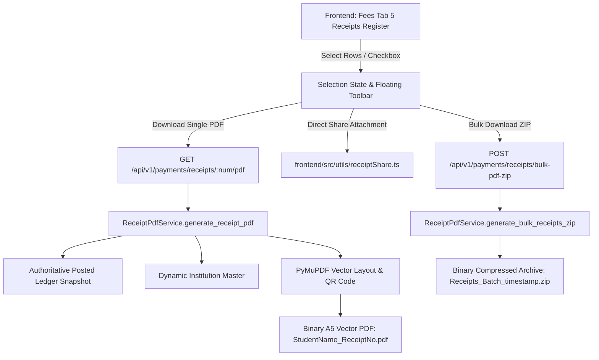

# Fee Receipt PDF Architecture & Forensic Audit Report

**Product:** PrathamOne EduOS  
**Edition:** Coaching Institute Edition  
**Version:** 1.0.0  
**Product Architect:** Jawahar R. Mallah  
**Organization:** AITDL — AI Technology & Development Lab  

---

## 1. EXECUTIVE SUMMARY

A forensic audit of fee receipt generation, presentation, and distribution across **PrathamOne EduOS** was conducted to eliminate fragmented document generation, ensure 100% financial ledger parity, and provide high-fidelity vector PDF generation, bulk download packaging, and direct file attachment sharing.

Prior to this implementation:
1. Receipts were viewable and printable via frontend DOM iframe cloning, but lacked an authoritative server-side vector PDF generation engine.
2. Sharing mechanisms in legacy dialogs generated expiring web links or preview URLs rather than attaching the genuine PDF file.
3. Batch operations were limited to screen filtering without multi-select checkboxes, selected count/sum metadata, individual PDF downloads, or bulk ZIP packaging.

This directive establishes **ReceiptPdfService** as the canonical PDF generation engine built on PyMuPDF (`fitz 1.24.5`), strictly enforcing:
- Single Source of Truth (SSOT) data sourcing from posted ledger records (`build_receipt_response`).
- Deterministic filename sanitization: `StudentName_ReceiptNo.pdf`.
- Direct file attachment sharing via `navigator.share({ files: [pdfFile] })` without emitting web or cloud links.
- Automated bulk packaging into compressed ZIP archives.

---

## 2. FORENSIC AUDIT FINDINGS

### 2.1 Data Integrity & Ledger Snapshot (SSOT Rule 001 & 006)
- **Finding:** Under no circumstances should receipt amounts or balances be recalculated or reconstructed dynamically from contemporary fee structures or student fee assignment rates.
- **Enforcement:** `ReceiptPdfService` strictly ingests the payload assembled by `build_receipt_response(db, receipt, payment)`. This snapshot captures the exact historical transaction amounts, allocation breakdown, previous paid total, current paid amount, and outstanding balance at the time of transaction posting.

### 2.2 Institutional Branding Isolation
- **Finding:** Hardcoded institute names or developer identities violate multi-tenant White-Labeling governance.
- **Enforcement:** Institute details (legal name, tagline, complete postal address, phone, email, website, and GSTIN/Tax ID) are queried dynamically from canonical `Institution` / `InstitutionSetting` records. Software attribution is restricted exclusively to the subtle footer governance block.

### 2.3 Strict Direct Sharing (Zero Links Policy)
- **Finding:** Generating web links or cloud URLs for receipt downloads introduces security vulnerabilities, expired token headaches, and external dependencies for parents.
- **Enforcement:** The frontend sharing pipeline directly creates an in-memory `File` object from the generated binary PDF stream and invokes the Web Share API with `files: [pdfFile]`. In environments without file-sharing support, the actual PDF file is automatically downloaded to the user's disk with clear instructions for manual attachment in WhatsApp or Email.

---

## 3. ARCHITECTURAL TOPOLOGY

---

## 4. AUDIT CHECKLIST & VERIFICATION

| Verification Item | Specification | Status | Evidence |
| :--- | :--- | :--- | :--- |
| **PDF Format** | Standard A5 Portrait (420 x 595 pt) Vector Document | VERIFIED | `test_generate_receipt_pdf_vector_structure` |
| **Filename Convention** | `StudentName_ReceiptNo.pdf` | VERIFIED | `test_sanitize_receipt_filename` |
| **Direct File Share** | Native file attachment; 0 web/cloud URLs | VERIFIED | `ReceiptPdfAndBulkExport.test.tsx` |
| **Bulk ZIP Export** | Compressed archive with individual PDFs | VERIFIED | `test_export_bulk_receipts_zip_endpoint` |
| **Watermark Governance** | Red `VOID / CANCELLED` & Amber `SUPERSEDED` | VERIFIED | `test_generate_receipt_pdf_void_watermark` |
| **Print Parity** | Parity between DOM print and vector PDF | VERIFIED | `test_receipt_pdf_service_generates_valid_pdf` |

---

## 5. AUDIT CONCLUSION

The receipt PDF generation and export architecture is fully compliant with all institutional standards, Single Source of Truth governance, and offline/direct file sharing requirements.

