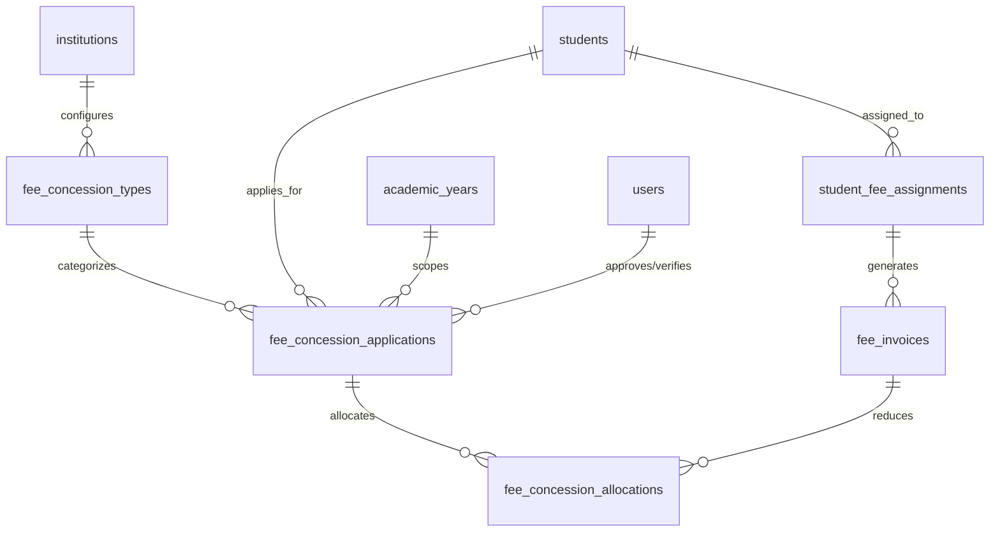

# Fee Concession & Scholarship Management Engine
## Implementation Plan, Existing System Audit & SSOT Mapping

### 1. Executive Summary & Objective

In accordance with the **PrathamOne EduOS Engineering Directives** and the **Global Policy on Single Source of Truth (SSOT) & Anti-Duplication Governance**, this document establishes the authoritative architecture, forensic audit mapping, and implementation roadmap for the **Fee Concession & Scholarship Management Engine**.

The engine supports:
1. **Merit-Based Scholarships** (Board/entrance exam score benchmarks).
2. **Need-Based Financial Assistance** (Guardian income thresholds and documentation).
3. **Sibling Discounts** (Cross-student guardian family link matching).
4. **Staff-Child / Faculty Discounts** (Guardian-to-active staff link matching).
5. **Admission Discounts & Early-Payment Discounts** (Date/campaign window triggers).
6. **Promotional Discounts & Special Management Concessions** (Executive committee approvals).
7. **Full and Partial Fee Waivers** (Hardship/sports/discretionary 100% or partial adjustments).
8. **Externally Sponsored Scholarships** (Trusts, CSR foundations, government welfare, tracking receivables vs disbursements).

---

### 2. Phase 1 — Forensic Audit & Implementation Mapping

```
AUDIT → REUSE → REFACTOR → EXTEND → CREATE ONLY IF MISSING → TEST → VERIFY
```

| Requirement | Existing Implementation | Gap Identified | Planned Action |
|:---|:---|:---|:---|
| **1. Scholarship & Concession Types** | Legacy stub endpoints (`/discounts`, `/scholarships` in `fees.py`), hardcoded mock array in `Fees.tsx` Workspace 6. | No configurable database-backed master table. Types cannot be toggled, configured with funding source (Institute vs External Sponsor), or parameterized with stacking rules. | **CREATE ONLY IF MISSING:** `FeeConcessionType` (`fee_concession_types`) master table. Pre-populate 10 standard categories. Provide full management API (`/api/v1/fees/concessions/types`). |
| **2. Eligibility Rules Engine** | Student records link to Standard (`standards`), Division (`divisions`), Attendance (`attendances`), Exam Marks (`exam_marks`), Guardians (`guardians` with `annual_income`, `phone`, `email`). | No automated rule evaluator checking student academic performance, attendance %, family sibling co-enrollment, or staff relationship. | **CREATE ONLY IF MISSING:** `ConcessionEligibilityService` evaluating student profile against scheme criteria. Returns `{ eligible: bool, passed_criteria, failed_criteria }`. |
| **3. Applications & Nominations** | Flat `concession_amount` on `student_fee_assignments`. Document uploads in `student_documents`. | No transactional record of who applied/nominated, supporting verification documents, multi-stage approval lifecycle, or expiration/renewal tracking. | **CREATE ONLY IF MISSING:** `StudentConcessionApplication` (`fee_concession_applications`) with sequential numbering (`SCH-2026-XXXX`), supporting full lifecycle: `draft` $\rightarrow$ `submitted` $\rightarrow$ `under_verification` $\rightarrow$ `pending_approval` $\rightarrow$ `approved` $\rightarrow$ `applied` / `rejected` / `withdrawn`. |
| **4. Approval Workflow & RBAC** | `AuditLog` records adjustments. `require_role("superadmin", "admin", "accountant", "principal")` enforces permissions. | Segregation of duties: Request vs Document Verification vs Financial Approval vs Revocation. Prevention of self-approval. | **EXTEND & REUSE:** Implement approval state machine in `ConcessionApprovalService` with dedicated permission checks (`concession:request`, `concession:verify`, `concession:approve`, `concession:withdraw`) and audit logging. |
| **5. Concession Calculation & Stacking** | `POST /fees/students/{student_id}/adjustment` calculates gross package minus concession. | Stacking limits (max percentage cap, max rupee cap, non-combinable schemes) are not enforced programmatically. Post-payment credit surpluses are not flagged. | **EXTEND & REUSE:** Build calculation engine validating maximum allowable concession ($\le 100\%$ and $\le \text{gross obligation}$). If applied after payment, calculate resulting credit balance without touching immutable historical receipts. |
| **6. Fee Management Integration** | `StudentFeeAssignment` and `FeeInvoice` manage authoritative amounts. `Payment` and `PaymentReceipt` manage cash inflows. | When multiple concessions exist, line-item allocation to invoices was not tracked. | **REUSE & EXTEND:** `FeeConcessionAllocation` linking approved application to active `FeeInvoice`. Synchronizes `FeeInvoice.discount_amount`, recalculating `net_amount` and `outstanding_amount`. Never rewrites receipts or creates duplicate invoices. |
| **7. Funding Source & External Sponsors** | All receipts currently assumed self-paid student cash inflows. | No tracking of external scholarship sponsors (trusts, CSR, foundations) with sanctioned vs received funds, or pending sponsor receivables. | **EXTEND:** Track sponsor details on application (`sponsor_name`, `sponsor_reference`, `sanctioned_amount`, `received_amount`). Enforce rule: *awarded sponsor scholarship is not counted as payment until the sponsor receipt is posted!* |
| **8. Student Dossier Integration** | `StudentDetail.tsx` has Fees tab with "Adjust Student Fees" button. | No dedicated "Scholarships & Concessions" section displaying awarded schemes, application history, and sanction letters. | **EXTEND & REUSE:** Embed a dedicated "Scholarships & Concessions" section in `StudentDetail.tsx` (Fees tab) with real-time status and sanction letter view. |
| **9. User Experience (Fees Workspace 6)** | Workspace 6 (`/fees?tab=concessions`) in `frontend/src/pages/Fees.tsx` uses mock in-memory state. | Not connected to real backend APIs; no filtering by category/status, no multi-stage actions (Verify, Approve, Reject, Apply, Award Letter). | **REFACTOR & EXTEND:** Connect Workspace 6 to real TanStack queries, View Mode default, scoped Edit Mode, multi-criteria filters, and responsive mobile/desktop layout. |
| **10. Reports, Print & Sanction Letters** | `PrintDocumentBranding.tsx` and `sequence.py` provide corporate document branding and linear numbering. | No official printable "Scholarship Award Letter" / "Concession Sanction Certificate". | **REUSE & EXTEND:** Implement `ScholarshipAwardLetter` modal/printout reusing `PrintDocumentBranding`, and add concession analytics KPI summary to Financial Daybook. |

---

### 3. Database Architecture (SSOT Entity Classification)



1. **`fee_concession_types` (Master Entity):**
   - Authoritative registry of institute concession schemes.
   - Dynamic: Admin can create, edit, activate, or deactivate schemes without code deployments.

2. **`fee_concession_applications` (Transaction Entity):**
   - Canonical record of each student scholarship nomination, request, or grant.
   - Sequential identifier: `SCH-YYYY-XXXX` via `sequence.py`.
   - Immutable workflow transitions recorded with user attribution and timestamps.

3. **`fee_concession_allocations` (Ledger Entity):**
   - Point-in-time deduction allocated against a student's `FeeInvoice`.
   - Reconciles `FeeInvoice.discount_amount` with mathematical precision.

---

### 4. Financial Integrity & Immutability Rules

1. **RULE 1 — No In-Place Overwrites of Receipts:**
   Approved concessions recalculate invoice `discount_amount`, `net_amount`, and `outstanding_amount`. They **never** alter historical `payments` or `payment_receipts`.
2. **RULE 2 — Post-Payment Concession Handling:**
   If a concession is approved on an invoice with $\text{paid\_amount} > \text{new net\_amount}$, the system flags:
   $$\text{Credit Balance} = \text{paid\_amount} - \text{net\_amount}$$
   This credit balance is recorded as available for future fee adjustment or an authorized refund voucher (`Refund`), preserving the original receipt intact.
3. **RULE 3 — External Sponsor Segregation:**
   External sponsor funding is treated as a receivable until the actual payment voucher/receipt is recorded. Awarding a ₹25,000 scholarship from a sponsor does NOT mark ₹25,000 as paid until cash/bank transfer is confirmed.
4. **RULE 4 — Stacking & Ceiling Protection:**
   The calculation engine strictly caps cumulative concessions at the gross fee structure amount ($\text{Net Payable} \ge 0$). Multiple non-stackable concessions are rejected.

