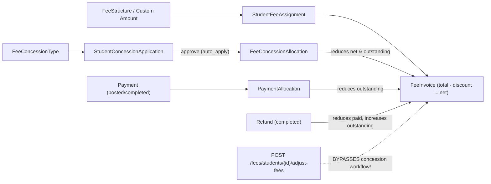

# PHASE 1 — COMPLETE SYSTEM-WIDE FINANCIAL DATA-FLOW & DISCREPANCY AUDIT

**Product:** PrathamOne EduOS (Coaching Institute Edition v1.0.0)  
**Pre-Audit Database Snapshot:** `data/backups/prashant_academy_pre_concession_governance_2026-11-11.sql` (`2,114,740` bytes)  
**Alembic Baseline Head:** `041_subject_dedup`  
**Audit Scope:** Database schema & live PostgreSQL data, Backend Models/Services/Endpoints, Frontend Dashboards/Pages/Reports, RBAC & Audit Logs.

---

## 1. Live Database Baseline (`prashant_academy`)

| Table / Metric | Live Count / Value | Audit Observation |
|:---|---:|:---|
| `fee_categories` | `7` | Fee heads active |
| `fee_structures` | `39` | Standard/board fee packages |
| `student_fee_assignments` | `39` | `concession_amount` synced for 2 students |
| `fee_invoices` (`PRODUCTION`) | `39` | Gross `₹28,89,000.00`, Discount `₹35,000.00`, Net `₹28,54,000.00`, Paid `₹18,82,900.00`, Outstanding `₹9,71,100.00` |
| `fee_invoice_items` | `39` | Line-item table (`fee_installments` retired in Migration 031) |
| `payments` | `178` | `169` completed (`₹18,18,900`), `4` posted (`₹64,000`), `5` reversed (`₹17,513`) |
| `payment_allocations` | `177` | Total `₹18,92,912.00` — exceeds valid payments by `₹10,012.00` because 3 reversed payments (`#107: ₹10,000`, `#175: ₹11`, `#176: ₹1`) still retain positive allocation rows! |
| `payment_receipts` | `180` | Versioned receipts with cancellation/supersession tracking |
| `refunds` | `2` | `#1 (₹1.00)`, `#2 (₹11.00)` both `status = 'requested'` (`₹12.00`) |
| `fee_concession_types` | `20` | `10` schemes seeded per institution (`inst 1` & `inst 2`), all merged in `category` without explicit `benefit_type` classification |
| `fee_concession_applications` | `2` | `#SCH-2026-0001` (`₹20,000.00`, Merit, `applied`), `#SCH-2026-0002` (`₹15,000.00`, Special Mgmt, `applied`) |
| `fee_concession_allocations` | `2` | `₹20,000.00` (Invoice `#3`), `₹15,000.00` (Invoice `#25`). Lacks `transaction_ref`, `posting_status`, reversal lineage |
| `institution_settings` | `28` | No `currency_code`, `currency_symbol`, or `currency_precision` keys present |

---

## 2. Current Financial Data Flow

---

## 3. Critical Discrepancies & Defects Found

### 3.1 Hardcoded Values, Dummy Data & Misleading Dashboard Metrics
1. **Hardcoded Ledger & Transaction Fallbacks (`frontend/src/pages/Dashboard.tsx:1829–1893`):**
   - Tab 7 (Transactions & Reconciliation) displays hardcoded fallback constants (`171`, `1794300`, `2894000`, `1094700`), and hardcodes `"100% Balanced"` & `"Variance: ₹0.00"` regardless of live `ledger_audit.is_reconciled`!
   - Tab 2 (`Dashboard.tsx:1319`) hardcodes subtitle `"Zero unauthorized waivers recorded"`, and Tab 7 (`Dashboard.tsx:1853`) hardcodes `"Zero refund liability backlog"` even when `2` refunds are pending in DB.
2. **Hardcoded Backend Dashboard Metrics (`backend/app/api/v1/endpoints/dashboard.py:856, 867`):**
   - `reversals_amount` is hardcoded to `0.0` despite `₹17,513.00` in reversed payments in live DB.
   - `target` is fabricated dynamically as `round(collected * 1.15, 2)`.
   - `net_collection` omits deduction of completed `Refund`s.
3. **Hardcoded Dummy Defaulters Array (`frontend/src/pages/Fees.tsx:189–286`):**
   - Defaulters workspace initializes a static array of 6 fake students (`Aarav Sharma`, `Diya Patel`, etc.) instead of fetching real DB defaulters via `reportsApi.feeDefaulters`.

### 3.2 Calculation Conflicts & Discrepancies Across Modules (SSOT Rule 006 Violations)
4. **Gross vs Net Naming Confusion (`dashboard.py:181, 263` & `fees.py:1035, 1052`):**
   - Both `/dashboard/stats` and `/fees/overview` label `SUM(FeeInvoice.net_amount)` as `total_fees` / `total_obligation` instead of separately exposing `Gross Fee Assessed` (`FeeInvoice.total_amount`), `Approved vs Posted Concessions`, `Fee Waivers`, `Scholarships`, and `Net Fee Due`.
   - `/fees/overview` lumps ALL `FeeInvoice.discount_amount` into a single `waived_amount` without distinguishing concessions, waivers, scholarships, or external sponsor funding.
5. **Report Intelligence False Realization Rate (`backend/app/services/report_intelligence_service.py:435, 455`):**
   - Divides `paid_amount` by `gross_invoiced` (`FeeInvoice.total_amount`) instead of `net_amount`, causing students with 100%-paid net invoices + scholarships to falsely register collection deficits!
6. **Student Dossier & Student Portal Paid/Cancelled Bugs (`students.py:897–914`, `student_portal.py:629–648`):**
   - Both omit `FeeInvoice.status != 'cancelled'` (inflating fees if cancelled invoices exist).
   - Both sum raw `Payment.amount` without subtracting completed `Refund`s, causing Student Dossier & Student Portal to show lower outstanding balances than `FeeInvoice.outstanding_amount` after a refund!
7. **Reversed `payment_allocations` Leak:**
   - Live DB contains `3` reversed payments (`#107`, `#175`, `#176`) whose `payment_allocations` rows retain positive amounts (`₹10,012.00`), inflating naive `SUM(payment_allocations.allocated_amount)` above `FeeInvoice.paid_amount`.
8. **Cartesian Join Duplication in `fees.py` (`/overview` L1060 & `/register` L1555):**
   - Joins `StudentEnrollment` directly instead of `latest_enrollment_subquery`, causing double-counting whenever a student transfers batches within the same academic year; also omits `is_demo` / `data_environment` filtering present in `dashboard.py`.
9. **Client-Side Calculation Duplication (Rule 006):**
   - `StudentDetail.tsx:2526–2530` computes `newNet` and `newOutstanding` client-side in `Adjust Student Fees`.
   - `Fees.tsx:4977–4979` resolves concession tier client-side (`applied || approved || requested`).

### 3.3 Missing Transaction Lifecycle, Bypass & Integrity Controls
10. **`/adjust-fees` Bypass (`fees.py:426–625`):**
    - Directly mutates `StudentFeeAssignment.concession_amount` and `FeeInvoice.discount_amount` without creating a canonical application/allocation ledger entry, fails to update `FeeInvoiceItem.discount_amount` (`L556`), ignores over-payment credit surplus (`L541`), and queries deprecated `FeeInstallment`.
11. **Physical Deletion of Historical Concession Allocations (`concession_service.py:803`):**
    - `withdraw_application` executes `await db.delete(alloc)` — destroying immutable audit evidence — and forgets to recalculate `FeeInvoiceItem.discount_amount` & `net_amount` (`L781–790`).
12. **Missing Statuses, Concurrency Locks, Idempotency & Sponsor Recovery Ledger:**
    - `FeeInvoice` updates in `concession_service.py:650`, `payment_workflow_service.py:174, 261`, and `payments.py:1574` lack `.with_for_update()` pessimistic row locks.
    - No `posted`, `reversed`, `cancelled`, or `expired` workflow transitions/endpoints exist; `valid_until` expiry is never enforced.
    - No `sponsor_settlements` transaction ledger or endpoint exists to record incoming external sponsor funds against `sponsor_sanctioned_amount`.
    - `StudentConcessionApplication` and `Refund` lack `idempotency_key`.
13. **RBAC Granularity Gap:**
    - `concessions.py` checks coarse roles (`require_role(...)`) instead of permission-based enforcement (`concessions:approve`, `concessions:reverse`, etc.), and `/applications/bulk` allows `auto_approve=True` bypassing segregation of duties.

### 3.4 Dashboard & Report Coverage Gaps
14. **7 Dashboards (Phase 4):** None of the 7 dashboards currently unify `Gross Assessed`, `Approved Concessions`, `Posted Concessions`, `Waivers`, `Scholarships`, `Sponsor Outstanding`, `Net Payable`, `Refunds`, and `Reversals` from one backend governance service. `FeeCollection.tsx`, `StudentDashboard.tsx`, `AcademicWorkspace.tsx`, and `LeadManagement.tsx` omit concession/scholarship visibility entirely; `Payments.tsx` has zero UI for `paymentsApi.listRefunds`/`approveRefund`/`processRefund`.
15. **20 Concession/Waiver/Scholarship Reports (Phase 5):** **0 of 20** specific Phase 5 concession/waiver/scholarship/sponsor/reconciliation reports exist in `reports.py` or `Reports.tsx`. `ReportIntelligenceService` falls back to dummy zeros for any unregistered report ID (`_generic_intelligence`).

---

## 4. Phase 1 Sign-Off & Architecture Decision

Database integrity of existing live rows shows zero `FeeInvoice` arithmetic variance (`total - discount == net` and `net - paid == outstanding` across all `39` invoices; `sfa.concession_amount == fi.discount_amount == SUM(fee_concession_allocations)` for all `39` students).  
Proceeding to **Phase 2–10** by extending the existing schema (Alembic Migration `042`), introducing a centralized SSOT `FinancialGovernanceService`, fixing all audited backend/frontend bugs, integrating all 7 dashboards and all 20 reports, and validating all 20 scenarios end-to-end.

