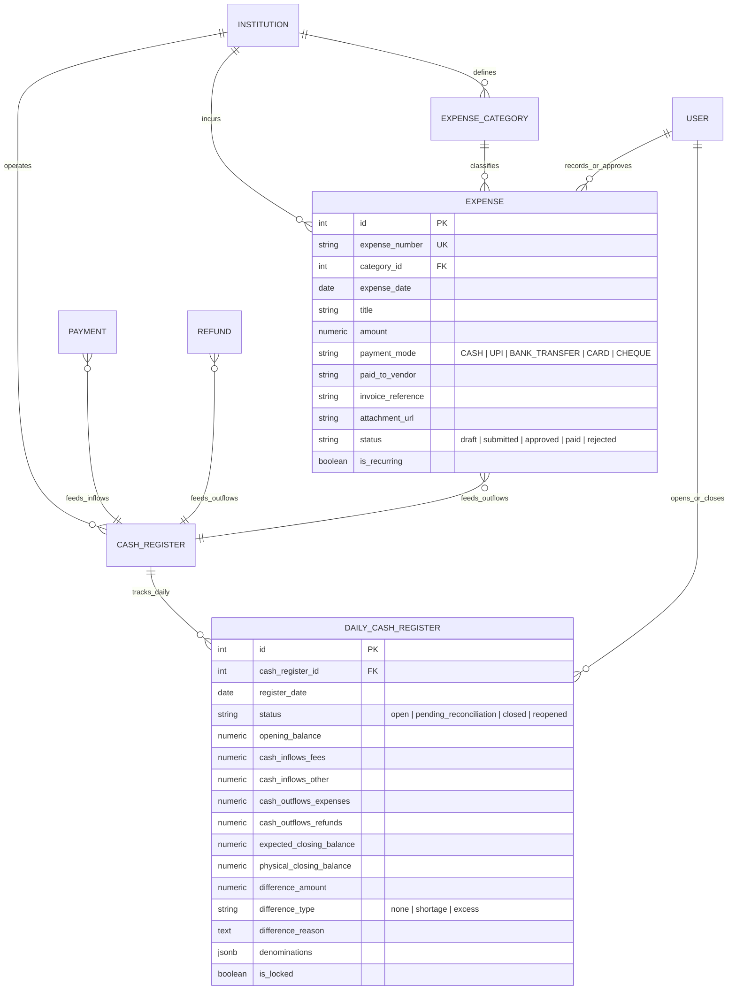

# Institute Daily Expense Management & Automated Cash Register Architecture

## 1. Executive Summary & Directive

Pursuant to the **PrathamOne EduOS Master Financial Directive**, coaching institutes require an integrated, lightweight financial management system that enforces rigorous separation of duties while maintaining single-source-of-truth (SSOT) integrity:

1. **Fees & Collections**: Money received from students (managed canonically by `payments` and `fee_invoices`).
2. **Daily Expense Management**: Money spent by the institute (staff salaries, rent, utilities, supplies, marketing).
3. **Daily Automated Cash Opening & Closing**: Live physical cash drawer tracking, denomination-level count, difference calculation, and tamper-resistant reconciliation.

```
+-----------------------------------------------------------------------------------+
|                        PRATHAMONE EduOS FINANCIAL ARCHITECTURE                    |
+-----------------------------------------------------------------------------------+
|  1. FEES & COLLECTIONS      |  2. EXPENSE MANAGEMENT      |  3. CASH REGISTER     |
|  - Student Fee Invoices     |  - Vendor & Salary Payments |  - Automated Opening  |
|  - Cash / UPI / Bank Inflow |  - Approval Lifecycle       |  - Denomination Count |
|  - Payment Receipts         |  - Bill / Invoice Upload    |  - Shortage / Excess  |
|  - Student Refunds          |  - Enterprise DataTable     |  - Closing & Locking  |
+-----------------------------------------------------------------------------------+
                                         |
                                         v
+-----------------------------------------------------------------------------------+
|                   LIVE DAILY CASHBOOK & AUDIT TRAIL (RECONCILED)                  |
|          Expected Closing = Opening Balance + Cash Inflows - Cash Outflows         |
+-----------------------------------------------------------------------------------+
```

---

## 2. Core Architectural Principles & SSOT Compliance

1. **Strict Tri-Partite Separation (Rule 001 & Rule 004)**:
   - Fee receipts belong strictly in `payments` and `payment_receipts`.
   - Institute outflows belong strictly in `expenses`.
   - Physical drawer balance belongs strictly in `daily_cash_registers`.
2. **Physical Cash Boundary**:
   - Only completed **CASH** transactions (`payment_method == 'CASH'` / `payment_mode == 'CASH'`) affect the cash register.
   - UPI, direct bank transfers, online gateway payments, and unpresented cheques **NEVER** affect physical cash in hand.
3. **Automated Daily Opening & Verification Carry-Forward**:
   - The opening balance of Day $T$ is automatically initialized from the verified closing balance of Day $T-1$.
   - If Day $T-1$ was not closed or verified, the register is flagged as `pending_reconciliation`.
4. **Denomination-Level Counting & Zero Auto-Balancing**:
   - Physical cash is counted across standard Indian currency denominations (₹500, ₹200, ₹100, ₹50, ₹20, ₹10, ₹5, ₹2, ₹1).
   - If Physical Cash $\neq$ Expected Cash, the difference (shortage or excess) is highlighted. The system **never** creates silent fictitious balancing transactions.
5. **Immutable Closing & Supervisory Lock (Rule 010)**:
   - Finalized closings become immutable (`is_locked = True`). Any post-closing adjustment requires an authorized reopening workflow with logged rationale.

---

## 3. Data Model Architecture



---

## 4. Acceptance Test Scenario (Mathematical Proof)

The test verifies:
- Opening Cash Balance: **₹5,000.00**
- Student Cash Fee Collections: **₹12,000.00** (from real cash payments)
- Cash Expenses Paid: **₹2,500.00** (from approved cash expenses)
- **Expected Closing**: $\$5,000 + \$12,000 - \$2,500 = \$14,500.00$
- Physical Cash Count:
  - $20 \times ₹500 = ₹10,000$
  - $15 \times ₹200 = ₹3,000$
  - $10 \times ₹100 = ₹1,000$
  - $6 \times ₹50 = ₹300$
  - **Total Physical Cash**: **₹14,300.00**
- **Difference**: $\$14,300 - \$14,500 = -₹200.00$ (**₹200 Shortage**)
- Operator logs mandatory explanation: *"₹200 minor coin shortage in counter drawer"*
- Supervisor verifies and locks register.
- Next business day automatically carries forward verified **₹14,300.00** as opening balance.

---

## 5. UI/UX Sleekness & Enterprise DataTable Standard

1. **Expense Register**:
   - Filterable columns: Vendor/Payee, Category, Expense Date, Amount, Payment Mode, Status, Bill/Receipt.
   - Quick search across description, vendor name, invoice reference.
   - View Mode by default; Edit Mode required for mutations (Rule 010).
2. **Cash Register & Daily Closing Deck**:
   - Prominent KPI Ribbon: Today's Opening Balance, Total Cash Inflows, Total Cash Outflows, Expected Cash, Physical Cash, Status.
   - Interactive Denomination Matrix with automatic dynamic total tallying.
   - Clear visual status badges: `Open` (Emerald), `Pending Reconciliation` (Amber), `Closed & Locked` (Slate).
