# PrathamOne EduOS — Reporting & Analytics Centre Forensic Audit, Report Inventory & Gap Analysis

**Document Reference:** `2026-11-07_REPORTS-EXPORTS_FORENSIC-AUDIT_REPORT-INVENTORY-AND-GAP-ANALYSIS_V1.md`  
**Product:** PrathamOne EduOS (Coaching Institute Edition)  
**Baseline Version:** 1.0.0  
**Architect:** Jawahar R. Mallah  
**Organization:** AITDL — AI Technology & Development Lab  

---

## 1. Executive Summary & Problem Diagnosis

### 1.1 The Core Problem: Why Does the "Reports" Menu Show Only One Generic Group?
Currently, clicking the **"Reports"** entry in the primary sidebar navigation (`/reports`) navigates the user directly to [`frontend/src/pages/Reports.tsx`](file:///f:/PrashantAcademy/frontend/src/pages/Reports.tsx). 

Forensic inspection of this file reveals that it was historically conceived as an ad-hoc fee collection screen with subsequent student exit tracking. It only displays 5 tabs:
1. `collection` — Fee Collection Report
2. `outstanding` — Outstanding Dues Report
3. `summary` — Payment Methods Breakdown
4. `withdrawals` — Student Withdrawals & Exit Ledger
5. `withdrawal-analytics` — Student Attrition Analytics

### 1.2 The Architectural Fragmentation
Meanwhile, **23+ specialized reports, analytical endpoints, and spreadsheet export routines already exist in the codebase**, but they are fractured and buried across isolated module workspaces:
- **Academic Workspace (`AcademicWorkspace.tsx` Tab 8):** Hosts Batch Capacity, Board/Standard Distribution, and Faculty Load reports.
- **Fees Workspace (`Fees.tsx` Tab 7):** Hosts Division-wise Fee Collection Summary, Defaulters & Overdue Roster, Payment Methods, and Financial Reconciliation Ledgers.
- **Teacher Payroll (`TeacherPayroll.tsx` & `teacher_payroll.py`):** Implements **10 complete specialized financial reports** with custom Excel exports (`monthly-register`, `teacher-history`, `teaching-hours`, `batch-cost`, `subject-cost`, `pending-payments`, `voucher-register`, `adjustments`, `approval-history`, `monthly-summary`), yet none appear in the main "Reports" menu.
- **Examinations (`Examinations.tsx` & `examinations.py`):** Contains exam performance, marks registers, and analytical distributions.
- **Attendance (`Attendance.tsx` & `attendance.py`):** Stores granular daily student check-ins and session marks, but lacks aggregated cohort and chronic defaulter reporting.
- **SysAdmin (`SysAdminWorkspace.tsx` & `sysadmin.py`):** Houses system audit logs and data exchange ledgers.

**Conclusion:** The coaching institute lacks a centralized, unified **Reporting & Analytics Centre**. Users are forced to hunt through disconnected screens to find business-critical insights.

---

## 2. Complete Inventory of Existing Reports Across All Modules

Following the mandatory Seven-State Classification:
- **A: Correctly implemented & working**
- **B: Implemented but incomplete**
- **C: Implemented with defects**
- **D: Implemented but not integrated into central Reports menu**
- **E: Placeholder or non-functional**
- **F: Genuinely missing**
- **G: Duplicate or conflicting**

| Report Title | Module | Backend Route | UI Component | Classification | Finding & Remediation Required |
| :--- | :--- | :--- | :--- | :---: | :--- |
| **Fee Collection Register** | 09_FEES_PAYMENTS | `/api/v1/reports/fee-collection` | `Reports.tsx` | **A** | Works with ExcelReportGrid, CodeX masking, and multi-format exports. |
| **Outstanding Dues & Aging** | 09_FEES_PAYMENTS | `/api/v1/reports/outstanding` | `Reports.tsx` | **A** | Works with ExcelReportGrid and CodeX masking. |
| **Payment Mode Breakdown** | 09_FEES_PAYMENTS | `/api/v1/reports/payments-summary` | `Reports.tsx` | **A** | Displays payment method counts and sums. |
| **Student Withdrawals Ledger** | 04_STUDENT_MANAGEMENT | `/api/v1/reports/withdrawals` | `Reports.tsx` | **A** | Displays withdrawn students, refunds, and retained fee amounts. |
| **Student Attrition Analytics** | 04_STUDENT_MANAGEMENT | `/api/v1/reports/withdrawal-analytics` | `Reports.tsx` | **A** | Features executive KPI cards, monthly attrition trends, and reason charts. |
| **Batch Capacity & Occupancy** | 03_ACADEMIC_MANAGEMENT | `/api/v1/reports/academic/batch-capacity` | `AcademicWorkspace.tsx` | **D** | Fully functional in backend and Tab 8, but hidden from `/reports`. |
| **Academic Distribution** | 03_ACADEMIC_MANAGEMENT | `/api/v1/reports/academic/distribution` | `AcademicWorkspace.tsx` | **D** | Fully functional in backend and Tab 8, but hidden from `/reports`. |
| **Faculty Teaching Load** | 03_ACADEMIC_MANAGEMENT | `/api/v1/reports/academic/faculty-load` | `AcademicWorkspace.tsx` | **D** | Fully functional in backend and Tab 8, but hidden from `/reports`. |
| **Fee Defaulters & Overdue** | 09_FEES_PAYMENTS | `/api/v1/fees/defaulters` | `Fees.tsx` | **D** | Embedded in Fees Tab 7, missing from central Reports. |
| **Financial Reconciliation** | 10_FINANCE_ACCOUNTING | `/api/v1/fees/reconciliation` | `Fees.tsx` | **D** | Embedded in Fees Tab 7, missing from central Reports. |
| **Teacher Monthly Register** | 06_TEACHER_PAYROLL | `/api/v1/teacher-payroll/reports/monthly-register` | `TeacherPayroll.tsx` | **D** | 100% functional with Excel export, missing from central Reports. |
| **Teacher Payment History** | 06_TEACHER_PAYROLL | `/api/v1/teacher-payroll/reports/teacher-history` | `TeacherPayroll.tsx` | **D** | 100% functional with Excel export, missing from central Reports. |
| **Teaching Hours & Delivery** | 06_TEACHER_PAYROLL | `/api/v1/teacher-payroll/reports/teaching-hours` | `TeacherPayroll.tsx` | **D** | 100% functional with Excel export, missing from central Reports. |
| **Batch Teaching Cost** | 06_TEACHER_PAYROLL | `/api/v1/teacher-payroll/reports/batch-cost` | `TeacherPayroll.tsx` | **D** | 100% functional with Excel export, missing from central Reports. |
| **Subject Teaching Cost** | 06_TEACHER_PAYROLL | `/api/v1/teacher-payroll/reports/subject-cost` | `TeacherPayroll.tsx` | **D** | 100% functional with Excel export, missing from central Reports. |
| **Pending Teacher Payments** | 06_TEACHER_PAYROLL | `/api/v1/teacher-payroll/reports/pending-payments` | `TeacherPayroll.tsx` | **D** | 100% functional with Excel export, missing from central Reports. |
| **Disbursement Vouchers** | 06_TEACHER_PAYROLL | `/api/v1/teacher-payroll/reports/voucher-register` | `TeacherPayroll.tsx` | **D** | 100% functional with Excel export, missing from central Reports. |
| **Payroll Adjustments Ledger** | 06_TEACHER_PAYROLL | `/api/v1/teacher-payroll/reports/adjustments` | `TeacherPayroll.tsx` | **D** | 100% functional with Excel export, missing from central Reports. |
| **Payroll Approval History** | 06_TEACHER_PAYROLL | `/api/v1/teacher-payroll/reports/approval-history` | `TeacherPayroll.tsx` | **D** | 100% functional with Excel export, missing from central Reports. |
| **Annual Payroll Cost Summary** | 06_TEACHER_PAYROLL | `/api/v1/teacher-payroll/reports/monthly-summary` | `TeacherPayroll.tsx` | **D** | 100% functional with Excel export, missing from central Reports. |
| **Exam Marks & Merit Roster** | 08_EXAMINATION | `/api/v1/examinations/{id}/marks` | `Examinations.tsx` | **D** | Embedded in exam detail modal, missing from central Reports. |
| **Exam Analytical Distribution** | 08_EXAMINATION | `/api/v1/examinations/{id}/analytics` | `Examinations.tsx` | **D** | Embedded in exam detail modal, missing from central Reports. |
| **Security Audit Logs** | 12_RBAC_SECURITY | `/api/v1/sysadmin/security-audit-logs` | `SysAdminWorkspace.tsx` | **D** | Administrative audit trail isolated in SysAdmin workspace. |
| **Communication Logs** | 15_INTEGRATIONS | `/api/v1/communication/logs` | `Communication.tsx` | **D** | Dispatch tracking isolated in Communication workspace. |
| **Data Import/Export History** | 11_REPORTS_EXPORTS | `/api/v1/import-export/history` | `ImportExport.tsx` | **D** | Migration logs isolated in Import/Export page. |

---

## 3. Gap Analysis: Genuinely Missing Business Reports

To satisfy coaching institute operational requirements, the following reports are **genuinely missing (Classification F)** and must be engineered:

### Category 1: Students & Admissions
1. **Student Master Directory & Demographic Roster:**
   - *Need:* A single exportable spreadsheet of all enrolled students with Roll No, Admission Date, DOB, Gender, Blood Group, Guardian Mobile, Address, Standard, Batch, and Status.
   - *Data Source:* `students`, `student_enrollments`, `divisions`, `standards`.
2. **Student Attendance Percentage & Defaulter Report:**
   - *Need:* Institute-wide or batch-wise student attendance summary (% Present, Total Days Conducted, Days Attended, Days Absent) with quick filtering for attendance < 75%.
   - *Data Source:* `attendances`, `students`, `student_enrollments`.

### Category 2: Academics & Curriculum
3. **Subject & Curriculum Offering Matrix:**
   - *Need:* Cross-tabulation of subjects taught per standard and board, associated syllabus codes, and active teachers.
   - *Data Source:* `subjects`, `standards`, `boards`.
4. **Timetable Room & Batch Utilization Ledger:**
   - *Need:* Weekly schedule analysis showing room occupancy, weekday distribution, and potential timetable clashes.
   - *Data Source:* `portal_timetable_entries`, `divisions`.

### Category 3: Examinations & Academic Performance
5. **Consolidated Exam Merit & Performance Register:**
   - *Need:* Multi-subject exam scores per student with Total Marks, Percentage, Grade, Rank in Batch, and Pass/Fail status.
   - *Data Source:* `examinations`, `exam_marks`, `students`, `subjects`.
6. **Subject-wise Exam Difficulty & Pass Analytics:**
   - *Need:* Comparative subject statistics (Highest Marks, Lowest Marks, Class Average, Pass Percentage, Failure Count).
   - *Data Source:* `examinations`, `exam_marks`, `subjects`.

### Category 4: Fees & Financial Operations
7. **Consolidated Fee Defaulters & Overdue Aging Roster:**
   - *Need:* Centralized list of students with unpaid/overdue installments, parent contact information, days overdue, and last payment date, with CodeX privacy compliance.
   - *Data Source:* `fee_invoices`, `fee_installments`, `students`.
8. **Daily Payment Collection & Cashier Register:**
   - *Need:* Day-wise cashier intake with receipt numbers, student admissions, payment modes, instrument/transaction references, and collector IDs.
   - *Data Source:* `payments`, `fee_invoices`, `students`.

### Category 5: Administration, Security & Auditing
9. **System Access & User Activity Audit Report:**
   - *Need:* Comprehensive user session, login, role switch, and permission verification log with IP address and timestamps.
   - *Data Source:* `codex_audit_logs`, `users`.

---

## 4. Target Architecture: PrathamOne Reporting & Analytics Centre

To eliminate the single-report confusion, the Reports navigation will be organized into **6 logical business categories with 24 dedicated report views**:

```mermaid
graph TD
    R[Reporting & Analytics Centre] --> C1[1. Students & Admissions]
    R --> C2[2. Academics & Batches]
    R --> C3[3. Fees & Financials]
    R --> C4[4. Teachers & Payroll]
    R --> C5[5. Examinations & Merit]
    R --> C6[6. System & Audit]

    C1 --> R1_1[Student Master Directory]
    C1 --> R1_2[Student Attendance Summary]
    C1 --> R1_3[Student Withdrawals Ledger]
    C1 --> R1_4[Student Attrition Analytics]

    C2 --> R2_1[Batch Capacity & Occupancy]
    C2 --> R2_2[Academic Board/Standard Distribution]
    C2 --> R2_3[Subject & Curriculum Matrix]
    C2 --> R2_4[Room & Schedule Utilization]

    C3 --> R3_1[Fee Collection Register]
    C3 --> R3_2[Outstanding Dues & Overdue Aging]
    C3 --> R3_3[Fee Defaulters & Escalation]
    C3 --> R3_4[Daily Payment Intake Register]
    C3 --> R3_5[Payment Mode Breakdown]

    C4 --> R4_1[Faculty Workload & Supervision]
    C4 --> R4_2[Teaching Hours & Delivery Report]
    C4 --> R4_3[Monthly Teacher Payment Register]
    C4 --> R4_4[Batch & Subject Teaching Cost]
    C4 --> R4_5[Disbursement Voucher Register]

    C5 --> R5_1[Consolidated Exam Merit Register]
    C5 --> R5_2[Subject-wise Exam Analytics]
    C5 --> R5_3[Student Report Cards Roster]

    C6 --> R6_1[Security & Access Audit Trail]
    C6 --> R6_2[Communication & Dispatch Logs]
    C6 --> R6_3[Data Import/Export History]
```

---

## 5. Implementation Roadmap & Governance Directives

1. **Category Navigation Shell:** Refactor `Reports.tsx` into a responsive two-tier or tabbed dashboard with a left-hand/top category switcher (`Students`, `Academics`, `Fees`, `Workforce`, `Exams`, `Audit`) and report cards/selector pills.
2. **Reusing `<ExcelReportGrid>`:** Every tabular report will utilize `<ExcelReportGrid>`, guaranteeing client-side search, column filtering, column reordering, sorting, column visibility toggle, and instant exports (`.xlsx`, `.csv`, `.json`).
3. **Backend Query Consolidation:**
   - Centralize report routes in `backend/app/api/v1/endpoints/reports.py` or proxy through domain services.
   - Enforce mandatory tenant isolation (`institution_id = current_user.institution_id`).
   - Enforce CodeX data masking (`CodeXService.mask_records_list`) on all financial columns (`fee_collection`, `outstanding`, `defaulters`, `payroll`, `daily_payments`).
4. **RBAC Security:**
   - Restrict financial and payroll reports to `admin`, `accountant`, `principal`, and `sysadmin`.
   - Allow teachers access to exam, attendance, and academic distribution reports.
   - Enforce explicit `can_decode` permissions for CodeX obfuscated values.

