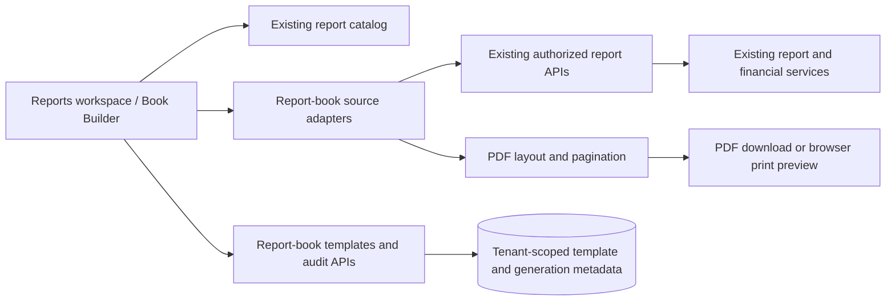

# Report Book Publishing Engine

## 1. Objective

The report-book feature is a composition layer on top of the existing reporting engine, not a parallel reporting system. It allows authorized users to assemble multiple source reports into a single branded publication or printable book while preserving the source-of-truth logic already implemented in the report catalog, report APIs, and financial governance services.

## 2. Design principles

- Reuse actual reports, calculations, and filters instead of duplicating report logic.
- Keep report books as a composition and publishing workflow around existing reports.
- Preserve institution and academic-year isolation for every template and generation record.
- Store reusable metadata and document audit snapshots instead of re-creating financial/academic tables.
- Keep print and PDF output aligned to the existing PrathamOne branding and print layout standards.

## 3. Architecture

### 3.1 Frontend

The UI entry point is the Reports workspace. The report-book experience is surfaced as a builder that:

- loads the live report catalog,
- filters reports by role and institutional access,
- allows chapter and subchapter arrangement,
- supports template presets for academic, fee, examination, payroll and institutional books,
- creates a printable PDF package from selected reports,
- records generation and download/print activities.

Main implementation files:

- `frontend/src/pages/Reports.tsx`
- `frontend/src/components/reports/ReportBookBuilder.tsx`
- `frontend/src/components/reports/reportBookCatalog.ts`
- `frontend/src/components/reports/reportBookSources.ts`
- `frontend/src/components/reports/reportBookPdf.ts`
- `frontend/src/components/reports/reportBookTypes.ts`

### 3.2 Backend

The backend adds a focused persistence layer for report-book templates and generation snapshots:

- `backend/app/models/report_book.py`
- `backend/app/api/v1/endpoints/reports.py`
- `backend/alembic/versions/048_report_book_publishing.py`
- `backend/alembic/versions/049_report_book_permissions.py`

The key model behavior is to store:

- reusable template configuration,
- institution-scoped references,
- generation metadata for auditability,
- immutable event records for download and print actions.

### 3.3 Source control and SSOT

The design intentionally ties report-book publishing to the existing report APIs and services. This avoids duplicate business logic for:

- student master information,
- attendance percentages,
- fee collection totals,
- outstanding balances,
- concession ledgers,
- examination outcomes,
- payroll summaries,
- audit logs.

The book builder therefore acts as a presentation and packaging layer rather than a second financial or academic engine.

### 3.3 Data and publishing flow

Report rows and financial calculations flow from existing APIs into the PDF renderer; the book tables store template configuration and generation metadata only. They do not persist a second copy of report records or financial transactions.

## 4. Feature scope

### Included

- multi-report selection and chapter organization,
- saved reusable templates,
- PDF generation with cover, numbering, outlines, and sections,
- adjustable page size and margin settings,
- print/download action recording,
- academic-year and institution-aware filtering,
- role-limited access to restricted reports.

### Guardrails

- no report logic duplication,
- no silent mixing of institutions or academic years,
- no historical financial mutation,
- no unapproved deployment or production rollout without explicit approval.

## 5. Audit-first findings and disposition

| Area inspected before implementation | Existing contract | Implementation disposition |
| --- | --- | --- |
| Reports workspace and catalog | `frontend/src/pages/Reports.tsx` owns the report catalog, existing filters, and Reports navigation. | Added the builder as a Reports view and referenced catalog IDs; no duplicate report module. |
| Report data and calculations | `backend/app/api/v1/endpoints/reports.py` and existing academic, payroll, homework, concession, and examination APIs own report data and calculations. | Added source adapters that call those APIs; financial reconciliation and totals are not recalculated by the book layer. |
| PDF/export baseline | `frontend/src/utils/reportExport.ts` covers report exports; the existing backend PDF service is receipt-specific. No general multi-report PDF assembler was found. | Added a composition-only PDF renderer; source report calculations remain unchanged. Excel attachments are not included in this initial slice. |
| Print branding | `PrintDocumentBranding.tsx` and `printing/PrintFooter.tsx` define the institutional header and canonical two-row footer/document-ID pattern. | PDF output carries institution branding, classification, document ID, page count, and PrathamOne EduOS attribution. It is a compiled management report, not a replacement for statutory receipts, invoices, or academic records. |
| Permissions and tenant scope | Existing report APIs enforce their own role/permission checks; `has_permission` supports granular report actions; institution access is checked in the API. | Added distinct `reports:view`, `reports:manage_templates`, `reports:generate_books`, `reports:download`, and `reports:print` permissions, plus institution-scoped persistence. Source APIs remain the data authorization boundary. |
| Academic/report filters | Existing report APIs accept different filter combinations. | Common year, examination, date, standard, and batch filters are forwarded where supported; unsupported filters are disclosed in the generated report rather than silently claimed as applied. |

### 5.1 Defects found during implementation audit

1. The pre-existing API validator reused the per-section report ID list as the global accumulator and extended the list with itself. This corrupted validation for any non-empty book. The local accumulator is now distinct, and regression tests cover multiple IDs and duplicates.
2. The generic institution access helper permits an unassigned non-system user to supply a tenant ID. Report-book routes now explicitly require the user's assigned institution (or a system administrator).
3. Fixed-size contents pagination could place entries outside A5 and small custom pages. The renderer now derives contents capacity from actual page height and margins.
4. Very long unbroken cell values could exceed their columns. The renderer now breaks those values within the measured column width and truncates only after the configured line limit.
5. PDF output previously omitted the canonical footer metadata. All pages now include document ID, continuous page numbering, classification, and software attribution.

## 6. Audit and validation approach

The implementation follows an audit-first workflow:

1. inspect existing report APIs and source data,
2. align templates to real report IDs,
3. validate role and access filtering,
4. persist generation metadata without rewriting transaction tables,
5. verify generated PDFs locally and in the browser,
6. document outcome and release readiness.

## 7. Verification evidence and current status

### Automated evidence

- Frontend production TypeScript/Vite build: **passed** after aligning academic-year display with the existing `AcademicYear.name` contract. Existing CSS pseudo-class and chunk-size warnings are unrelated to the report-book changes. The report-book PDF renderer is loaded as a separate on-demand chunk.
- Report-book PDF tests: **4 passed**. They cover A4/A5/custom geometry, orientation, page-height-based contents pagination, overlong table cell wrapping, and parsing a generated multi-page A5 PDF containing portrait and landscape sections. The multi-report PDF test verifies portrait report pages precede the later landscape section.
- Focused frontend report/print tests: **22 passed** across `ReportBookPdf.test.ts`, `ReportingCentre.test.tsx`, and `PrintFooterAndGovernance.test.tsx`.
- Focused backend report-book tests: **5 passed** for distinct report validation, duplicate rejection, unassigned-tenant rejection, granular permission denial, template save/reopen, generation audit, and download event recording.
- Report-book plus source report-centre backend suites: **14 passed**.
- Python bytecode compilation for the changed API, models, migrations, and tests: **passed**.

### Scope and remaining release gates

- Generation snapshots persist document ID, filters, selected report IDs, page size, row counts, configuration, and server generation time. Report rows and PDFs themselves are not archived by this feature; existing reports remain authoritative and are fetched again on a later generation.
- Large-book behavior is validated with a paginated 60-row fixture and report-source calls are sequential to avoid request fan-out. Production-scale stress testing against the largest institution datasets remains required.
- Automated tests verify PDF parsing, orientation, pagination behavior, and layout bounds; visual print preview review on representative devices/printers and independent inspection of exact TOC text/page destinations remain release QA gates.
- Optional Excel attachments are not implemented. Original report export endpoints remain available from the Reports workspace.
- Deployment, database migration execution, and production rollout have **not** been performed.

The feature is implementation-complete for the composition workflow but remains **Review Required** pending the release gates above and explicit deployment approval.

## 8. Release recommendation

Recommend a review-and-approve gate before production release. The feature should be considered approved only after:

- completed QA against real institution data,
- verification of TOC/page numbering accuracy,
- checks for mixed portrait/landscape sections,
- validation of permissions and isolation,
- sign-off on audit snapshot behavior.
- completed report-centre reconciliation tests and visual print review,
- approval to apply migration `048_report_book_publishing` followed by `049_report_book_permissions`,
- explicit deployment approval.

This keeps the system aligned with the institutional governance model while preventing accidental misuse of financial or academic data.
