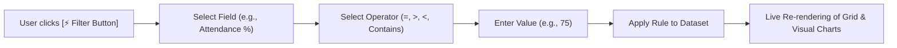

# Universal Flexible Student & Academic 360° Reporting Specification

**Product:** PrathamOne EduOS (Coaching Institute Edition)  
**Baseline Version:** 1.0.0  
**Architect:** Jawahar R Mallah  
**Organization:** Smritisys & AITDL Networks  
**Date:** November 21, 2026  
**Status:** Approved Architectural Specification  

---

## 1. Executive Summary & Objective

Coaching institute management requires multidimensional operational intelligence across educational boards, academic standards (grades), and operating batches, with student-level drilldowns into demographics, attendance compliance, financial realization, and academic performance.

This specification designs the **Universal Flexible Student & Academic 360° Report** (Dynamic Student Matrix), combining:
1. **Hierarchical Categorization & Slicing:** Board-wise, Standard/Grade-wise, and Batch-wise segmentation.
2. **Comprehensive Student Telemetry:** Student name, admission number, guardian contact, attendance percentage, fee balance, and exam grade.
3. **Advanced Filter Engine ("Filter Builder"):** Dynamic condition builder allowing users to choose *any field* and apply operators:
   - Equal to (`=`)
   - Greater than (`>`) or Greater than or equal to (`>=`)
   - Smaller than (`<`) or Smaller than or equal to (`<=`)
   - Contains (`LIKE` / substring match)
4. **Interactive Multi-Column Sorting ("Shorting"):** Instant ascending/descending ordering on any tabular column.
5. **Visual Analytical Charts:** Real-time synchronized charts powered by Recharts (Board distribution, batch attendance vs. capacity, fee realization vs. dues, and attendance compliance donuts).
6. **Production Spreadsheet Experience:** Full integration with the canonical `<ExcelReportGrid>` component for column resizing, drag-and-drop reordering, column visibility toggles, and multi-format exports (.xlsx, .csv, .json).

---

## 2. Canonical Data Architecture & Field Schema

In strict alignment with **SSOT Rule 001** and **Rule 003**, all data is queried from canonical master, transaction, and relationship tables without duplicating data models.

### 2.1 Tabular Column Schema

| Column ID | Field Name | Data Type | Default Visible | Filter Type | Supported Operators | Aggregation / Summary |
| :--- | :--- | :--- | :--- | :--- | :--- | :--- |
| `admission_number` | Admission # / PRN | Text (Code) | Yes | text | `=`, `contains` | Unique Count (`Total: N`) |
| `student_name` | Student Name | Text | Yes | text | `=`, `contains` | Alphabetical Count |
| `board_name` | Board | Select / Text | Yes | select | `=`, `contains` | Breakdown by Board |
| `standard_name` | Standard / Grade | Select / Text | Yes | select | `=`, `contains` | Breakdown by Grade |
| `division_name` | Batch / Division | Select / Text | Yes | select | `=`, `contains` | Breakdown by Batch |
| `gender` | Gender | Select | No | select | `=` | Ratio (M / F / Other) |
| `student_phone` | Student Mobile | Text | No | text | `=`, `contains` | — |
| `guardian_name` | Guardian Name | Text | Yes | text | `=`, `contains` | — |
| `guardian_phone` | Guardian Mobile | Text | Yes | text | `=`, `contains` | Contactable % |
| `attendance_pct` | Attendance % | Percentage | Yes | number | `=`, `>`, `<`, `>=`, `<=` | Cohort Average % |
| `total_sessions` | Total Sessions | Number | No | number | `=`, `>`, `<`, `>=`, `<=` | Sum of Sessions |
| `present_days` | Attended Sessions | Number | No | number | `=`, `>`, `<`, `>=`, `<=` | Sum of Attended |
| `total_fees` | Total Fees Assessed | Currency (₹) | Yes | number | `=`, `>`, `<`, `>=`, `<=` | Sum (₹ Total Assessed) |
| `paid_fees` | Realized / Paid Fees | Currency (₹) | Yes | number | `=`, `>`, `<`, `>=`, `<=` | Sum (₹ Total Collected) |
| `balance_fees` | Outstanding Dues | Currency (₹) | Yes | number | `=`, `>`, `<`, `>=`, `<=` | Sum (₹ Total Deficit) |
| `payment_status` | Fee Status | Badge | Yes | select | `=` | Counts (Paid, Partial, Defaulter) |
| `last_exam_pct` | Academic Score % | Percentage | Yes | number | `=`, `>`, `<`, `>=`, `<=` | Average Cohort Marks % |
| `performance_grade`| Performance Grade | Badge | No | select | `=` | Grade Distribution (A+, A, B, C) |
| `status` | Enrollment Status | Badge | Yes | select | `=` | Enrolled, Active, Withdrawn |

---

## 3. Dynamic Filter Engine ("Filter Builder")

The Filter Engine provides an interactive condition builder allowing operators on any tabular dimension:



### 3.1 Operator Matrix

1. **Equal To (`=`):**
   - Exact matching for categorical data: `Board = 'CBSE'`, `Standard = '10th'`, `Payment Status = 'Defaulter'`.
2. **Greater Than (`>` or `>=`):**
   - Numerical & percentage filtering: `Balance Fees > 5000`, `Attendance % >= 85`, `Exam Score > 90`.
3. **Smaller Than (`<` or `<=`):**
   - Threshold checking: `Attendance % < 75` (Defaulter audit), `Balance Fees <= 0` (Fully paid).
4. **Contains (`contains` / Substring):**
   - Case-insensitive search: `Student Name contains 'Sharma'`, `Guardian Phone contains '9820'`.

### 3.2 Multi-Rule Chaining
Users can compose multi-condition filters using logical `AND`:
- `[Board = 'CBSE']` AND `[Standard = '10th']` AND `[Attendance % < 75]` AND `[Balance Fees > 0]`
- Instantly isolates at-risk students who are both academic attendance defaulters and financial defaulters.

---

## 4. Visual Analytics & Interactive Charts Suite

Visualizations update dynamically whenever filters or search terms change:

```
+------------------------------------------------------------------------------------------------+
|  KPI TILES:                                                                                    |
|  [ Total Students: 142 ]  [ Avg Attendance: 83.4% ]  [ Total Dues: ₹4,85,000 ]  [ Defaulters: 18 ] |
+------------------------------------------------------------------------------------------------+
|  CHART 1: Board & Standard Distribution       |  CHART 2: Batch Attendance vs Realization      |
|  (Stacked Column: CBSE, ICSE, State vs Grade) |  (Dual Axis: Capacity, Enrolled & Attd %)      |
+------------------------------------------------------------------------------------------------+
|  CHART 3: Financial Health by Batch           |  CHART 4: Attendance Defaulter Compliance      |
|  (Bar: Billed vs Collected vs Outstanding)    |  (Donut: >85% Good, 75-85% Avg, <75% Risk)     |
+------------------------------------------------------------------------------------------------+
|  SPREADSHEET GRID (<ExcelReportGrid> with Multi-Sort, Column Resize, and Export)               |
+------------------------------------------------------------------------------------------------+
```

---

## 5. Implementation Roadmap & Architecture Compliance

1. **Backend Route:** `/api/v1/reports/students/flexible-matrix` in `backend/app/api/v1/endpoints/reports.py` querying `Student`, `StudentEnrollment`, `Standard`, `Division`, `Board`, `Attendance`, and `FeeInvoice` with async batch aggregation.
2. **Frontend UI Component:** Dynamic Filter Bar and Recharts analytical drawer integrated directly into `frontend/src/pages/Reports.tsx` powered by `<ExcelReportGrid>`.
3. **Export Compliance:** Excel `.xlsx`, `.csv`, and `.json` generation preserving exact filtered rows and formatted values.
