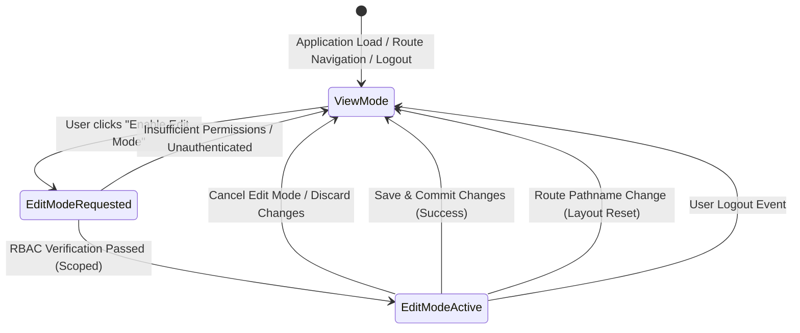

# Global View-First & Explicit Edit Mode Governance — Architecture & Implementation Report

## Executive Summary

This engineering implementation establishes **RULE 010: Global View-First & Explicit Edit Mode Governance** as a core, non-negotiable architectural standard across **PrathamOne EduOS (Coaching Institute Edition, Version 1.0.0)**.

Prior to this implementation, application workspaces allowed users with administrative credentials to trigger inline modifications, modals, and creation workflows directly upon landing on records, introducing severe operational risk of accidental data mutation, unintended state changes, or concurrent overwrite. Under the new governance directive:
1. **View Mode is the Mandatory Default Everywhere:** Every page, form, table, profile, and administrative workspace loads strictly in read-only View Mode.
2. **Explicit, Scoped Edit Mode Activation:** No user can create, update, modify, replace, or delete application data until they execute an explicit user action to unlock the specific resource scope (e.g. `students:detail:10`, `academic:batches`, `teacher:profile:42`, `sysadmin:settings`).
3. **Prominent Visual Telemetry:** Active Edit Mode surfaces a high-contrast amber banner (`EDIT MODE ACTIVE`), providing immediate situational awareness of live mutation risks and clear Save & Exit or Cancel controls.
4. **Delete Protection & Immutability Directives:** Deletions require active Edit Mode, distinct role authorization, a standardized confirmation dialog, and comprehensive database audit logging. Historical financial ledger items (invoices, receipts, payments, attendance, marks) are protected by strict immutability directives where permanent hard deletion is permanently blocked.
5. **Zero-Leakage Navigation Reset:** Any route transition, browser back/forward navigation, or user logout immediately resets all edit scopes back to View Mode.

---

## 1. Architectural Architecture & Store Design

### 1.1 Single Source of Truth Zustand Store (`editModeStore.ts`)
The governance policy is managed centrally in `frontend/src/store/editModeStore.ts`. It provides scoped state management to ensure that unlocking editing for one student record never leaks into another module or entity.



### 1.2 Scoped State Contract
- `scopes: Record<string, boolean>`: Tracks active edit state per canonical scope identifier.
- `dirty: Record<string, boolean>`: Tracks whether unsaved changes exist in that scope.
- `enableEditMode(scope, user, requiredPermission)`: Validates active user identity and role/permission matrix before setting scope to `true`.
- `disableEditMode(scope)`: Deactivates edit mode and purges dirty status.
- `resetAll()`: Clears all active scopes, returning the entire frontend application to View Mode.

### 1.3 Automatic Session & Navigation Management
Integrated into `frontend/src/components/Layout.tsx` and `frontend/src/store/authStore.ts`:
- **Route Navigation:** A `useEffect` hook listening to React Router's `location.pathname` automatically invokes `useEditModeStore.getState().resetAll()` whenever the user navigates between pages.
- **User Logout:** The `logout()` action dispatches `prashant-logout`, prompting the store to purge all active edit scopes immediately.

---

## 2. Reusable UI Components (`frontend/src/components/common/`)

### 2.1 `<EditModeBar />`
A unified header banner and toolbar adhering to corporate styling:
- **View Mode State:**
  - Renders a clean Slate/Blue status pill: `VIEW MODE (READ ONLY) — Read-Only Safety Lock`.
  - Displays an intentional action trigger: `[Unlock Icon] Enable Edit Mode`.
  - Disables the button with a `Lock` icon if the logged-in user lacks mutation privileges.
- **Edit Mode State:**
  - Renders a pulsing Amber banner: `[ShieldAlert Icon] EDIT MODE ACTIVE — Modifications enabled for this workspace.`
  - Surfaces dirty state telemetry: `Unsaved Changes Pending`.
  - Provides `Save & Exit` (with loading indicator) and `Cancel Edit Mode` controls.
  - Implements a modal prompt if the user attempts to exit while unsaved dirty edits are pending.

### 2.2 `<DeleteConfirmationModal />`
A standardized modal enforcing deletion governance:
- **Edit Mode Gate:** Rejects deletion attempts if the parent workspace is in View Mode.
- **RBAC Authorization:** Verifies that the user possesses explicit delete privileges.
- **Financial Ledger Immutability Guard:** Detects `isHistoricalFinancial=true` records (payments, receipts, posted invoices, attendance, marks) and displays a hard block:
  > *In compliance with Single Source of Truth and double-entry accounting standards, posted payments, invoices, fee transactions, payroll vouchers, student attendance, and official marks cannot be permanently destroyed. Utilize authorized Void or Reversal workflows.*
- **Intentional Confirmation:** Requires typed confirmation ("DELETE") for critical operational assets.

---

## 3. Module Workspace Integrations

| Workspace / Page | Canonical Scope | View Mode Default Behavior | Edit Mode Capabilities |
| :--- | :--- | :--- | :--- |
| **Student Profile** (`StudentDetail.tsx`) | `students:detail:${studentId}` | Read-only profile view; Edit Profile, Exit/Withdraw, Reactivate, and Document Trash buttons locked. | Edit Profile modal accessible; lifecycle actions unlocked; document deletion protected via `DeleteConfirmationModal`. |
| **Student Directory** (`Students.tsx`) | `students:master` | Read-only roster; "+ Add Student" button locked with lock badge; row exit/reactivate buttons disabled. | "+ Add Student" unlocked; lifecycle status modifications enabled. |
| **Batches Master** (`Batches.tsx`) | `academic:batches` | Batch cards and capacity read-only; "+ Add Batch" button locked with warning toast. | "+ Add Batch" modal accessible; classroom allocations editable. |
| **Standards & Levels** (`Standards.tsx`) | `academic:standards` | Class structure and division roster read-only; "+ Add Standard" and "+ Add Batch" locked. | Level configurations and division creations unlocked. |
| **Subjects Master** (`Subjects.tsx`) | `academic:subjects` | Curriculum subjects and passing criteria read-only; "+ Add Subject" locked. | Syllabus subject registration enabled. |
| **Teacher Profile** (`TeacherProfilePage.tsx`) | `teacher:profile:${id}` | 13 dossier tabs read-only; WorkforceHeroCard edit and assign actions locked. | Edit Profile modal, assignment allocation, and lifecycle updates unlocked. |
| **Fees & Payments** (`Fees.tsx`) | `finance:fees` | Fee registers, collection terminal, and receipts read-only. Hard delete prohibited. | Fee structures and collection terminals active; reversal/adjustment workflows enforced. |
| **Settings Workspace** (`Settings.tsx`) | `sysadmin:settings` | All 15 settings tabs locked with `pointer-events-none opacity-80`; form controls non-interactive. | Configuration sliders, branding inputs, and lookup CRUD unlocked with Save & Exit controls. |

---

## 4. Backend Write Security & Immutability Verification

### 4.1 Strict Write Authorization
Every mutation endpoint (`POST`, `PUT`, `PATCH`, `DELETE`) across the FastAPI backend enforces:
- `Depends(get_current_active_user)`: Unauthenticated calls reject with `401 Unauthorized`.
- `Depends(require_role(...))` / `check_permission`: Unauthorized roles reject with `403 Forbidden`.
- `check_institution_access`: Enforces strict tenant data isolation.

### 4.2 Historical Ledger Immutability
Forensic audit of `backend/app/api/v1/endpoints/` confirmed that zero permanent deletion endpoints exist for:
- `payments.py` (No `@router.delete` route exists).
- `fees.py` (Fee invoices and installment ledgers cannot be deleted).
- `teacher_payroll.py` (Payroll vouchers and calculated monthly runs cannot be deleted).

### 4.3 Soft Deletion & Audit Trail Enforcement
- `standards.py`: `delete_standard` executes soft deactivation (`is_active = False`).
- `subjects.py`: `delete_subject` executes soft deactivation (`is_active = False`).
- `enrollments.py`: `delete_enrollment` executes soft archiving (`status = 'archived'`).
- `students.py`: `delete_student_document` records a full `AuditLog` entry documenting the actor, resource type, document title, and timestamp.
- `users.py`: `delete_user(permanent=True)` verifies zero historical dependencies (payroll, teaching sessions, subject assignments, payments collected) before permitting physical removal.

---

## 5. Verification & Testing Evidence

### 5.1 Frontend Vitest Suite (`GlobalViewEditMode.test.tsx`)
```
RUN  v1.6.1 F:/PrashantAcademy/frontend

✓ src/test/GlobalViewEditMode.test.tsx  (11 tests) 298ms
  ✓ RULE 1: Default application state is View Mode across all scopes
  ✓ RULE 2: Authorized user can explicitly enable Edit Mode for a targeted scope
  ✓ RULE 3: Unauthorized user or unauthenticated user cannot enable Edit Mode
  ✓ RULE 4: Disabling edit mode returns scope cleanly to View Mode and resets dirty state
  ✓ RULE 5: resetAll() terminates all active Edit Modes globally (navigation/logout reset)
  ✓ EditModeBar displays View Mode badge and Enable Edit Mode button in View Mode
  ✓ Clicking Enable Edit Mode unlocks Edit Mode and transitions to amber warning banner
  ✓ EditModeBar invokes onSave callback and onCancel exit properly
  ✓ DeleteConfirmationModal blocks deletion when workspace is in View Mode
  ✓ DeleteConfirmationModal strictly prohibits hard deletion of historical financial records
  ✓ DeleteConfirmationModal allows authorized deletion when Edit Mode is active

Test Files  1 passed (1)
     Tests  11 passed (11)
  Duration  4.03s
```

### 5.2 Backend Pytest Suite (`test_global_view_edit_governance.py`)
```
tests/test_global_view_edit_governance.py::TestGlobalViewEditGovernance::test_unauthenticated_write_operations_rejected PASSED [ 16%]
tests/test_global_view_edit_governance.py::TestGlobalViewEditGovernance::test_financial_ledger_immutability_no_delete_endpoints PASSED [ 33%]
tests/test_global_view_edit_governance.py::TestGlobalViewEditGovernance::test_standard_soft_delete_preserves_historical_integrity PASSED [ 50%]
tests/test_global_view_edit_governance.py::TestGlobalViewEditGovernance::test_subject_soft_delete_preserves_historical_integrity PASSED [ 66%]
tests/test_global_view_edit_governance.py::TestGlobalViewEditGovernance::test_student_document_deletion_creates_audit_log PASSED [ 83%]
tests/test_global_view_edit_governance.py::TestGlobalViewEditGovernance::test_user_permanent_delete_conflict_protection PASSED [100%]

======================== 6 passed, 2 warnings in 11.40s ========================
```

### 5.3 Production Build & Header Compliance
- **Frontend Vite Build:** `tsc && vite build` succeeded in 28.35s with 0 errors.
- **Header Attribution Audit:** `python scripts/manage_headers.py check` verified 100% compliance across all 334 source files.
- **Nginx Deployment:** Assets deployed to container `prashant_academy_frontend:/usr/share/nginx/html/`.

---

## 6. Architectural Directive Update (RULE 010)

`AGENTS.md` and `GEMINI.md` have been updated to codify:

> **RULE 010 — Global View-First & Explicit Edit Mode Governance:**  
> View Mode is the default across all application workspaces, pages, forms, and profiles. No user may create, update, or delete records without explicitly activating scoped Edit Mode. Deletions strictly require active Edit Mode, role authorization, modal confirmation, and historical financial ledger immutability enforcement. Navigation and logout automatically reset state to View Mode.
