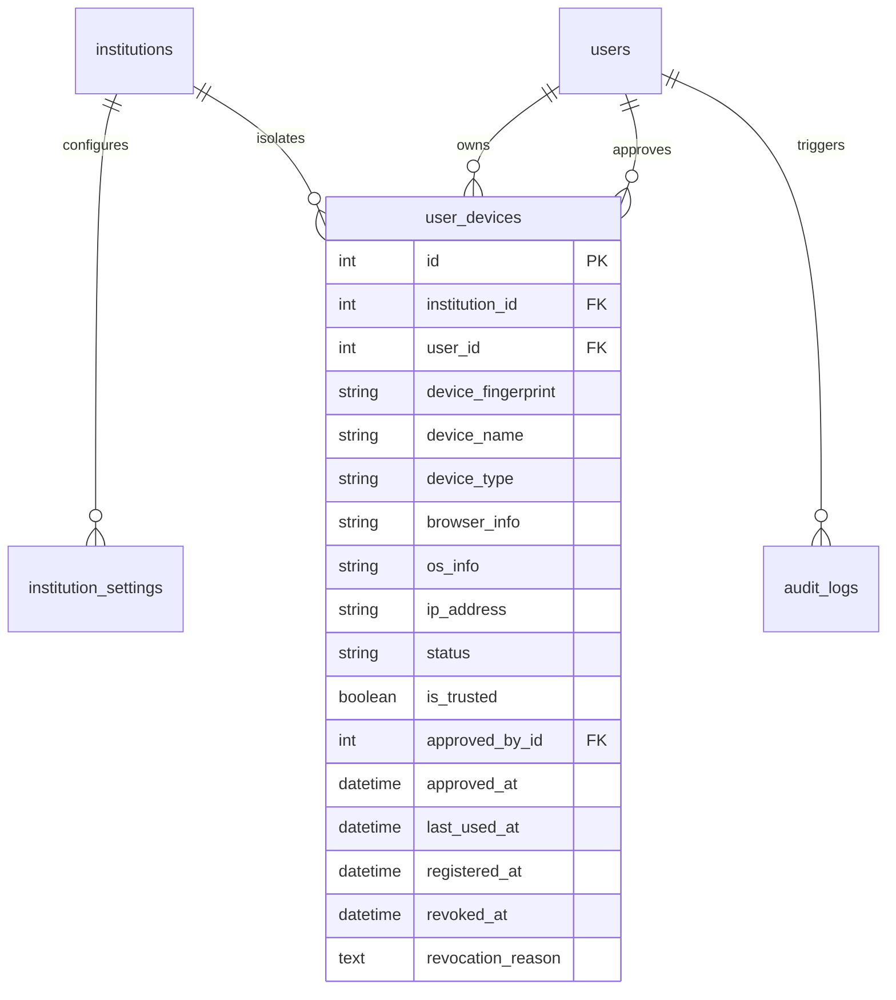

# PRATHAMONE EduOS — OPTIONAL DEVICE-WISE SECURITY BINDING SPECIFICATION

**Canonical Document:** `docs/12_RBAC_SECURITY/2026-11-19_RBAC-SECURITY_SPECIFICATION_OPTIONAL-DEVICE-BINDING-ARCHITECTURE_V1.md`  
**Author:** Jawahar R Mallah  
**Organization:** Smritisys & AITDL Networks  
**Product:** PrathamOne EduOS (Coaching Institute Edition)  
**Baseline Version:** 1.0.0  

---

## 1. MANDATE & DESIGN PHILOSOPHY

Device-Wise Security Binding is architected as an **OPTIONAL, institution-configurable security layer** within PrathamOne EduOS. It is **never mandatory** for all institutions or users, and its status has **zero impact** on licensing, subscription activation, user records, or existing operational capabilities.

### 1.1 Core Directives
1. **Disabled by Default:** Every coaching institution installs and initializes with Device Binding strictly set to `disabled`. Standard authentication workflows proceed completely unimpeded.
2. **Zero Global Restrictions:** Restrictions are strictly scoped by `institution_id`. One coaching institute enabling device binding never imposes restrictions on another tenant.
3. **Licensing Independence:** Disabling or enabling Device Binding does not activate, pause, or deactivate institution subscription licenses or quotas.
4. **Safe Disable Guarantee:** Disabling the feature immediately stops all device-level enforcement, while preserving 100% of registered device profiles, user accounts, and immutable audit logs.
5. **Shadow Mode Staged Rollout:** Institutions can preview and audit logins under shadow mode before enforcing hard blocks.

---

## 2. FOUR FLEXIBLE SECURITY POLICIES

The system supports four distinct operational policies:

| Mode | Key | Behavior | Default |
| :--- | :--- | :--- | :--- |
| **1. Disabled** | `disabled` | Users can log in from any otherwise authorized device without device registration checks. | **YES** |
| **2. Optional Registration** | `optional_registration` | Users can register and label devices; unregistered devices are still allowed full access. | No |
| **3. Registered Devices Only** | `registered_only` | Only registered and active devices can access the software. Unregistered devices are rejected with HTTP 403. | No |
| **4. Admin Approval Required** | `admin_approval_required` | New devices are automatically placed in `pending_approval` status. Administrator authorization is required before access is permitted. | No |

---

## 3. DATA ARCHITECTURE & SSOT COMPLIANCE

In strict compliance with **SSOT Rules 001–005**:
- The canonical master person table remains `users`.
- Multi-tenancy is enforced through `institutions.id`.
- Settings are centrally persisted in `institution_settings` under category `security`.
- Hardware identity and registration records are stored in canonical table `user_devices`.
- Security events and audit trails are recorded in `audit_logs`.

### 3.1 Entity Relationship

---

## 4. SAFE DISABLE & AUDIT RETENTION LIFECYCLE

When an authorized administrator disables Device Binding:
1. `enable_device_binding` transitions to `false` and `policy_mode` transitions to `disabled`.
2. Login and token issuance endpoints immediately bypass device registration verification.
3. Registered hardware rows in `user_devices` remain completely intact.
4. No user accounts, credentials, or session histories are modified or deleted.
5. A structured audit event `DEVICE_BINDING_SAFELY_DISABLED` is recorded in `audit_logs`.

---

## 5. API INTERFACE SUMMARY

| Endpoint | Method | Role Required | Description |
| :--- | :--- | :--- | :--- |
| `/api/v1/security/device-binding/settings` | `GET` | Authenticated | Retrieve tenant device security settings |
| `/api/v1/security/device-binding/settings` | `PUT` | Admin / SysAdmin | Update device binding configuration |
| `/api/v1/security/device-binding/disable` | `POST` | Admin / SysAdmin | Execute safe disablement |
| `/api/v1/security/device-binding/devices` | `GET` | Authenticated | List registered devices (scoped) |
| `/api/v1/security/device-binding/devices` | `POST` | Authenticated | Register a new client device |
| `/api/v1/security/device-binding/devices/{id}/approve` | `PUT` | Admin / SysAdmin | Authorize a pending device |
| `/api/v1/security/device-binding/devices/{id}/revoke` | `PUT` | Admin / Owner | Revoke an active device |
| `/api/v1/security/device-binding/devices/{id}` | `DELETE` | Admin / Owner | Remove a device record |
