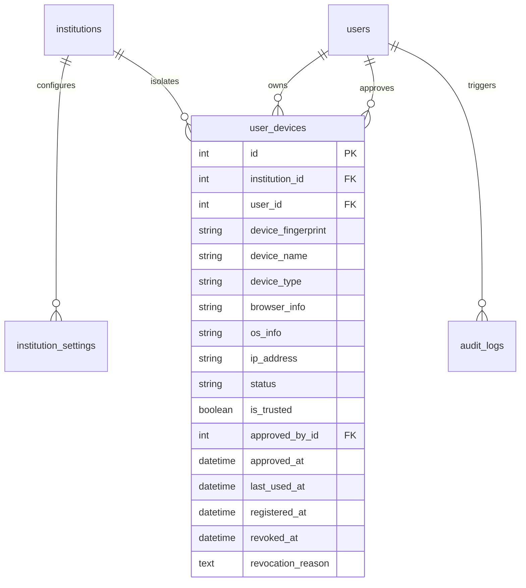

# PRATHAMONE EduOS — OPTIONAL DEVICE-WISE SECURITY BINDING SPECIFICATION

**Canonical Document:** `docs/12_RBAC_SECURITY/2026-11-19_RBAC-SECURITY_SPECIFICATION_OPTIONAL-DEVICE-BINDING-ARCHITECTURE_V1.md`  
**Author:** Jawahar R Mallah  
**Organization:** Smritisys & AITDL Networks  
**Product:** PrathamOne EduOS (Coaching Institute Edition)  
**Baseline Version:** 1.0.0  

---

## 1. MANDATE & DESIGN PHILOSOPHY

Device-Wise Security Binding is architected as an **OPTIONAL, institution-configurable security layer** within PrathamOne EduOS. It is **never mandatory** for all institutions or users, and its status has **zero impact** on licensing, subscription activation, user records, or existing operational capabilities.

### 1.1 Core Directives
1. **Disabled by Default:** Every coaching institution installs and initializes with Device Binding strictly set to `disabled`. Standard authentication workflows proceed completely unimpeded.
2. **Zero Global Restrictions:** Restrictions are strictly scoped by `institution_id`. One coaching institute enabling device binding never imposes restrictions on another tenant.
3. **Licensing Independence:** Disabling or enabling Device Binding does not activate, pause, or deactivate institution subscription licenses or quotas.
4. **Safe Disable Guarantee:** Disabling the feature immediately stops all device-level enforcement, while preserving 100% of registered device profiles, user accounts, and immutable audit logs.
5. **Shadow Mode Staged Rollout:** Institutions can preview and audit logins under shadow mode before enforcing hard blocks.

---

## 2. FOUR FLEXIBLE SECURITY POLICIES

The system supports four distinct operational policies:

| Mode | Key | Behavior | Default |
| :--- | :--- | :--- | :--- |
| **1. Disabled** | `disabled` | Users can log in from any otherwise authorized device without device registration checks. | **YES** |
| **2. Optional Registration** | `optional_registration` | Users can register and label devices; unregistered devices are still allowed full access. | No |
| **3. Registered Devices Only** | `registered_only` | Only registered and active devices can access the software. Unregistered devices are rejected with HTTP 403. | No |
| **4. Admin Approval Required** | `admin_approval_required` | New devices are automatically placed in `pending_approval` status. Administrator authorization is required before access is permitted. | No |

---

## 3. DATA ARCHITECTURE & SSOT COMPLIANCE

In strict compliance with **SSOT Rules 001–005**:
- The canonical master person table remains `users`.
- Multi-tenancy is enforced through `institutions.id`.
- Settings are centrally persisted in `institution_settings` under category `security`.
- Hardware identity and registration records are stored in canonical table `user_devices`.
- Security events and audit trails are recorded in `audit_logs`.

### 3.1 Entity Relationship

---

## 4. SAFE DISABLE & AUDIT RETENTION LIFECYCLE

When an authorized administrator disables Device Binding:
1. `enable_device_binding` transitions to `false` and `policy_mode` transitions to `disabled`.
2. Login and token issuance endpoints immediately bypass device registration verification.
3. Registered hardware rows in `user_devices` remain completely intact.
4. No user accounts, credentials, or session histories are modified or deleted.
5. A structured audit event `DEVICE_BINDING_SAFELY_DISABLED` is recorded in `audit_logs`.

---

## 5. API INTERFACE SUMMARY

| Endpoint | Method | Role Required | Description |
| :--- | :--- | :--- | :--- |
| `/api/v1/security/device-binding/settings` | `GET` | Authenticated | Retrieve tenant device security settings |
| `/api/v1/security/device-binding/settings` | `PUT` | Admin / SysAdmin | Update device binding configuration |
| `/api/v1/security/device-binding/disable` | `POST` | Admin / SysAdmin | Execute safe disablement |
| `/api/v1/security/device-binding/devices` | `GET` | Authenticated | List registered devices (scoped) |
| `/api/v1/security/device-binding/devices` | `POST` | Authenticated | Register a new client device |
| `/api/v1/security/device-binding/devices/{id}/approve` | `PUT` | Admin / SysAdmin | Authorize a pending device |
| `/api/v1/security/device-binding/devices/{id}/revoke` | `PUT` | Admin / Owner | Revoke an active device |
| `/api/v1/security/device-binding/devices/{id}` | `DELETE` | Admin / Owner | Remove a device record |
| `/api/v1/security/device-binding/devices/{id}/trust` | `PUT` | Admin / SysAdmin | Toggle trusted workstation status (`is_trusted`) |
| `/api/v1/security/device-binding/devices/{id}/terminate-session` | `POST` | Authenticated | Immediately terminate active device session |
| `/api/v1/security/device-binding/sessions/terminate-user` | `POST` | Admin / SysAdmin | Emergency kill-switch: terminate all sessions for a user |
| `/api/v1/security/device-binding/incidents` | `GET` | Admin / SysAdmin | Telemetry stream & KPI metrics for security incidents |

---

## 6. TRUSTED DEVICE MANAGEMENT

The system differentiates between standard enrolled hardware and designated institutional workstations:
- **`is_trusted` Flag:** Boolean indicator stored on canonical `user_devices` records.
- **Visual Badging:** Distinctive `⭐ Trusted` badge versus `🛡️ Standard` profile.
- **1-Click Administrative Elevation:** In Scoped Edit Mode, administrators can elevate verified corporate hardware to Trusted status or demote devices instantly.
- **Security Implications:** Trusted devices can bypass frequent step-up verification prompts while standard devices remain subject to adaptive step-up authentication.

---

## 7. IMMEDIATE SESSION REVOCATION (EMERGENCY KILL-SWITCH)

To safeguard institutional data against compromised devices or insider threats:
1. **Device-Level Kill-Switch (`POST /devices/{id}/terminate-session`):**
   - Transitions `user_devices.status` immediately to `revoked`.
   - Clears `is_trusted` flag.
   - Logs `SESSION_REVOKED` in `audit_logs` with actor attribution.
   - User's active session is terminated instantly upon next request.
2. **Account-Level Kill-Switch (`POST /sessions/terminate-user`):**
   - Revokes all active devices associated with a target user ID.
   - Logs `USER_SESSIONS_REVOKED` with `severity="critical"`.
   - Requires explicit modal confirmation in Edit Mode.

---

## 8. SECURITY INCIDENT CENTER & REAL-TIME MONITORING

A dedicated executive workspace tab inside `Settings → Security & Device Binding`:
- **4 Real-Time KPI Metric Cards:**
  1. **Total Incidents:** Cumulative count of all tracked access events and security violations.
  2. **Blocked Intrusions (Critical Red):** Unauthorized access attempts blocked due to unapproved or unregistered hardware fingerprints.
  3. **Shadow Observations (Amber):** Non-compliant logins recorded under shadow mode without disrupting user workflow.
  4. **Revoked Sessions (Purple):** Total sessions immediately terminated by administrators.
- **Interactive Incident Stream:** Detailed table rendering exact timestamps, severity pills (`CRITICAL`, `WARNING`, `INFO`), target user email, client IP address, user agent, and complete policy violation details.
- **Compliance Export:** Generates structured CSV audit files for institutional accreditation and cybersecurity compliance records.

---

## 9. DEVICE NAMING, PRIVACY & DPDP ACT 2023 CONSENT ARCHITECTURE

To comply with the **Digital Personal Data Protection Act (DPDP Act) 2023** and modern privacy regulations:

### 9.1 Browser Sandbox Limitations vs Explicit Device Naming
- Web browsers deliberately do not expose internal machine hostnames (e.g., `DESKTOP-8Q4JKLM`) via standard JavaScript APIs to prevent silent user tracking and anti-fingerprinting violations.
- PrathamOne EduOS solves this transparently and legally by:
  1. Pre-filling an intelligent hardware descriptor based on client OS and browser (e.g. `Windows 11 / 10 (Google Chrome)`).
  2. Querying the local companion agent (`http://127.0.0.1:9876/hardware-identity`) if installed to detect the physical workstation hostname and NIC MAC.
  3. Allowing the user to personalize the **Device Friendly Name** (e.g. *"Physics Lab Laptop"*, *"Rajesh Home PC"*) before registration.

### 9.2 DPDP Act 2023 Section 5 Notice & Section 6 Affirmative Consent
Prior to binding any device hardware profile or device name to a user account:
1. **Itemised Privacy Disclosure:**
   - **What is collected:** Device Friendly Name, operating system version, browser client signature, and a cryptographic hardware fingerprint.
   - **What is NEVER accessed:** No personal files, no document folders, no web browsing history, no keystrokes, and no GPS location data.
   - **Purpose:** Multi-factor hardware device binding to protect student records, examination marks, and coaching financial ledgers from unauthorized account access.
2. **Affirmative Consent Checkbox:**
   - Requires explicit check: *"I authorize Prashant Academy to register this device name and hardware profile to my account for institutional access."*
   - Sends `x-device-name`, `x-device-fingerprint`, and `x-device-consent: true` headers with authentication.
3. **Immutable Audit Trail:**
   - Backend registers device with status `active` (or `pending_approval`) and logs `DEVICE_REGISTERED_WITH_CONSENT` to `audit_logs` including actor ID, client IP, and UTC timestamp.
