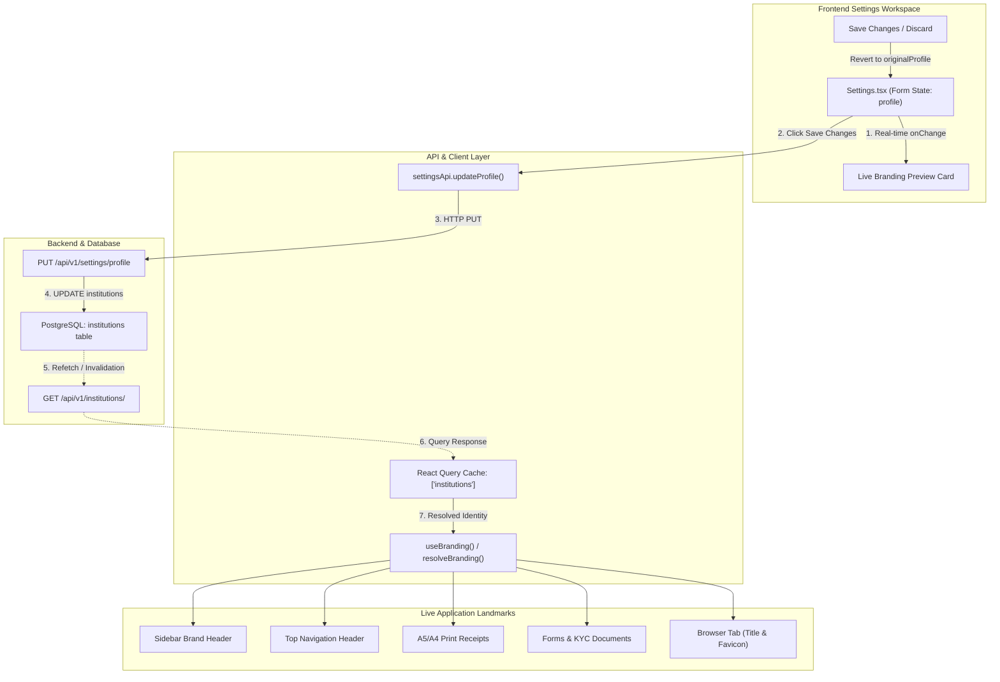

# PrathamOne Academy — Deep Audit & Verification: Branding Preview & Apply

**Document Reference:** `AITDL-AUDIT-2026-11-05-BRANDING-V1`  
**System:** PrathamOne Academy Coaching Institute Management System (Enterprise Edition)  
**Client:** Prashant Academy  
**Author / Auditor:** Jawahar R. Mallah, Senior Full-Stack Architect, QA Engineer & UX Reviewer  
**Organization:** AITDL (AI Technology & Development Lab)  
**Audit Timestamp:** November 5, 2026, 20:00 IST  
**Environment:** Production Containerized Stack (`prashant_academy_frontend`, `prashant_academy_backend`, `prashant_academy_db`)  

---

## 1. Executive Summary

A comprehensive architectural, functional, UX, and security audit of the **“Branding Preview — How your institute will appear in the application”** feature was conducted across the PrathamOne Academy application. The feature is primarily hosted in the **Institute Settings Workspace** (`frontend/src/pages/Settings.tsx`), backed by `backend/app/api/v1/endpoints/settings.py` and `institutions.py`, and rendered globally through the `useBranding()` hook in `frontend/src/config/branding.ts`.

While the UI renders a visually polished live gradient preview card that reacts immediately to local form state changes, the audit identified **two Critical severity architectural failures** and **three High/Medium severity integration gaps** that break the promise of applying branding across the live application:

1. **[CRITICAL] StringDataRightTruncationError on Logo & Favicon Upload**: `Institution.logo_url` and `favicon_url` are defined as `VARCHAR(500)`. Uploading any real image file via `FileReader.readAsDataURL()` produces base64 strings exceeding 500 characters, causing PostgreSQL to reject the update with `<class 'asyncpg.exceptions.StringDataRightTruncationError'>` (HTTP 500).
2. **[CRITICAL] Data Flow Severed Between Database and Live Application**: `GET /api/v1/institutions/` (`list_institutions`), which fuels `useBranding()`, completely omits `short_name`, `tagline`, `logo_url`, `favicon_url`, `primary_color`, `secondary_color`, and `accent_color`. Furthermore, `Settings.tsx` never invalidates the `['institutions']` React Query cache upon saving.
3. **[HIGH] Theme Presets Never Persisted in "Branding & Appearance" Category**: Clicking theme presets in the `branding` category mutates `profile` state, but clicking "Save Changes" only saves `allSettings['branding']`. The chosen colors are discarded upon page refresh or category change.
4. **[HIGH] Hardcoded Defaults in `resolveBranding()`**: The global branding resolver hardcodes `colors: BRANDING_CONFIG.colors`, `tagline: BRANDING_CONFIG.tagline`, and static monogram computation, ignoring database values even when present.
5. **[MEDIUM] Sidebar and UI Landmark Discrepancies**: `Sidebar.tsx` and header elements hardcode generic icons and static Tailwind background classes, preventing the live app from mirroring the Branding Preview.

---

## 2. Feature Architecture & Data Flow

The complete operational lifecycle of institution branding spans seven distinct stages:



### Data Flow Audit Findings:
* **Step 1 (Form State → Preview)**: **Working**. Editing name, short name, tagline, or hex colors in `Settings.tsx` immediately updates the preview banner card via React state.
* **Step 2 to 4 (Save → API → DB)**: **Fails on images**. Plain text saves successfully, but image uploads crash with PostgreSQL `VARCHAR(500)` truncation.
* **Step 5 to 7 (DB → Query Cache → Live App)**: **Completely broken**. Cache is not invalidated on save, `GET /institutions/` strips branding fields, and `resolveBranding()` ignores database colors and tagline.

---

## 3. Branding Field Inventory & Implementation Status

| Branding Field | Form State Key | DB Column Type | Preview Supported? | Persisted in DB? | Reflected in Live App? | Audit Verdict |
|---|---|---|---|---|---|---|
| **Institute Name** | `profile.name` | `VARCHAR(200)` | Yes (Banner Title) | Yes | Yes (via `academyName`) | **Functional** |
| **Short Name / Monogram** | `profile.short_name` | `VARCHAR(50)` | Yes (Monogram fallback) | Yes | No (hardcoded word-split) | **Buggy** |
| **Tagline** | `profile.tagline` | `VARCHAR(255)` | Yes (Banner Subtitle) | Yes | No (hardcoded default) | **Broken in Live App** |
| **Primary Color** | `profile.primary_color` | `VARCHAR(20)` | Yes (Gradient Start) | Yes | No (hardcoded `#1e40af`) | **Broken in Live App** |
| **Secondary Color** | `profile.secondary_color` | `VARCHAR(20)` | Yes (Gradient End) | Yes | No (hardcoded `#071739`) | **Broken in Live App** |
| **Accent Color** | `profile.accent_color` | `VARCHAR(20)` | Yes (Ambient Halo) | Yes | No (hardcoded `#0284c7`) | **Broken in Live App** |
| **Logo Image** | `profile.logo_url` | `VARCHAR(500)` | Yes (Emblem Image) | **NO (Crashes 500)** | No (omitted from API) | **CRITICAL FAULT** |
| **Favicon** | `profile.favicon_url` | `VARCHAR(500)` | Yes (Favicon Tile) | **NO (Crashes 500)** | No (DOM link never updated) | **CRITICAL FAULT** |
| **Street Address** | `profile.address` | `TEXT` | No (Address Sub-tab) | Yes | Yes (Receipts/KYC) | **Functional** |
| **City, State, Pincode** | `city`, `state`, `pincode` | `VARCHAR` | No (Address Sub-tab) | Yes | Yes (Receipts/KYC) | **Functional** |
| **Contact Phone** | `profile.phone` | `VARCHAR(20)` | No (Address Sub-tab) | Yes | Yes (Header/Receipts) | **Functional** |
| **Official Email** | `profile.email` | `VARCHAR(200)` | No (Address Sub-tab) | Yes | Yes (Receipts/KYC) | **Functional** |
| **Website URL** | `profile.website` | `VARCHAR(200)` | No (Address Sub-tab) | Yes | Yes (Receipts/Footer) | **Functional** |

---

## 4. Preview vs. Live Application Discrepancies

| UI Landmark | Branding Preview Card | Live Application Reality | Discrepancy Description |
|---|---|---|---|
| **Sidebar Brand Header** | Custom logo image or short-name monogram | Generic `<GraduationCap>` vector in static gradient | Sidebar never renders the uploaded logo or monogram. |
| **Sidebar Theme Accent** | Custom primary to secondary gradient | Hardcoded `bg-[#0f172a]` with blue active states | Theme colors selected in Branding Preview do not theme the sidebar. |
| **Header Tagline** | Custom subtitle e.g. "Learn • Practice • Achieve" | Static default tagline | Hardcoded in `branding.ts`, ignoring database override. |
| **Favicon** | Custom 32x32 image tile | Static `/favicon.svg` in `<link rel="icon">` | Browser tab icon never changes when new favicon is saved. |
| **Login Page** | Custom logo, title, and theme gradient | Fallback branding if unauthenticated | Unauthenticated `/login` cannot fetch `GET /institutions/` (requires auth). |
| **Theme Presets Card** | Shows 4 preset color palettes | Presets modify state, but Save discards changes | Clicking a preset in the `branding` sub-tab is lost on save. |

---

## 5. Technical Audit & Evidence

### Concrete Proof 1: Backend Database Truncation Error (HTTP 500)
When uploading a standard 512x512 logo, `reader.readAsDataURL(file)` generates a 1,200+ byte base64 payload. Sending this to `PUT /api/v1/settings/profile` triggers:

```
sqlalchemy.exc.DBAPIError: (sqlalchemy.dialects.postgresql.asyncpg.Error)
<class 'asyncpg.exceptions.StringDataRightTruncationError'>: value too long for type character varying(500)
[SQL: UPDATE institutions SET logo_url=$1::VARCHAR, updated_at=now() WHERE institutions.id = $2::INTEGER]
```

### Concrete Proof 2: Truncated Institution List API Response
Calling `GET /api/v1/institutions/` produces:
```json
[
  {
    "id": 1,
    "name": "Prashant Academy",
    "code": "PA001",
    "city": "Mumbai",
    "state": "Maharashtra",
    "phone": "+91-22-12345678",
    "email": "info@example.com",
    "website": "https://example.com",
    "address": "123 Education Lane, School District"
  }
]
```
> Notice that `short_name`, `tagline`, `logo_url`, `favicon_url`, `primary_color`, `secondary_color`, and `accent_color` are **completely stripped from the output**.

---

## 6. Findings by Severity & Root Causes

### 1. [CRITICAL] `StringDataRightTruncationError` on Logo & Favicon Update
* **Root Cause**: `Institution.logo_url` and `Institution.favicon_url` columns are `VARCHAR(500)`.
* **Fix**: Create Alembic migration `018_branding_text` to convert `logo_url` and `favicon_url` to `Text` in `institutions` table and update model.

### 2. [CRITICAL] Incomplete Response in `list_institutions` & Missing Cache Invalidation
* **Root Cause**: `backend/app/api/v1/endpoints/institutions.py` omits branding fields. `Settings.tsx` `handleSave` omits `queryClient.invalidateQueries({ queryKey: ['institutions'] })`.
* **Fix**: Include all branding attributes in `list_institutions` and `get_institution`. Invalidate `['institutions']` on profile save.

### 3. [HIGH] Save Changes Discards Theme Presets in `branding` Category
* **Root Cause**: `handleSave` in `Settings.tsx` checks `if (activeCategory === 'profile')` to call `updateProfile`. In `branding`, it saves `allSettings['branding']`, ignoring `profile.primary_color`.
* **Fix**: Check `if (activeCategory === 'profile' || activeCategory === 'branding')` to save `profile`.

### 4. [HIGH] Hardcoded Defaults in `resolveBranding()`
* **Root Cause**: `frontend/src/config/branding.ts` does not merge `activeInstitution` colors, tagline, short name, or favicon.
* **Fix**: Map `colors.primary`, `secondary`, `accent`, `tagline`, `monogram`, and `assets.faviconUrl` from `activeInstitution`.

### 5. [MEDIUM] Dynamic CSS Theme Variables & Favicon DOM Injection
* **Root Cause**: Live app does not inject CSS variables on `:root` and does not update `<link rel="icon">`.
* **Fix**: In `useBranding()`, set CSS custom properties (`--color-primary`, `--color-secondary`, `--color-accent`) on `document.documentElement` and update `<link rel="icon">`.

### 6. [MEDIUM] Public Branding Endpoint for Login Page
* **Root Cause**: Unauthenticated visitors on `/login` cannot call `GET /institutions/`.
* **Fix**: Add public unauthenticated endpoint `GET /api/v1/institutions/public/branding` and cache active branding in `localStorage`.

---

## 7. Remediation Blueprint & Execution Plan

1. **Database Migration (`018_branding_text`)**:
   - Alter `institutions.logo_url` and `institutions.favicon_url` from `VARCHAR(500)` to `Text`.
   - Update `backend/app/models/institution.py`.
2. **Backend Endpoints (`institutions.py`)**:
   - Return `short_name`, `tagline`, `logo_url`, `favicon_url`, `primary_color`, `secondary_color`, `accent_color` in `list_institutions` and `get_institution`.
   - Add public `GET /api/v1/institutions/public/branding`.
3. **Frontend Types (`frontend/src/types/index.ts`)**:
   - Add branding properties to `Institution` interface.
4. **Branding Resolver (`frontend/src/config/branding.ts`)**:
   - Fully merge all tenant branding fields, inject CSS variables, update favicon DOM link, and cache in `localStorage`.
5. **Settings Workspace (`frontend/src/pages/Settings.tsx`)**:
   - Unify `profile` and `branding` save/discard logic.
   - Invalidate React Query cache on save.
   - Add file type and size validation on logo/favicon uploads.
6. **Sidebar (`frontend/src/components/Sidebar.tsx`)**:
   - Mirror Branding Preview by rendering logo image or monogram with dynamic gradient.
7. **Regression Testing & Verification**:
   - Vitest test suite for branding preview, apply, and persistence.
   - Backend pytest suite for settings and institutions.
   - Frontend production build.
