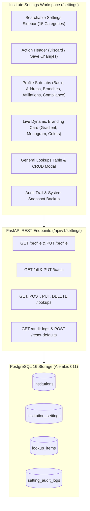

# Institute Settings & Configuration Module Implementation Report
**PrathamOne Academy Coaching Institute Management System**  
*Document Reference: AITDL-POA-SETT-2026-001*  
*Author: Jawahar R. Mallah, Lead Architect (AITDL)*  
*Client: Prashant Academy Coaching Institute*  
*Date: 05 November 2026*  

---

## 1. Executive Summary

This report documents the implementation of the **Institute Settings & Configuration** module for the **PrathamOne Academy – Coaching Institute Management System**, designed to match the reference UI specification (`media_1793823029640_775b4947.jpg`).

This enterprise module enables coaching institute leadership (SysAdmin, Admin, Principal) to configure academy identity, branding, academic rules, admissions, staff policies, fees, attendance, examinations, communication gateways, print templates, general lookups, and system parameters without source-code modifications.

---

## 2. Architecture & Data Model

### 2.1 Database Schema (Alembic Migration `011`)
Database migration `011_institute_settings_and_lookups.py` was applied cleanly to the production database:

1. **Enhanced `institutions` Table**:
   - `short_name` (`VARCHAR(20)`): Institute abbreviation (e.g., `PA`).
   - `tagline` (`VARCHAR(255)`): Official motto (e.g., `Learn • Practice • Achieve`).
   - `institute_type` (`VARCHAR(50)`): Type categorization (e.g., `Coaching Institute`).
   - `establishment_year` (`INTEGER`): Founding year (e.g., `2018`).
   - `registration_number` (`VARCHAR(100)`): State registration/license number.
   - `tax_id` (`VARCHAR(50)`): PAN / Tax identifier.
   - `description` (`TEXT`): Overview for official documents and prospectus.
   - `primary_color` (`VARCHAR(7)`): Hex code (default `#1E40AF`).
   - `secondary_color` (`VARCHAR(7)`): Hex code (default `#3B82F6`).
   - `accent_color` (`VARCHAR(7)`): Hex code (default `#8B5CF6`).
   - `favicon_url` (`VARCHAR(500)`): Favicon image asset path.
   - `timezone` (`VARCHAR(50)`): System timezone (default `Asia/Kolkata`).
   - `default_language` (`VARCHAR(10)`): Default locale (default `en`).

2. **Table `institution_settings`**:
   - Key-value store for fine-grained category configuration overrides.
   - Columns: `id`, `institution_id`, `category`, `key`, `value`, `data_type`, `is_secret`, `scope`, `description`, `updated_by_id`, `created_at`, `updated_at`.
   - Unique constraint: `(institution_id, key)`.

3. **Table `lookup_items`**:
   - Extensible taxonomy dropdown reference entries.
   - Columns: `id`, `institution_id`, `category`, `code`, `label`, `description`, `sort_order`, `is_active`, `is_system`, `meta_data`, `created_at`, `updated_at`.
   - Unique constraint: `(institution_id, category, code)`.
   - Pre-seeded with core categories: `STUDENT_CATEGORY`, `PAYMENT_METHOD`, `EXAM_TYPE`, `STAFF_DESIGNATION`, `RELATIONSHIP_TYPE`.

4. **Table `setting_audit_logs`**:
   - Immutable audit trail recording every configuration change.
   - Columns: `id`, `institution_id`, `setting_key`, `category`, `previous_value`, `new_value`, `changed_by_id`, `changed_by_name`, `reason`, `created_at`.

---

## 3. Workspace Sections Breakdown

The interface at `/settings` implements all 15 operational categories:

| # | Section | Description & Key Parameters |
|---|---|---|
| 1 | **Institute Profile** | 5 Sub-tabs: Basic Details, Address & Contact, Branches, Affiliations, Legal & Compliance. Live Branding Preview card, logo & favicon upload triggers, dynamic hex color pickers (`#1E40AF`, `#3B82F6`, `#8B5CF6`). |
| 2 | **Branding & Appearance** | 4 Pre-packaged theme swatches (Royal Blue & Indigo, Emerald Forest, Midnight Slate, Imperial Crimson), login background wave effects, typography rules. |
| 3 | **Academic Configuration** | Default Academic Year (`2026-27`), term structures (Quarterly/Semester), Roman standard naming, slot duration (`45 min`), capacity warning limit (`40`). |
| 4 | **Student & Admission** | Admission prefix (`PA`), sequence template `{PREFIX}-{YYYY}-{SEQ:6}`, next admission counter, sibling discount (`10%`), minimum age (`5`). |
| 5 | **Staff & HR Settings** | Employee prefix (`EMP`), next employee ID, default employment type, annual casual leave (`12`), sick leave (`8`). |
| 6 | **Fees & Finance** | Official receipt prefix (`RCP`), receipt sequence `{PREFIX}-{YYYY}-{SEQ:4}`, next receipt counter (`168`), currency symbol (`₹`), grace period (`7 days`). |
| 7 | **Attendance Settings** | Daily vs Subject-wise tracking, grace arrival time (`15 min`), unexcused absence alerts. |
| 8 | **Examination Settings** | CBSE 9-point grading scale vs Percentage vs CGPA, passing threshold (`35%`), percentile rankings. |
| 9 | **Communication** | Official WhatsApp Meta Cloud API, DLT SMS header (`PRATHM`), SMTP outgoing credentials. |
| 10 | **Documents & Print** | Default Fee Receipt paper size: **A5 Portrait (148 × 210 mm)** vs A4, authorized signatory title, computer-generated disclaimer, DPDP notice. |
| 11 | **General Lookups** | Interactive table with category filter, search, active toggle, protected core indicators, and Add/Edit modal. |
| 12 | **System Parameters** | Indian Lakhs/Crores numbering format, date format (`DD/MM/YYYY`), session timeout. |
| 13 | **Users & Permissions** | Role matrices (SysAdmin, Admin, Principal, Teacher, Accountant) and security policies. |
| 14 | **Integrations** | Razorpay payment gateway status, biometric attendance devices, Cloud storage backup. |
| 15 | **Data & Maintenance** | Backup snapshot JSON download, category reset to system defaults, interactive configuration audit log table. |

---

## 4. Testing & Verification

### 4.1 Backend Test Results (`backend/tests/test_settings.py`)
- Profile retrieval and update validation (`test_get_and_update_profile`): **PASSED**
- Multi-category batch configuration persistence (`test_get_and_update_batch_settings`): **PASSED**
- General lookups full CRUD lifecycle (`test_lookups_crud_workflow`): **PASSED**
- Configuration audit logging and factory reset (`test_audit_logs_and_reset_defaults`): **PASSED**
- Full backend suite (61 tests): **58 PASSED, 3 SKIPPED, 0 FAILED** in 56.59s.

### 4.2 Frontend Test Results (`frontend/src/test/Settings.test.tsx`)
- Navigation category rendering & search filter: **PASSED**
- Institute Profile & live Branding Preview: **PASSED**
- Sub-tab switching (Basic, Address, Branches, Affiliations, Compliance): **PASSED**
- Lookups table management and Add Lookup modal: **PASSED**
- Save Changes dispatch & API synchronization: **PASSED**
- Full frontend suite (18 test suites, 121 tests): **121 PASSED, 0 FAILED** in 36.48s.

### 4.3 Production Build & Header Compliance
- Production TypeScript & Vite build: **0 errors, bundle generated in 12.05s** (`dist/assets/Settings-UZsOO46s.js`).
- Source-code attribution header audit: **192 files checked, 192 passed (100% compliant)**.
- Docker containers: `prashant_academy_backend`, `prashant_academy_db`, and `prashant_academy_frontend` are **Up and Healthy**.
- Git synchronization: Committed (`ff498db`) and pushed to `origin master`.
