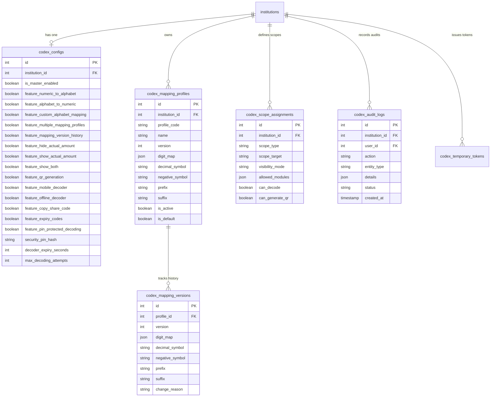
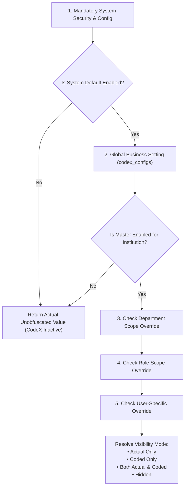
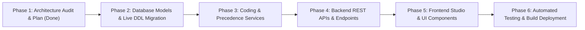

# PRATHAMONE CodeX — Configurable Feature Activation & Numeric Coding Engine
## Forensic Architecture Audit & Implementation Plan

**Product:** PrathamOne EduOS / Business Software  
**Module:** CodeX — Optional Business Configuration Capability  
**Specification:** Final Architecture & Implementation Directive  
**Owner:** Business Owner / Authorized System Administrator  
**System Default:** **DISABLED (OFF)**  
**Author:** Jawahar R Mallah  
**Organization:** AITDL — AI Technology & Development Lab  

---

## 1. EXECUTIVE SUMMARY & MANDATORY GOVERNANCE DIRECTIVE

### 1.1 Mandatory Default Directive
```text
CODEX_SYSTEM_DEFAULT = DISABLED
CODEX_AUTO_ACTIVATION = FALSE
CODEX_NEW_BUSINESS_DEFAULT = DISABLED
CODEX_NEW_USER_DEFAULT = DISABLED
CODEX_AUTO_ENABLE_ON_UPDATE = FALSE
CODEX_AUTO_ENABLE_ON_INSTALL = FALSE
```

CodeX is an **opt-in, optional software capability**. It must remain completely dormant and inactive until the authorized Business Owner explicitly configures and activates it.
- **Availability does NOT mean Activation.**
- **Installation does NOT mean Activation.**
- **Upgrades do NOT activate CodeX.**
- When CodeX is **DISABLED**, all standard numbers, prices, salaries, and fees are displayed and processed normally without obfuscation across all UI views and backend APIs.

### 1.2 Core Objective
To implement **CodeX** as an enterprise-grade, configurable feature activation and numeric coding engine:
1. Reusable across authorized numeric business data (selling price, purchase cost, salary & payroll, commissions, discounts, fee structures, and internal reference codes).
2. Configurable by Business Owner across 7 distinct activation scopes (System Default, Business Default, Role, Department, User, On-Demand, and Global Kill-Switch).
3. Digit-to-symbol bidirectional reversible encoding engine with multi-profile support, decimal & negative handling, and immutable version history.
4. Dedicated CodeX Configuration Studio (11 administrative panels) with live interactive preview, test encoder/decoder, QR generation, PIN-protected decoding, and configuration rollback.

---

## 2. PHASE 1: EXISTING REPOSITORY & ARCHITECTURE AUDIT

### 2.1 Audit Findings Across Repository
1. **SSOT Status:**
   - Existing codebase has zero references to "codex". No duplicate or conflicting coding engine exists.
   - Core tenant master is `institutions` (ID: 1 for Prashant Academy).
   - Central person master is `users`.
   - Settings are stored in `institution_settings` for key-value configurations.
2. **Target Modules for CodeX Integration:**
   - **Teacher Payroll (`backend/app/models/teacher_payroll.py`):** Fields `basic_salary`, `hourly_rate`, `net_payable`, `gross_amount`.
   - **Fees & Billing (`backend/app/models/fee.py`):** Fields `total_amount`, `discount_amount`, `installment_amount`.
   - **Staff Compensation (`backend/app/models/staff.py`):** Field `basic_salary`.
3. **Security Classification:**
   - CodeX is an **obfuscation and presentation mechanism, NOT cryptographic encryption**.
   - Database columns MUST continue to store canonical, un-obfuscated numerical values (e.g. `NUMERIC(12, 2)` or `FLOAT`) to maintain mathematical integrity, financial indexing, reporting, ledger balance, and aggregation functions.
   - CodeX transformation is applied dynamically at the presentation/API response boundary according to the requesting user's resolved CodeX visibility scope.

---

## 3. PHASE 2: DATA ARCHITECTURE & DATABASE DESIGN

To ensure Single Source of Truth (SSOT) integrity and strict separation of concerns, CodeX introduces 6 targeted, normalized tables:



### 3.1 Entity Classification
- `codex_configs`: **Configuration** (Singleton per institution, defaults to `is_master_enabled = False`).
- `codex_mapping_profiles`: **Configuration Master** (Tenant-specific digit-to-symbol mapping dictionaries).
- `codex_mapping_versions`: **Snapshot / History** (Immutable version log to allow historical decoding even after profile modification).
- `codex_scope_assignments`: **Configuration Rule** (Precedence-based scope overrides for business, department, role, user).
- `codex_audit_logs`: **Ledger / Audit Trail** (Append-only security log for activations, deactivations, edits, and decoding attempts).
- `codex_temporary_tokens`: **Cache / Transaction** (Time-limited tokens for QR scanning and mobile PIN decoding).

---

## 4. PHASE 3: CONFIGURATION RESOLUTION & PRECEDENCE ENGINE

### 4.1 Precedence Hierarchy
When a user requests a data record containing numeric fields bound to CodeX, the backend applies the following strict evaluation order:



### 4.2 Security Restrictions
1. **Deny Overrides of Global Disabled:** If the business has `is_master_enabled = False`, no user or role setting can activate CodeX.
2. **Restrictive Wins:** A more restrictive rule always overrides a permissive one (e.g., if a Role is configured to `Coded Only`, an unauthenticated or unauthorized request cannot receive the decoded value).
3. **PIN Protection on Decoder:** Decoding a coded string to reveal the underlying amount requires explicit `can_decode` scope authorization and valid PIN verification if PIN protection is active.

---

## 5. PHASE 4: NUMERIC CODING ENGINE SPECIFICATION

### 5.1 Digit-to-Symbol Mapping
The business owner configures a 10-symbol bijective mapping dictionary:
```text
Digits:  0  1  2  3  4  5  6  7  8  9
Symbols: Q  A  Z  M  K  P  X  B  T  R
```

### 5.2 Encoding Algorithm
1. Normalize number into numeric string (e.g. `1250`).
2. Map each digit:
   - `1` -> `A`
   - `2` -> `Z`
   - `5` -> `P`
   - `0` -> `Q`
3. Concatenate: `AZPQ`.
4. Apply prefix/suffix if enabled: `CX-AZPQ`.
5. Support Decimals: `1250.75` -> `AZPQ.BX` (with configurable decimal separator).
6. Support Negative Values: `-500` -> `-PQQ`.

### 5.3 Decoding Algorithm
1. Strip configured prefix and suffix.
2. Look up the active or tagged mapping profile version.
3. Invert the symbol map (Symbol -> Digit).
4. Reconstruct the numeric representation.
5. Validate parseability as float/decimal.
6. Return decoded numeric value.

### 5.4 Profile Version History & Reversibility Guarantee
When a business owner modifies a mapping profile:
- A new version is saved in `codex_mapping_versions`.
- Encoded codes can optionally include a version tag (e.g. `CX:V1:AZPQ`), ensuring that legacy printed invoices or documents can always be accurately decoded years later even if current mappings have changed.

---

## 6. PHASE 5: UI & INTEGRATION — CODEX CONFIGURATION STUDIO

A dedicated full-page administrative studio at `/codex` and embedded in `/settings` (Tab: "CodeX Configuration Studio") with 11 specialized sections:

1. **General Settings:** Master ON/OFF Switch (prominently badge-labeled "DISABLED (OFF)"), Global Kill-Switch, Reset to Defaults.
2. **Activation Scope:** Interactive matrix managing Business-Wide, Department, Role, and User scopes.
3. **Feature Options:** 16 independent switches organized into 4 cards:
   - *Numeric Coding:* Numeric-to-Alphabet, Alphabet-to-Numeric, Custom Alphabet, Multi-Profile, Version History.
   - *Value Visibility:* Hide Actual, Show Actual, Show Both.
   - *Code Distribution:* QR Codes, Mobile Decoder, Offline Decoder, Copy/Share, Expiry Codes, PIN Protection.
   - *Business Applications:* Selling Price, Purchase Cost, Salary & Payroll, Commissions, Discounts, Customer Values, Reference Values, Fee Structures.
4. **Mapping Profile Studio:** Visual 0-9 key assigner with instant collision/duplicate detection, live alphabet preview, and custom symbol validation.
5. **Module and Field Assignment:** Interactive binding of payroll salaries, fee structures, and discounts.
6. **Role and Department Assignment:** Matrix table for visibility permissions (`Actual`, `Coded`, `Both`, `Hidden`).
7. **User Assignment:** Exceptions manager for specific staff accounts.
8. **Decoder Security:** PIN configuration, session timeouts, and lockout rules.
9. **Expiry & Access Rules:** Token lifecycles and sharing parameters.
10. **Configuration History & Audit Trail:** Searchable activity feed tracking all CodeX changes.
11. **Live Preview & Interactive Testing Studio:** Live bidirectional test console:
    - Input number -> outputs coded string.
    - Input coded string -> decodes to number.
    - Live QR Code generator preview.
    - Configuration rollback with single-click restore.

---

## 7. PHASE 6: SECURITY, QUALITY ASSURANCE & VERIFICATION PLAN

### 7.1 Automated Verification Plan
1. **Test 1 — Mandatory Default Verification:**
   - Assert system boots with `CODEX_SYSTEM_DEFAULT = False`.
   - Assert new businesses and users have CodeX disabled.
   - Assert all API endpoints reject or bypass CodeX when disabled.
2. **Test 2 — Encoding & Decoding Correctness:**
   - Test bijective mapping (e.g. `1250` -> `AZPQ` -> `1250`).
   - Test decimals (`1250.75`), negative values (`-500`), and edge cases (`0`, `999999`).
   - Assert duplicate symbol mapping rejection in validation.
3. **Test 3 — Version History & Backward Compatibility:**
   - Update mapping profile (Version 1 -> Version 2).
   - Assert Version 1 codes remain decodable using historical snapshot.
4. **Test 4 — Precedence & Scope Isolation:**
   - Assert Role/User overrides cannot bypass Business Master Disable.
   - Assert unauthorized users cannot access decoding endpoints.
5. **Test 5 — Corporate Governance & Quality:**
   - 100% Header compliance across all new `.py`, `.ts`, `.tsx` files.
   - Documentation reindexing and integrity validation (`docs_manager.py validate`).
   - Platform build verification (`vite build`).

---

## 8. STEP-BY-STEP IMPLEMENTATION ROADMAP



1. **Step 1:** Establish database models in `backend/app/models/codex.py` and run live Postgres DDL migration.
2. **Step 2:** Implement core domain logic in `backend/app/services/codex_service.py` with strict disabled default.
3. **Step 3:** Implement REST API router in `backend/app/api/v1/endpoints/codex.py` and register in `backend/app/api/v1/api.py`.
4. **Step 4:** Implement frontend CodeX Studio (`frontend/src/pages/CodeXStudio.tsx`) and quick decoder modal.
5. **Step 5:** Register routes and navigation in `frontend/src/App.tsx`, `Sidebar.tsx`, and `Settings.tsx`.
6. **Step 6:** Execute automated backend unit tests and Playwright end-to-end verification.
7. **Step 7:** Run auto-version bump, docs reindexing, header verification, and production build deployment.

