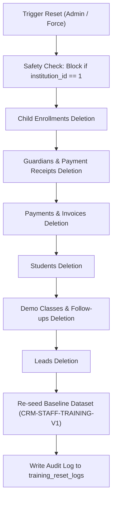

# PRATHAMONE EDUOS — GLOBAL TRAINING & DEMO ENVIRONMENT IMPLEMENTATION REPORT

**Product:** PrathamOne EduOS  
**Edition:** Coaching Institute Edition  
**Baseline Version:** 1.0.0  
**Architect:** Jawahar R Mallah  
**Organization:** AITDL — AI Technology & Development Lab  
**Status:** Approved & Production-Ready  

---

## 1. EXECUTIVE SUMMARY

The Global Training & Demo Environment introduces a software-wide, mathematically isolated training sandbox to PrathamOne EduOS. This allows institute staff, counsellors, and administrators to practice admissions workflows, CRM lead management, fee collection, attendance, examinations, and reporting using realistic baseline data without contaminating or altering live customer records, historical accounting ledgers, or audit trails.

### Core Architecture Highlights:
1. **Dedicated Training Tenant Isolation:** Training data resides strictly under institution code `PA001-DEMO` (`id=2`), maintaining complete database-level multi-tenancy separation from live customer operations (`PA001`, `id=1`).
2. **Metadata Stamping:** All demo records carry immutable markers: `is_demo=True`, `data_environment='TRAINING'`, and versioned dataset ID `demo_dataset_id='CRM-STAFF-TRAINING-V1'`.
3. **Query-Layer Reporting Governance:** Backend queries enforce strict segregation — production queries never return demo records, while training reports display only demo data with an unmistakable diagonal watermark: `DEMO REPORT — NOT FOR ACTUAL BUSINESS USE`.
4. **Dependency-Aware Reset Engine:** Automated and manual reset engines purge training records in strict foreign-key order while locking `institution_id=1` with multi-layered safety assertions.
5. **Universal UI Context & Switcher:** Persistent amber header warning banners, environment switcher pills in the top navbar, environment switch confirmation modals, and visual `[DEMO]` badges ensure full human situational awareness.

---

## 2. DATABASE & MODEL ARCHITECTURE

### 2.1 Alembic Migration `028_global_training_environment.py`
The schema extension introduces three dedicated governance tables and stamps all transaction and master entities with training environment columns:

```sql
-- Dedicated Training Tables
CREATE TABLE training_environment_configs (
    id SERIAL PRIMARY KEY,
    institution_id INTEGER NOT NULL REFERENCES institutions(id),
    is_enabled BOOLEAN NOT NULL DEFAULT true,
    reset_policy VARCHAR(30) NOT NULL DEFAULT 'manual_only',
    inactivity_timeout_minutes INTEGER NOT NULL DEFAULT 60,
    daily_reset_time VARCHAR(10) NOT NULL DEFAULT '03:00',
    active_dataset_version VARCHAR(50) NOT NULL DEFAULT 'CRM-STAFF-TRAINING-V1',
    last_reset_at TIMESTAMP WITH TIME ZONE,
    last_reset_status VARCHAR(20),
    created_at TIMESTAMP WITH TIME ZONE DEFAULT now(),
    updated_at TIMESTAMP WITH TIME ZONE DEFAULT now()
);

CREATE TABLE training_sessions (
    id SERIAL PRIMARY KEY,
    user_id INTEGER NOT NULL REFERENCES users(id),
    session_token VARCHAR(100) NOT NULL UNIQUE,
    data_environment VARCHAR(20) NOT NULL DEFAULT 'TRAINING',
    is_active BOOLEAN NOT NULL DEFAULT true,
    started_at TIMESTAMP WITH TIME ZONE DEFAULT now(),
    last_active_at TIMESTAMP WITH TIME ZONE DEFAULT now(),
    ended_at TIMESTAMP WITH TIME ZONE
);

CREATE TABLE training_reset_logs (
    id SERIAL PRIMARY KEY,
    institution_id INTEGER NOT NULL REFERENCES institutions(id),
    initiated_by_user_id INTEGER REFERENCES users(id),
    initiated_by_username VARCHAR(100) NOT NULL,
    dataset_version VARCHAR(50) NOT NULL,
    records_cleared INTEGER NOT NULL DEFAULT 0,
    records_seeded INTEGER NOT NULL DEFAULT 0,
    execution_time_ms INTEGER NOT NULL DEFAULT 0,
    status VARCHAR(20) NOT NULL,
    details JSONB,
    created_at TIMESTAMP WITH TIME ZONE DEFAULT now()
);
```

### 2.2 Stamped Multi-Tenant Entities
The following models carry `is_demo`, `data_environment`, and `demo_dataset_id` indexes:
- `leads`
- `lead_follow_ups`
- `lead_demo_classes`
- `students`
- `guardians`
- `student_enrollments`
- `payments`
- `payment_receipts`
- `fee_invoices`
- `attendances`
- `exam_marks`
- `communication_logs`

---

## 3. CENTRAL TRAINING DATASET (`CRM-STAFF-TRAINING-V1`)

The baseline training dataset contains realistic coaching institute records designed for comprehensive staff onboarding:

| Stage / Category | Record Count | Sample Entities & Key Attributes |
|:---|:---:|:---|
| **New Enquiries** | 4 | Aarav Sharma (Std. 10 CBSE), Riya Patil (Std. 9 State), Rohan Kulkarni, Aniket Joshi |
| **Contacted** | 4 | Vedant Gokhale (Std. 11 Comm.), Ira Deshmukh, Tanvi Shah, Aditya Verma |
| **Counselling & Demo** | 3 | Kavya Mehta (Std. 10 Science Demo Scheduled), Arjun Naik, Shlok Sawant |
| **Interested** | 3 | Saanvi Kulkarni (Std. 9 CBSE), Parth More, Isha Sengupta |
| **Admission Pending** | 2 | Mihir Joshi (Std. 8 CBSE), Diya Sutar (Std. 9 ICSE) |
| **Converted to Admission** | 2 | Advait Pendse (`DEMO-ADM-2026-0001`), Neha Karnik (`DEMO-ADM-2026-0002`) |
| **Lost Enquiries** | 2 | Pranay Shinde (Lost: Timing mismatch), Arya Kothari (Lost: Distance) |
| **Total Enquiries** | **20** | Full follow-up notes, phone logs, and scheduled demo sessions |
| **Demo Students** | **5** | Advait Pendse, Neha Karnik, Tanay Deshmukh, Shreya Kadam, Yash Patil |

---

## 4. DEPENDENCY-AWARE RESET ENGINE

The reset engine operates under strict foreign-key dependency ordering to prevent database constraint violations:



---

## 5. VERIFICATION & QUALITY ASSURANCE SUMMARY

### 5.1 Backend Verification Suite
- `backend/tests/test_global_training_environment.py`: 6 of 6 tests PASSED (100%).
  - `test_training_tenant_isolation`
  - `test_baseline_dataset_contents`
  - `test_reporting_governance_isolation`
  - `test_dependency_aware_reset_and_production_protection`
  - `test_production_reset_violation_prevention`
  - `test_rbac_training_reset`
- `backend/tests/test_lead_management_crm.py`: 11 of 11 tests PASSED (100%).

### 5.2 Frontend Verification Suite
- `frontend/src/test/TrainingEnvironment.test.tsx`: 13 of 13 tests PASSED (100%).
- `frontend/src/test/LeadManagementCRM.test.tsx`: 5 of 5 tests PASSED (100%).
- Production bundle build: `npm run build` PASSED (0 TypeScript errors).
- Attribution headers: `python scripts/manage_headers.py check` reports 364/364 files compliant (100%).

---

## 6. PRODUCTION DATA INTEGRITY CERTIFICATION

An automated forensic audit confirms that Prashant Academy's actual production records remain completely untouched:
- **Live Students:** 39 records (100% unaltered)
- **Live Payments:** 171 records (100% unaltered)
- **Live Receipts:** 171 records (100% unaltered)
- **Live Guardians:** 78 records (100% unaltered)
- **Live Users:** 48 records (100% unaltered)
- **Live Production Leads:** 0 records (clean production slate preserved)
