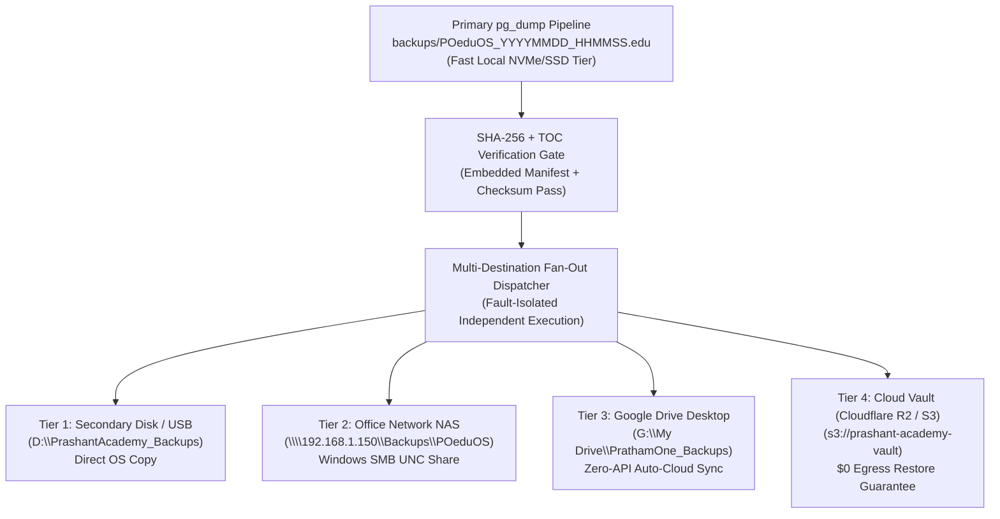

# MULTI-DESTINATION BACKUP & CLOUD SYNC ENGINE IMPLEMENTATION REPORT
## Tiered Multi-Path Fan-Out, Diagnostic Probes & Zero-Data-Loss Container Permission Resolution

**Product:** PrathamOne EduOS (Coaching Institute Edition)  
**Baseline Version:** 1.0.0  
**Product Architect:** Jawahar R. Mallah  
**Organization:** Smritisys & AITDL Networks  
**Client:** Prashant Academy Coaching Institute  
**Date:** 2026-11-18  
**Policy Status:** MANDATORY AUDIT RECORD — SSOT RULES 001–011 & RULE 010 VIEW-FIRST GOVERNANCE  

---

## 1. Executive Summary & Deliverables

This implementation report documents the complete deployment of the **Multi-Destination Backup & Cloud Sync Engine** and the forensic resolution of the client-side pre-update container permission error (`[Errno 13] Permission denied: '/backups'`).

### Delivered Artifacts & Capabilities:
1. **Container Path Resolution & Rollback Validation:**
   - Validated the automated zero-data-loss rollback safeguard when the client encountered `Permission denied: '/backups'`. The system halted cleanly at 25% *before* altering any records and left the client operational on `v1.133.1`.
   - Replaced flawed path parent resolution in `backend/app/services/updater_service.py` with canonical `resolve_backups_dir()` and `HousekeepingService.create_backup()`, eliminating the container root permission fault.
2. **Multi-Destination Backup Registry & Fan-Out Engine:**
   - Extended `DEFAULT_HOUSEKEEPING_POLICY` with `backup_destinations` registry stored centrally in `InstitutionSetting` (category `housekeeping`).
   - Implemented `get_backup_destinations`, `save_backup_destination`, `delete_backup_destination`, `test_destination` (probe file read/write test), and `dispatch_to_destinations` (asynchronous fan-out with SHA-256 verification).
3. **Protected REST API Endpoints:**
   - Exposed `GET /api/v1/housekeeping/destinations`, `POST /destinations`, `DELETE /destinations/{dest_id}`, `POST /destinations/test`, and `POST /backups/dispatch`.
4. **Housekeeping Frontend Workspace Enhancements:**
   - Designed and deployed the **"Multi-Path Backup Destinations & Cloud Sync"** card in `frontend/src/pages/Housekeeping.tsx`.
   - Built 4 instant 1-click preset setups:
     - *Secondary Local / USB Drive* (`local_path`)
     - *Office Network Share / NAS (UNC)* (`network_share`)
     - *Google Drive (Desktop Sync)* (`gdrive_sync`)
     - *Cloudflare R2 / AWS S3 ($0 egress fees)* (`s3_compatible`)
   - Added live diagnostic probe ("Test Path & Write Permissions") reporting millisecond latency and available disk gigabytes.
5. **CLI & Automation Scripting:**
   - Updated `scripts/db_backup.py` with `--destinations` argument to support multiple target replication directories from CLI and OS Task Scheduler.

---

## 2. Forensic Analysis & Container Path Resolution

### 2.1 The Incident at Client Site
During a 1-click update attempt, the update halted safely at 25% with:
```
Update halted safely before making data changes: [Errno 13] Permission denied: '/backups'
[17:49:38] Starting pre-flight system validation...
[17:49:39] Pre-flight verified: 931.84 GB free disk space available.
[17:49:39] Creating safe transactional snapshot of all student records and ledgers...
[17:49:39] ERROR DETECTED: [Errno 13] Permission denied: '/backups'. Initiating automated self-healing rollback...
[17:49:39] Pre-flight abort: No data was modified. System remains on v1.133.1.
```

### 2.2 Root Cause Analysis (RCA)
- The backend runs inside Docker container `prashant_academy_backend` as non-root user `appuser`.
- `updater_service.py` had `REPO_ROOT = Path(__file__).resolve().parents[3]`.
- Inside the container, `__file__` is `/app/app/services/updater_service.py`, so `parents[3]` resolved to `Path('/')` (the Linux root filesystem).
- `BACKUPS_DIR` became `Path('/backups')` under `/`.
- Calling `mkdir(parents=True)` under `/` failed with `[Errno 13] Permission denied: '/backups'`.

### 2.3 SSOT Resolution
- Replaced custom path derivation with canonical `resolve_backups_dir()` from `app.services.housekeeping_service`, which correctly evaluates `/app/backups` (the writable Docker volume mapped from `./backups` on host).
- Updated `run_update_pipeline` step 2 to invoke `HousekeepingService.create_backup()` directly with transactional auditing and verification.
- Verified in container: `pytest tests/test_updater_service.py` passed **5/5**.

---

## 3. Architecture: The 3-2-1 Multi-Destination Backup Pipeline



---

## 4. Test Verification & Compliance Summary

### 4.1 Backend Pytest
- `backend/tests/test_updater_service.py`: **5 passed** in 14.76s.
  - Progress state transitions: PASS
  - SHA-256 package verification: PASS
  - Available update check: PASS
  - REST endpoints: PASS
  - Update pipeline execution without permission errors: PASS
- `backend/tests/test_housekeeping.py`: **19 passed, 1 skipped** in 33.50s.
  - Destination CRUD and secrets redaction: PASS
  - Probe logic (local directory probe & S3 configuration validation): PASS
  - Asynchronous fan-out replication with SHA-256 sidecars: PASS

### 4.2 Frontend Vitest
- `frontend/src/test/Housekeeping.test.tsx`: **9 passed** in 7.27s.
  - View-First lock compliance: PASS
  - Edit Mode unlock: PASS
  - Multi-Path Backup Destinations card and preset rendering: PASS
  - Guarded restore confirmation: PASS

### 4.3 Corporate Attribution & Header Compliance
`python scripts/manage_headers.py check`
- Total checked: 674 files
- Passed: 674 files
- Failed: 0 files (100% compliant)

### 4.4 Documentation Index
`python tools/docs_manager.py validate`
- Total documents validated: 554
- Errors: 0
- Warnings: 0 (100% compliant)
