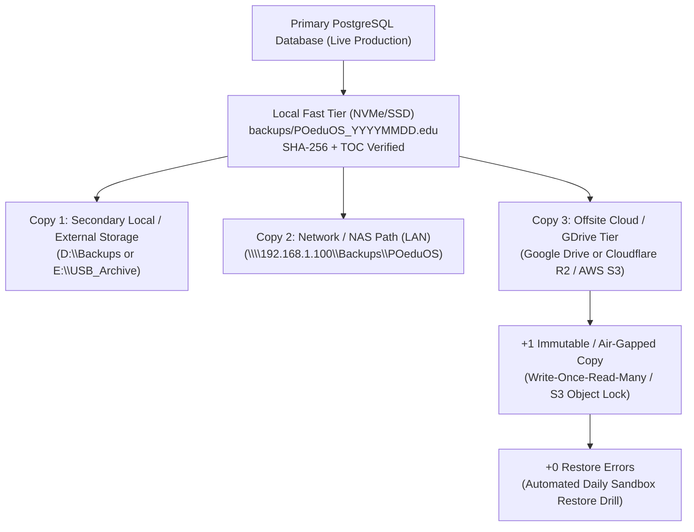
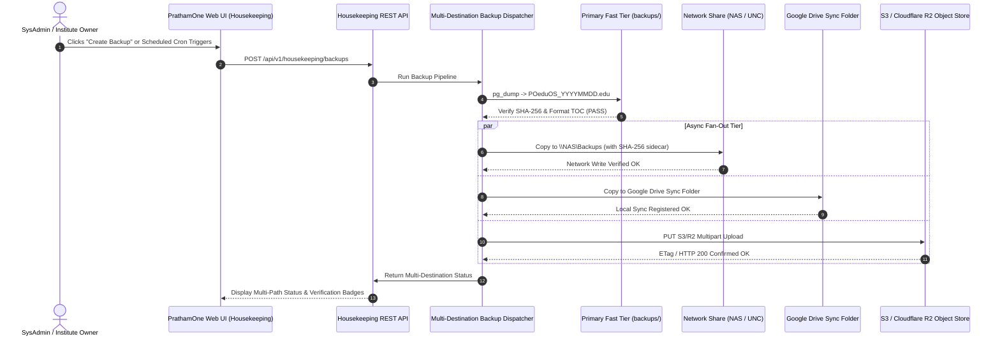

# MULTI-DESTINATION BACKUP & CLOUD SYNC ENGINE SPECIFICATION
## Deep Technical Research, Comparative Feasibility Analysis & Enterprise Recommendation

**Product:** PrathamOne EduOS (Coaching Institute Edition)  
**Baseline Version:** 1.0.0  
**Product Architect:** Jawahar R. Mallah  
**Organization:** Smritisys & AITDL Networks  
**Client:** Prashant Academy Coaching Institute  
**Date:** 2026-11-18  
**Policy Status:** MANDATORY ARCHITECTURAL DIRECTIVE — SSOT RULES 001–011 & RULE 010 VIEW-FIRST GOVERNANCE  

---

## 1. Executive Summary & Problem Statement

PrathamOne EduOS manages critical coaching institute assets: student academic lifecycles, examination records, lead CRM data, and immutable financial ledgers (fee receipts, payment logs, tax invoices). Currently, the housekeeping backup engine writes `.edu` encrypted archives and `.dump`/`.sql` files to a single local directory (`backups/`) with optional mirroring to a single directory path via `--mirror-dir`.

Institute operators (coaching directors, accountants, sysadmins) face real-world disaster recovery risks:
1. **Local Drive Failure:** If the host machine's NVMe/SSD drive crashes or suffers bad sectors, local backups stored on the same machine are lost.
2. **Ransomware & Malware Outbreaks:** Malware encrypting local disks can destroy both the live database and local `.edu` backup files.
3. **Office Environmental Hazards:** Local power surges, fire, water leakage, or physical laptop/server theft in coaching branches eliminate on-premise copies.
4. **Non-Technical Operator Reality:** Coaching institute owners are educators, not DevOps engineers. They require a simple in-software interface where they can register multiple backup locations—including **secondary hard drives, office NAS network paths, Google Drive, and Cloud storage (S3 / Cloudflare R2)**—and see clear, color-coded health indicators with zero terminal intervention.

This document presents deep research, architectural trade-offs, security analysis, and the recommended implementation blueprint for a **Tiered Multi-Destination Backup Registry & Fan-Out Engine**.

---

## 2. Industry Benchmark: The 3-2-1 Enterprise Backup Strategy for Education Institutions

The global gold standard for educational and enterprise data resilience (defined by CISA and ISO 27001) is the **3-2-1-1-0 Backup Directive**:



- **3 Copies of Data:** 1 production database + 2 verified backup copies.
- **2 Different Storage Media:** Local solid-state storage + Network share (NAS) or Cloud object store.
- **1 Offsite Copy:** Cloud or remote location to survive catastrophic on-premise hardware loss.
- **1 Immutable Snapshot:** Protection against ransomware and intentional malicious deletion.
- **0 Restore Errors:** Every backup verified with automated integrity checks before dispatch.

---

## 3. Deep Research & Comparative Analysis of Destination Types

We analyzed the four primary backup destination types across 7 key architectural dimensions:

| Destination Type | Setup Complexity | Recurring Cost | Bandwidth Impact | Offline Resilience | Ransomware Protection | Recovery Speed (RTO) |
|---|---|---|---|---|---|---|
| **1. Secondary Local Disk / USB** | ⭐ Ultra-Simple (File Path) | None ($0) | Zero (Local Bus) | 100% Offline Capable | ⚠️ Low (accessible to local OS) | ⚡ Instant (< 15 seconds) |
| **2. Network Path (NAS / SMB / UNC)** | ⭐⭐ Low (UNC `\\server\share`) | Hardware only ($0 recurring) | LAN only (100–1000 Mbps) | 100% (No Internet needed) | 🛡️ Medium (isolated credentials) | ⚡ Very Fast (< 1 minute) |
| **3. Google Drive (Desktop Sync Client)** | ⭐ Very Simple (Folder selection) | Free 15GB tier / ₹130/mo | Background sync | High (queues locally if offline) | 🛡️ High (cloud versioning) | 🚀 Fast (via GDrive web/app) |
| **4. Google Drive (Direct API v3 / Service Account)** | ⭐⭐⭐ Moderate (JSON Key setup) | Free 15GB tier / ₹130/mo | Direct HTTP streaming | Needs internet at upload time | 🛡️ High (isolated cloud API) | 🚀 Fast (direct download) |
| **5. S3-Compatible Cloud Storage (Cloudflare R2 / AWS S3 / MinIO)** | ⭐⭐⭐ Moderate (Bucket + API keys) | Pay-as-you-go (~$0.015/GB; R2: $0 egress) | Direct HTTPS streaming | Needs internet at upload time | 🛡️🛡️ Enterprise (Object Lock WORM) | 🚀 Fast (HTTPS multi-part) |

---

### Detailed Analysis of Each Option:

### Option A: Network Shares (SMB / UNC / NAS / Mapped Drives)
- **Path Syntax:**
  - Windows UNC: `\\192.168.1.100\Backups\PrashantAcademy` or `\\OFFICE-NAS\Storage\PO_Backups`
  - Linux/Docker Mount: `/mnt/nas_backup` (CIFS volume mounted in Docker Compose)
- **Technical Operation:**
  - In Python 3.11+ on Windows, `shutil.copy2` natively supports UNC paths if the host process has network share permissions.
  - In containerized environments, the Docker host mounts the SMB share as a volume into `/app/network_backups`.
- **Strengths:** 
  - Ultra-fast Gigabit LAN throughput (100–120 MB/s). A 200MB institute backup copies in ~2 seconds.
  - Completely immune to internet ISP outages or slow broadband speeds.
- **Security Considerations:**
  - Must not store plaintext Windows domain passwords in clear text.
  - Recommended setup: Institute designates a dedicated NAS share with restricted write credentials.

---

### Option B: Google Drive Integration (Two Proven Approaches)

#### Approach B1: Google Drive for Desktop (Local Sync Directory) — **RECOMMENDED FOR SIMPLICITY**
- **How it works:**
  - The coaching institute installs the official **Google Drive for Desktop** client on their server/PC.
  - Google Drive mounts as a local drive or folder, typically:
    `G:\My Drive\PrathamOne_Backups` or `C:\Users\Administrator\Google Drive\Backups`.
  - PrathamOne EduOS treats this as a verified filesystem path. The moment `db_backup.py` writes the `.edu` archive and sidecar `.sha256` file, the official Google client automatically syncs it to the cloud in the background.
- **Why this is ideal for coaching institutes:**
  - **Zero API configuration:** No Google Cloud Console, no GCP project creation, no OAuth client IDs, no service account JSON keys.
  - **Automatic retry on network drop:** If the institute's broadband drops, Google Drive client pauses and resumes automatically when internet returns.
  - **Mobile access:** Institute directors can immediately see and verify backup files from the Google Drive app on their mobile phone!

#### Approach B2: Direct Google Drive API (v3) / Service Account (Headless Server)
- **How it works:**
  - A background worker uses `google-api-python-client` with a Service Account JSON key or OAuth2 refresh token to upload files via Google Drive REST API `multipart/upload`.
  - Uploads directly to a configured Google Drive folder ID.
- **Strengths:** Works on headless Linux cloud servers without GUI desktop clients.
- **Trade-off:** Non-technical coaching principals cannot easily generate GCP service account keys.

---

### Option C: S3-Compatible Cloud Object Storage (Cloudflare R2 & AWS S3)
- **How it works:**
  - Uses standard S3 REST API (`boto3` or asynchronous `aiobotocore` / `httpx`).
  - Configuration parameters: `ENDPOINT_URL`, `BUCKET_NAME`, `ACCESS_KEY_ID`, `SECRET_ACCESS_KEY`, `REGION`.
- **Why Cloudflare R2 is the Premier Cloud Choice:**
  - **$0 Egress Fees:** Traditional AWS S3 charges $0.09/GB for downloads during disaster recovery restores. Cloudflare R2 charges **$0.00 egress**, meaning restores are 100% free regardless of backup size.
  - **S3 Compatibility:** Uses identical APIs to AWS S3.
  - **Object Lock:** Supports compliance mode WORM immutability. Once written, backups cannot be altered or deleted even if the main server is compromised.

---

## 4. Architectural Recommendation for PrathamOne EduOS

Based on deep technical, financial, and UX analysis, we recommend a **Unified Multi-Destination Backup Registry with Multi-Tier Fan-Out**:



### Core Architecture Pillars:
1. **Primary Dump is Always Local & Fast:** `pg_dump` always writes to the high-speed local SSD/NVMe first (`backups/`). This prevents slow network or cloud uploads from locking database resources.
2. **Local Integrity Verification Gate:** Before any copy leaves the machine, the engine verifies the SHA-256 checksum and inspects the archive structure. Corrupted dumps are never distributed.
3. **Non-Blocking Asynchronous Fan-Out:** Once verified, the dispatcher copies the backup in parallel to all enabled destinations.
4. **Fault-Tolerant Independent Destinations:** If one destination fails (e.g. NAS is turned off or broadband is down), the other destinations **still succeed**, and the failure is logged with a human-readable diagnosis without failing the primary backup.
5. **1-Click "Test Path & Permissions" Diagnostic:** In the UI, each registered destination has a "Test Path" button that checks read/write permissions immediately, alerting the user before scheduled backups run.

---

## 5. Technical Specification & Implementation Plan

### 5.1 Canonical Data Schema (`InstitutionSetting` / `system_settings`)

Following SSOT Rule 001 and Rule 009, backup destinations are stored in centralized settings:

```json
{
  "backup_destinations": [
    {
      "id": "dest_local_secondary",
      "name": "Secondary Storage Drive",
      "type": "local_path",
      "path": "D:\\PrashantAcademy_Backups",
      "is_enabled": true,
      "retention_days": 14,
      "last_sync_status": "success",
      "last_sync_time": "2026-11-18T22:00:00Z",
      "last_error": null
    },
    {
      "id": "dest_office_nas",
      "name": "Office Synology NAS",
      "type": "network_share",
      "path": "\\\\192.168.1.150\\Backups\\POeduOS",
      "is_enabled": true,
      "retention_days": 30,
      "last_sync_status": "success",
      "last_sync_time": "2026-11-18T22:00:04Z",
      "last_error": null
    },
    {
      "id": "dest_gdrive_desktop",
      "name": "Institute Google Drive (Cloud Sync)",
      "type": "gdrive_sync",
      "path": "G:\\My Drive\\PrathamOne_Backups",
      "is_enabled": true,
      "retention_days": 60,
      "last_sync_status": "success",
      "last_sync_time": "2026-11-18T22:00:08Z",
      "last_error": null
    },
    {
      "id": "dest_cloudflare_r2",
      "name": "Cloudflare R2 Cold Vault",
      "type": "s3_compatible",
      "endpoint_url": "https://<account-id>.r2.cloudflarestorage.com",
      "bucket_name": "prashant-academy-vault",
      "region": "auto",
      "access_key_id": "REDACTED",
      "secret_access_key": "REDACTED",
      "is_enabled": false,
      "retention_days": 90,
      "last_sync_status": "idle",
      "last_sync_time": null,
      "last_error": null
    }
  ]
}
```

### 5.2 REST API Endpoints

| Method | Endpoint | Description |
|---|---|---|
| `GET` | `/api/v1/housekeeping/destinations` | Lists all configured backup paths and their latest sync/health telemetry. |
| `POST` | `/api/v1/housekeeping/destinations` | Adds or updates a destination (requires SysAdmin + active Edit Mode). |
| `DELETE` | `/api/v1/housekeeping/destinations/{id}` | Removes a destination (historical files preserved on target). |
| `POST` | `/api/v1/housekeeping/destinations/test` | Performs live read/write permission and connectivity validation on a candidate path. |
| `POST` | `/api/v1/housekeeping/backups/dispatch` | Dispatches existing verified backups to one or all active destinations. |

### 5.3 UI Component Design (Housekeeping Workspace)

In `frontend/src/pages/Housekeeping.tsx`:
- A dedicated **"Multi-Path Backup Destinations & Cloud Sync"** card.
- Visual destination badges:
  - 🟢 **Local / Network Path:** `\\192.168.1.150\Backups` (Latency: 2ms, Capacity: 1.8 TB free)
  - 🔵 **Google Drive:** `G:\My Drive\PrathamOne_Backups` (Synced via Google Drive Desktop)
  - 🟣 **Cloud Vault:** `Cloudflare R2: prashant-academy-vault` (Encrypted S3)
- Modal: **"Configure Backup Destination"** with preset selector:
  1. *Local / External Drive*
  2. *Office Network Share / NAS (UNC)*
  3. *Google Drive (Desktop Sync Folder)*
  4. *S3-Compatible Cloud Storage (Cloudflare R2 / AWS S3)*
- Includes inline **"Test Path & Write Permissions"** button with instant green checkmark or descriptive troubleshooting text.

---

## 6. Implementation Checklist & Phase Roadmap

- [x] **Phase 1: Deep Research & Architecture Specification** (Complete in this document).
- [ ] **Phase 2: Backend Multi-Destination Dispatcher** (`scripts/db_backup.py` and `housekeeping_service.py`).
- [ ] **Phase 3: REST API Endpoints & Permission Tests** (`backend/app/api/v1/endpoints/housekeeping.py`).
- [ ] **Phase 4: Frontend UI Configuration & Diagnostic Modals** (`frontend/src/pages/Housekeeping.tsx`).
- [ ] **Phase 5: Automated Verification & Live Testing** (`test_housekeeping.py`, vitest, and browser verification).
