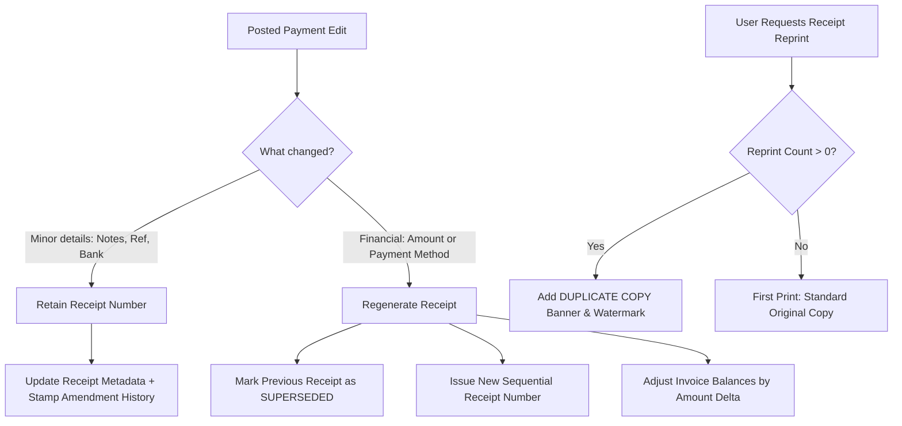

# PrathamOne Academy — Fees & Payments Workflow Implementation
## Comprehensive Audit Report & Architecture Blueprint

**Project:** PrathamOne Academy Coaching Institute Management System  
**Module:** Financial Ledger, Fees, Payments, Receipts & Workflow Governance  
**Author:** Jawahar R. Mallah, AITDL (AI Technology & Development Lab)  
**Client:** Prashant Academy Coaching Institute  
**Date:** November 5, 2026  
**Status:** **Pending User Approval (Pre-Coding Phase)**

---

## 1. Executive Summary & Objective

The objective of this implementation is to establish an enterprise-grade, user-friendly payment workflow for **PrathamOne Academy** with configurable ERP controls. The system maintains everyday payment recording simple and fast for standard operations while providing strict approval matrices, comprehensive field-level audit logs, receipt supersession versioning, and controlled refund lifecycles for organizations requiring stricter governance.

---

## 2. Comprehensive System Audit (Phase 1)

### 2.1 Existing Data Models & Database Schema

| Table | Current Schema & Constraints | Current Statuses | Findings & Gaps |
| :--- | :--- | :--- | :--- |
| `payments` | Columns: `id`, `student_id`, `academic_year_id`, `amount`, `payment_date`, `payment_method`, `transaction_reference`, `bank_name`, `cheque_number`, `cheque_date`, `notes`, `status`, `reversed_at`, `reversal_reason`, `reversed_by_id`, `collected_by_id`, `created_at`. | `'completed'`, `'reversed'` | • Immediate ledger impact on insert; no `draft`, `submitted`, or `approved` stages.<br>• Lacks `submitted_by_id`, `submitted_at`, `approved_by_id`, `approved_at`, `posted_by_id`, `posted_at`, and edit tracking. |
| `payment_receipts` | Columns: `id`, `receipt_number` (`unique=True`), `payment_id` (`unique=True`), `student_id`, `amount`, `payment_date`, `payment_method`, `receipt_data` (JSON text), `generated_at`. | Status stored inside JSON `receipt_data` as `'voided'` or `'valid'`. | • `payment_id` has a `UNIQUE` constraint, which prohibits having both a superseded previous receipt and a newly regenerated receipt for the same payment.<br>• No first-class `version`, `is_current`, `superseded_at`, `superseded_by_receipt_number`, or `reprint_count`. |
| `refunds` | Columns: `id`, `institution_id`, `student_id`, `enrollment_id`, `payment_id`, `invoice_id`, `amount`, `refund_date`, `refund_method`, `reference_number`, `reason`, `status`, `notes`, `processed_by_id`, `created_at`, `updated_at`. | `'completed'` | • Currently only invoked during student withdrawal exit in `students.py`.<br>• No independent payment-linked refund endpoint in `payments.py`.<br>• Lacks refund lifecycle (`draft`/`requested` → `approved` → `completed`). |
| `audit_logs` | Columns: `id`, `user_id`, `action`, `resource_type`, `resource_id`, `old_data`, `new_data`, `ip_address`, `user_agent`, `is_system_audit`, `severity`, `details`, `created_at`. | General system logging | • Ready for structured JSON diff logging of old vs. new values, actor, timestamp, and user reason on every payment modification. |
| `institution_settings` | Key-value settings table with categories, types, and scope. | General lookups & settings | • Needs configuration keys for payment workflow modes, approval thresholds, roles, and refund controls. |

### 2.2 Existing APIs & Endpoints

- `POST /api/v1/payments/`: Immediately commits transaction, decrements invoice outstanding balance, and generates receipt.
- `GET /api/v1/payments/`: Lists payments with student, standard, batch, receipt number, and filters.
- `GET /api/v1/payments/{payment_id}`: Retrieves single transaction with allocations.
- `POST /api/v1/payments/{payment_id}/reverse`: Reverses payment, restores balances, voids receipt.
- `GET /api/v1/payments/receipts/{receipt_number}`: Returns authoritative receipt payload with historical fee breakdown.
- `GET /api/v1/payments/receipts-list`: Lists all issued receipts.

### 2.3 Numbering & Concurrency Audit

- In `app.services.sequence.generate_next_receipt_number`: Queries `PaymentReceipt.receipt_number.like('RCP-YYYY-%')` and calculates `max_seq + 1` in application memory.
- **Concurrency Risk:** If two cashiers collect fees simultaneously, both could read the identical `max_seq` and attempt to insert duplicate receipt numbers, causing constraint violations.
- **Solution:** Introduce an atomic document sequence lock (`SELECT FOR UPDATE`) on the sequence register during number reservation.

---

## 3. Proposed Payment Workflow Architecture

```mermaid
stateDiagram-v2
    [*] --> Draft : Create Payment Draft
    Draft --> Draft : Free Edits (No Ledger Impact)
    Draft --> Submitted : Submit for Posting / Review
    
    state "Simple Mode" as Simple {
        Submitted --> Posted : Direct Post (Routine)
    }
    
    state "Standard ERP Mode" as ERP {
        Submitted --> Approved : Review & Approval (Threshold/Cheque)
        Approved --> Posted : Execute Ledger Posting
    }

    Posted --> Posted : Minor Correction (Retains Receipt #)
    Posted --> Superseded : Amount/Method Edit (Regenerates Receipt)
    Superseded --> Posted : New Active Receipt Issued
    
    Posted --> Reversed : Void / Cancellation (Restores Balance)
    
    Posted --> RefundRequested : Request Refund (Linked to Payment)
    RefundRequested --> RefundApproved : Approve Refund
    RefundApproved --> RefundCompleted : Process & Disburse
```

### 3.1 State Definitions & Ledger Rules

1. **`draft`:**
   - Editable freely by any permitted user (`staff`, `accountant`, `admin`).
   - Does **NOT** alter student invoice balances or installment registers.
   - No permanent sequential receipt number is consumed. A temporary voucher identifier (`DFT-XXXX`) is assigned.
2. **`submitted`:**
   - Prepared by staff/cashier with full allocation breakdown.
   - Authorized users can edit submitted payments; every change is captured in `audit_logs` (old vs. new values).
   - In **Simple Mode**, can be posted immediately. In **Standard ERP Mode**, routes to approval if policy rules trigger.
3. **`approved`:** (Standard ERP Mode only)
   - Sanctioned by an authorized reviewer (`admin`, `principal`, `sysadmin`).
   - Unlocks the transaction for ledger posting.
4. **`posted`:**
   - Authoritative financial ledger status (synonymous with historical `'completed'`).
   - Atomic deduction from invoice `outstanding_amount` and increment of `paid_amount`.
   - Official sequential receipt number assigned (`RCP-YYYY-XXXX`).
   - Editable directly only by Admins or users with `payments:edit_posted` permission, requiring a mandatory change reason.
5. **`reversed`:**
   - Complete reversal / cancellation of the payment voucher.
   - Restores invoice and installment balances to their pre-payment state.
   - Associated receipt marked as **VOIDED**.

---

## 4. Configurable Modes: Simple vs. Standard ERP

### 4.1 Simple Mode (Default)
- **Lifecycle:** `Draft` → `Submitted` → `Posted` (or direct 1-click **Record & Post**).
- Designed for speed in day-to-day coaching operations. Routine cash and UPI collections post immediately.
- Authorized users can edit submitted or posted payments with audit reason logging.

### 4.2 Standard ERP Mode
- **Lifecycle:** `Draft` → `Submitted` → `Approved` (when required) → `Posted`.
- **Configurable Criteria for Approval:**
  - **Amount Threshold:** Payments exceeding threshold (e.g. $\ge$ ₹25,000) require approval.
  - **Payment Method:** Specific methods (e.g. Cheque, Demand Draft, RTGS/NEFT) require verification before clearance.
  - **Role-based Policy:** Cashiers/Staff submit; Accountants/Admins approve.
  - Payments below the threshold bypass approval and post directly.

---

## 5. Granular Permissions Matrix

| Permission Key | Description | Allowed Roles (Default) |
| :--- | :--- | :--- |
| `payments:create_draft` | Create new payment draft vouchers | Staff, Accountant, Admin, SysAdmin |
| `payments:edit_draft` | Modify existing unsubmitted drafts | Staff (own drafts), Accountant, Admin, SysAdmin |
| `payments:edit_submitted`| Modify submitted payment details prior to posting | Accountant, Admin, SysAdmin |
| `payments:post` | Execute authoritative ledger posting and receipt generation | Accountant, Admin, SysAdmin |
| `payments:edit_posted` | Perform audited modifications to already posted payments | Admin, SysAdmin |
| `payments:approve` | Approve submitted payments under ERP workflow rules | Admin, Principal, SysAdmin |
| `payments:refund` | Initiate, approve, and process partial or full refunds | Accountant (initiate), Admin / Principal (approve) |
| `payments:configure_workflow` | Toggle workflow mode (Simple/ERP) and change thresholds | Admin, SysAdmin |

*Backend Enforcement:* All endpoints will validate these permissions using the authenticated user's role and permission records, returning `403 Forbidden` on unauthorized attempts.

---

## 6. Audit Logging & Financial Integrity

Every modification to a `submitted` or `posted` payment records an immutable entry in `audit_logs`:
- **Payment ID & Receipt Number:** Identifies exact transaction and official document.
- **Old Data vs. New Data:** Exact JSON structure of changed attributes (e.g. amount, method, reference, notes).
- **Actor:** User ID, username, and role.
- **Timestamp:** Server-side UTC timestamp.
- **Audited Reason:** Mandatory human-readable explanation supplied by the user.

Audit records are strictly insert-only and cannot be updated or deleted.

---

## 7. Receipt Handling & Versioning Scheme



1. **Minor Corrections:**
   - Changes to non-financial fields (notes, bank name, reference number) preserve the existing `receipt_number`.
   - Receipt version number increments; amendment history is appended to `receipt_data`.
2. **Financial Corrections (Amount or Payment Method Changes):**
   - The existing receipt is marked `status = 'superseded'` with `superseded_at` timestamp.
   - A new receipt record is generated with a new sequential receipt number.
   - When viewed or printed, the superseded receipt displays a prominent **"SUPERSEDED"** watermark with a link to the new replacement receipt.
3. **Reprints:**
   - Any print requested after the initial issue marks the document with a clear **"DUPLICATE COPY"** watermark to prevent fraudulent duplicate submissions.
4. **Concurrency Protection:**
   - Receipt number allocation uses a database sequence lock to guarantee zero collisions even during simultaneous high-volume fee collections.

---

## 8. Refund Workflow Specification

1. **Initiate Refund (`POST /api/v1/payments/{id}/refunds`):**
   - Linked directly to the originating payment record (`payment_id`).
   - Validates that the requested amount does not exceed the remaining refundable balance:  
     $$\text{Max Refundable} = \text{Payment Amount} - \sum(\text{Completed Refunds for Payment})$$
   - Status: `requested` (or `completed` in Simple Mode when initiated by an authorized Admin).
2. **Approve Refund (`POST /api/v1/refunds/{id}/approve`):**
   - Authorized reviewer (`payments:approve`) sanctions the refund.
3. **Process Refund (`POST /api/v1/refunds/{id}/process`):**
   - Marks status as `completed`.
   - Records disbursement method (Cash, Bank Transfer, UPI), reference number, and disbursement date.
   - Adjusts student net retained collections in reporting.

---

## 9. Database Migrations Plan

### Migration Script: `016_payment_workflow_and_refunds.py`

1. **Table `payments`:**
   - Add columns:
     - `submitted_at: DateTime(timezone=True), nullable=True`
     - `submitted_by_id: Integer, ForeignKey("users.id"), nullable=True`
     - `approved_at: DateTime(timezone=True), nullable=True`
     - `approved_by_id: Integer, ForeignKey("users.id"), nullable=True`
     - `posted_at: DateTime(timezone=True), nullable=True`
     - `posted_by_id: Integer, ForeignKey("users.id"), nullable=True`
     - `last_edited_at: DateTime(timezone=True), nullable=True`
     - `last_edited_by_id: Integer, ForeignKey("users.id"), nullable=True`
     - `edit_count: Integer, default=0, server_default='0'`
   - Data migration: Existing rows with `status = 'completed'` remain valid as posted transactions (`posted_at = created_at`).
2. **Table `payment_receipts`:**
   - Drop `UNIQUE` constraint on `payment_id` to allow superseded version history.
   - Add columns:
     - `version: Integer, default=1, server_default='1'`
     - `status: String(20), default='valid', server_default='valid'` (`'valid'`, `'superseded'`, `'voided'`)
     - `superseded_at: DateTime(timezone=True), nullable=True`
     - `superseded_by_receipt_number: String(50), nullable=True`
     - `reprint_count: Integer, default=0, server_default='0'`
3. **Table `refunds`:**
   - Add columns:
     - `requested_by_id: Integer, ForeignKey("users.id"), nullable=True`
     - `approved_by_id: Integer, ForeignKey("users.id"), nullable=True`
     - `approved_at: DateTime(timezone=True), nullable=True`
     - `rejection_reason: Text, nullable=True`
4. **Seed `institution_settings`:**
   - `fees.payment_workflow_mode = 'simple'`
   - `fees.erp_approval_amount_threshold = '25000'`
   - `fees.erp_approval_roles = '["admin", "principal", "sysadmin"]'`
   - `fees.erp_require_approval_methods = '["cheque", "bank_transfer"]'`
   - `fees.allow_posted_payment_edits = 'true'`
   - `fees.refund_approval_required = 'true'`

---

## 10. Migration & Risk Mitigation Assessment

| Potential Risk | Severity | Mitigation Strategy |
| :--- | :--- | :--- |
| **Receipt Renumbering** | Critical | Zero existing receipt numbers will be modified or reassigned. All historical receipts retain their exact numbers. |
| **Historical Data Overwrite** | High | Edits never overwrite past payment records without an audited JSON diff in `audit_logs`. |
| **Query Compatibility** | Medium | Statuses `'completed'` and `'posted'` are treated as synonymous across all analytical and reporting queries. |
| **Concurrent Posting Collision** | Medium | Row-level locking on sequence records prevents duplicate receipt numbers during simultaneous postings. |
| **Draft Financial Leakage** | High | Invoices are only decremented upon entering `posted` state; drafts have zero impact on ledger balance. |

---

## 11. Approval & Verification Request

To proceed with implementation, explicit user confirmation is requested on:
1. **Approval of Workflow Blueprint:** Simple Mode (default) and Standard ERP Mode as designed.
2. **Approval of Schema Changes:** Proposed Alembic migration `016_payment_workflow_and_refunds.py`.
3. **Authorization to Implement:** Transition from Phase 1 (Audit & Proposal) to Phase 2 (Implementation & Testing).
