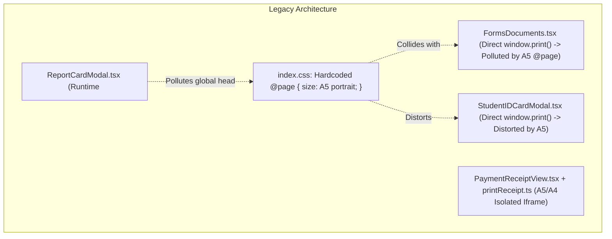
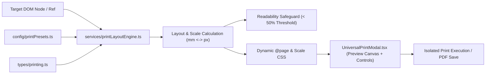

# PRATHAMONE EduOS — UNIVERSAL PRINT ENGINE ARCHITECTURE AUDIT

**Product:** PrathamOne EduOS (Coaching Institute Edition)  
**Baseline Version:** 1.0.0  
**Lead Auditor & Product Architect:** Jawahar R Mallah  
**Organization:** AITDL — AI Technology & Development Lab  
**Date:** 2026-11-07  

---

## 1. OBJECTIVE & FORENSIC DISCOVERY

A comprehensive audit of all existing print services, receipt generators, PDF renderers, and browser `@media print` implementations was conducted across **PrathamOne EduOS**.

The goal was to identify architectural bottlenecks, styling collisions, and printer incompatibilities that previously prevented universal page scaling across A4, A5, A3, Letter, Legal, Thermal, and Custom paper formats.

---

## 2. EXISTING PRINT SUBSYSTEMS AUDIT

### 2.1 Subsystem Analysis

1. **Global CSS Collision (`frontend/src/index.css:104-107`):**
   - *Finding:* A global `@page { size: A5 portrait; margin: 6mm 8mm; }` rule was hardcoded unscoped within `@media print`.
   - *Consequence:* Any component or page triggering direct `window.print()` (e.g. CBSE A4 forms, student report cards, payroll registers, and student smart ID cards) was forcibly clamped to A5 portrait in the browser print dialog. This resulted in unintended scaling artifacts, clipping, or double-sheet spilling.

2. **Isolated Receipt Printing Engine (`frontend/src/utils/printReceipt.ts`):**
   - *Finding:* Employs an isolated sandboxed iframe (`printReceiptElement`) to print receipts without outer modal backdrops or sidebar navigation.
   - *Limitation:* Restricted exclusively to `'A5' | 'A4'`. Required over 350 lines of duplicate inline utility CSS strings manually embedded into the iframe. Did not support A3, Letter, Legal, or continuous 80mm thermal rolls.

3. **Forms & KYC Workspace (`frontend/src/pages/FormsDocuments.tsx`):**
   - *Finding:* Renders 31 authoritative A4 institutional forms via `FormTemplateEngine.tsx`.
   - *Limitation:* Triggered raw `window.print()`, directly colliding with the unscoped A5 `@page` rule. Lacked live paper size selection, margin control, fit-to-page scaling, and PDF export preview.

4. **Graphical Report Cards (`frontend/src/components/ReportCardModal.tsx`):**
   - *Finding:* Dynamically injected an inline `<style>` tag into the DOM during component mount with `@media print { body * { visibility: hidden; } #printable-report-card { visibility: visible; } }`.
   - *Risk:* Style leaks in single-page applications where the injected CSS could override other active print containers if unmounted uncleanly.

5. **Student Smart ID Cards (`frontend/src/components/StudentIDCardModal.tsx`):**
   - *Finding:* Renders CR80 standard PVC smart cards (85.6 × 53.98 mm) with barcodes and QR codes.
   - *Limitation:* Lacked direct thermal dye-sublimation card printer dimensions or 8-up sheet layout options.

6. **Thermal POS & Barcode Label Printers:**
   - *Finding:* Institute front-desk operations require continuous thermal roll printing (80mm and 58mm) for walk-in fee tokens and payment slips. Previously, thermal printing required manual printer driver adjustments.

---

## 3. UNIFIED ARCHITECTURAL BLUEPRINT

To solve these deficiencies without breaking existing thermal, barcode, or receipt layouts, the **Universal Print Fit & Page Layout Engine** was designed around four core tenets:

1. **Decoupled `@page` Rules:** Replaced static A5 rule in `index.css` with flexible `@page { size: auto; margin: 8mm; }`. All paper dimensions (A4, A5, A3, Letter, Legal, Custom) are dynamically generated per print job.
2. **True Physical Dimension Translation:** Converts physical millimeters to standard CSS pixels using authoritative 96 DPI factor ($1\text{ mm} = 3.7795275591\text{ px}$).
3. **Six Deterministic Fit Modes:**
   - `fit-one-page`: $\min(s_w, s_h)$ guarantees single-sheet output.
   - `fit-width`: scales width to printable boundary while permitting natural vertical page flow.
   - `fit-height`: scales height.
   - `original`: strict 100% unscaled presentation.
   - `shrink-oversized`: downscales only when content overflows printable area.
   - `multi-page`: natural pagination with repeated table headers (`thead { display: table-header-group }`).
4. **Readability Protection Engine:** Detects when auto-scaling drops below readable font thresholds (< 50%) and presents interactive warning recommendations without destructive content truncation.

---
*Report Certified by Product Architect Jawahar R Mallah — AITDL AI Technology & Development Lab.*

