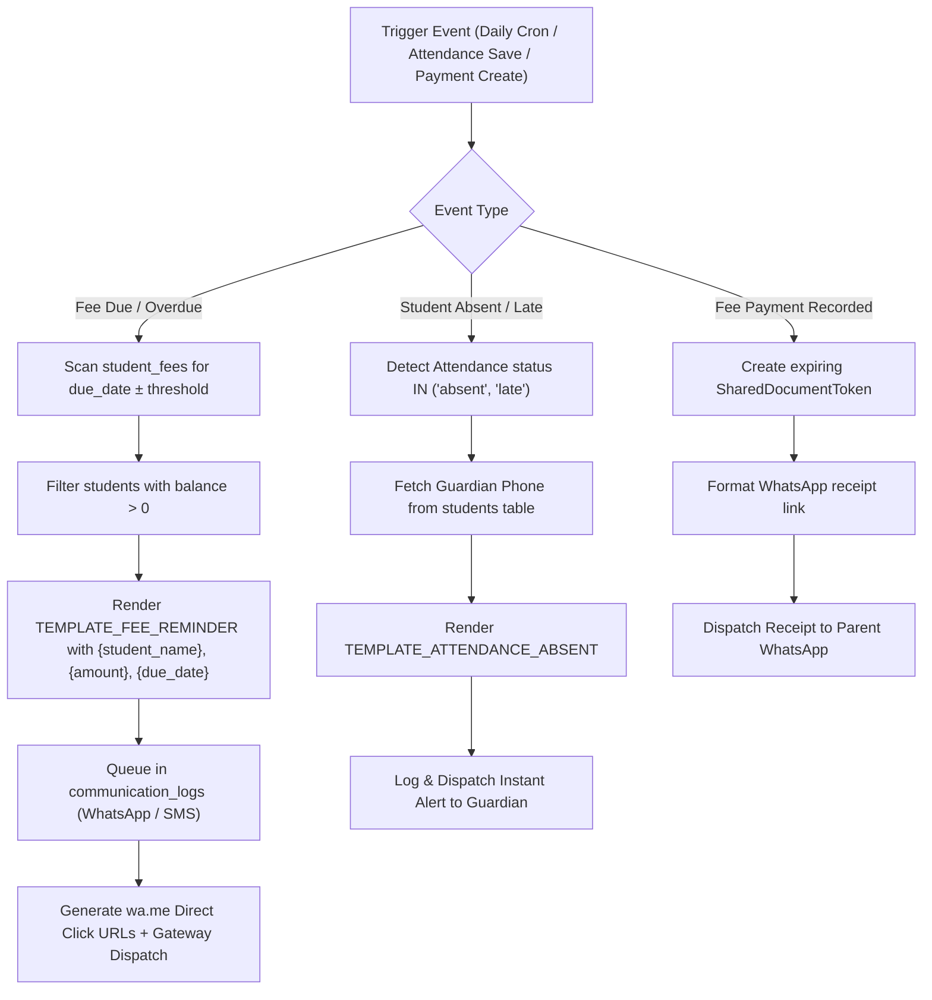

# PRATHAMONE EduOS — REAL-TIME COMMUNICATION & AUTOMATION ENGINE
## Implementation Plan — Module 1 of Roadmap Sequence

**Product:** PrathamOne EduOS  
**Edition:** Coaching Institute Edition  
**Version:** 1.0.0  
**Module:** 15_INTEGRATIONS (Communication & Automation)  
**Product Architect:** Jawahar R Mallah  
**Organization:** AITDL — AI Technology & Development Lab  

---

## 1. OBJECTIVE

Implement a unified, real-time automated communication engine for coaching institutes that:
1. **Automated Overdue Fee Reminders:** Scans upcoming fee installments (3 days before due date) and overdue commitments (1 day after), generating personalized reminder queues with direct WhatsApp (`wa.me`) and SMS dispatch links.
2. **Instant Attendance Absent/Late Alerts:** Real-time dispatch of alerts to guardian mobile phones/WhatsApp when students are marked `absent` or `late`.
3. **One-Click Secure Document Dispatch:** Dispatches official PDF fee receipts and teacher payment vouchers directly to WhatsApp with expiring tokenized view links (`/shared-doc/{token}`).
4. **Automation Workspace UI:** Adds an interactive "Automated Triggers & Queues" workspace within `Communication.tsx`.

---

## 2. SINGLE SOURCE OF TRUTH & ANTI-DUPLICATION COMPLIANCE

In strict accordance with the Global SSOT policy:
- **Reuse Existing Tables:** Reuses `message_templates`, `communication_logs`, `shared_document_tokens`, `system_settings`, `students`, `student_fees`, `payments`, and `attendances`.
- **No Duplicate Masters:** Student contact information is sourced authoritatively from `students.guardian_phone` and `students.phone`.
- **Centralized Domain Logic:** All reminder calculations, token generation, and wa.me deep links reside in `backend/app/services/communication.py`.

---

## 3. ARCHITECTURE & WORKFLOW SPECIFICATION

---

## 4. IMPLEMENTATION TASKS

### Phase 1: Backend Domain Service Extensions (`communication.py`)
- `generate_fee_reminder_queue(db, institution_id, days_before=3, days_after=1)`: Identifies all pending fee records requiring reminder, formats variable maps, and generates wa.me links.
- `dispatch_attendance_alert(db, institution_id, student_id, date, status, remarks)`: Queries guardian phone and logs/dispatches alert.
- `get_or_create_automation_settings(db, institution_id)`: Centralized configuration stored in `system_settings`.

### Phase 2: REST API Endpoints (`communication.py`)
- `POST /api/v1/communication/automation/fee-reminders/preview`: Returns preview of students with pending overdue reminders.
- `POST /api/v1/communication/automation/fee-reminders/dispatch`: Batch queues and dispatches reminders.
- `POST /api/v1/communication/automation/attendance-alerts`: Dispatches absentee alerts for specific attendance records.
- `GET /api/v1/communication/automation/rules`: Returns current automated trigger configuration.
- `POST /api/v1/communication/automation/rules`: Updates automated trigger settings.

### Phase 3: Frontend Communication Hub Elevation (`Communication.tsx`)
- Add 5th tab: **`automation`** ("Automated Triggers & Reminders").
- Real-time Fee Overdue Reminder Queue table with search, filter, and one-click WhatsApp action.
- Batch "Send Reminders" action.
- Automation Rule toggle switches (Attendance alerts, Overdue reminders, Receipt auto-dispatch).

### Phase 4: Test Suite & Verification
- Pytest tests: `tests/test_communication_automation.py`.
- Vitest tests: `frontend/src/test/Communication.test.tsx`.
- Reindex documentation via `tools/docs_manager.py reindex`.

