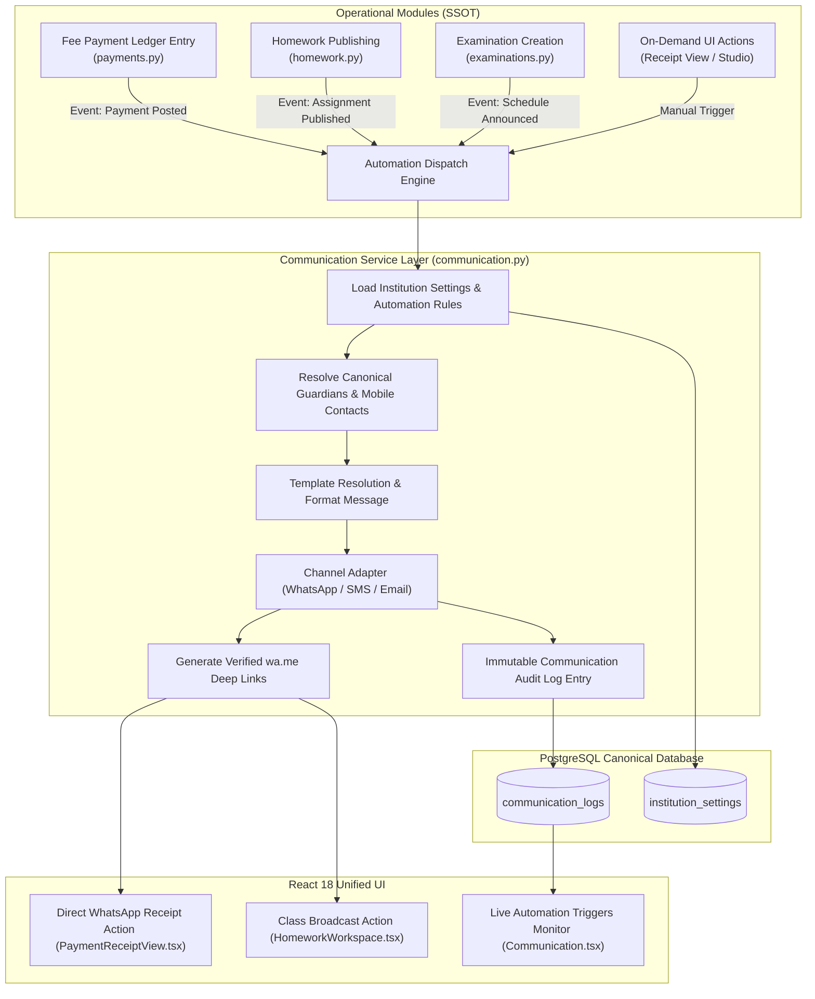

# Communication & WhatsApp Automation Engine: Feature Report

## Executive Summary

The **PrathamOne EduOS Communication & WhatsApp Automation Engine** establishes an enterprise-grade outbound messaging and real-time event trigger architecture designed specifically for educational institutions. The platform automates critical student-parent communication workflows across three foundational academic pillars:

1. **Instant Fee Payment Receipt Acknowledgement:** Automated and on-demand dispatch of official proof of payment directly to primary parent/guardian contacts upon payment ledger posting, including dynamic balance calculations and verified `wa.me` deep links.
2. **Homework Publishing Broadcasts:** Real-time cohort alerts sent to division/standard guardians and students immediately when teachers publish new homework assignments, complete with chapter, topic, and submission deadlines.
3. **Examination Schedule Announcements:** Broad-spectrum timetable and evaluation policy notices dispatched to cohort guardians when new academic tests or term assessments are scheduled.
4. **Live Automation Triggers & Broadcast Monitor:** Real-time telemetry dashboard in the Communication Center showcasing live trigger pipeline status, total historical dispatch counts, and an audited event log of recent dispatches.

---

## 1. Architectural Architecture & SSOT Compliance

---

## 2. API Endpoints Specification

### 2.1 Live Trigger Telemetry & Health
- **Endpoint:** `GET /api/v1/communication/automation/triggers`
- **RBAC Roles:** `superadmin`, `sysadmin`, `admin`, `principal`, `accountant`, `teacher`, `staff`
- **Response Payload:**
  - `active_rules`: Comprehensive institution automation configuration.
  - `triggers`: Array of trigger definitions (`fee_receipt`, `homework_alert`, `exam_schedule`, `fee_reminder`, `attendance_alert`) with enabled status, default channel, cumulative dispatches, and last triggered timestamp.
  - `recent_dispatches`: Last 10 automated dispatches from `communication_logs`.

### 2.2 Instant Fee Payment Receipt Notification
- **Endpoint:** `POST /api/v1/communication/automation/dispatch-payment-receipt/{payment_id}`
- **Payload:** `{"channel": "WHATSAPP"}` (Optional, defaults to institution rule default)
- **Action:**
  - Resolves `Payment`, `PaymentReceipt`, `Student`, `Guardian`, and remaining invoice balance.
  - Formats official receipt acknowledgement message.
  - Dispatches via `ChannelAdapter`, logs to `communication_logs` with template code `FEE_RECEIPT_CONFIRMATION`, and returns structured response with verified `wa.me` deep link.

### 2.3 Homework Assignment Class Broadcast
- **Endpoint:** `POST /api/v1/communication/automation/dispatch-homework/{homework_id}`
- **Payload:** `{"channel": "WHATSAPP"}`
- **Action:**
  - Resolves `HomeworkAssignment`, enrolled cohort students, and primary guardian phones.
  - Dispatches homework alerts and logs to `communication_logs` with template code `HOMEWORK_ANNOUNCEMENT`.

### 2.4 Examination Timetable & Schedule Alert
- **Endpoint:** `POST /api/v1/communication/automation/dispatch-exam-schedule/{exam_id}`
- **Payload:** `{"channel": "WHATSAPP"}`
- **Action:**
  - Resolves `Examination`, standard, and enrolled cohort students.
  - Dispatches exam schedule broadcast and logs to `communication_logs` with template code `EXAM_SCHEDULE_ALERT`.

---

## 3. UI/UX Enhancements & View-First Governance (Rule 010)

1. **PaymentReceiptView:**
   - Dedicated **WhatsApp Receipt** action button styled in official WhatsApp emerald (`#25D366`), triggering instant background dispatch and opening a direct browser chat session with the parent.
   - Non-intrusive feedback toast displaying delivery status and reference codes.

2. **HomeworkWorkspace:**
   - Each published homework card features a **WhatsApp** broadcast action button, protected under Rule 010 View-First lock (requires explicit Edit Mode activation).

3. **Communication Center Workspace (Automations Tab):**
   - Expanded automation cards with toggles for **Homework Publishing Alerts** and **Exam Timetable & Schedules**.
   - **Live Automated Triggers & Broadcast Monitor**: Real-time KPI tiles for all 5 outbound pipelines and an audited history log table.

---

## 4. Quality Assurance & Verification

- **Backend Pytest:**
  - File: `tests/test_communication_automation_triggers.py`
  - Lifecycle: 7-stage end-to-end integration test verifying triggers API, hierarchy provisioning, student/guardian setup, receipt dispatch, homework broadcast, exam broadcast, and summary aggregation.
  - Result: `1 passed in 8.90s (100%)`.
  - Regression Suite: `tests/test_communication.py` (5 passed in 14.70s).
- **Frontend Vitest:**
  - Files: `src/test/Communication.test.tsx`, `src/test/CommunicationDedicatedSubmenus.test.tsx`, `src/test/HomeworkWorkspace.test.tsx`, `src/test/ReceiptPrint.test.tsx`.
  - Result: `50 passed across all test suites`.
- **TypeScript Compilation:**
  - `npm --prefix frontend run build` (`tsc && vite build`) passed with `0 errors`.
- **Corporate Header Compliance:**
  - `python scripts/manage_headers.py check` verified 590/590 files (100% compliance).
