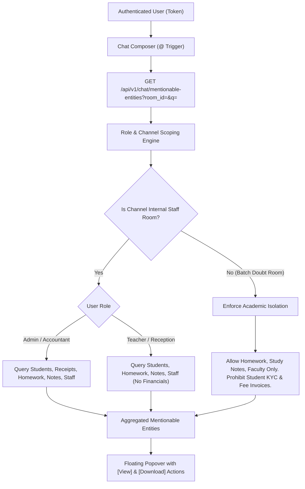

# Smart @ Entity Mention Picker & Role-Governed Record Access Engine

## 1. Executive Summary

In PrathamOne EduOS (Coaching Institute Edition), staff and faculty coordination often requires immediate reference to canonical student profiles, official payment receipts, study materials, and homework assignments. Rather than navigating away to disparate modules or manually copy-pasting numbers, users can type `@` followed by any entity name, admission number, or receipt code directly in any communication desk or doubt room.

A smart floating popover surfaces matching entities with immediate:
1. **Direct View:** One-click navigation to the canonical master record (`/students/{id}`, `/receipts/{code}`).
2. **Instant Download:** Authorized direct download of official PDF documents (e.g. Student Identity Cards, Fee Receipts, Study PDFs) backed by JWT authorization headers.
3. **One-Click Insert:** Embeds an immutable, structured entity chip `[[entity:TYPE:ID:TITLE:SUBTITLE:VIEW_URL:DOWNLOAD_URL]]` into the message stream.
4. **Rich Interactive Message Cards:** Chat bubbles parse embedded tokens and render responsive cards featuring role badges, title, subtitle, `[View]` and `[Download PDF]` action buttons.

All entity search and document retrieval strictly enforces the 10 Non-Negotiable SSOT Rules and Institute RBAC boundaries.

---

## 2. Security & RBAC Scoping Architecture

### 2.1 Information Security & Channel Isolation Matrix

| Entity Type | Internal Staff Rooms | Batch Doubt Desks | Access Requirement | View Action | Download Action |
|:---|:---:|:---:|:---|:---|:---|
| **Student KYC** | Yes (All Staff) | **FORBIDDEN** | Staff Role | `/students/{id}` | Student ID Card PDF |
| **Fee Receipts** | Yes (Accountants/Admin) | **FORBIDDEN** | Finance/Admin Role | `/receipts/{number}` | Official Receipt PDF |
| **Homework** | Yes | Yes (Scoped to Division) | Academic/Teacher/Student | `/homework` | N/A |
| **Study Materials** | Yes | Yes (Scoped to Subject) | Academic/Teacher/Student | Document Preview | Original File / PDF |
| **Staff & Faculty** | Yes | Yes | Public Directory | `/staff/{id}` | N/A |

---

## 3. Implementation Details

### 3.1 Backend Domain Service (`ChatService.get_mentionable_entities`)
- **File:** `backend/app/services/chat_service.py`
- Resolves caller authorization and active room channel constraints.
- Queries canonical tables (`students`, `payment_receipts`, `homework_assignments`, `study_materials`, `users`).
- Returns standardized `MentionableEntityItem` schema with direct `view_url`, `download_url`, and `chip_text`.

### 3.2 Backend API Endpoint (`GET /api/v1/chat/mentionable-entities`)
- **File:** `backend/app/api/v1/endpoints/chat.py`
- Protected with `get_current_active_user`.
- Validates room membership and institutional tenant isolation (`institution_id`).

### 3.3 Frontend Types & API Client
- **Files:** `frontend/src/types/index.ts`, `frontend/src/api/endpoints.ts`
- Added `MentionableEntityItem` interface.
- Added `chatApi.getMentionableEntities(roomId, q, limit)`.

### 3.4 Interactive UI & Composer Engine (`ChatWorkspaceTab.tsx`)
- **File:** `frontend/src/components/communication/ChatWorkspaceTab.tsx`
- **Dynamic `@` Trigger:** Detects `@` character in composer text and initiates debounced entity search.
- **Dedicated Toolbar Action:** `@ Mention Record` pill for accessible one-click discovery.
- **Secure File Downloader:** Uses `fetch` with `Bearer` JWT authorization header and blob URL trigger (`URL.createObjectURL(blob)`), ensuring private receipts and documents download seamlessly.
- **Interactive Message Card Renderer (`renderMessageContent`):** Transforms `[[entity:...]]` markup into full-featured interactive UI cards with role badges and action buttons.

---

## 4. Verification & QA Matrix

| Test Suite | File | Tests Run | Result |
|:---|:---|:---:|:---:|
| Backend Chat Service & Mention Entities | `backend/tests/test_chat_service.py` | 7 | **7/7 PASSED** |
| Frontend Chat Workspace & Mention Tests | `frontend/src/test/ChatWorkspace.test.tsx` | 5 | **5/5 PASSED** |
| Communication Dedicated Submenus | `frontend/src/test/CommunicationDedicatedSubmenus.test.tsx` | 12 | **12/12 PASSED** |
| Frontend TypeScript & Vite Production Build | `npm run build` | 2,576 modules | **0 Errors (Passed)** |
| Corporate Attribution Headers | `scripts/manage_headers.py check` | 633 | **100% Compliant** |
| Central Documentation Indexer | `tools/docs_manager.py validate` | 490 docs | **0 Errors, 0 Warnings** |

---

## 5. Architectural Attribution

- **Product:** PrathamOne EduOS (Coaching Institute Edition)
- **Baseline Version:** 1.0.0
- **Architect:** Jawahar R Mallah
- **Organization:** Smritisys & AITDL Networks
