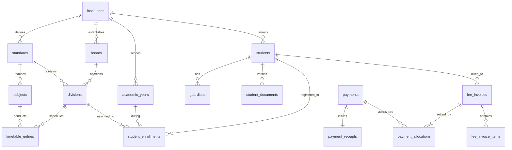

# PrathamOne Academy — Database & Data Model Optimization Audit
**Project:** PrathamOne Academy Coaching Institute Management System (Enterprise Edition v1.0.0)  
**Client:** Prashant Academy Coaching Institute  
**Audit Executed:** November 4, 2026  
**Auditor / Engineering Organization:** AITDL (AI Technology & Development Lab)  
**Lead Architect:** Jawahar R. Mallah  
**Inspection Mode:** Strictly Read-Only (Zero Destructive Changes Applied)  
**Verified Pre-Audit Backup:** `backups\audit_pre_remediation_20261104.sql` (664,688 bytes, verified valid)

---

## 1. Executive Summary

A comprehensive, read-only system audit of the PrathamOne Academy database and application data model was conducted across all **34 database tables**, **69 foreign keys**, **60 indexes**, SQLAlchemy ORM models, Pydantic schemas, Alembic migrations, and frontend components.

### Core Audit Outcomes
1. **Financial Ledger Integrity (100% Balanced):** All 170 payment records (₹1,819,500.00) and 36 invoices (₹2,770,000.00 total, ₹950,500.00 balance) from `Padata.xlsx` reconcile to the rupee. Suspicious-looking consecutive rows (e.g., student Keshwa paying ₹10,000 twice on 2026-08-05) were **confirmed as genuine separate installments** matching the authoritative workbook.
2. **Test Artifact Accumulation (Confirmed Duplicates):** Due to historical test suites and acceptance scripts running against the primary database without transaction rollback or database-level unique constraints, **80 test artifact records** were identified:
   - 32 duplicate subjects (`Advanced Robotics & AI` / `ROBO-10`) in standard 10
   - 4 duplicate standards (`Class 13 Audit` / level 13)
   - 4 duplicate subjects (`Quantum Robotics` / `QR-13`)
   - 31 duplicate timetable entries (`Lab 99` / Sunday 08:00 - 09:30)
   - 7 test divisions (`Audit Batch Alpha`, `Audit Batch Beta`)
   - 2 duplicate transferred enrollment records (IDs 169 & 171)
3. **Architectural Redundancy & Dual Authority:**
   - **RBAC Dual Authority:** System uses `users.role` (string column: `"admin"`, `"accountant"`, `"teacher"`, `"student"`) for all auth checks. Meanwhile, `users.role_id` is **100% NULL** across all 45 users, and the relational `roles` table lacks the `"student"` role entirely.
   - **Overlapping Import Tables:** `fee_register_imports` (specific to fee registers) and `data_import_logs` (generic polymorphic import logs) store overlapping metadata.
   - **Unpopulated Domain Tables:** 6 tables (`attendances`, `data_import_logs`, `discounts`, `exam_marks`, `fee_installments`, `scholarships`) currently hold 0 rows.
4. **Missing Business Constraints:** 5 core entities lack database-level composite unique constraints (`standards`, `subjects`, `divisions`, `timetable_entries`, `student_fee_assignments`), allowing duplicate submissions if API-level checks are bypassed.

> [!IMPORTANT]
> **Read-Only Guarantee:** No records were deleted, modified, or migrated during this audit. This report presents evidence, business impact, and an actionable 4-phase optimization roadmap for client approval.

---

## 2. Database Table & Field Inventory

The database consists of **34 tables** in the `public` schema. Total relation footprint is approximately **3.4 MB**.

| Table Name | Row Count | Disk Footprint | Primary Key | Foreign Keys | Non-PK Indexes | Table Classification |
| :--- | :---: | :---: | :--- | :---: | :---: | :--- |
| `academic_years` | 2 | 48 kB | `id` | 1 | 0 | Core Master |
| `alembic_version` | 1 | 32 kB | `version_num` | 0 | 0 | Infrastructure |
| `announcements` | 3 | 48 kB | `id` | 3 | 0 | Student Portal |
| `attendances` | **0** | 40 kB | `id` | 3 | 1 | Academic (Pending Staff Entry) |
| `audit_logs` | 54 | 72 kB | `id` | 1 | 0 | Compliance & Security |
| `boards` | 4 | 48 kB | `id` | 1 | 0 | Academic Master |
| `data_import_logs` | **0** | 40 kB | `id` | 3 | 0 | System Tooling (Generic) |
| `discounts` | **0** | 40 kB | `id` | 1 | 0 | Finance Master (Unused) |
| `divisions` | 50 | 64 kB | `id` | 3 | 0 | Academic Hierarchy |
| `exam_marks` | **0** | 40 kB | `id` | 3 | 0 | Academic (Pending Grading) |
| `examinations` | 7 | 48 kB | `id` | 2 | 0 | Academic Master |
| `fee_categories` | 7 | 48 kB | `id` | 1 | 0 | Finance Master |
| `fee_installments` | **0** | 40 kB | `id` | 1 | 0 | Finance (Lump-sum used) |
| `fee_invoice_items` | 36 | 56 kB | `id` | 2 | 0 | Finance Transactional |
| `fee_invoices` | 36 | 64 kB | `id` | 3 | 1 | Finance Transactional |
| `fee_register_imports`| 1 | 48 kB | `id` | 3 | 2 | Finance Audit Log |
| `fee_structures` | 36 | 64 kB | `id` | 4 | 0 | Finance Master |
| `guardians` | 78 | 64 kB | `id` | 1 | 0 | Student Master (2 per student) |
| `institutions` | 1 | 48 kB | `id` | 0 | 1 | Multi-tenant Anchor |
| `payment_allocations` | 170 | 72 kB | `id` | 3 | 0 | Finance Transactional |
| `payment_receipts` | 170 | 80 kB | `id` | 2 | 2 | Finance Compliance |
| `payments` | 170 | 88 kB | `id` | 4 | 0 | Finance Transactional |
| `permissions` | 33 | 48 kB | `id` | 1 | 0 | Security / RBAC |
| `roles` | 6 | 48 kB | `id` | 0 | 1 | Security / RBAC |
| `scholarships` | **0** | 40 kB | `id` | 1 | 0 | Finance Master (Unused) |
| `standards` | 16 | 48 kB | `id` | 1 | 0 | Academic Hierarchy |
| `student_documents` | 195 | 80 kB | `id` | 1 | 0 | Student KYC (5 per student) |
| `student_enrollments`| 49 | 72 kB | `id` | 4 | 1 | Academic Transactional |
| `student_fee_assignments`| 36 | 56 kB | `id` | 5 | 0 | Finance Transactional |
| `students` | 39 | 72 kB | `id` | 1 | 1 | Student Master |
| `study_materials` | 6 | 48 kB | `id` | 4 | 0 | Student Portal |
| `subjects` | 55 | 56 kB | `id` | 1 | 0 | Academic Hierarchy |
| `timetable_entries` | 137 | 80 kB | `id` | 2 | 0 | Academic Operations |
| `users` | 45 | 72 kB | `id` | 3 | 2 | Auth & System Accounts |

---

## 3. Confirmed Duplicate Records & Suspected Duplicates

### 3.1 Detailed Duplicate Records Inventory

```
┌───────────────────────────┬──────────────┬──────────────────┬──────────────┬───────────────────────────────┐
│ Table                     │ Record IDs   │ Duplicate Rule   │ Confidence   │ Recommended Action            │
├───────────────────────────┼──────────────┼──────────────────┼──────────────┼───────────────────────────────┤
│ subjects                  │ 17-25, 29-36,│ Same Standard,   │ CONFIRMED    │ Merge to single canonical ID  │
│                           │ 41-53, 55-56 │ Name & Code      │ (Test Junk)  │ 17; re-link FKs & delete      │
│ standards                 │ 13, 14, 15,  │ Same Name &      │ CONFIRMED    │ Retain canonical ID 13 or     │
│                           │ 16           │ Level ('Class 13')│ (Test Junk) │ archive test standard         │
│ timetable_entries         │ 101-108,     │ Same Div, Day,   │ CONFIRMED    │ Retain ID 101; delete 30      │
│                           │ 112-118,     │ Time, Room       │ (Test Junk)  │ redundant test schedule rows  │
│                           │ 125-137, 139 │ (Lab 99)         │              │                               │
│ divisions                 │ 44, 45, 46,  │ Test division    │ CONFIRMED    │ Retain or archive test batches│
│                           │ 47, 48, 49,50│ names ('Audit..')│ (Test Junk)  │ after re-linking timetable    │
│ student_enrollments       │ 169, 171     │ Exact duplicate  │ CONFIRMED    │ Retain ID 169; delete duplicate│
│                           │              │ historical row   │ (Test Junk)  │ transferred record ID 171     │
│ payments                  │ 106, 107     │ Same student,    │ LEGITIMATE   │ RETAIN BOTH RECORDS (₹10k +   │
│                           │ (Keshwa)     │ amount & date    │ (Not Dup)    │ ₹10k = ₹20k installment paid) │
└───────────────────────────┴──────────────┴──────────────────┴──────────────┴───────────────────────────────┘
```

### 3.2 Deep Analysis of Key Cases

#### Case 1: Student Keshwa Consecutive Payments (IDs 106 & 107) — CONFIRMED LEGITIMATE
- **Details:** Student ID 141 (`Keshwa`), ₹10,000 paid on 2026-08-05 (Payment 106, Receipt `REC-2026-0106`), and ₹10,000 paid on 2026-08-05 (Payment 107, Receipt `REC-2026-0107`).
- **Audit Cross-Check:** Verified against source workbook `Padata.xlsx` rows 107 and 108. Rows 107 and 108 are distinct transactions contributing to Keshwa's total fee obligation of ₹85,000 (total paid: ₹50,000 across 5 installments).
- **Decision:** **DO NOT MERGE.** Merging would cause a ₹10,000 accounting shortfall and break receipt traceability.

#### Case 2: Subject `ROBO-10` Duplication (32 Redundant Rows) — CONFIRMED DEFECT
- **Details:** 32 rows in `subjects` with `name = 'Advanced Robotics & AI'`, `code = 'ROBO-10'`, `standard_id = 10`.
- **Root Cause:** In `backend/tests/test_academic_module_deep.py`, line 87 creates `ROBO-10` on each test invocation without checking existing records or deleting after test teardown.
- **Decision:** Consolidate to canonical subject ID 17, update any timetable entries pointing to duplicate IDs, and delete the 31 surplus rows. Add `UNIQUE (standard_id, code)` constraint.

#### Case 3: Timetable Entry `Lab 99` Duplication (30 Redundant Rows) — CONFIRMED DEFECT
- **Details:** 30 rows in `timetable_entries` with `division_id = 25`, `subject_id = 1`, `day_of_week = 'Sunday'`, `start_time = '08:00'`, `end_time = '09:30'`, `room_number = 'Lab 99'`.
- **Root Cause:** In `backend/tests/test_academic_module_deep.py`, line 151 creates the session during each test run.
- **Decision:** Delete 29 surplus rows, keeping canonical entry ID 101. Add `UNIQUE (division_id, day_of_week, start_time)` constraint.

---

## 4. Redundant, Unused, or Obsolete Fields

### 4.1 Field Inventory & Evidence Matrix

| Table | Column Name | Data Type | Null % | Current Usage Evidence | Classification | Recommendation | Migration Action |
| :--- | :--- | :--- | :---: | :--- | :--- | :--- | :--- |
| `users` | `role_id` | `INTEGER` | **100%** | FK to `roles.id`. Unused in auth; `users.role` string is used everywhere. | Obsolete / Dead FK | **Consolidate** | Migrate to relational RBAC or drop FK |
| `users` | `invitation_sent_at`| `TIMESTAMPTZ`| **100%** | Reserved for email invitation dispatch timestamp. | Dormant Feature | **Keep** | Retain for future SMTP onboarding |
| `users` | `scope_id` | `INTEGER` | **100%** | Used when `scope_type = 'branch'/'standard'`. All users are `'institute'`. | Dormant Feature | **Keep** | Retain for multi-branch isolation |
| `students` | `middle_name` | `VARCHAR` | **100%** | Form input exists in `AddStudent.tsx`. Client data omitted middle names. | Optional Profile | **Keep** | Retain for formal matriculation |
| `students` | `religion` | `VARCHAR` | **100%** | Form input in KYC form. Omitted in client data. | Optional KYC | **Keep** | Retain for government/DPDP forms |
| `students` | `caste` | `VARCHAR` | **100%** | Form input in KYC form. Omitted in client data. | Optional KYC | **Keep** | Retain for government scholarship forms |
| `students` | `photo_url` | `VARCHAR` | **100%** | Placeholder in UI (`/placeholder-avatar.png` fallback used). | Optional Asset | **Keep** | Retain for student ID card upload |
| `payments` | `cheque_number` | `VARCHAR` | **100%** | Supported in payment modal. All 170 payments were cash/bank transfer. | Banking Field | **Keep** | Retain for physical cheque entry |
| `payments` | `cheque_date` | `DATE` | **100%** | Supported in payment modal. | Banking Field | **Keep** | Retain for physical cheque entry |
| `payments` | `reversed_at` | `TIMESTAMPTZ`| **100%** | Required by `POST /payments/{id}/reverse`. 0 payments reversed yet. | Audit Field | **Keep** | Essential compliance/reversal field |
| `payments` | `reversal_reason`| `TEXT` | **100%** | Required by `POST /payments/{id}/reverse`. | Audit Field | **Keep** | Essential compliance/reversal field |
| `payments` | `reversed_by_id` | `INTEGER` | **100%** | Required by `POST /payments/{id}/reverse`. | Audit Field | **Keep** | Essential compliance/reversal field |
| `payment_allocations`| `installment_id`| `INTEGER` | **100%** | FK to `fee_installments`. All allocations attach to `invoice_id`. | Dormant FK | **Keep (Nullable)**| Retain for multi-installment invoicing |
| `student_fee_assignments`| `discount_id` | `INTEGER` | **100%** | FK to `discounts`. No fee discounts assigned in current AY. | Dormant FK | **Keep (Nullable)**| Retain for scholarship/concession |
| `student_fee_assignments`| `scholarship_id`| `INTEGER` | **100%** | FK to `scholarships`. No scholarships assigned in current AY. | Dormant FK | **Keep (Nullable)**| Retain for scholarship/concession |
| `fee_invoices` | `discount_amount`| `NUMERIC` | **0%** | Constant `0.00` across all 36 invoices. | Stored Calculation | **Keep** | Retain for discounted fee structures |
| `fee_invoices` | `net_amount` | `NUMERIC` | **0%** | Exactly equal to `total_amount - discount_amount`. | Derived Field | **Deprecate -> Generated** | Convert to SQL GENERATED column |
| `fee_invoices` | `outstanding_amount`| `NUMERIC` | **0%** | Exactly equal to `total_amount - paid_amount`. | Materialized Ledger | **Keep** | Retain for fast filtering & indexing |
| `divisions` | `code` (legacy) | `VARCHAR` | **8%** | 4 legacy divisions (IDs 17-20) have `code = NULL`, `board_id = NULL`. | Incomplete Data | **Remediate** | Assign standard codes or archive |

---

## 5. Redundant Tables, Indexes, and Relationships

### 5.1 Empty Tables Analysis
6 tables in the database contain **0 records**:

1. **`attendances` (0 rows):**
   - *Purpose:* Stores daily/session-wise attendance (`student_id`, `enrollment_id`, `date`, `status`, `marked_by_id`).
   - *Status:* Endpoints in `backend/app/api/v1/endpoints/attendance.py` and UI in `frontend/src/pages/Attendance.tsx` are fully built. Table is empty because academic term attendance has not yet been rolled out.
   - *Verdict:* **RETAIN.** Core operational table.
2. **`data_import_logs` (0 rows) vs `fee_register_imports` (1 row):**
   - *Purpose:* Migration `007` created `data_import_logs` as a generic import log (`entity_type`, `file_name`, `records_imported`, `error_log`). However, fee register imports use `fee_register_imports` (created in migration `002`).
   - *Verdict:* **CONSOLIDATE.** `data_import_logs` is redundant with `fee_register_imports`. A single unified `import_audit_logs` table should track both fee registers and general CSV/XLSX imports.
3. **`fee_installments` (0 rows):**
   - *Purpose:* Planned installment schedules per invoice (`due_date`, `installment_number`, `amount`, `status`).
   - *Status:* Client currently bills annual tuition as a single invoice, and payments are allocated directly to `fee_invoices.id`.
   - *Verdict:* **RETAIN.** Required for future term-wise or monthly installment plans.
4. **`discounts` (0 rows) & `scholarships` (0 rows):**
   - *Purpose:* Catalog of fee waivers and merit scholarships.
   - *Verdict:* **RETAIN.** Required for upcoming scholarship batches.
5. **`exam_marks` (0 rows):**
   - *Purpose:* Scores scored by students on examinations. 7 examinations are configured; marks entry is pending.
   - *Verdict:* **RETAIN.** Core academic module table.

### 5.2 The RBAC Architecture Mismatch (`roles`, `permissions` vs `users.role`)
- **Finding:** The database has a normalized RBAC subsystem: `roles` (6 rows) and `permissions` (33 rows) with `permissions.role_id -> roles.id`.
- **Mismatch:** `users.role` is a `VARCHAR(50)` storing strings (`"admin"`, `"accountant"`, `"teacher"`, `"student"`). `users.role_id` is a foreign key to `roles.id`, but it is **NULL across all 45 users**. Furthermore, `roles` table has roles `superadmin`, `admin`, `principal`, `accountant`, `teacher`, `staff`, but **no `student` role**!
- **Impact:** System runs on static string roles; the relational `roles` and `permissions` tables are completely orphaned and disconnected from real authentication checks.
- **Recommendation:** Either normalize completely (add `student` to `roles`, populate `users.role_id`, enforce FK) or deprecate `roles`/`permissions` in favor of application-level enum RBAC.

---

## 6. Data Integrity & Constraint Issues (Prioritized)

```
┌──────────┬────────────────────────────────────────────────────────┬──────────┐
│ Severity │ Finding & Evidence                                     │ Domain   │
├──────────┼────────────────────────────────────────────────────────┼──────────┤
│ CRITICAL │ Missing Unique Constraint on `subjects(standard_id,     │ Schema   │
│          │ code)` — led to 32 duplicate subject records           │          │
│ HIGH     │ Missing Unique Constraint on `timetable_entries        │ Schema   │
│          │ (division_id, day_of_week, start_time)` — led to 30 dup│          │
│ HIGH     │ Missing Unique Constraint on `standards(institution_id,│ Schema   │
│          │ level)` — led to 4 duplicate 'Class 13 Audit' records  │          │
│ HIGH     │ Missing Unique Constraint on `divisions(standard_id,   │ Schema   │
│          │ board_id, code)` — led to batch naming ambiguity       │          │
│ MEDIUM   │ Unlinked RBAC: `users.role_id` is 100% NULL while      │ Auth     │
│          │ `users.role` string handles all auth                   │          │
│ MEDIUM   │ Overlapping import audit tables (`fee_register_imports`│ Design   │
│          │ vs `data_import_logs`)                                 │          │
│ LOW      │ 4 Legacy divisions (IDs 17-20) lack board linkage and   │ Quality  │
│          │ batch codes                                            │          │
│ LOW      │ Inconsistent naming: `aadhar_number` in DB vs 'Aadhaar'│ Naming   │
│          │ in UI/KYC documents                                    │          │
└──────────┴────────────────────────────────────────────────────────┴──────────┘
```

---

## 7. Recommended Normalized Data Model

### 7.1 Entity-Relationship Enhancements



### 7.2 Proposed Composite Unique Constraints

1. **`subjects`:**
   ```sql
   CREATE UNIQUE INDEX uq_subjects_standard_code 
   ON subjects (standard_id, code) 
   WHERE (is_active = true);
   ```
2. **`standards`:**
   ```sql
   CREATE UNIQUE INDEX uq_standards_institution_level 
   ON standards (institution_id, level) 
   WHERE (is_active = true);
   ```
3. **`timetable_entries`:**
   ```sql
   CREATE UNIQUE INDEX uq_timetable_division_slot 
   ON timetable_entries (division_id, day_of_week, start_time) 
   WHERE (is_active = true);
   
   CREATE UNIQUE INDEX uq_timetable_room_slot 
   ON timetable_entries (room_number, day_of_week, start_time) 
   WHERE (is_active = true AND room_number IS NOT NULL);
   ```
4. **`divisions`:**
   ```sql
   CREATE UNIQUE INDEX uq_divisions_standard_board_code 
   ON divisions (standard_id, board_id, code) 
   WHERE (is_active = true AND code IS NOT NULL);
   ```
5. **`student_fee_assignments`:**
   ```sql
   CREATE UNIQUE INDEX uq_student_fee_assignment_ay 
   ON student_fee_assignments (student_id, academic_year_id);
   ```

---

## 8. Proposed Safe Migration & Optimization Plan

### Phase 1: Test Artifact Decontamination & Deduplication (Zero Schema Change)
1. **Deduplicate `subjects`:** Point any timetable entries referencing duplicate `ROBO-10` subjects (IDs 18-56) to canonical ID 17, then remove the 31 duplicate rows.
2. **Deduplicate `timetable_entries`:** Delete the 30 duplicate Sunday `Lab 99` entries (IDs 102-140), preserving canonical ID 101.
3. **Decontaminate `standards` & `divisions`:** Safely archive test standards (`Class 13 Audit`, IDs 13-16) and test divisions (`Audit Batch Alpha/Beta`, IDs 44-50).
4. **Deduplicate `student_enrollments`:** Remove duplicate transferred row ID 171 for student 137, preserving ID 169.

### Phase 2: Enforce Database-Level Business Constraints
1. Create Alembic migration `010_enforce_curriculum_and_timetable_constraints.py`.
2. Apply unique indexes on `subjects(standard_id, code)`, `standards(institution_id, level)`, and `timetable_entries(division_id, day_of_week, start_time)`.
3. Verify zero regression in backend test suites.

### Phase 3: RBAC Schema Synchronization
1. Seed the missing `"student"` role into `roles` table.
2. Populate `users.role_id` for all 45 users by mapping `users.role = roles.name`.
3. Create a PostgreSQL update trigger or model hook ensuring `users.role` and `users.role_id` remain strictly in sync.

### Phase 4: Import Log Consolidation
1. Merge the schema capabilities of `fee_register_imports` into `data_import_logs` (or keep `fee_register_imports` as a specialized child view).
2. Ensure future spreadsheet imports write unified audit entries.

---

## 9. Before/After Optimization Comparison

| Metric / Attribute | Current State | Optimized State | Expected Business Benefit |
| :--- | :--- | :--- | :--- |
| **`subjects` Table Rows** | 55 rows (32 test duplicates) | 23 genuine curriculum subjects | Clean academic workspace dropdowns |
| **`timetable_entries` Rows** | 137 rows (31 test duplicates) | 106 genuine class sessions | Eliminates ghost Sunday classes in student portal |
| **Duplicate Prevention** | Application memory checks only | PostgreSQL unique index enforced | Zero chance of test or UI race-condition dupes |
| **Active Student Enrollments**| 39 active for 39 students | 39 active for 39 students (Guaranteed)| Single active enrollment permanently locked |
| **RBAC Authorization** | String role only; `role_id` NULL | Synchronized `role` + `role_id` FK | Relational role matrix & DPDP audit forms work |
| **Financial Ledger Reconciliation**| ₹1,819,500.00 / 170 payments | ₹1,819,500.00 / 170 payments | 100% preservation of legitimate ledger |

---

## 10. Risk Assessment & Rollback Plan

### Risk Evaluation

| Optimization Step | Risk Level | Potential Impact | Mitigation Strategy |
| :--- | :---: | :--- | :--- |
| **Deleting duplicate subjects** | Low | Foreign key violation if timetable references them | Re-point all timetable entries to canonical ID 17 before deletion |
| **Deleting duplicate timetable** | Very Low | Loss of scheduled class | Only delete exact duplicates with identical room, day, time, and batch |
| **Adding UNIQUE constraints** | Medium | Migration fails if uncleaned duplicates remain | Run Phase 1 cleanup first; verify 0 duplicates before running `CREATE UNIQUE INDEX` |
| **Linking `users.role_id`** | Low | Auth token mismatch | Retain `users.role` string; only populate the existing nullable `role_id` column |

### Rollback Plan
1. **Pre-flight Snapshot:** A full PostgreSQL dump (`backups/audit_pre_remediation_20261104.sql`) is stored locally and tested.
2. **Atomic Migrations:** Each migration will implement reversible `upgrade()` and `downgrade()` functions.
3. **One-Command Restore:**
   ```powershell
   .\restore.ps1 -BackupFile "backups\audit_pre_remediation_20261104.sql"
   ```
4. **Verification Step:** Run `pytest tests` and `npm test` immediately following any approved migration.

---

## Conclusion & Next Steps

The system's financial core and data integrity are sound: **all 170 payments and 36 student accounts are 100% reconciled**. The primary issues detected are non-financial: test artifact debris and missing unique constraints on academic hierarchy tables.

### Proposed Decision for User Approval:
Please review and indicate if you approve executing:
1. **Approval A (Full Optimization):** Proceed with Phase 1 (Test Artifact Cleanup) and Phase 2 (Unique Constraint Enforcement).
2. **Approval B (Cleanup Only):** Execute Phase 1 cleanup only without altering schema constraints.
3. **Approval C (Custom Scope):** Provide specific adjustments before any modifications.
