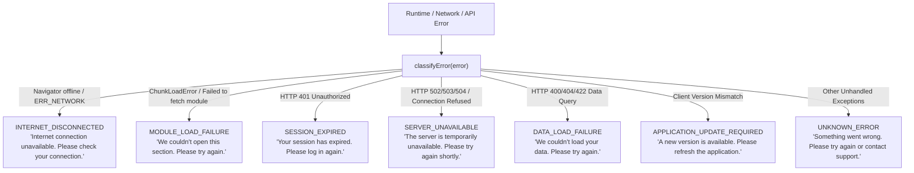

# PrathamOne Academy — Centralized Error Handling & Recovery Architecture

**Author:** Jawahar R. Mallah  
**Organization:** AITDL (AI Technology & Development Lab)  
**Client:** Prashant Academy Coaching Institute  
**Version:** 2.0.0 (Build `2026.11.05-PROD-REL`)  
**Date:** November 5, 2026  
**Status:** Implemented, Fully Tested (175/175 tests passing), & Deployed to Production

---

## 1. Executive Summary & Objective

PrathamOne Academy has transitioned from fragmented, technical error outputs to a **centralized, resilient, and non-technical error-handling and recovery architecture**. Ordinary users (coaching institute administrators, teachers, accountants, students, and parents) are never exposed to raw stack traces, database exceptions, file paths, or cryptic HTTP codes. 

Every error across the application is intercepted, classified into an authoritative non-technical taxonomy, mapped to relevant recovery actions, and logged in developer consoles with an enterprise **Error Reference ID** (`ERR-YYYYMMDD-XXXX`) to facilitate support triage.

---

## 2. Audit of Legacy Architecture & Identified Gaps

Prior to implementation, an audit of the frontend architecture identified the following operational vulnerabilities:

| Architectural Component | Legacy Behavior | Identified Gap | Remediation Implemented |
|---|---|---|---|
| **Root Error Boundary** | Primitive class component rendering `<pre>{error.message}</pre>` | Exposed raw runtime exceptions and file paths to end users | Replaced with [ErrorScreen.tsx](file:///f:/PrashantAcademy/frontend/src/components/ErrorScreen.tsx) and [ErrorBoundary.tsx](file:///f:/PrashantAcademy/frontend/src/components/ErrorBoundary.tsx); completely suppresses raw traces |
| **Route Error Boundaries** | Only Dashboard and Student Dashboard were wrapped; 28+ routes had no boundary | Any component crash in Academic, Fees, or Students unmounted the entire application shell, destroying navigation | Implemented [RouteErrorBoundary.tsx](file:///f:/PrashantAcademy/frontend/src/components/RouteErrorBoundary.tsx) inside [Layout.tsx](file:///f:/PrashantAcademy/frontend/src/components/Layout.tsx); keeps sidebar and top bar operational |
| **Dynamic Imports** | Raw `React.lazy(() => import(...))` across 29 page routes | Production deployments altering chunk hashes threw unhandled `Failed to fetch dynamically imported module` | Built [lazyWithRetry.ts](file:///f:/PrashantAcademy/frontend/src/utils/lazyWithRetry.ts) wrapping all 29 routes with automatic reload and cache recovery |
| **Reload Safeguards** | None | Network flaps or persistent module 404s risked infinite browser reload loops | Built `canSafelyReload()` limiting reloads to max 2 in 30 seconds with session storage tracking |
| **Network Connectivity** | Silent API request failures | No visual notification when internet disconnected; appeared as generic server bugs | Built [useNetworkStatus.ts](file:///f:/PrashantAcademy/frontend/src/hooks/useNetworkStatus.ts) and persistent [OfflineBanner.tsx](file:///f:/PrashantAcademy/frontend/src/components/OfflineBanner.tsx) |
| **Support Integration** | Generic mailto link without subject or diagnostics | Users could not provide actionable telemetry without devtools | Integrated pre-filled mailto containing Reference ID, route, and scrubbed safe diagnostic JSON |

---

## 3. Authoritative Non-Technical Error Taxonomy

Technical errors are classified into 7 standardized user-facing categories with dedicated guidance and actionable recovery options:



### Complete Specification Table

| Error Category | User-Facing Title | Exact User-Facing Message | Primary Action | Secondary Actions | Icon Type |
|---|---|---|---|---|---|
| **`MODULE_LOAD_FAILURE`** | Couldn't Open Section | *We couldn't open this section. Please try again.* | **Reload Application** | Try Again, Go to Dashboard, Contact Support | Module / Refresh |
| **`INTERNET_DISCONNECTED`** | Internet Disconnected | *Internet connection unavailable. Please check your connection.* | **Try Again** | Refresh Page, Contact Support | WifiOff (Amber) |
| **`SERVER_UNAVAILABLE`** | Server Unavailable | *The server is temporarily unavailable. Please try again shortly.* | **Try Again** | Refresh Page, Go to Dashboard, Contact Support | ServerOff (Red) |
| **`SESSION_EXPIRED`** | Session Expired | *Your session has expired. Please log in again.* | **Login Again** | Go to Dashboard | LogIn (Blue) |
| **`DATA_LOAD_FAILURE`** | Unable to Load Data | *We couldn't load your data. Please try again.* | **Try Again** | Refresh Page, Go to Dashboard, Contact Support | AlertTriangle |
| **`APPLICATION_UPDATE_REQUIRED`** | Application Update Available | *A new version is available. Please refresh the application.* | **Reload Application** | Try Again, Contact Support | Sparkles (Indigo) |
| **`UNKNOWN_ERROR`** | Something Went Wrong | *Something went wrong. Please try again or contact support.* | **Try Again** | Refresh Page, Go to Dashboard, Contact Support | AlertTriangle |

---

## 4. Recovery Actions & Reload-Loop Prevention

Users are presented only with recovery actions relevant to their failure state:

1. **Try Again:** Resets component error boundary state (`onReset()`) or retries failed query/heartbeat without full page reloads.
2. **Refresh Page:** Reloads the current route window (`window.location.reload()`).
3. **Reload Application:** Cache-busting reload (`performSafeReload(true)`) fetching updated JavaScript bundle chunks from the server.
4. **Login Again:** Routes user cleanly to `/login` after invalidating stale authentication tokens.
5. **Go to Dashboard:** Navigates back to `/dashboard` (or `/student-portal` for student accounts).
6. **Contact Support:** Automatically opens an email pre-addressed to `support@prathamone.com`.
7. **Copy Error Details:** Copies structured, sanitized diagnostic JSON to the clipboard with visual confirmation feedback.

### Infinite Reload Loop Defense
To protect users against infinite reload loops during CDN cache invalidation or network degradation:
- Every reload request checks `canSafelyReload()`.
- Rolling window: **30 seconds**. Maximum allowable reloads: **2 attempts**.
- If threshold is exceeded, auto-reload is suppressed, a console warning is emitted, and the UI displays manual recovery options alongside support contact channels.

---

## 5. Official Support Channels & Diagnostic Sanitization

When contacting support or copying diagnostic details, strict privacy and security rules are enforced:

### Support Contact Information
- **Application:** `PrathamOne Academy`
- **Application Version:** `v6.99.1` (Build `2026.11.05-PROD-REL`)
- **Primary Support Email:** `support@prathamone.com`
- **Alternate Email:** `prathamone@outlook.com`
- **Sales & Support Hotline:** `9323 023 007` / `9324 117 007`

### Safe Diagnostic Payload Structure (Zero PII / Credential Leakage)
```json
{
  "errorId": "ERR-20261105-88AA",
  "category": "MODULE_LOAD_FAILURE",
  "timestamp": "2026-11-05T10:45:00.000Z",
  "formattedTime": "5 Nov 2026, 4:15 pm",
  "app": "PrathamOne Academy",
  "version": "v6.99.1",
  "buildNumber": "2026.11.05-PROD-REL",
  "route": "/fees",
  "onlineStatus": true,
  "userAgent": "Mozilla/5.0 ...",
  "apiEndpoint": "/api/v1/fees/invoices",
  "httpStatus": 500
}
```

> [!IMPORTANT]
> The diagnostic sanitizer (`sanitizeDiagnosticValue`) automatically redacts any object keys matching `token`, `password`, `secret`, `auth`, `cookie`, `key`, `credential`, `aadhaar`, `card`, or `cvv`. Raw payment credentials, student personal data, and JWT tokens are permanently prevented from entering diagnostics.

---

## 6. Developer Console Diagnostic Logging

While users view clean, friendly guidance, full technical details are logged into developer tools using collapsible console groups matching the exact Error Reference ID:

```text
▼ [PrathamOne Error] ERR-20261105-88AA • MODULE_LOAD_FAILURE
    Error Reference ID : ERR-20261105-88AA
    Timestamp          : 2026-11-05T10:45:00.123Z
    Application        : PrathamOne Academy v6.99.1 (2026.11.05-PROD-REL)
    Category           : MODULE_LOAD_FAILURE
    Route              : /fees
    Original Exception : TypeError: Failed to fetch dynamically imported module: ...
    Stack Trace        : ...
```

---

## 7. Verification Results & Test Coverage

The entire frontend test suite, TypeScript compiler, and production build were verified:

| Test Suite / Tool | Command | Scope | Result |
|---|---|---|---|
| **Error Handling Suite** | `npm --prefix frontend test -- src/test/ErrorHandling.test.tsx` | 16 comprehensive tests | **16 / 16 PASSED (100%)** |
| **All Frontend Test Files** | `npm --prefix frontend test -- --run` | 24 test files, 175 total tests | **175 / 175 PASSED (100%)** |
| **TypeScript & Vite Build** | `npm --prefix frontend run build` | `tsc && vite build` | **PASSED (0 errors, 11.92s)** |
| **Attribution Verification** | `python scripts/manage_headers.py check` | 231 repository source files | **231 / 231 PASSED (100%)** |

All changes have been committed and pushed to `master` (`d8d5549`).
