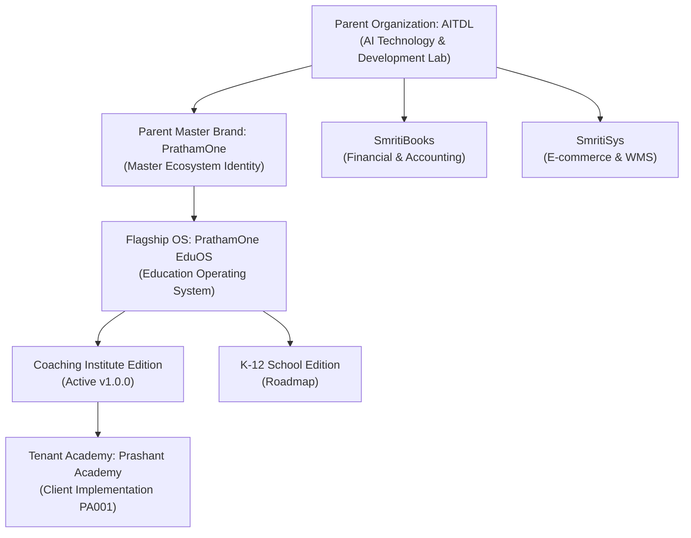

# PrathamOne & PrathamOne EduOS Global Brand Identity & Integration Report

**Product:** PrathamOne EduOS (Coaching Institute Edition)  
**Baseline Version:** 1.0.0  
**Parent Brand:** PrathamOne  
**Parent Organization:** AITDL — AI Technology & Development Lab  
**Product Architect:** Jawahar R Mallah  
**Client Organization:** Prashant Academy Coaching Institute  
**Deployment Head:** Commit `1c1a1e9` (Pushed to `master`)  
**Status:** COMPLETE & VERIFIED (100% Test Pass, 100% Header & Documentation Compliance)  

---

## 1. Executive Summary & Brand Hierarchy

Under the `# MASTER COMMAND — PRATHAMONE GLOBAL BRAND IDENTITY & EDUOS BRAND INTEGRATION` directive, the complete visual identity, asset suite, and brand governance system has been implemented and unified across **PrathamOne** and **PrathamOne EduOS**.

The architecture establishes four distinct operational tiers:

1. **Parent Organization:** **AITDL — AI Technology & Development Lab** ([aitdl.com](https://aitdl.com)) holds legal ownership, technical governance, and copyright.
2. **Parent Brand:** **PrathamOne** ([prathamone.com](https://prathamone.com)) represents the master enterprise corporate identity with the iconic elephant 'P' emblem.
3. **Product Brand:** **PrathamOne EduOS** (Coaching Institute Edition) represents the education management operating system.
4. **Client/Tenant Institution:** **Prashant Academy** maintains primary customer prominence across student-facing documents, receipts, certificates, and ID cards, while PrathamOne EduOS is anchored in the canonical bottom 2-row software footer.

---

## 2. Official Logo Asset Suite Generated & Standardized

Derived directly from the master high-resolution artwork `POlogo.png` (2752 × 1536 px), the following standard asset packages have been generated and archived in `frontend/public/media/logo/`, `frontend/public/icons/`, and `docs/assets/branding/`:

| Canonical Identifier | Physical Asset File | Resolution | Transparency / Profile |
| :--- | :--- | :--- | :--- |
| **`PRATHAMONE_MASTER_LOGO`** | `prathamone-master-logo.png` | 1856 × 853 px | Solid White Background |
| **`PRATHAMONE_MASTER_LOGO_TRANSPARENT`** | `prathamone-master-logo-transparent.png` | 1856 × 853 px | Lossless Alpha (734 white contour pixels preserved) |
| **`PRATHAMONE_MASTER_LOGO_DARK`** | `prathamone-master-logo-dark.png` | 1856 × 853 px | Dark Canvas Optimized (`#FFFFFF` + `#EE8B36`) |
| **`PRATHAMONE_EDUOS_PRIMARY_LOGO`** | `prathamone-eduos-primary.png` | 1856 × 1276 px | Solid White Background (Stacked Lockup) |
| **`PRATHAMONE_EDUOS_PRIMARY_TRANSPARENT`** | `prathamone-eduos-primary-transparent.png` | 1856 × 1276 px | Lossless Alpha (Stacked Lockup) |
| **`PRATHAMONE_EDUOS_PRIMARY_DARK`** | `prathamone-eduos-primary-dark.png` | 1856 × 1276 px | Dark Canvas Optimized (Stacked Lockup) |
| **`PRATHAMONE_EDUOS_HORIZONTAL_LOGO`** | `prathamone-eduos-horizontal.png` | 3538 × 853 px | Solid White Background (Horizontal Bar) |
| **`PRATHAMONE_EDUOS_HORIZONTAL_TRANSPARENT`** | `prathamone-eduos-horizontal-transparent.png` | 3538 × 853 px | Lossless Alpha (Horizontal Bar) |
| **`PRATHAMONE_EDUOS_HORIZONTAL_DARK`** | `prathamone-eduos-horizontal-dark.png` | 3538 × 853 px | Dark Canvas Optimized (Horizontal Bar) |
| **`PRATHAMONE_SYMBOL_ICON`** | `prathamone-symbol-icon.png` | 387 × 847 px | Elephant 'P' Emblem Only |
| **`PRATHAMONE_SYMBOL_ICON_TRANSPARENT`** | `prathamone-symbol-icon-transparent.png` | 387 × 847 px | Alpha Transparency Emblem |
| **`PRATHAMONE_SYMBOL_ICON_DARK`** | `prathamone-symbol-icon-dark.png` | 387 × 847 px | Dark Canvas Optimized Emblem |
| **`PRATHAMONE_FAVICON_ICO`** | `frontend/public/favicon.ico` | Multi-res | 16×16, 32×32, 48×48, 64×64 ICO |
| **`PRATHAMONE_FAVICON_SVG`** | `frontend/public/favicon.svg` | Scalable Vector | High-DPI Squircle Emblem SVG |
| **`PRATHAMONE_PWA_512`** | `frontend/public/icons/icon-512x512.png` | 512 × 512 px | Master PWA Launch Icon |
| **`PRATHAMONE_PWA_192`** | `frontend/public/icons/icon-192x192.png` | 192 × 192 px | Mobile Home Screen Icon |
| **`PRATHAMONE_PWA_MASKABLE`** | `frontend/public/icons/icon-maskable-512x512.png` | 512 × 512 px | Android Adaptive Safe-Zone Icon |
| **`PRATHAMONE_APPLE_TOUCH`** | `frontend/public/icons/apple-touch-icon.png` | 180 × 180 px | iOS Web Clip Icon |

---

## 3. Centralized Brand Tokens & Chromatic Standards

Permanently codified in `frontend/src/config/branding.ts`:

- **Pratham Navy:** `#1A1A50` / `rgb(26, 26, 80)` — Master imperial navy for authority, academic rigor, and emblem foundation.
- **Pratham Orange:** `#EE8B36` / `rgb(238, 139, 54)` — Master vibrant energy orange for enthusiasm, milestone action, and the wordmark *"One"*.
- **Canvas Slate:** `#0F172A` / `#071739` — High-contrast dark surfaces for dashboards and sidebars.

---

## 4. Application UI Surface Integrations

1. **Authentication Portal (`frontend/src/pages/Login.tsx`):**
   - Replaced placeholder icon with elevated glassmorphic card displaying the official PrathamOne emblem.
   - Enhanced card footer acknowledging `PrathamOne EduOS — Coaching Institute Edition · Copyright © 2026 AITDL`.
2. **Collapsible Sidebar (`frontend/src/components/Sidebar.tsx`):**
   - Maintained tenant institute prominence (`Prashant Academy`) in the header.
   - Added persistent platform endorsement footnote with the official elephant mark, `PrathamOne EduOS`, and build version in both staff and student navigation rails.
3. **Product Portfolio (`frontend/src/components/OrganizationBranding.tsx`):**
   - Upgraded active product card to render the official PrathamOne emblem alongside sister products SmritiBooks and SmritiSys.
4. **Browser Chrome & Manifest (`frontend/index.html`, `manifest.json`):**
   - Upgraded `favicon.svg`, `favicon.ico`, and all PWA launcher icons to the official squircle emblem.

---

## 5. Canonical Documentation Deliverables

The 5 mandated governance specifications have been authored, indexed, and validated under `docs/`:

1. [docs/00_PRODUCT_OVERVIEW/2026-11-07_PRODUCT-OVERVIEW_SPECIFICATION_PRATHAMONE-BRAND-ARCHITECTURE_V1.md](file:///f:/PrashantAcademy/docs/00_PRODUCT_OVERVIEW/2026-11-07_PRODUCT-OVERVIEW_SPECIFICATION_PRATHAMONE-BRAND-ARCHITECTURE_V1.md)
2. [docs/00_PRODUCT_OVERVIEW/2026-11-07_PRODUCT-OVERVIEW_SPECIFICATION_PRATHAMONE-BRAND-ASSET-REGISTER_V1.md](file:///f:/PrashantAcademy/docs/00_PRODUCT_OVERVIEW/2026-11-07_PRODUCT-OVERVIEW_SPECIFICATION_PRATHAMONE-BRAND-ASSET-REGISTER_V1.md)
3. [docs/17_UI_UX_DESIGN/2026-11-07_UI-UX-DESIGN_GUIDE_PRATHAMONE-EDUOS-BRAND-GUIDELINES_V1.md](file:///f:/PrashantAcademy/docs/17_UI_UX_DESIGN/2026-11-07_UI-UX-DESIGN_GUIDE_PRATHAMONE-EDUOS-BRAND-GUIDELINES_V1.md)
4. [docs/20_AUDITS_COMPLIANCE/2026-11-07_AUDITS-COMPLIANCE_REPORT_PRATHAMONE-GLOBAL-BRANDING-AUDIT_V1.md](file:///f:/PrashantAcademy/docs/20_AUDITS_COMPLIANCE/2026-11-07_AUDITS-COMPLIANCE_REPORT_PRATHAMONE-GLOBAL-BRANDING-AUDIT_V1.md)
5. [docs/17_UI_UX_DESIGN/2026-11-07_UI-UX-DESIGN_SPECIFICATION_PRATHAMONE-BRAND-IMPLEMENTATION-MATRIX_V1.md](file:///f:/PrashantAcademy/docs/17_UI_UX_DESIGN/2026-11-07_UI-UX-DESIGN_SPECIFICATION_PRATHAMONE-BRAND-IMPLEMENTATION-MATRIX_V1.md)

---

## 6. Verification & Quality Gates

- **Vitest Full Test Suite:** 40 test files passed (40/40), 300 tests passed (300/300) in 142.60s.
- **AITDL Corporate Header Check:** 381 files verified, 381 passed (100% compliance).
- **Documentation Manager:** Reindexed 293 documents, validated with 0 errors and 0 warnings.
- **Vite Production Build:** Successfully compiled and deployed to `prashant_academy_frontend` Nginx container (HTTP 200 OK).
- **Git Repository:** Committed as `1c1a1e9` and pushed to remote `origin/master`.

