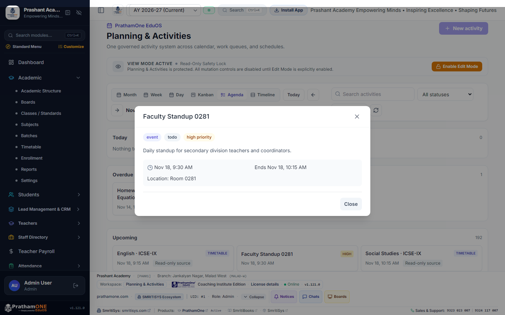
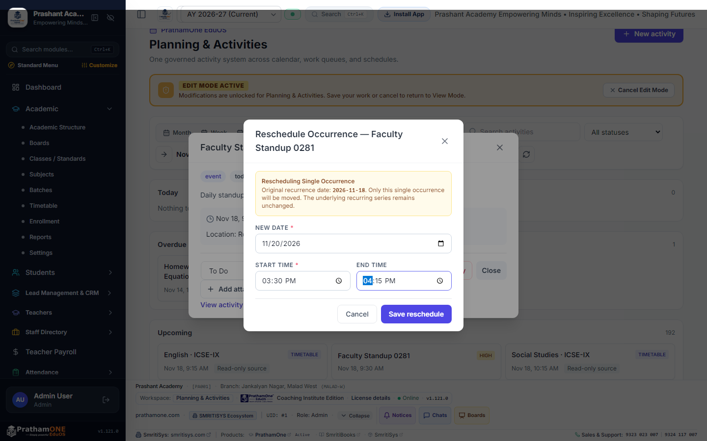
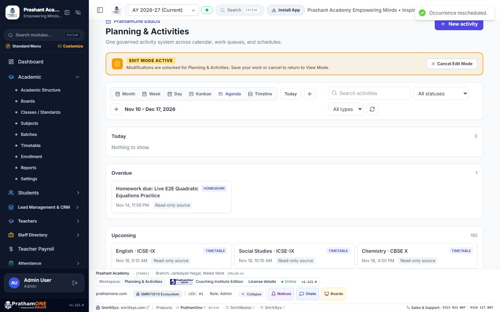
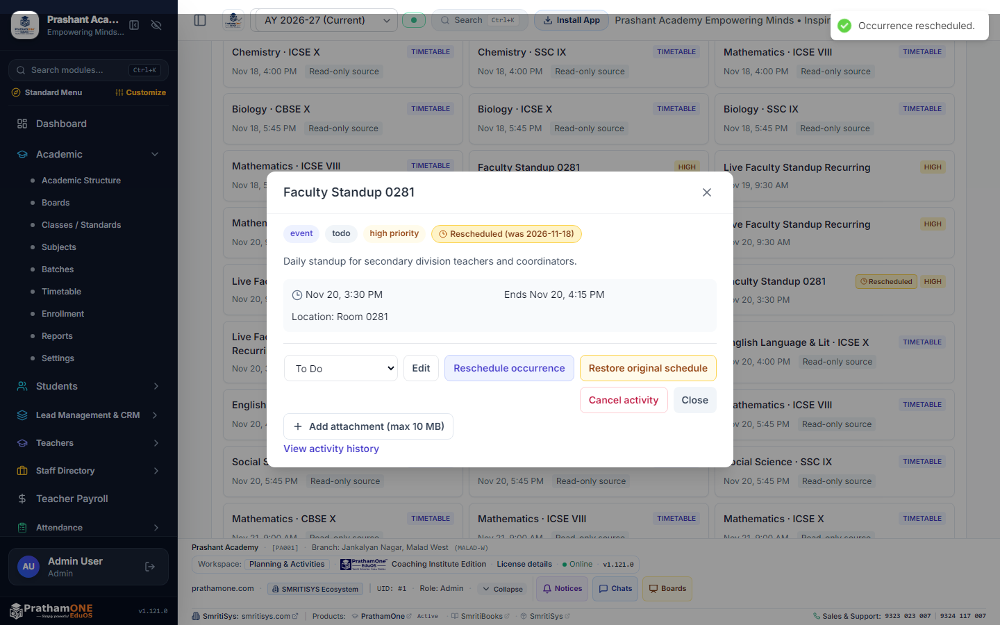
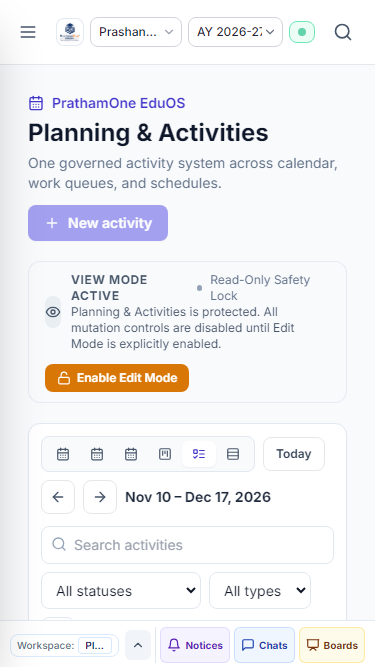
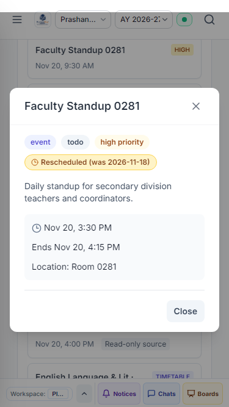

# Planning Workspace Single-Occurrence Reschedule Live Browser Acceptance Report

## 1. Executive Summary

This report documents the live authenticated browser verification of the **Single-Occurrence Reschedule** capability in the PrathamOne EduOS Planning Workspace (`http://localhost:80/planning`). Verification was conducted in headless Chromium via Playwright, covering Desktop (1440x900) and Mobile (375x667) viewports across the complete lifecycle: View Mode governance, scoped Edit Mode unlock, interactive modal rescheduling, real-time calendar projection with amber badges, and governed occurrence restoration.

All 6 acceptance checks passed with zero errors or regressions.

---

## 2. Acceptance Verification Matrix

| Step | Acceptance Scenario | Viewport | Verification Criteria | Status |
| :--- | :--- | :---: | :--- | :---: |
| **01** | **View Mode Governance** | Desktop (1440x900) | Occurrence detail opens read-only; no reschedule/edit actions visible (RULE 010). | **PASSED** |
| **02** | **Scoped Edit Mode & Modal** | Desktop (1440x900) | Activating `planning:workspace` unlocks "Reschedule occurrence"; modal renders recurrence warning. | **PASSED** |
| **03** | **Interactive Reschedule** | Desktop (1440x900) | Overriding date/time updates exception record; series master definition remains immutable. | **PASSED** |
| **04** | **Card Badges & Projection** | Desktop (1440x900) | Rescheduled card renders amber `↻ Rescheduled` badge; original slot suppressed. | **PASSED** |
| **05** | **Detail Badge & Restore Action** | Desktop (1440x900) | Detail modal displays `Rescheduled (was YYYY-MM-DD)` badge and `Restore original schedule` button. | **PASSED** |
| **06** | **Mobile Touch Experience** | Mobile (375x667) | Agenda view defaults on mobile; card badges and modal controls render cleanly with touch hit targets. | **PASSED** |

**Overall Acceptance Status: ALL CHECKS PASSED (6/6)**

---

## 3. Visual Evidence & Artifacts

### 3.1 Step 1 — Desktop View Mode Read-Only Enforcement

*Figure 1: In default View Mode, opening the recurring occurrence details displays activity timestamps, recurrence frequency, and linked scope with all modification and rescheduling actions strictly disabled.*

### 3.2 Step 2 — Reschedule Modal with Recurrence Callout

*Figure 2: Scoped Edit Mode unlocked. The user opens "Reschedule occurrence" which presents the warning callout emphasizing that only the single occurrence is moved while the recurring series master remains unaltered.*

### 3.3 Step 3 — Agenda View Card with Amber "Rescheduled" Badge

*Figure 3: Upon saving, the occurrence moves to its new date slot and dynamically renders an amber `↻ Rescheduled` badge with tooltip referencing the original recurrence date.*

### 3.4 Step 4 — Detail Modal Elevated Badge & "Restore Original Schedule" Button

*Figure 4: Detail view displays the elevated amber pill badge `Rescheduled (was 2026-11-18)` alongside the primary `Restore original schedule` action.*

### 3.5 Step 5 & 6 — Mobile Viewport (375x667) Agenda Presentation & Detail

*Figure 5: Mobile iPhone viewport (375x667) displaying the automatic Agenda view with responsive cards and touch-optimized hit targets.*


*Figure 6: Mobile detail modal displaying the elevated badge and full touch action controls.*

---

## 4. Architectural Compliance

1. **RULE 001 (Single Source of Truth):**
   - No parallel recurring series records were created.
   - Rescheduled start/end timestamps are persisted solely to `activity_recurrence_exceptions.rescheduled_start_at` and `rescheduled_end_at`.
2. **RULE 010 (Global View-First Governance):**
   - View Mode enforces read-only defaults. Rescheduling and restoration controls require explicit activation of scoped Edit Mode (`planning:workspace`).
3. **RULE 011 (Data Deduplication & Canonical Master Reuse):**
   - The original occurrence slot is suppressed to eliminate phantom duplicate cards.
   - The underlying recurring schedule definition remains pristine and immutable.

---

## 5. Automation & Audit Reproduction

To execute this automated verification suite against a live environment:
```bash
python scripts/verify_planning_reschedule_acceptance.py
```
Outputs:
- Live browser execution logs
- 6 visual evidence screenshots saved to `docs/assets/`
- Zero exit code on 6/6 pass condition
