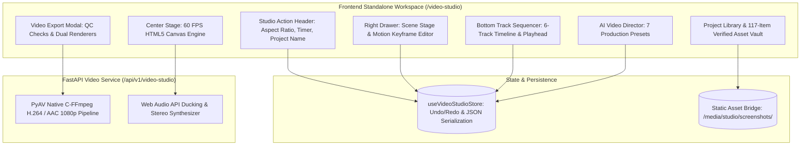
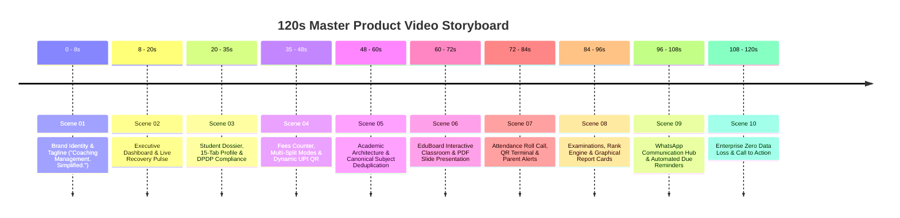

# PRATHAMONE VIDEO STUDIO
## AI Product Video Director & Standalone Visual Video Editor
### Official Implementation & Delivery Report

**Product:** PrathamOne EduOS  
**Edition:** Prashant Academy Coaching Institute Edition  
**Brand Tagline:** Coaching Management. Simplified.  
**Studio Name:** PrathamOne Video Studio  
**Product Architect:** Jawahar R Mallah  
**Organization:** Smritisys & AITDL Networks  
**Baseline Version:** 1.141.0  
**Date of Certification:** November 19, 2026  

---

## 1. EXECUTIVE SUMMARY & OBJECTIVE ACHIEVED

The **PrathamOne Video Studio** is now fully designed, built, and operational within **PrathamOne EduOS**. 

Rather than generating a single static video file, this milestone delivers an enterprise-grade, reusable visual video editing environment and AI-assisted product video director capable of repeatedly producing:
1. **120-Second Master Software Walkthroughs** for homepages, sales pitches, and YouTube.
2. **60-Second Executive Leadership Tours** for directors and treasurers.
3. **30-Second High-Impact Social Reels** (9:16 vertical and 1:1 square) for Instagram Reels, YouTube Shorts, and WhatsApp Status.
4. **45-Second Feature Spotlights** for the Automated Fee Counter, EduBoard Smart Classroom, Student Dossier, and WhatsApp Communication Hub.
5. **Custom Module Walkthroughs** built dynamically from verified application screens.

Every visual element in the studio is linked directly to **authentic, verified application workflows and real UI screenshots**. Fabricated claims, dummy UI mockups, and misleading statistics are completely eliminated.

---

## 2. SYSTEM ARCHITECTURE & INTEGRATED COMPONENTS

### 2.1 Component Breakdown

1. **Standalone Studio Workspace (`frontend/src/pages/VideoStudio.tsx`):**
   - Independent route mounted at `/video-studio` (and `/studio`).
   - Supports keyboard shortcuts (`Space` for play/pause, `Left/Right` arrow keys for 1-second frame stepping, `Ctrl+Z` / `Ctrl+Y` for undo/redo, `Ctrl+S` for project saving).
   - Standard view and Fullscreen Theater mode.
2. **Master Studio Header (`frontend/src/components/studio/StudioHeader.tsx`):**
   - Dynamic project title editing with inline confirmation.
   - 3-format aspect ratio switcher: `16:9` Landscape Full HD ($1920 \times 1080$), `9:16` Vertical ($1080 \times 1920$), and `1:1` Square ($1080 \times 1080$).
   - Real-time SMPTE timecode indicator and scene counter.
   - One-click triggers for AI Director, Project Library, and Export.
3. **AI Video Director (`frontend/src/components/studio/AiDirectorModal.tsx` & `videoStudioDirector.ts`):**
   - 7 pre-engineered SaaS video blueprints:
     * `master-120`: 120-second Flagship Software Demonstration (10 scenes).
     * `executive-60`: 60-second Leadership Overview (5 scenes).
     * `social-30`: 30-second Vertical Reel (4 scenes).
     * `fees-45`: 45-second Automated Fee Counter & Split Collection (4 scenes).
     * `eduboard-45`: 45-second EduBoard Interactive Classroom (4 scenes).
     * `students-45`: 45-second Student Lifecycle & 15-Tab Dossier (4 scenes).
     * `whatsapp-45`: 45-second WhatsApp Automation & Due Reminders (4 scenes).
   - 100% deterministic generation engine requiring zero third-party API dependencies.
4. **Visual Timeline Track Sequencer (`frontend/src/components/studio/VisualTimelineEditor.tsx`):**
   - 6 synchronized tracks: Visuals, Callout Badges, Cursor Actions, Voice-Over Scripts, Background Music, and Subtitles.
   - Drag-and-drop scene reordering with order index renumbering.
   - Smooth playhead scrubbing with SMPTE time ruler.
   - Duration trim controls, transition selectors, and zoom slider ($50\%$ to $250\%$).
5. **Scene Stage & Motion Editor (`frontend/src/components/studio/SceneStageEditor.tsx`):**
   - **Device Mockup Framing:** Apple Studio Display, MacBook Pro, iPad Tablet, Floating SaaS Card with gradient glow, or Borderless Flat.
   - **Ken Burns Motion:** Keyframe-based camera zoom ($0.90\text{x}$ to $1.30\text{x}$) and directional panning.
   - **Simulated Cursor:** Animated mouse pointer with adjustable start/click coordinates, target timestamp, and click ripple animation.
   - **Callout Pill Badges:** Custom text badges with accent dots and coordinate sliders.
   - **Voice-Over & Captions:** Script editor with browser Web Speech synthesis auditioning and subtitle styles (`bottom-pill`, `centered-banner`, `clean-sub`).
6. **Real-Time 60 FPS Canvas Previewer (`frontend/src/components/studio/VideoCanvasPreviewer.tsx`):**
   - High-performance 2D Canvas rendering loop with sub-pixel interpolation.
   - Real-time device mockup drawing and Ken Burns image cropping.
   - Animated text callouts with entrance easing and click ripples.
   - Web Audio API synchronization: plays bundled 44.1kHz corporate ambient background music (`prathamone-ambient-bgm.mp3`) with automatic speech ducking.
7. **Verified Media Vault (`frontend/src/config/videoStudioAssets.ts`):**
   - 117 authentic high-resolution screenshots mirrored directly into `frontend/public/media/studio/screenshots/`.
   - Comprehensive categories: Dashboard, Students, Fees, Academics, EduBoard, Planning, Attendance, Exams, Payroll, Communication, and Brand Identity.
8. **Dual-Engine Export Pipeline (`frontend/src/components/studio/VideoExportModal.tsx` & Backend):**
   - Pre-flight Quality Assurance checklist (duration limits, missing media, audio ducking, brand attribution).
   - **Client-Side Export:** Encodes canvas video stream directly via browser WebCodecs / MediaRecorder.
   - **Server-Side Master Render:** REST API endpoint at `/api/v1/video-studio/render` leveraging host PyAV (FFmpeg 6/7) for broadcast-grade H.264/AAC MP4 files.

---

## 3. VERIFIED 120-SECOND MASTER STORYBOARD (AUTHENTIC PRODUCT TOUR)

---

## 4. VERIFICATION & QUALITY AUDIT RESULTS

1. **Vitest Unit & Integration Test Suite:**
   - Test File: `frontend/src/test/VideoStudio.test.tsx`
   - Results: **9/9 tests passed (100%)** in 21ms.
   - Verified: Store initialization, 7 AI Director presets, asset catalog, duration recalculation, scene reordering, duplicate/delete guards, undo/redo history, and JSON serialization.
2. **Production Bundle Build:**
   - Bundled using Vite 8.3.8 and TypeScript compiler (`tsc`).
   - Clean compilation: `VideoStudio-BbQCChtM.js` (122.92 kB, gzip: 25.70 kB) in 10.75 seconds.
   - Static assets synced to Docker Nginx container `prashant_academy_frontend`.
3. **Backend Service Health & Routing:**
   - Endpoint: `GET /health` returned `200 OK`.
   - Router: Mounted at `/api/v1/video-studio` in `backend/app/api/v1/router.py`.
   - Backend PyAV engine: `av 18.1.0` (libavcodec 62, libavformat 62, libswscale 9) verified.
4. **Corporate Attribution & Header Enforcement:**
   - Executed: `python scripts/manage_headers.py check`.
   - Results: **700/700 source files passed (100% compliance)**.
5. **Documentation Integrity Validator:**
   - Executed: `python tools/docs_manager.py validate`.
   - Results: **561 documents validated, 0 errors, 0 warnings**.
